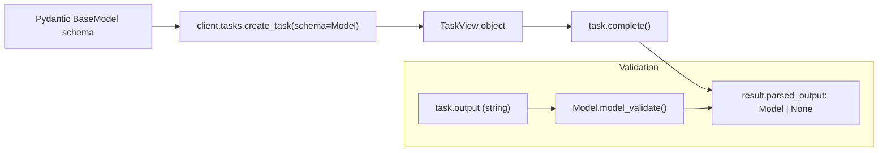
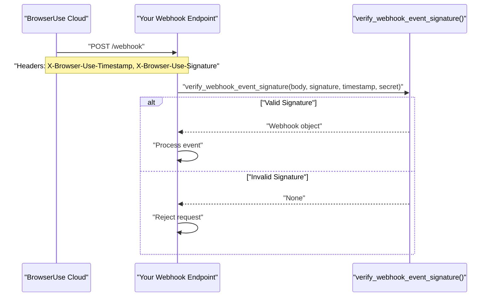
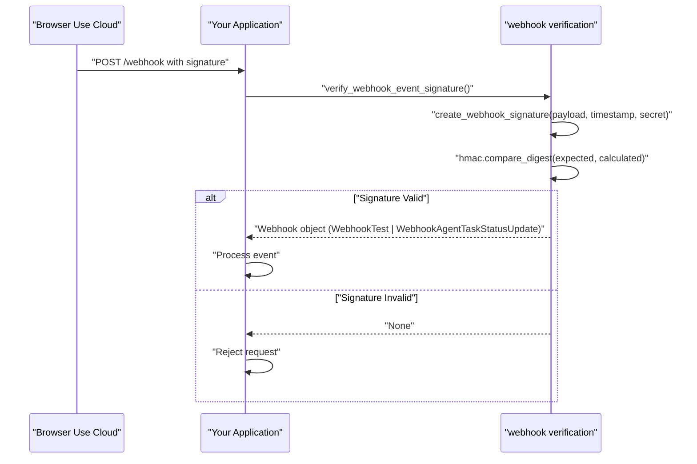
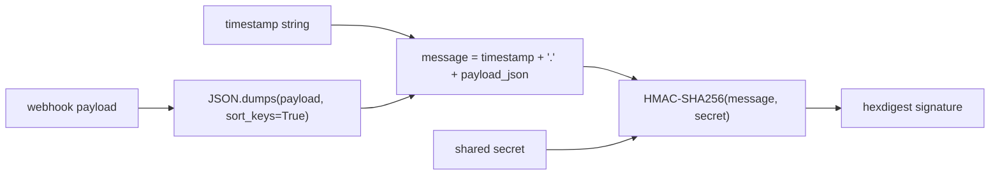
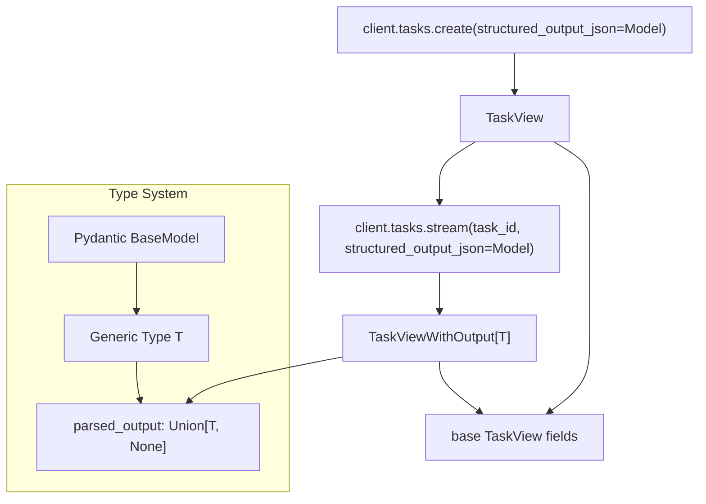
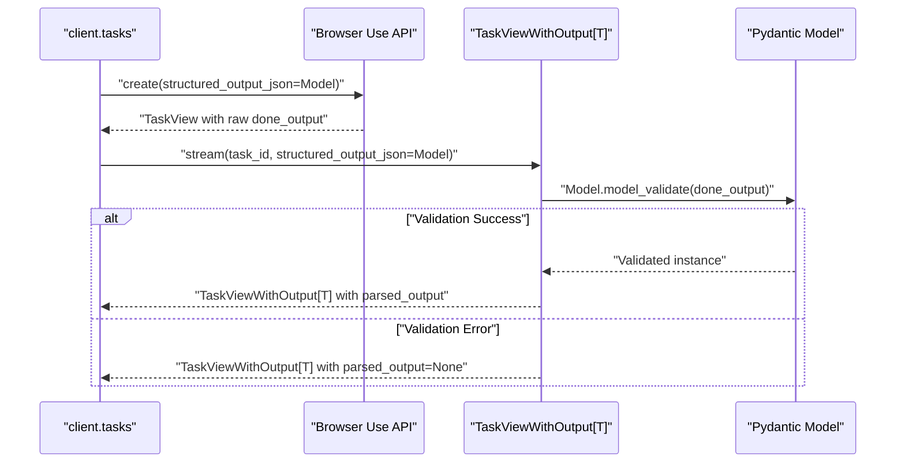
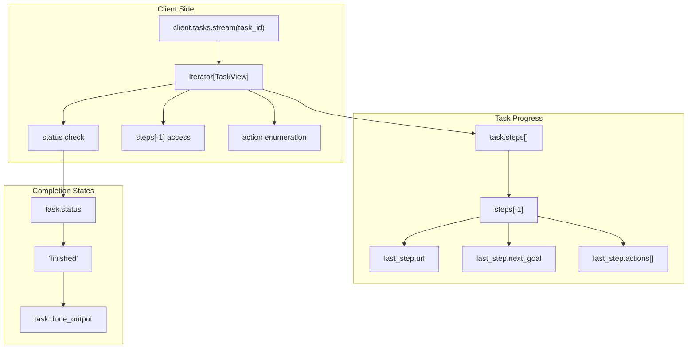

<!-- source: DeepWiki mcp.deepwiki.com · repo browser-use/browser-use-python · page 5 Advanced Features · fetched 2026-10-30 -->

# Advanced Features

Relevant source files

The following files were used as context for generating this wiki page:

- [README.md](README.md)
- [examples/webhooks.py](examples/webhooks.py)
- [src/browser_use_sdk/lib/webhooks.py](src/browser_use_sdk/lib/webhooks.py)

The browser-use-sdk provides advanced features beyond basic task execution that enable production-ready applications. This section introduces three key capabilities:

1. **Webhooks** - Receive real-time event notifications about task status changes with cryptographic signature verification
2. **Structured Output** - Extract type-safe task results using Pydantic models
3. **Task Streaming** - Monitor task execution progress in real-time through iterator-based APIs

These features work together to create responsive, type-safe applications with secure event handling. The following sections provide an overview of each capability, with detailed documentation in their respective subsections.

**Sources:** [README.md:46-156]()
</str>

<old_str>
## Structured Output Overview

Structured output allows you to specify a Pydantic model as a `schema` parameter when creating tasks, ensuring that task results are returned as validated Python objects instead of raw strings.

### Type-Safe Result Extraction

When you provide a Pydantic `BaseModel` class to `client.tasks.create_task()`, the SDK automatically validates the task output against your schema:

**Sources:** [README.md:46-78]()

### Usage Pattern

The structured output feature works with both synchronous and asynchronous clients:

| Method | Parameter | Result Field |
|--------|-----------|--------------|
| `create_task(schema=Model)` | Pydantic `BaseModel` class | `result.parsed_output: Model \| None` |
| `task.complete()` | Returns result with validated output | Access via `result.parsed_output` |
| `task.stream()` | Works with structured output | Each update includes parsed output when available |

The `parsed_output` field contains a validated instance of your Pydantic model if parsing succeeds, or `None` if validation fails. The raw string output remains available in the `output` field.

For detailed information on schema definition, validation behavior, and error handling, see [Structured Output](#5.2).

**Sources:** [README.md:46-78](), [README.md:62-76]()
</old_str>
<new_str>
## Webhooks Overview

The SDK provides a webhook system for receiving asynchronous notifications from BrowserUse Cloud when task status changes occur. Instead of polling for updates, your application can expose an HTTP endpoint that receives push notifications.

### Webhook Integration Pattern

The webhook system uses HMAC-SHA256 signature verification to ensure event authenticity:

**Sources:** [README.md:116-156](), [src/browser_use_sdk/lib/webhooks.py:79-136]()

### Basic Usage

The SDK provides the `verify_webhook_event_signature()` function to validate incoming webhook requests:

| Component | Purpose |
|-----------|---------|
| `verify_webhook_event_signature()` | Validates webhook signature and parses event payload |
| `Webhook` union type | Type-safe representation of all webhook event types |
| `X-Browser-Use-Signature` header | Contains HMAC-SHA256 signature |
| `X-Browser-Use-Timestamp` header | Contains event timestamp |

For detailed webhook implementation including event types, signature creation, and security considerations, see [Webhooks](#5.1).

**Sources:** [src/browser_use_sdk/lib/webhooks.py:51-52](), [src/browser_use_sdk/lib/webhooks.py:79-86](), [examples/webhooks.py:1-66]()

## Webhooks

The browser-use-sdk provides a secure webhook system for receiving real-time notifications about task status changes. Webhooks use HMAC-SHA256 signature verification to ensure authenticity and prevent tampering.

### Webhook Event Types

The system supports two primary webhook event types defined in the `Webhook` union type:

| Event Type | Class | Purpose |
|------------|--------|---------|
| `test` | `WebhookTest` | Webhook endpoint testing |
| `agent.task.status_update` | `WebhookAgentTaskStatusUpdate` | Task status change notifications |

### Webhook Verification Flow

**Sources:** [src/browser_use_sdk/lib/webhooks.py:79-136](), [tests/test_webhooks.py:46-66]()

### Security Implementation

The webhook signature system uses a specific message format and HMAC-SHA256 algorithm:

The `create_webhook_signature()` function implements this by creating a deterministic JSON representation and computing the HMAC signature. The `verify_webhook_event_signature()` function reconstructs the signature and uses `hmac.compare_digest()` for timing-safe comparison.

**Sources:** [src/browser_use_sdk/lib/webhooks.py:56-76](), [src/browser_use_sdk/lib/webhooks.py:126-131]()

## Structured Output

Structured output enables type-safe extraction of task results using Pydantic models. This feature transforms free-form AI responses into validated Python objects.

### Type-Safe Task Results

**Sources:** [src/browser_use_sdk/lib/parse.py:13-19](), [examples/stream.py:44-76]()

The `TaskViewWithOutput[T]` class extends the base `TaskView` with a `parsed_output` field containing the validated Pydantic model instance. This provides compile-time type checking and runtime validation.

### Structured Output Data Flow

**Sources:** [examples/stream.py:62-71](), [src/browser_use_sdk/lib/parse.py:10-19]()

## Task Streaming

Task streaming provides real-time monitoring of task execution progress through the `client.tasks.stream()` method. This enables responsive user interfaces and real-time progress tracking.

### Streaming Architecture

**Sources:** [examples/stream.py:15-40](), [examples/stream.py:25-35]()

### Streaming with Structured Output

The streaming API supports both regular text output and structured Pydantic model output:

| Method | Return Type | Use Case |
|--------|-------------|----------|
| `stream(task_id)` | `Iterator[TaskView]` | Real-time progress with text output |
| `stream(task_id, structured_output_json=Model)` | `Iterator[TaskViewWithOutput[T]]` | Real-time progress with validated objects |

The structured streaming variant combines real-time progress monitoring with type-safe output parsing, enabling responsive applications with validated data structures.

**Sources:** [examples/stream.py:62-76](), [src/browser_use_sdk/lib/parse.py:13-19]()

### Change Detection

The streaming system uses content hashing for efficient change detection through the `hash_task_view()` function, which creates SHA256 hashes of serialized `TaskView` objects using a custom JSON encoder that handles datetime serialization.

**Sources:** [src/browser_use_sdk/lib/parse.py:31-35](), [src/browser_use_sdk/lib/parse.py:21-28]()

---

