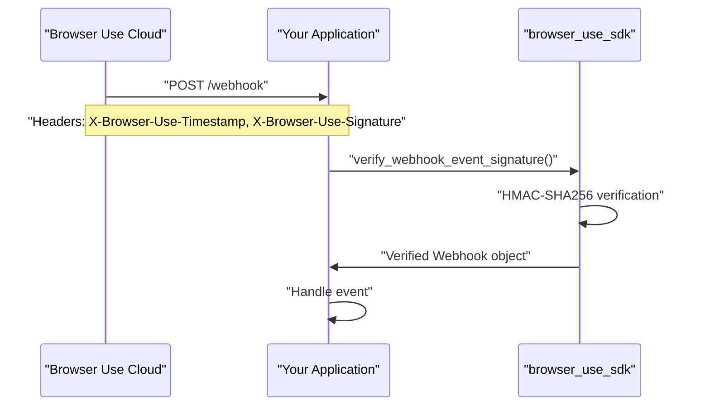
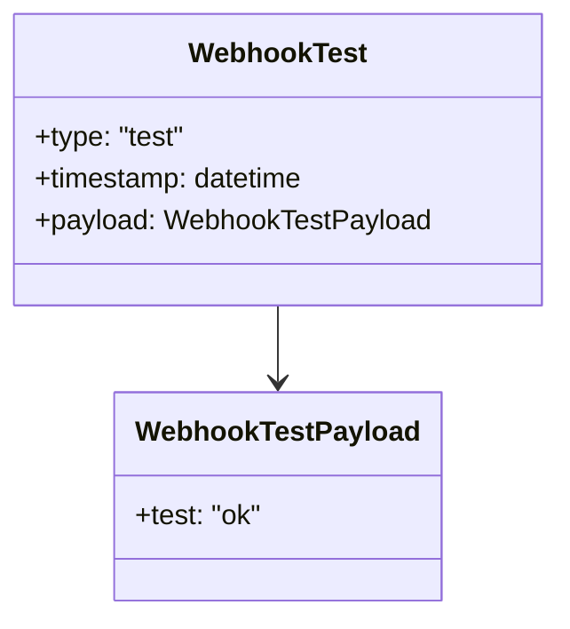
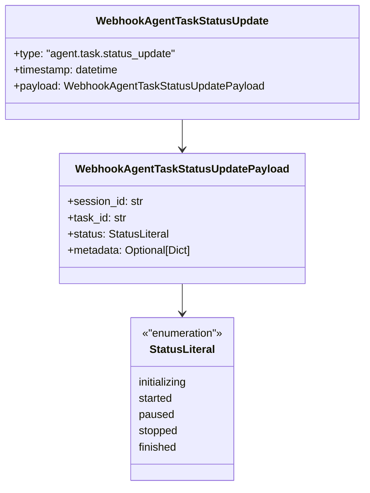
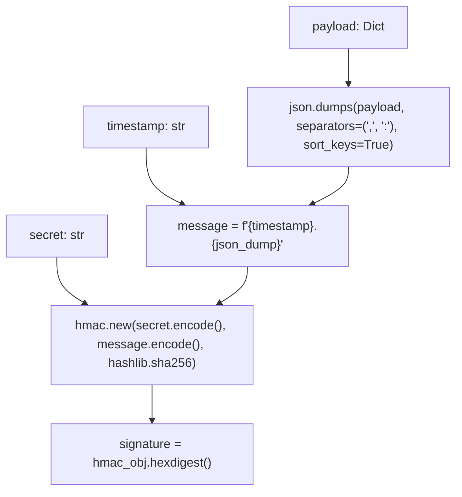
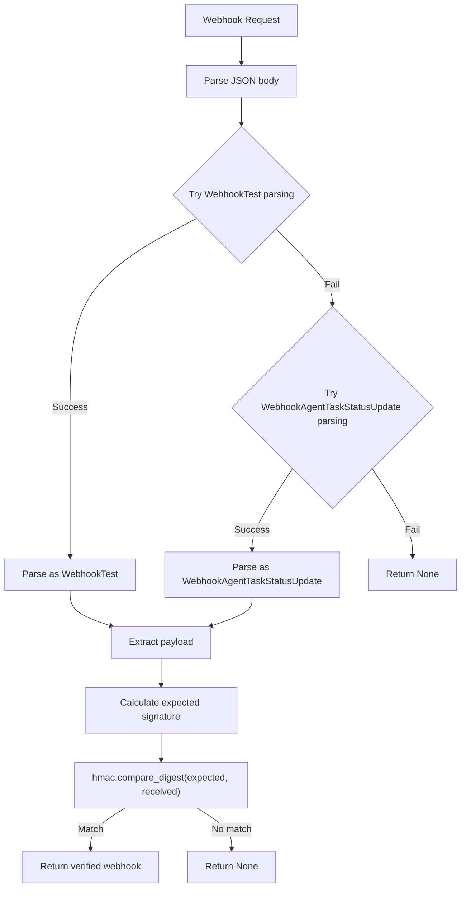
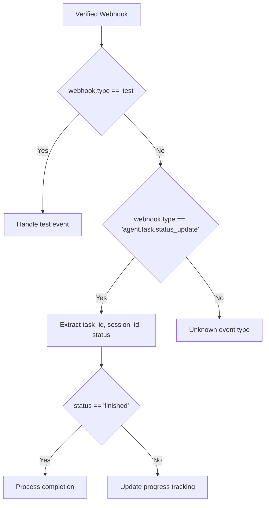

<!-- source: DeepWiki mcp.deepwiki.com · repo browser-use/browser-use-python · page 5.1 Webhooks · fetched 2026-10-30 -->

# Webhooks

<details>
<summary>Relevant source files</summary>

The following files were used as context for generating this wiki page:

- [README.md](README.md)
- [examples/webhooks.py](examples/webhooks.py)
- [src/browser_use_sdk/lib/webhooks.py](src/browser_use_sdk/lib/webhooks.py)

</details>


Webhooks provide real-time event notifications from Browser Use Cloud to your application. This document covers webhook setup, event verification, and handling different webhook event types using the browser-use-sdk.

For information about streaming task updates directly via polling, see [Task Streaming](#5.3). For structured output handling, see [Structured Output](#5.2).

## Overview

The Browser Use Cloud platform sends HTTP POST requests to your configured webhook endpoints when significant events occur, such as task status changes. The SDK provides utilities for verifying webhook authenticity and parsing event payloads.



**Webhook Event Flow**

Sources: [src/browser_use_sdk/lib/webhooks.py:79-136](), [README.md:100-140]()

## Webhook Event Types

The SDK defines two primary webhook event types, both implementing a common structure with `type`, `timestamp`, and `payload` fields.

### Test Events

Test webhooks are used to verify endpoint connectivity and configuration.



**Test Webhook Structure**

### Task Status Updates

Agent task status update webhooks notify when task execution state changes.



**Task Status Update Structure**

Sources: [src/browser_use_sdk/lib/webhooks.py:16-51]()

## Security and Verification

Webhook security relies on HMAC-SHA256 signatures and timestamp validation to prevent replay attacks and ensure authenticity.

### Signature Generation

The `create_webhook_signature()` function generates signatures using a deterministic process:



**Signature Generation Process**

### Verification Process

The `verify_webhook_event_signature()` function performs comprehensive validation:



**Webhook Verification Flow**

Sources: [src/browser_use_sdk/lib/webhooks.py:56-136]()

## Implementation Example

Here's a complete webhook handler implementation using FastAPI:

```python
from browser_use_sdk.lib.webhooks import verify_webhook_event_signature
from fastapi import FastAPI, Request, HTTPException

@app.post('/webhook')
async def webhook(request: Request):
    body = await request.json()
    timestamp = request.headers.get('X-Browser-Use-Timestamp')
    signature = request.headers.get('X-Browser-Use-Signature')
    
    verified_webhook = verify_webhook_event_signature(
        body=body,
        timestamp=timestamp,
        secret=SECRET_KEY,
        expected_signature=signature,
    )
    
    if verified_webhook is None:
        raise HTTPException(status_code=400, detail="Invalid webhook")
    
    # Handle verified webhook
    return {'status': 'success'}
```

### Event Handling Pattern



**Event Type Dispatch Pattern**

Sources: [README.md:106-136](), [examples/webhooks.py:44-65]()

## Code Entity Reference

| Component | File Location | Purpose |
|-----------|---------------|---------|
| `WebhookTest` | [src/browser_use_sdk/lib/webhooks.py:22-27]() | Test webhook event model |
| `WebhookAgentTaskStatusUpdate` | [src/browser_use_sdk/lib/webhooks.py:42-47]() | Task status update event model |
| `create_webhook_signature` | [src/browser_use_sdk/lib/webhooks.py:56-76]() | HMAC-SHA256 signature generation |
| `verify_webhook_event_signature` | [src/browser_use_sdk/lib/webhooks.py:79-136]() | Webhook verification and parsing |
| `Webhook` | [src/browser_use_sdk/lib/webhooks.py:51]() | Union type for all webhook events |

### Header Constants

Webhook requests include standard headers for verification:

- `X-Browser-Use-Timestamp`: ISO format timestamp
- `X-Browser-Use-Signature`: HMAC-SHA256 signature hex string

Sources: [src/browser_use_sdk/lib/webhooks.py:1-137](), [tests/test_webhooks.py:1-152](), [examples/webhooks.py:1-66]()

---

