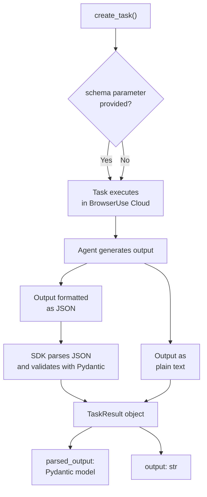
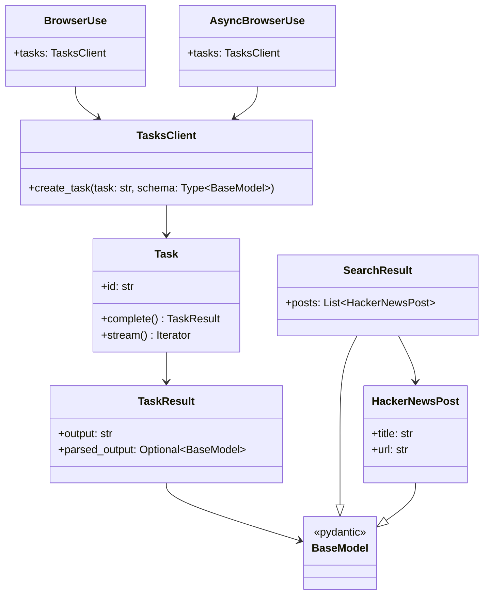
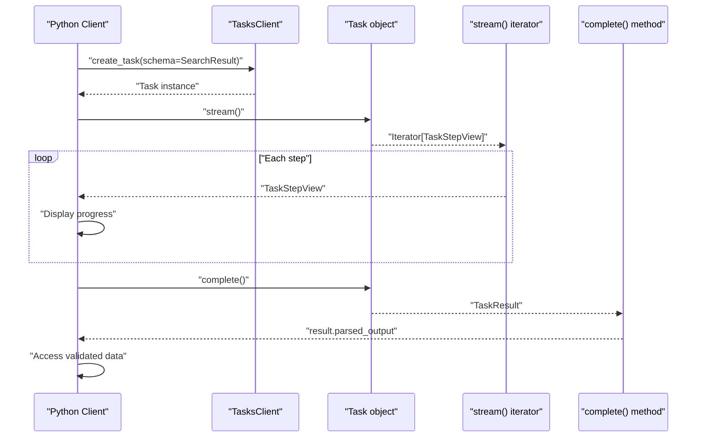
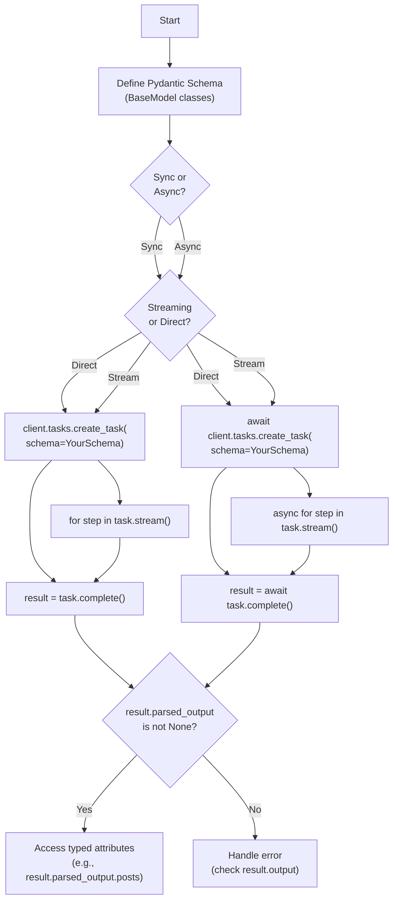

<!-- source: DeepWiki mcp.deepwiki.com · repo browser-use/browser-use-python · page 5.2 Structured Output · fetched 2026-10-30 -->

# Structured Output

<details>
<summary>Relevant source files</summary>

The following files were used as context for generating this wiki page:

- [README.md](README.md)
- [examples/async_run.py](examples/async_run.py)
- [examples/run.py](examples/run.py)
- [examples/stream.py](examples/stream.py)

</details>


This page describes how to use Pydantic schemas to obtain structured, validated output from tasks executed by the BrowserUse SDK. The SDK provides first-class support for defining output schemas using Pydantic models, which are then parsed and validated automatically from the task results.

For information about task creation and lifecycle, see [Tasks](#3.1). For information about streaming task progress, see [Task Streaming](#5.3).

---

## Overview

The BrowserUse SDK allows you to specify a Pydantic schema when creating a task. When provided, the SDK instructs the agent to format its output according to the schema, then automatically parses and validates the result. This eliminates manual parsing of unstructured text output and provides type-safe access to task results.

### Key Concepts

| Concept | Description |
|---------|-------------|
| `schema` parameter | Accepts a Pydantic `BaseModel` class to define expected output structure |
| `parsed_output` attribute | Contains the validated Pydantic model instance after task completion |
| `output` attribute | Contains the raw string output (always available, regardless of schema) |
| Automatic parsing | The SDK handles JSON parsing and Pydantic validation transparently |

Sources: [README.md:46-78](), [examples/run.py:34-62]()

---

## Data Flow: Structured vs Unstructured Output

The following diagram illustrates how structured output differs from unstructured output in the task execution flow:



Sources: [README.md:46-78](), [examples/run.py:14-62]()

---

## Defining Pydantic Schemas

Schemas are defined as standard Pydantic `BaseModel` classes. The SDK supports nested models, lists, and all standard Pydantic field types.

### Example Schema Definition

The following structure is used throughout the examples in the codebase:

```python
class HackerNewsPost(BaseModel):
    title: str
    url: str

class SearchResult(BaseModel):
    posts: List[HackerNewsPost]
```

This nested structure demonstrates:
- A child model (`HackerNewsPost`) with simple string fields
- A parent model (`SearchResult`) containing a list of child models
- Type annotations that Pydantic uses for validation

Sources: [README.md:55-60](), [examples/run.py:36-41](), [examples/stream.py:35-40](), [examples/async_run.py:34-39]()

---

## Creating Tasks with Schemas

To use structured output, pass the Pydantic model class (not an instance) to the `schema` parameter when calling `create_task()`.

### Synchronous Task Creation

```python
# From examples/run.py
task = client.tasks.create_task(
    task="""
    Find top 10 Hacker News articles and return the title and url.
    """,
    llm="gpt-4.1",
    schema=SearchResult,  # Pass the class, not an instance
)
```

### Asynchronous Task Creation

```python
# From examples/async_run.py
task = await client.tasks.create_task(
    task="""
    Find top 10 Hacker News articles and return the title and url.
    """,
    llm="gpt-4.1",
    schema=SearchResult,
)
```

Sources: [examples/run.py:43-49](), [examples/async_run.py:41-47](), [README.md:63-68]()

---

## Task Creation API Mapping

The following diagram maps the natural language concepts to the actual code entities involved in structured task creation:



Sources: [README.md:30-42](), [examples/run.py:8-49](), [examples/async_run.py:9-47]()

---

## Accessing Parsed Output

After task completion, the result contains two output attributes:

| Attribute | Type | Description |
|-----------|------|-------------|
| `output` | `str` | Raw string output from the agent (always present) |
| `parsed_output` | `Optional[BaseModel]` | Validated Pydantic model instance (only if schema was provided) |

### Synchronous Access Pattern

The following pattern from [examples/run.py:51-58]() demonstrates accessing parsed output:

```python
result = task.complete()

if result.parsed_output is not None:
    for post in result.parsed_output.posts:
        print(f" - {post.title} - {post.url}")
```

### Asynchronous Access Pattern

The async version from [examples/async_run.py:49-56]() follows the same pattern:

```python
result = await task.complete()

if result.parsed_output is not None:
    print("Structured Task Output:")
    for post in result.parsed_output.posts:
        print(f" - {post.title} - {post.url}")
```

The `parsed_output` attribute is typed as `Optional[BaseModel]`, so checking for `None` is necessary before accessing model attributes.

Sources: [examples/run.py:51-58](), [examples/async_run.py:49-56](), [README.md:72-75]()

---

## Structured Output with Streaming

Structured output can be combined with task streaming to get real-time progress updates while still receiving a validated result at the end.

### Streaming Pattern

The following sequence diagram illustrates the streaming flow with structured output:



### Code Pattern

From [examples/stream.py:42-59]():

```python
task = client.tasks.create_task(
    task="""
    Find top 10 Hacker News articles and return the title and url.
    """,
    llm="gpt-4.1",
    schema=SearchResult,
)

for step in task.stream():
    print(f"Step {step.number}: {step.url} ({step.next_goal})")

result = task.complete()

if result.parsed_output is not None:
    for post in result.parsed_output.posts:
        print(f" - {post.title} - {post.url}")
```

The streaming provides progress updates via `TaskStepView` objects, while `complete()` returns the final validated output.

Sources: [examples/stream.py:42-59](), [README.md:86-114]()

---

## Structured vs Unstructured Output Comparison

The following table compares tasks created with and without schemas:

| Aspect | Without Schema | With Schema |
|--------|---------------|-------------|
| `schema` parameter | Not provided or `None` | Pydantic `BaseModel` class |
| Agent instruction | Generate free-form text | Generate JSON matching schema |
| `result.output` | Contains full text output | Contains JSON string |
| `result.parsed_output` | Always `None` | Validated Pydantic instance or `None` |
| Type safety | Manual parsing required | Automatic validation |
| Error handling | String processing errors | Pydantic validation errors |

### Unstructured Example

From [examples/run.py:14-28]():

```python
task = client.tasks.create_task(
    task="""
    Find top 10 Hacker News articles and return the title and url.
    """,
    llm="gemini-2.5-flash",
)

result = task.complete()
print(result.output)  # Raw text output
# result.parsed_output is None
```

### Structured Example

From [examples/run.py:43-58]():

```python
task = client.tasks.create_task(
    task="""
    Find top 10 Hacker News articles and return the title and url.
    """,
    llm="gpt-4.1",
    schema=SearchResult,
)

result = task.complete()
if result.parsed_output is not None:
    # Type-safe access to validated data
    for post in result.parsed_output.posts:
        print(f" - {post.title} - {post.url}")
```

Sources: [examples/run.py:14-62]()

---

## Error Handling Considerations

### Validation Failures

When the agent's output doesn't match the provided schema, the SDK's Pydantic validation may fail. In such cases:
- The task may complete with an error status
- `parsed_output` will be `None`
- `output` will still contain the raw response

### Null Checking Pattern

Always check if `parsed_output` is not `None` before accessing its attributes:

```python
result = task.complete()

if result.parsed_output is not None:
    # Safe to access typed attributes
    for post in result.parsed_output.posts:
        process(post)
else:
    # Handle parsing failure
    print(f"Failed to parse output: {result.output}")
```

This pattern is consistently used across all examples in the codebase.

Sources: [examples/run.py:55-58](), [examples/async_run.py:53-56](), [examples/stream.py:57-59]()

---

## Usage Patterns Summary

The following diagram summarizes the common usage patterns for structured output:



Sources: [examples/run.py:34-62](), [examples/async_run.py:33-59](), [examples/stream.py:34-64]()

---

## Complete Example Reference

For complete working examples demonstrating structured output:

- **Synchronous direct completion**: [examples/run.py:34-62]()
- **Synchronous with streaming**: [examples/stream.py:34-64]()
- **Asynchronous direct completion**: [examples/async_run.py:33-59]()
- **README example**: [README.md:46-78]()

All examples follow the same pattern:
1. Define nested Pydantic models
2. Pass the root model to `schema` parameter
3. Check `parsed_output` for `None`
4. Access validated, typed data

Sources: [examples/run.py](), [examples/stream.py](), [examples/async_run.py](), [README.md]()

---

