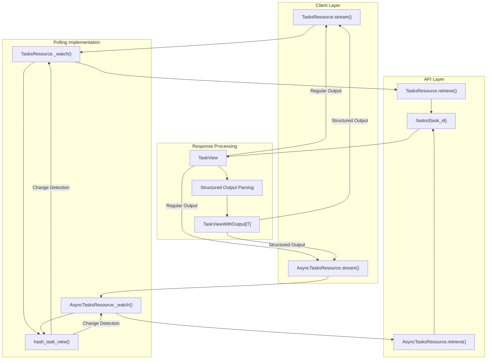
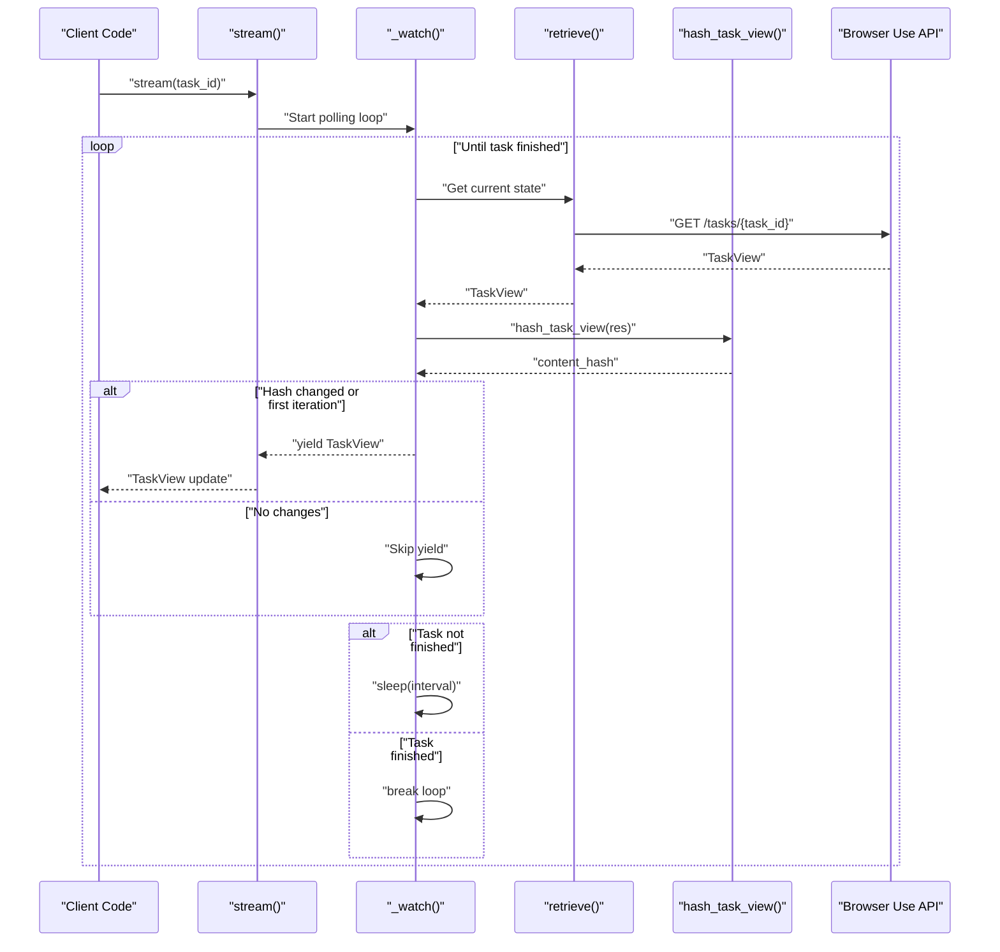
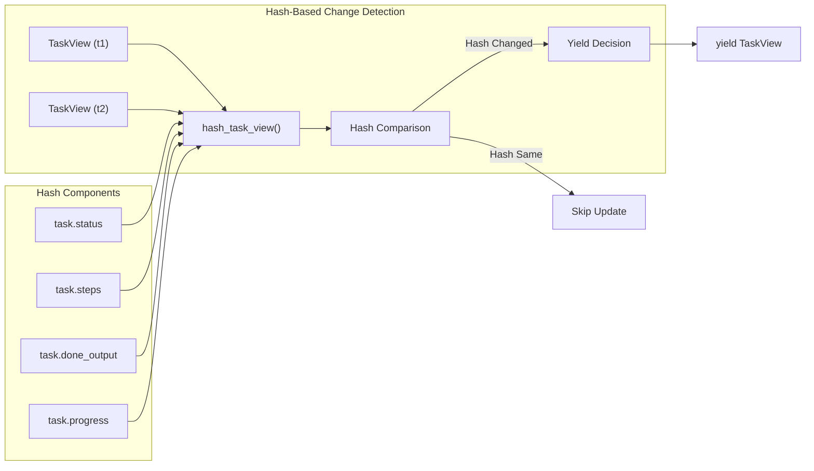

<!-- source: DeepWiki mcp.deepwiki.com · repo browser-use/browser-use-python · page 5.3 Task Streaming · fetched 2026-10-30 -->

# Task Streaming

<details>
<summary>Relevant source files</summary>

The following files were used as context for generating this wiki page:

- [README.md](README.md)
- [examples/async_stream.py](examples/async_stream.py)
- [examples/stream.py](examples/stream.py)

</details>


This document covers the real-time monitoring capabilities of the browser-use-sdk through streaming APIs. Task streaming allows developers to receive live updates about task execution progress, status changes, and results as they happen.

For information about structured output handling, see [Structured Output](#5.2). For basic task management operations, see [Task Management API](#4.1).

## Overview

Task streaming provides real-time visibility into task execution through iterator-based APIs. The streaming system polls the task status and yields updates only when changes occur, implementing efficient change detection through content hashing.

The streaming functionality is available in both synchronous and asynchronous variants, supporting regular task monitoring and structured output parsing with full type safety.

**Sources**: [src/browser_use_sdk/resources/tasks.py:444-484](), [src/browser_use_sdk/resources/tasks.py:1239-1277]()

## Streaming Architecture



The streaming system implements a polling-based approach with intelligent change detection. The `hash_task_view()` function computes content hashes to ensure updates are only yielded when task state actually changes.

**Sources**: [src/browser_use_sdk/resources/tasks.py:485-519](), [src/browser_use_sdk/resources/tasks.py:1279-1320](), [src/browser_use_sdk/lib/parse.py:26]()

## Core Streaming Methods

### Synchronous Streaming

The `TasksResource.stream()` method provides synchronous task monitoring through Python iterators:

| Method Signature | Return Type | Purpose |
|-----------------|-------------|---------|
| `stream(task_id)` | `Iterator[TaskView]` | Regular task monitoring |
| `stream(task_id, structured_output_json=T)` | `Iterator[TaskViewWithOutput[T]]` | Structured output monitoring |

The synchronous implementation uses `time.sleep()` for interval-based polling and terminates when the task reaches a "finished" status.

**Sources**: [src/browser_use_sdk/resources/tasks.py:444-484](), [src/browser_use_sdk/resources/tasks.py:485-519]()

### Asynchronous Streaming

The `AsyncTasksResource.stream()` method provides asynchronous task monitoring with non-blocking iteration:

| Method Signature | Return Type | Purpose |
|-----------------|-------------|---------|
| `stream(task_id)` | `AsyncIterator[TaskView]` | Async regular monitoring |
| `stream(task_id, structured_output_json=T)` | `AsyncIterator[TaskViewWithOutput[T]]` | Async structured monitoring |

The async implementation uses `asyncio.sleep()` and includes additional status checks for paused and stopped states.

**Sources**: [src/browser_use_sdk/resources/tasks.py:1239-1277](), [src/browser_use_sdk/resources/tasks.py:1279-1320]()

## Streaming Flow



The streaming flow implements efficient polling with change detection to minimize unnecessary updates while ensuring all significant state changes are captured.

**Sources**: [src/browser_use_sdk/resources/tasks.py:500-518](), [src/browser_use_sdk/resources/tasks.py:1294-1319]()

## Usage Patterns

### Basic Task Streaming

```python
# From examples/stream.py
task = client.tasks.create(task="Find top 10 Hacker News articles")
for res in client.tasks.stream(task.id):
    print(res.status)
    if res.status == "finished":
        print(res.done_output)
```

### Structured Output Streaming

```python
# From examples/stream.py with structured output
for res in client.tasks.stream(task.id, structured_output_json=SearchResult):
    if res.status == "finished" and res.parsed_output:
        for post in res.parsed_output.posts:
            print(f"{post.title} - {post.url}")
```

### Asynchronous Streaming

```python
# From examples/async_stream.py
async for res in client.tasks.stream(task.id):
    print(f"Status: {res.status}")
    if len(res.steps) > 0:
        last_step = res.steps[-1]
        print(f"Step: {last_step.url} ({last_step.next_goal})")
```

**Sources**: [examples/stream.py:25-36](), [examples/stream.py:62-71](), [examples/async_stream.py:26-35]()

## Change Detection Mechanism



The change detection system uses the `hash_task_view()` function to compute content-based hashes, ensuring streaming clients only receive updates when meaningful task state changes occur.

**Sources**: [src/browser_use_sdk/lib/parse.py:26](), [src/browser_use_sdk/resources/tasks.py:509-513](), [src/browser_use_sdk/resources/tasks.py:1303-1306]()

## Structured Output Integration

Task streaming seamlessly integrates with structured output parsing, providing type-safe iteration over parsed results. When a structured output type is specified, the streaming system automatically parses the `done_output` field and yields `TaskViewWithOutput[T]` instances.

The structured output integration supports:
- Generic type parameters for compile-time type safety
- Automatic JSON schema validation through Pydantic models
- Graceful handling of null outputs during task execution

**Sources**: [src/browser_use_sdk/resources/tasks.py:467-480](), [src/browser_use_sdk/resources/tasks.py:1262-1275]()

## Polling Configuration

| Parameter | Default | Sync Location | Async Location |
|-----------|---------|---------------|----------------|
| `interval` | 1.0 seconds | [tasks.py:488]() | [tasks.py:1282]() |
| Hash storage | `hash: str \| None` | [tasks.py:498]() | [tasks.py:1292]() |
| Termination conditions | "finished" | [tasks.py:515-516]() | [tasks.py:1308-1319]() |

The async implementation includes additional termination conditions for "paused" and "stopped" states, providing more granular control over streaming lifecycle management.

**Sources**: [src/browser_use_sdk/resources/tasks.py:485-519](), [src/browser_use_sdk/resources/tasks.py:1279-1320]()

---

