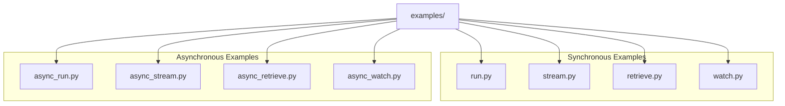
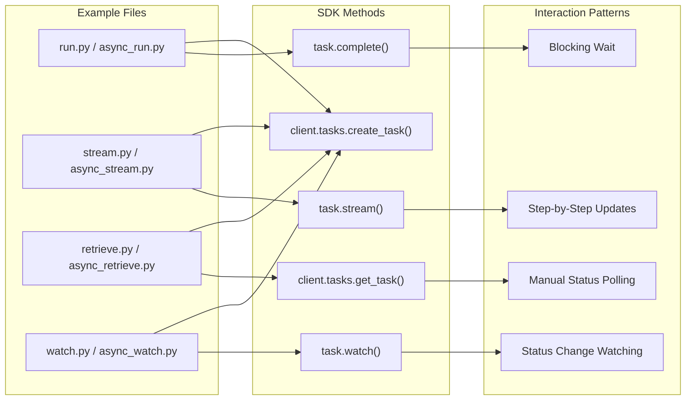

<!-- source: DeepWiki mcp.deepwiki.com · repo browser-use/browser-use-python · page 6 Examples · fetched 2026-10-30 -->

# Examples

<details>
<summary>Relevant source files</summary>

The following files were used as context for generating this wiki page:

- [README.md](README.md)
- [examples/async_retrieve.py](examples/async_retrieve.py)
- [examples/async_run.py](examples/async_run.py)
- [examples/async_stream.py](examples/async_stream.py)
- [examples/async_watch.py](examples/async_watch.py)
- [examples/retrieve.py](examples/retrieve.py)
- [examples/run.py](examples/run.py)
- [examples/stream.py](examples/stream.py)
- [examples/watch.py](examples/watch.py)

</details>


This page provides an overview of the practical code examples included in the `browser-use-python` repository. These examples demonstrate how to use the SDK in various scenarios, including basic task execution, streaming updates, manual polling, and structured output parsing. Each example is implemented in both synchronous and asynchronous variants to support different application architectures.

For detailed walkthroughs of synchronous usage patterns, see [Synchronous Examples](#6.1). For asynchronous usage patterns, see [Asynchronous Examples](#6.2). For information about core SDK concepts referenced in these examples, see [Core Concepts](#3).

**Sources:** [README.md:1-200](), [examples/run.py:1-63](), [examples/async_run.py:1-70]()

## Example Directory Structure

The examples directory contains executable Python scripts that demonstrate SDK functionality. All examples are designed to be run directly using the shebang `#!/usr/bin/env -S poetry run python` and import the API key from a shared `api` module.



**Sources:** [examples/run.py:1-1](), [examples/stream.py:1-1](), [examples/retrieve.py:1-1](), [examples/watch.py:1-1](), [examples/async_run.py:1-1](), [examples/async_stream.py:1-1](), [examples/async_retrieve.py:1-1](), [examples/async_watch.py:1-1]()

## Example Categories

The examples are organized by interaction pattern rather than by feature. Each pattern is available in both synchronous and asynchronous forms.

| Pattern | Synchronous File | Asynchronous File | Description |
|---------|-----------------|-------------------|-------------|
| **Basic Execution** | `run.py` | `async_run.py` | Creates tasks and waits for completion using `task.complete()` method |
| **Streaming Steps** | `stream.py` | `async_stream.py` | Iterates over task steps as they occur using `task.stream()` generator |
| **Manual Polling** | `retrieve.py` | `async_retrieve.py` | Manually polls task status using `client.tasks.get_task()` in a loop |
| **Watch Status** | `watch.py` | `async_watch.py` | Watches for task status changes using `task.watch()` generator |

Each example demonstrates both regular (string output) and structured (Pydantic schema) task variants.

**Sources:** [examples/run.py:14-62](), [examples/stream.py:14-64](), [examples/retrieve.py:15-89](), [examples/watch.py:14-73](), [examples/async_run.py:15-69](), [examples/async_stream.py:15-80](), [examples/async_retrieve.py:15-97](), [examples/async_watch.py:15-80]()

## Example Task Definition

All examples use a consistent task definition to demonstrate SDK functionality: searching for the top 10 Hacker News articles and returning their titles and URLs. This task is executed with two variants:

1. **Regular Task**: Returns unstructured string output using `llm="gemini-2.5-flash"`
2. **Structured Task**: Returns parsed Pydantic objects using `llm="gpt-4.1"` and a `SearchResult` schema

The structured task uses the following Pydantic models defined in multiple example files:

```python
class HackerNewsPost(BaseModel):
    title: str
    url: str

class SearchResult(BaseModel):
    posts: List[HackerNewsPost]
```

**Sources:** [examples/run.py:16-19](), [examples/run.py:36-48](), [examples/stream.py:16-19](), [examples/stream.py:35-48]()

## Client Initialization Pattern

All examples initialize the SDK client using the same pattern. The synchronous examples use the `BrowserUse` client class, while asynchronous examples use `AsyncBrowserUse`:

- Synchronous: `client = BrowserUse(api_key=API_KEY)` ([examples/run.py:10]())
- Asynchronous: `client = AsyncBrowserUse(api_key=API_KEY)` ([examples/async_run.py:11]())

Both clients expose the same API surface but differ in their return types (synchronous methods vs. coroutines).

**Sources:** [examples/run.py:8-10](), [examples/async_run.py:9-11]()

## Example Workflow Mapping

The following diagram shows how different examples map to SDK API methods and workflow patterns:



**Sources:** [examples/run.py:15-28](), [examples/stream.py:14-27](), [examples/retrieve.py:15-40](), [examples/watch.py:14-32]()

## Task Completion Methods

The SDK provides three distinct methods for tracking task progress, each demonstrated by a corresponding example:

### task.complete()
Blocks until the task finishes and returns the final `TaskView` object. Used in [examples/run.py:24]() and [examples/async_run.py:25]().

### task.stream()
Returns a generator that yields `TaskStepView` objects as each step completes. After iteration completes, `task.complete()` can be called to retrieve the final result. Used in [examples/stream.py:24-25]() and [examples/async_stream.py:25]().

### task.watch()
Returns a generator that yields `TaskView` objects whenever the task status changes. Used in [examples/watch.py:24]() and [examples/async_watch.py:25]().

### Manual Polling with get_task()
The client method `client.tasks.get_task(task_id)` can be called repeatedly in a custom polling loop. Used in [examples/retrieve.py:32-38]() and [examples/async_retrieve.py:32-38]().

**Sources:** [examples/run.py:24](), [examples/stream.py:24-27](), [examples/retrieve.py:30-38](), [examples/watch.py:22-29]()

## Structured Output Handling

All examples demonstrate structured output parsing by providing a Pydantic schema to `create_task()`. When a schema is provided:

1. The `schema` parameter is passed to `client.tasks.create_task()` ([examples/run.py:48]())
2. The returned task object includes `parsed_output` attribute of the schema type
3. For `get_task()` polling, the schema must also be passed to the retrieval method ([examples/retrieve.py:72]())

The parsed output is accessed via the `parsed_output` attribute on the result:

- In `run.py`: `result.parsed_output` after `task.complete()` ([examples/run.py:55-57]())
- In `stream.py`: `result.parsed_output` after iteration completes ([examples/stream.py:58-59]())
- In `retrieve.py`: `structured_status.parsed_output` in the polling loop ([examples/retrieve.py:76-80]())

**Sources:** [examples/run.py:42-59](), [examples/stream.py:42-61](), [examples/retrieve.py:46-86]()

## Code Entity to Example Mapping

The following diagram maps SDK code entities to the examples that demonstrate their usage:

```mermaid
graph TD
    subgraph "SDK Client Classes"
        BrowserUse["BrowserUse"]
        AsyncBrowserUse["AsyncBrowserUse"]
    end
    
    subgraph "Task API Methods"
        create_task["tasks.create_task()"]
        get_task["tasks.get_task()"]
    end
    
    subgraph "Task Instance Methods"
        complete["task.complete()"]
        stream["task.stream()"]
        watch["task.watch()"]
    end
    
    subgraph "Synchronous Examples"
        runSync["run.py"]
        streamSync["stream.py"]
        retrieveSync["retrieve.py"]
        watchSync["watch.py"]
    end
    
    subgraph "Asynchronous Examples"
        runAsync["async_run.py"]
        streamAsync["async_stream.py"]
        retrieveAsync["async_retrieve.py"]
        watchAsync["async_watch.py"]
    end
    
    BrowserUse --> runSync
    BrowserUse --> streamSync
    BrowserUse --> retrieveSync
    BrowserUse --> watchSync
    
    AsyncBrowserUse --> runAsync
    AsyncBrowserUse --> streamAsync
    AsyncBrowserUse --> retrieveAsync
    AsyncBrowserUse --> watchAsync
    
    create_task --> runSync
    create_task --> streamSync
    create_task --> retrieveSync
    create_task --> watchSync
    create_task --> runAsync
    create_task --> streamAsync
    create_task --> retrieveAsync
    create_task --> watchAsync
    
    complete --> runSync
    complete --> streamSync
    complete --> runAsync
    complete --> streamAsync
    
    stream --> streamSync
    stream --> streamAsync
    
    watch --> watchSync
    watch --> watchAsync
    
    get_task --> retrieveSync
    get_task --> retrieveAsync
```



**Sources:** [examples/run.py:8-62](), [examples/stream.py:8-64](), [examples/retrieve.py:9-89](), [examples/watch.py:8-73](), [examples/async_run.py:9-69](), [examples/async_stream.py:9-80](), [examples/async_retrieve.py:9-97](), [examples/async_watch.py:9-80]()

## Example Function Organization

Each example file contains two functions demonstrating the same interaction pattern with different output types:

| File | Regular Task Function | Structured Task Function |
|------|----------------------|--------------------------|
| `run.py` | `run_regular_task()` | `run_structured_task()` |
| `stream.py` | `stream_regular_task()` | `stream_structured_task()` |
| `retrieve.py` | `retrieve_regular_task()` | `retrieve_structured_task()` |
| `watch.py` | `watch_regular_task()` | `watch_structured_task()` |
| `async_run.py` | `run_regular_task()` (async) | `run_structured_task()` (async) |
| `async_stream.py` | `stream_regular_task()` (async) | `stream_structured_task()` (async) |
| `async_retrieve.py` | `retrieve_regular_task()` (async) | `retrieve_structured_task()` (async) |
| `async_watch.py` | `watch_regular_task()` (async) | `watch_structured_task()` (async) |

Both functions are called sequentially in each example file to demonstrate both output modes.

**Sources:** [examples/run.py:14-62](), [examples/stream.py:14-64](), [examples/retrieve.py:15-89](), [examples/watch.py:14-73](), [examples/async_run.py:15-69](), [examples/async_stream.py:15-80](), [examples/async_retrieve.py:15-97](), [examples/async_watch.py:15-80]()

## Async Example Coordination

The asynchronous examples demonstrate concurrent task execution using `asyncio.gather()`. The main function in async examples runs both regular and structured tasks concurrently:

```python
async def main() -> None:
    await asyncio.gather(
        run_regular_task(),
        run_structured_task(),
    )
```

This pattern is used in [examples/async_run.py:61-66](), [examples/async_stream.py:72-77](), [examples/async_retrieve.py:89-94](), and [examples/async_watch.py:72-77]() to show how multiple tasks can be managed simultaneously in asynchronous code.

**Sources:** [examples/async_run.py:61-69](), [examples/async_stream.py:72-80](), [examples/async_retrieve.py:89-97](), [examples/async_watch.py:72-80]()

## Output Patterns

The examples demonstrate different approaches to displaying task progress and results:

### Basic Execution Pattern
Prints the task ID, then waits for completion and prints the final output:
- [examples/run.py:22-26]() (sync)
- [examples/async_run.py:23-27]() (async)

### Streaming Pattern
Prints the task ID, then prints each step's details (number, URL, next goal) as it occurs:
- [examples/stream.py:22-25]() (sync)
- [examples/async_stream.py:23-26]() (async)

### Manual Polling Pattern
Prints the task ID, then prints the status on each poll until finished:
- [examples/retrieve.py:29-38]() (sync)
- [examples/async_retrieve.py:29-38]() (async)

### Watch Pattern
Prints the task ID, then prints the status whenever it changes:
- [examples/watch.py:22-29]() (sync)
- [examples/async_watch.py:23-30]() (async)

**Sources:** [examples/run.py:22-28](), [examples/stream.py:22-27](), [examples/retrieve.py:29-40](), [examples/watch.py:22-31](), [examples/async_run.py:23-29](), [examples/async_stream.py:23-33](), [examples/async_retrieve.py:29-40](), [examples/async_watch.py:23-32]()

---

