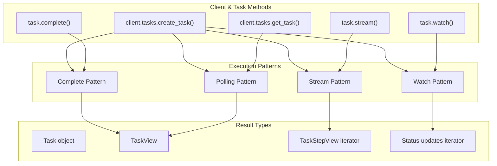
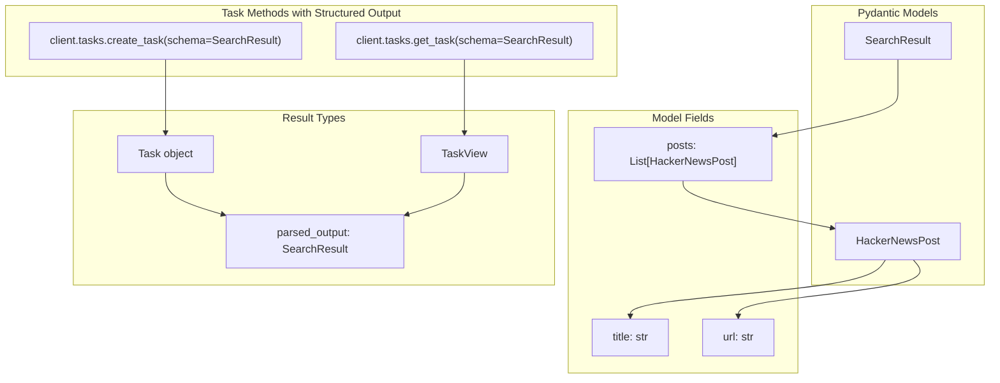

<!-- source: DeepWiki mcp.deepwiki.com · repo browser-use/browser-use-python · page 6.1 Synchronous Examples · fetched 2026-10-30 -->

# Synchronous Examples

<details>
<summary>Relevant source files</summary>

The following files were used as context for generating this wiki page:

- [examples/async_watch.py](examples/async_watch.py)
- [examples/retrieve.py](examples/retrieve.py)
- [examples/run.py](examples/run.py)
- [examples/stream.py](examples/stream.py)
- [examples/watch.py](examples/watch.py)

</details>


This document provides comprehensive examples for using the synchronous `BrowserUse` client to interact with browser automation tasks. These examples demonstrate the core synchronous patterns for task creation, execution monitoring, and result handling.

For asynchronous operations and concurrent task management, see [Asynchronous Examples](#6.2). For detailed API reference documentation, see [Task Management API](#4.1).

## Client Initialization

All synchronous examples begin with initializing the `BrowserUse` client with an API key.

```python
from browser_use_sdk import BrowserUse

client = BrowserUse(api_key=API_KEY)
```

Sources: [examples/run.py:8-10](), [examples/retrieve.py:9-11](), [examples/stream.py:8-10](), [examples/watch.py:8-10]()
</thinking>


## Task Execution Patterns

The synchronous SDK provides four primary patterns for task execution, each suited to different use cases and requirements for monitoring task progress.

### Task Execution Flow



Sources: [examples/run.py](), [examples/retrieve.py](), [examples/stream.py](), [examples/watch.py]()

### Complete Pattern

The `task.complete()` method provides the simplest synchronous execution pattern, blocking until the task completes and returning the final result.

**Regular Task Example:**
```python
task = client.tasks.create_task(
    task="Find top 10 Hacker News articles and return the title and url.",
    llm="gemini-2.5-flash",
)

print(f"Task ID: {task.id}")

result = task.complete()

print(result.output)
```

Sources: [examples/run.py:14-28]()

### Polling Pattern

For scenarios requiring manual control over task monitoring, the polling pattern provides explicit task lifecycle management using `client.tasks.get_task()`.

**Polling Implementation:**
```python
task = client.tasks.create_task(
    task="Find top 10 Hacker News articles and return the title and url.",
    llm="gemini-2.5-flash",
)

print(f"Task ID: {task.id}")

while True:
    regular_status = client.tasks.get_task(task.id)
    print(regular_status.status)
    if regular_status.status == "finished":
        print(regular_status.output)
        break
    time.sleep(1)
```

Sources: [examples/retrieve.py:15-40]()

### Stream Pattern

The streaming pattern provides real-time step-by-step updates as the task progresses through the browser automation workflow using `task.stream()`.

**Streaming Implementation:**
```python
task = client.tasks.create_task(
    task="Find top 10 Hacker News articles and return the title and url.",
    llm="gemini-2.5-flash",
)

print(f"Task ID: {task.id}")

for step in task.stream():
    print(f"Step {step.number}: {step.url} ({step.next_goal})")

print("Regular: DONE")
```

Sources: [examples/stream.py:14-30]()

### Watch Pattern

The watch pattern polls the task status at regular intervals, returning updated `TaskView` objects. This is useful when you need periodic status updates but don't need step-by-step detail like streaming provides.

**Watch Implementation:**
```python
task = client.tasks.create_task(
    task="Find top 10 Hacker News articles and return the title and url.",
    llm="gemini-2.5-flash",
)

print(f"Task ID: {task.id}")

for state in task.watch():
    print(f"Regular Task Status: {state.status}")
    
    if state.status == "finished":
        print(f"Regular Task Output: {state.output}")
        break

print("Regular: DONE")
```

Sources: [examples/watch.py:14-34]()

## Structured Output Examples

All execution patterns support structured output using Pydantic models for type-safe result parsing. The `schema` parameter enables automatic JSON parsing and validation.

### Structured Output Data Models



Sources: [examples/run.py:36-41](), [examples/retrieve.py:54-59](), [examples/stream.py:35-41](), [examples/watch.py:39-44]()

### Structured Complete Pattern

```python
class HackerNewsPost(BaseModel):
    title: str
    url: str

class SearchResult(BaseModel):
    posts: List[HackerNewsPost]

task = client.tasks.create_task(
    task="Find top 10 Hacker News articles and return the title and url.",
    llm="gpt-4.1",
    schema=SearchResult,
)

print(f"Task ID: {task.id}")

result = task.complete()

if result.parsed_output is not None:
    for post in result.parsed_output.posts:
        print(f" - {post.title} - {post.url}")
```

Sources: [examples/run.py:35-62]()

### Structured Polling Pattern

```python
task = client.tasks.create_task(
    task="Find top 10 Hacker News articles and return the title and url.",
    llm="gpt-4.1",
    schema=SearchResult,
)

print(f"Task ID: {task.id}")

while True:
    structured_status = client.tasks.get_task(task_id=task.id, schema=SearchResult)
    print(structured_status.status)
    
    if structured_status.status == "finished":
        if structured_status.parsed_output is None:
            print("No output")
        else:
            for post in structured_status.parsed_output.posts:
                print(f" - {post.title} - {post.url}")
        break
    
    time.sleep(1)
```

Sources: [examples/retrieve.py:46-89]()

### Structured Streaming Pattern

```python
task = client.tasks.create_task(
    task="Find top 10 Hacker News articles and return the title and url.",
    llm="gpt-4.1",
    schema=SearchResult,
)

print(f"Task ID: {task.id}")

for step in task.stream():
    print(f"Step {step.number}: {step.url} ({step.next_goal})")

result = task.complete()

if result.parsed_output is not None:
    for post in result.parsed_output.posts:
        print(f" - {post.title} - {post.url}")
```

Sources: [examples/stream.py:34-64]()

### Structured Watch Pattern

```python
task = client.tasks.create_task(
    task="Find top 10 Hacker News articles and return the title and url.",
    llm="gpt-4.1",
    schema=SearchResult,
)

print(f"Task ID: {task.id}")

for state in task.watch():
    print(f"Structured Task Status: {state.status}")
    
    if state.status == "finished":
        print(f"Structured Task Output: {state.output}")
        
        if state.parsed_output is not None:
            for post in state.parsed_output.posts:
                print(f" - {post.title} - {post.url}")
        else:
            print("No output...")
        
        break
```

Sources: [examples/watch.py:38-73]()

## LLM Configuration

All examples demonstrate configuring the LLM model for task execution using the `llm` parameter in `create_task()`.

### LLM Configuration Options

| Parameter | Example Value | LLM Provider |
|-----------|---------------|--------------|
| `llm` | `"gemini-2.5-flash"` | Google Gemini |
| `llm` | `"gpt-4.1"` | OpenAI GPT |

Sources: [examples/run.py:19](), [examples/run.py:46](), [examples/stream.py:19](), [examples/retrieve.py:26](), [examples/retrieve.py:65]()

## Common Implementation Patterns

### Error Handling and Status Checking

All synchronous patterns rely on checking the `status` field to determine task completion:

```python
# Polling pattern
if regular_status.status == "finished":
    print(regular_status.done_output)

# Streaming pattern  
if res.status == "finished":
    print(res.done_output)
```

### Output Validation

When using structured output, always check for `None` values in `parsed_output`:

```python
if structured_result.parsed_output is not None:
    # Process structured data
    for post in structured_result.parsed_output.posts:
        print(f" - {post.title} - {post.url}")
```

### Sleep Intervals for Polling

Manual polling implementations should include appropriate sleep intervals to avoid excessive API calls:

```python
time.sleep(1)  # 1-second interval between polls
```

Sources: [examples/retrieve.py:38](), [examples/retrieve.py:84]()

---

