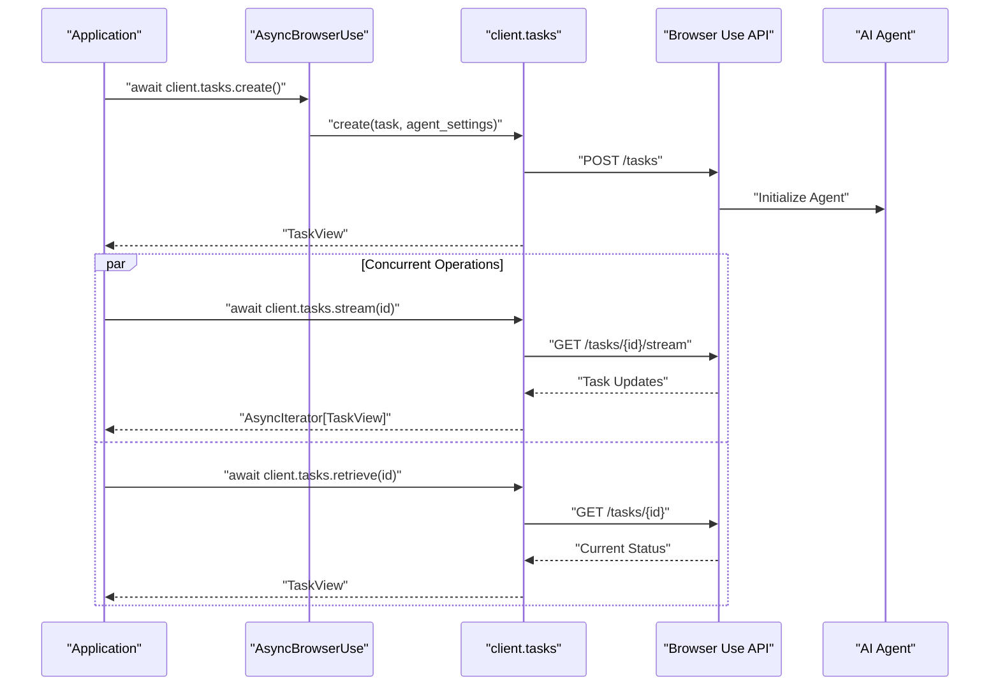
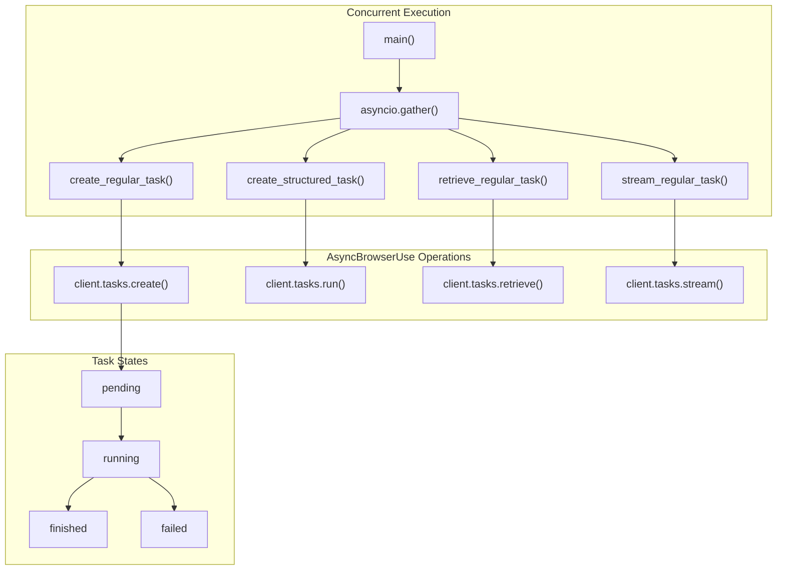
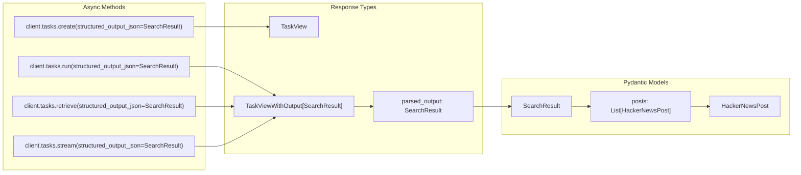

<!-- source: DeepWiki mcp.deepwiki.com · repo browser-use/browser-use-python · page 6.2 Asynchronous Examples · fetched 2026-10-30 -->

# Asynchronous Examples

<details>
<summary>Relevant source files</summary>

The following files were used as context for generating this wiki page:

- [examples/async_retrieve.py](examples/async_retrieve.py)
- [examples/async_run.py](examples/async_run.py)
- [examples/async_stream.py](examples/async_stream.py)
- [examples/async_watch.py](examples/async_watch.py)
- [examples/watch.py](examples/watch.py)

</details>


This page demonstrates how to use the `AsyncBrowserUse` client for concurrent browser automation operations. The asynchronous client enables efficient execution of multiple tasks simultaneously and provides non-blocking interfaces for task monitoring.

For synchronous usage patterns, see [Synchronous Examples](#6.1). For detailed information about task streaming capabilities, see [Task Streaming](#5.3). For structured output configuration, see [Structured Output](#5.2).

## Client Initialization

The `AsyncBrowserUse` client is initialized the same way as the synchronous client, automatically reading the API key from the `BROWSER_USE_API_KEY` environment variable.

```python
from browser_use_sdk import AsyncBrowserUse
client = AsyncBrowserUse()
```

**Sources:** [examples/async_create.py:8-11](), [examples/async_retrieve.py:8-11](), [examples/async_run.py:8-11](), [examples/async_stream.py:8-12]()

## Core Async Patterns

### Async Task Execution Flow



**Sources:** [examples/async_create.py:15-24](), [examples/async_retrieve.py:22-28](), [examples/async_stream.py:16-25]()

### Create and Monitor Pattern

The basic pattern creates a task and returns immediately without waiting for completion:

```python
async def create_regular_task() -> None:
    res = await client.tasks.create(
        task="Find top 10 Hacker News articles and return the title and url.",
        agent_settings={"llm": "gemini-2.5-flash"},
    )
    print(f"Task ID: {res.id}")
```

**Sources:** [examples/async_create.py:15-24]()

### Run and Wait Pattern

The `run()` method combines creation and execution, waiting for the task to complete:

```python
async def run_regular_task() -> None:
    result = await client.tasks.run(
        task="Find top 10 Hacker News articles and return the title and url.",
        agent_settings={"llm": "gemini-2.5-flash"},
    )
    print(f"Task Output: {result.done_output}")
```

**Sources:** [examples/async_run.py:15-27]()

### Polling with Retrieve Pattern

For manual status monitoring, use `retrieve()` with polling:

```python
async def retrieve_with_polling() -> None:
    task = await client.tasks.create(
        task="Find top 10 Hacker News articles and return the title and url.",
        agent_settings={"llm": "gemini-2.5-flash"},
    )
    
    while True:
        status = await client.tasks.retrieve(task.id)
        if status.status == "finished":
            print(f"Output: {status.done_output}")
            break
        await asyncio.sleep(1)
```

**Sources:** [examples/async_retrieve.py:22-40]()

### Streaming Pattern

For real-time progress monitoring, use the streaming interface:

```python
async def stream_task_progress() -> None:
    task = await client.tasks.create(
        task="Find top 10 Hacker News articles and return the title and url.",
        agent_settings=AgentSettings(llm="gemini-2.5-flash"),
    )
    
    async for update in client.tasks.stream(task.id):
        print(f"Status: {update.status}")
        if len(update.steps) > 0:
            last_step = update.steps[-1]
            print(f"Step: {last_step.url} ({last_step.next_goal})")
```

**Sources:** [examples/async_stream.py:16-35]()

## Concurrent Task Execution

### Async Task Coordination Patterns



**Sources:** [examples/async_create.py:49-54](), [examples/async_run.py:57-62](), [examples/async_retrieve.py:89-94](), [examples/async_stream.py:74-79]()

### Parallel Task Execution

All async examples use `asyncio.gather()` to run multiple tasks concurrently:

```python
async def main() -> None:
    await asyncio.gather(
        create_regular_task(),
        create_structured_task(),
    )
```

This pattern allows multiple browser automation tasks to execute simultaneously, significantly improving throughput for batch operations.

**Sources:** [examples/async_create.py:49-54](), [examples/async_run.py:57-62](), [examples/async_retrieve.py:89-94](), [examples/async_stream.py:74-79]()

## Structured Output with Async

### Async Structured Output Patterns



**Sources:** [examples/async_create.py:27-43](), [examples/async_run.py:31-54](), [examples/async_retrieve.py:51-83](), [examples/async_stream.py:39-68]()

### Structured Output Creation

Define Pydantic models for type-safe output parsing:

```python
class HackerNewsPost(BaseModel):
    title: str
    url: str

class SearchResult(BaseModel):
    posts: List[HackerNewsPost]

# Create task with structured output
res = await client.tasks.create(
    task="Find top 10 Hacker News articles and return the title and url.",
    agent_settings={"llm": "gpt-4.1"},
    structured_output_json=SearchResult,
)
```

**Sources:** [examples/async_create.py:28-43]()

### Structured Output Retrieval

When retrieving structured tasks, pass the model class to get typed results:

```python
status = await client.tasks.retrieve(
    task_id=task.id, 
    structured_output_json=SearchResult
)

if status.status == "finished" and status.parsed_output:
    for post in status.parsed_output.posts:
        print(f"- {post.title} - {post.url}")
```

**Sources:** [examples/async_retrieve.py:69-77]()

### Structured Output Streaming

Streaming also supports structured output with type-safe parsing:

```python
async for update in client.tasks.stream(task.id, structured_output_json=SearchResult):
    if update.status == "finished" and update.parsed_output:
        for post in update.parsed_output.posts:
            print(f"- {post.title} - {post.url}")
```

**Sources:** [examples/async_stream.py:57-65]()

## Error Handling Considerations

### Async Exception Patterns

When using concurrent execution with `asyncio.gather()`, exceptions in any task will propagate and cancel other running tasks unless properly handled. Consider using `asyncio.gather(..., return_exceptions=True)` for fault tolerance in production scenarios.

For long-running operations like polling or streaming, implement exponential backoff and timeout mechanisms to handle network interruptions gracefully.

**Sources:** [examples/async_retrieve.py:31-38](), [examples/async_stream.py:26-35]()

## Performance Optimization

| Pattern | Use Case | Concurrency | Resource Usage |
|---------|----------|-------------|----------------|
| `create()` | Fire-and-forget | High | Low |
| `run()` | Simple execution | Medium | Medium |
| `retrieve()` with polling | Custom monitoring | Low | Medium |
| `stream()` | Real-time updates | Medium | High |

The async client is particularly effective for:
- Batch processing multiple independent tasks
- Real-time monitoring of long-running browser automations
- Building responsive applications that don't block on browser operations

**Sources:** [examples/async_create.py:49-54](), [examples/async_run.py:57-62](), [examples/async_retrieve.py:89-94](), [examples/async_stream.py:74-79]()

---

