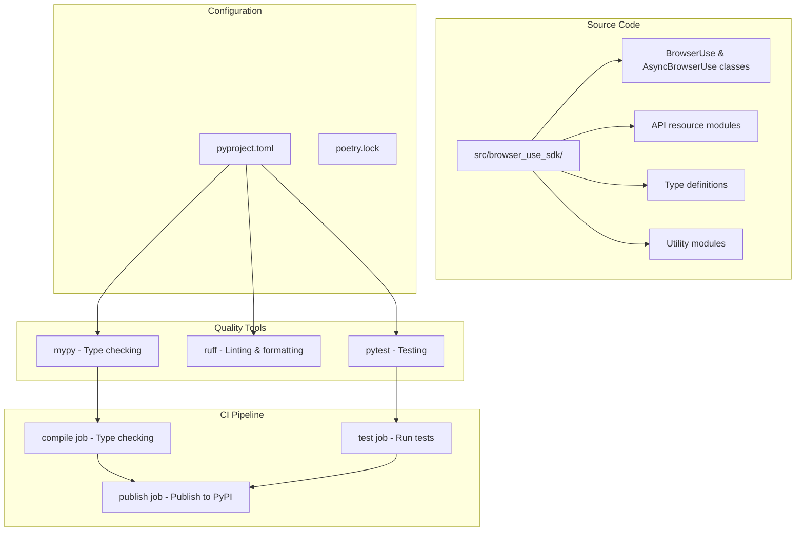
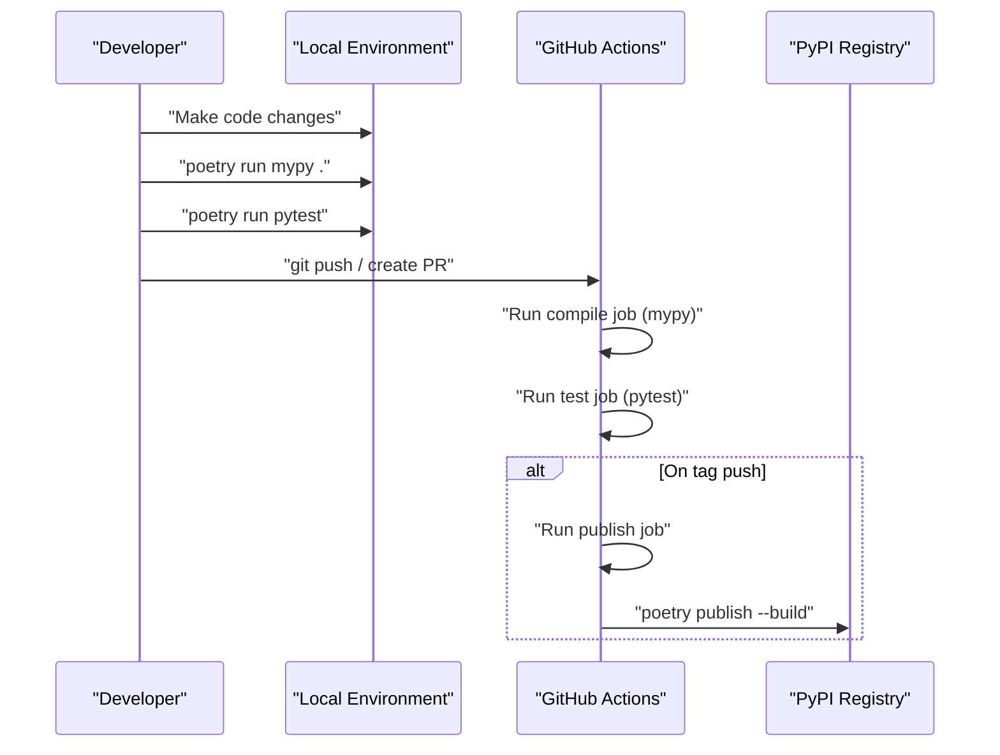
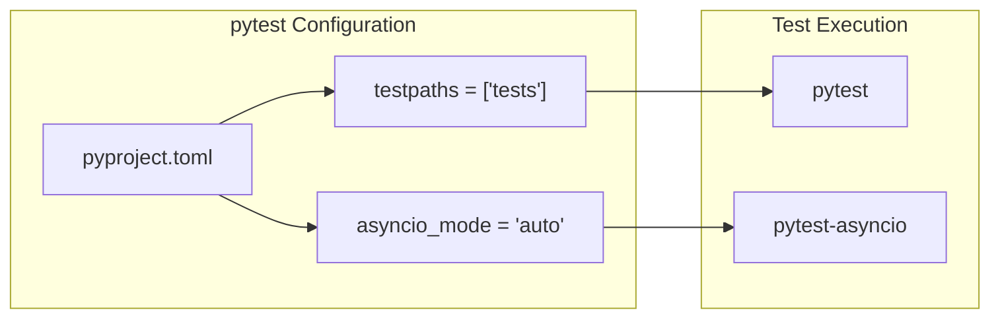

<!-- source: DeepWiki mcp.deepwiki.com · repo browser-use/browser-use-python · page 7 Development · fetched 2026-10-30 -->

# Development

<details>
<summary>Relevant source files</summary>

The following files were used as context for generating this wiki page:

- [.github/workflows/ci.yml](.github/workflows/ci.yml)
- [poetry.lock](poetry.lock)
- [pyproject.toml](pyproject.toml)
- [src/browser_use_sdk/version.py](src/browser_use_sdk/version.py)

</details>


This page provides information for contributors and developers working on the `browser-use-sdk` itself. It covers the development environment, build system, testing infrastructure, and CI/CD pipeline.

For information about using the SDK in your applications, see [Getting Started](#2). For details about the SDK's API structure, see [Client API Reference](#4).

## Overview

The `browser-use-sdk` is a Python package that provides a client library for interacting with the BrowserUse API. The development workflow emphasizes code quality through automated testing, type checking, and linting.

### Development Architecture

The following diagram shows the key components of the development infrastructure:



Sources: [pyproject.toml:1-85](), [.github/workflows/ci.yml:1-62]()

### Build System Components

The project uses Poetry as the primary dependency management and build tool:

| Component | Tool | Purpose |
|-----------|------|---------|
| Build System | `poetry-core` | Package building and distribution |
| Dependency Management | `poetry` | Python environment and dependency resolution |
| Type Checking | `mypy` | Static type analysis with Pydantic plugin |
| Code Formatting | `ruff` | Code linting and import sorting |
| Testing | `pytest` + `pytest-asyncio` | Synchronous and asynchronous testing |
| CI/CD | GitHub Actions | Automated quality gates and publishing |

Sources: [pyproject.toml:4-6](), [pyproject.toml:36-49](), [pyproject.toml:82-84]()

## Development Environment Setup

### Prerequisites

The development environment requires the following tools and versions:

| Requirement | Version | Purpose |
|-------------|---------|---------|
| Python | `^3.8` | Base language requirement |
| Poetry | `1.5.1` | Dependency management |
| httpx | `>=0.21.2` | HTTP client library |
| pydantic | `>= 1.9.2` | Data validation |
| mypy | `==1.13.0` | Type checking |
| pytest | `^7.4.0` | Testing framework |
| ruff | `==0.11.5` | Linting and formatting |

Sources: [pyproject.toml:36-49](), [.github/workflows/ci.yml:16]()

### Installation

To set up the development environment:

1. Install Poetry (version 1.5.1 or compatible):
   ```bash
   curl -sSL https://install.python-poetry.org | python - -y --version 1.5.1
   ```

2. Install dependencies:
   ```bash
   poetry install
   ```

3. Verify installation:
   ```bash
   poetry run python -c "import browser_use_sdk; print(browser_use_sdk.__version__)"
   ```

Sources: [.github/workflows/ci.yml:14-18](), [.github/workflows/ci.yml:30-34]()

### Development Workflow

The typical development workflow involves making changes, running quality checks locally, and submitting changes through CI:



Sources: [.github/workflows/ci.yml:1-62]()

## Testing

### Test Configuration

The project uses `pytest` with async support for testing. The configuration is defined in `pyproject.toml`:



| Configuration Key | Value | Purpose |
|------------------|-------|---------|
| `testpaths` | `["tests"]` | Directory containing test files |
| `asyncio_mode` | `"auto"` | Automatically detect and run async tests |

Sources: [pyproject.toml:51-53]()

### Running Tests

To run the test suite:

```bash
# Run all tests
poetry run pytest -rP .

# Run tests with verbose output
poetry run pytest -v

# Run tests in a specific file
poetry run pytest tests/specific_test.py
```

The `-rP` flag is used in CI to show extra test summary info for passed tests.

Sources: [.github/workflows/ci.yml:36-37]()

## Continuous Integration

The project uses GitHub Actions for CI/CD. The workflow is triggered on every push and defines three jobs that run sequentially.

### CI Pipeline

The CI pipeline consists of three jobs:

```mermaid
graph TB
    subgraph "CI Workflow (.github/workflows/ci.yml)"
        Push["git push event"]
        
        subgraph "Job: compile"
            CompileCheckout["Checkout code"]
            CompileSetup["Setup Python 3.8"]
            CompilePoetry["Bootstrap Poetry 1.5.1"]
            CompileInstall["poetry install"]
            CompileMypy["poetry run mypy ."]
        end
        
        subgraph "Job: test"
            TestCheckout["Checkout code"]
            TestSetup["Setup Python 3.8"]
            TestPoetry["Bootstrap Poetry 1.5.1"]
            TestInstall["poetry install"]
            TestRun["poetry run pytest -rP ."]
        end
        
        subgraph "Job: publish"
            PublishCheckout["Checkout code"]
            PublishSetup["Setup Python 3.8"]
            PublishPoetry["Bootstrap Poetry 1.5.1"]
            PublishInstall["poetry install"]
            PublishBuild["poetry publish --build"]
        end
    end
    
    Push --> CompileCheckout
    CompileCheckout --> CompileSetup
    CompileSetup --> CompilePoetry
    CompilePoetry --> CompileInstall
    CompileInstall --> CompileMypy
    
    Push --> TestCheckout
    TestCheckout --> TestSetup
    TestSetup --> TestPoetry
    TestPoetry --> TestInstall
    TestInstall --> TestRun
    
    CompileMypy --> PublishCheckout
    TestRun --> PublishCheckout
    PublishCheckout --> PublishSetup
    PublishSetup --> PublishPoetry
    PublishPoetry --> PublishInstall
    PublishInstall --> PublishBuild
```



Sources: [.github/workflows/ci.yml:1-62]()

### Job Details

The CI workflow defines the following jobs:

| Job | Trigger | Steps | Purpose |
|-----|---------|-------|---------|
| `compile` | On push | Setup Python, install Poetry, run mypy | Type check the codebase |
| `test` | On push | Setup Python, install Poetry, run pytest | Execute test suite |
| `publish` | On tag push | Setup Python, install Poetry, build and publish | Publish package to PyPI |

The `publish` job only runs when a tag matching `refs/tags/*` is pushed and requires both `compile` and `test` jobs to pass.

Sources: [.github/workflows/ci.yml:5-21](), [.github/workflows/ci.yml:22-38](), [.github/workflows/ci.yml:39-61]()

### CI Environment

Each job uses the following configuration:

- **Runner**: `ubuntu-latest`
- **Python Version**: `3.8`
- **Poetry Version**: `1.5.1`

Sources: [.github/workflows/ci.yml:6](), [.github/workflows/ci.yml:11-13](), [.github/workflows/ci.yml:14-16]()

## Code Quality Standards

### Type Checking Configuration

The project enforces strict type checking with `pyright`:

```
typeCheckingMode = "strict"
pythonVersion = "3.8"
reportImplicitOverride = true
```

Sources: [pyproject.toml:140-154]()

### Linting Rules

Ruff is configured with specific rule sets:

- **Import Sorting**: `isort` rules for consistent imports
- **Code Quality**: `bugbear` rules for common Python issues  
- **Unused Code**: Detection of unused imports and arguments
- **Print Statements**: Flagged in non-script files

Sources: [pyproject.toml:167-186](), [pyproject.toml:207-211]()

### Package Structure

The built package follows Python standards:

```
src/browser_use_sdk/           # Main package source
├── _client.py                 # Generated client classes
├── resources/                 # Generated resource modules
├── types/                     # Generated type definitions
└── _utils.py                  # Utility functions
```

Sources: [pyproject.toml:96-102](), [pyproject.toml:106-117]()

---

