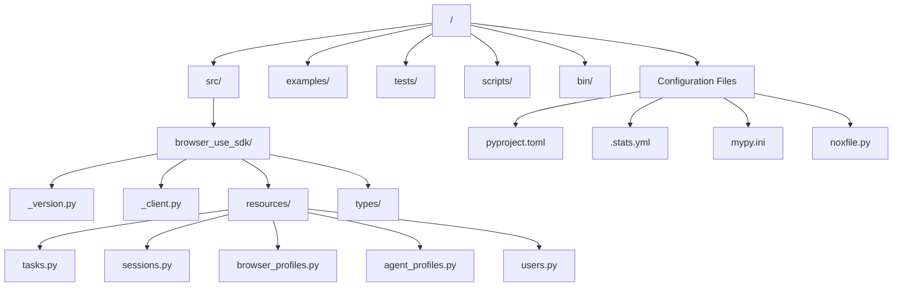
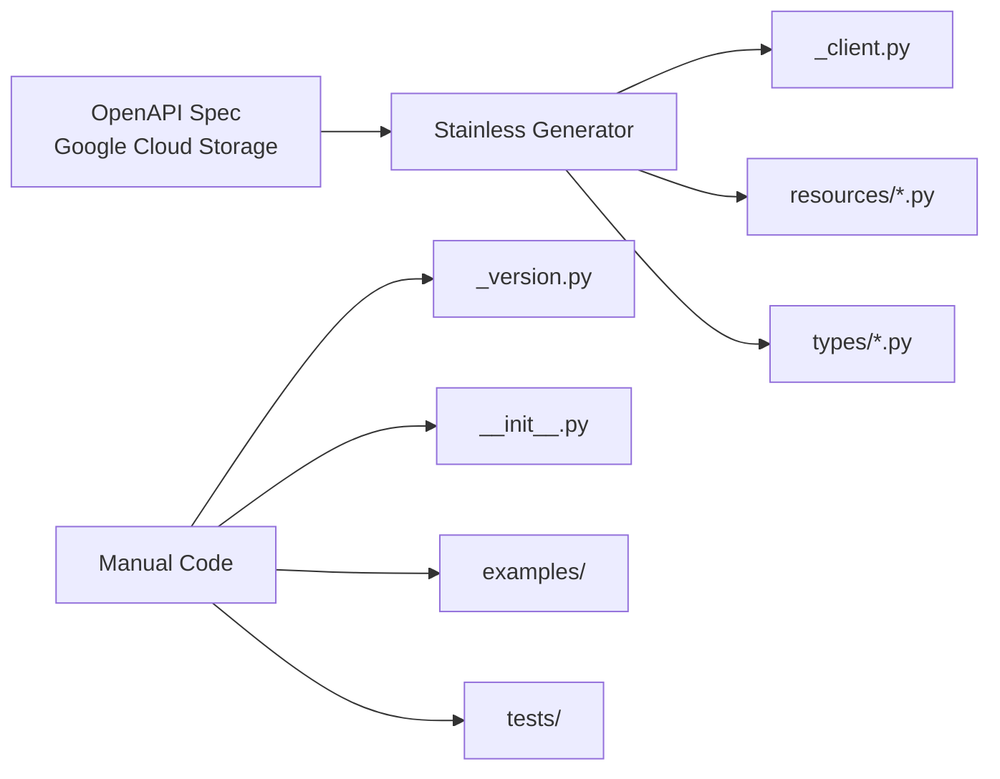
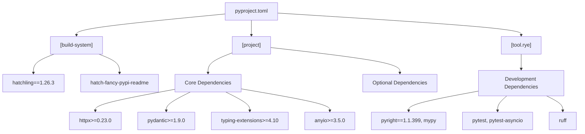
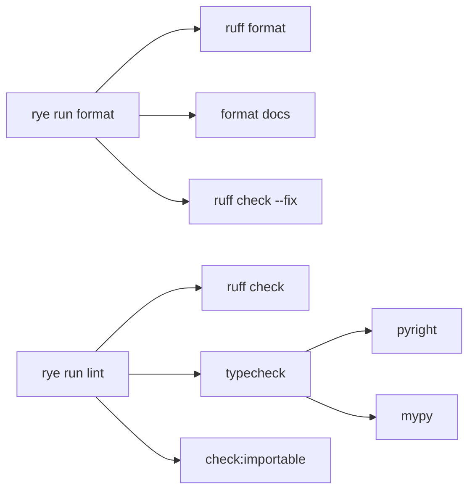
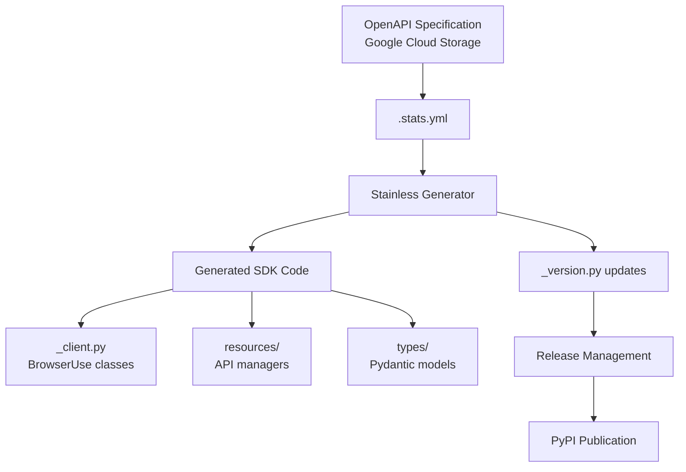
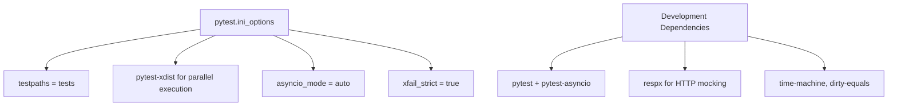

<!-- source: DeepWiki mcp.deepwiki.com · repo browser-use/browser-use-python · page 7.1 Project Structure · fetched 2026-10-30 -->

# Project Structure

Relevant source files

The following files were used as context for generating this wiki page:

- [.fernignore](.fernignore)
- [assets/cloud-banner-python.png](assets/cloud-banner-python.png)
- [poetry.lock](poetry.lock)
- [pyproject.toml](pyproject.toml)

This document provides an overview of the browser-use-sdk codebase organization, build system, development tools, and code generation workflow. It covers the technical infrastructure that supports SDK development and maintenance.

For information about using the SDK APIs, see [Client API Reference](#4). For testing procedures, see [Testing](#7.2). For release processes, see [Release Management](#7.3).

## Directory Structure

The browser-use-sdk follows a standard Python package layout with automated code generation from OpenAPI specifications:

**Sources:** [pyproject.toml:97-117]()

## Source Code Organization

The main SDK source code resides in `src/browser_use_sdk/` and follows Stainless-generated patterns:

| Component | Path | Purpose |
|-----------|------|---------|
| Core Client | `src/browser_use_sdk/_client.py` | Main `BrowserUse` and `AsyncBrowserUse` classes |
| Version Info | `src/browser_use_sdk/_version.py` | Package version and metadata |
| Resources | `src/browser_use_sdk/resources/` | API resource managers for tasks, sessions, profiles |
| Type Definitions | `src/browser_use_sdk/types/` | Pydantic models and type annotations |
| Public API | `src/browser_use_sdk/__init__.py` | Exported classes and functions |

The codebase is primarily auto-generated from OpenAPI specifications, with minimal custom code:

**Sources:** [src/browser_use_sdk/_version.py:1-5](), [.stats.yml:1-5]()

## Build System and Dependencies

The project uses modern Python tooling configured in `pyproject.toml`:

### Package Management
- **Build Backend:** `hatchling` for PEP 517 compliant builds
- **Dependency Manager:** Rye for development dependency management
- **Package Source:** Source code in `src/` layout

### Core Dependencies
The SDK has minimal runtime dependencies focused on HTTP communication and type safety:

| Dependency | Version Constraint | Purpose |
|------------|-------------------|---------|
| `httpx` | `>=0.23.0, <1` | HTTP client for API communication |
| `pydantic` | `>=1.9.0, <3` | Data validation and serialization |
| `typing-extensions` | `>=4.10, <5` | Enhanced type annotations |
| `anyio` | `>=3.5.0, <5` | Async compatibility layer |

**Sources:** [pyproject.toml:10-17](), [pyproject.toml:92-94](), [pyproject.toml:101-102]()

## Development Tooling

The project includes comprehensive development tooling configured through Rye scripts:

### Code Quality Pipeline

### Development Scripts
The project defines several Rye scripts for common development tasks:

| Script | Command | Purpose |
|--------|---------|---------|
| `format` | Chain of formatting commands | Auto-format code and docs |
| `lint` | Chain of linting commands | Check code quality and types |
| `typecheck` | PyRight + MyPy | Comprehensive type checking |
| `check:importable` | Python import test | Verify package imports correctly |

### Tool Configuration
- **Ruff:** Line length 120, Python 3.8+ target, isort integration
- **PyRight:** Strict type checking mode, Python 3.8 baseline
- **MyPy:** Additional type validation
- **Pytest:** Auto-discovery in `tests/`, parallel execution with `pytest-xdist`

**Sources:** [pyproject.toml:63-90](), [pyproject.toml:140-158](), [pyproject.toml:159-212]()

## Code Generation Workflow

The SDK uses Stainless for automated code generation from OpenAPI specifications:

### OpenAPI Tracking
The `.stats.yml` file tracks the OpenAPI specification state:
- **Spec URL:** Google Cloud Storage location
- **Spec Hash:** Content verification (`0dae4d4d33a3ec93e470f9546e43fad3`)
- **Config Hash:** Generation configuration tracking
- **Endpoints:** Currently 26 configured endpoints

**Sources:** [.stats.yml:1-5](), [src/browser_use_sdk/_version.py:1-5]()

## Quality Assurance

The project maintains high code quality through multiple validation layers:

### Testing Framework

### Type Safety
- **PyRight:** Strict mode type checking with Python 3.8 baseline
- **MyPy:** Additional type validation for comprehensive coverage
- **Import Verification:** Automated import testing via `check:importable` script

### Code Standards
- **Ruff:** Comprehensive linting with custom rule selection
- **Formatting:** Automated code formatting with docstring support
- **Import Organization:** Length-sorted imports with first-party package recognition

**Sources:** [pyproject.toml:130-138](), [pyproject.toml:47-61](), [pyproject.toml:167-186]()

---

