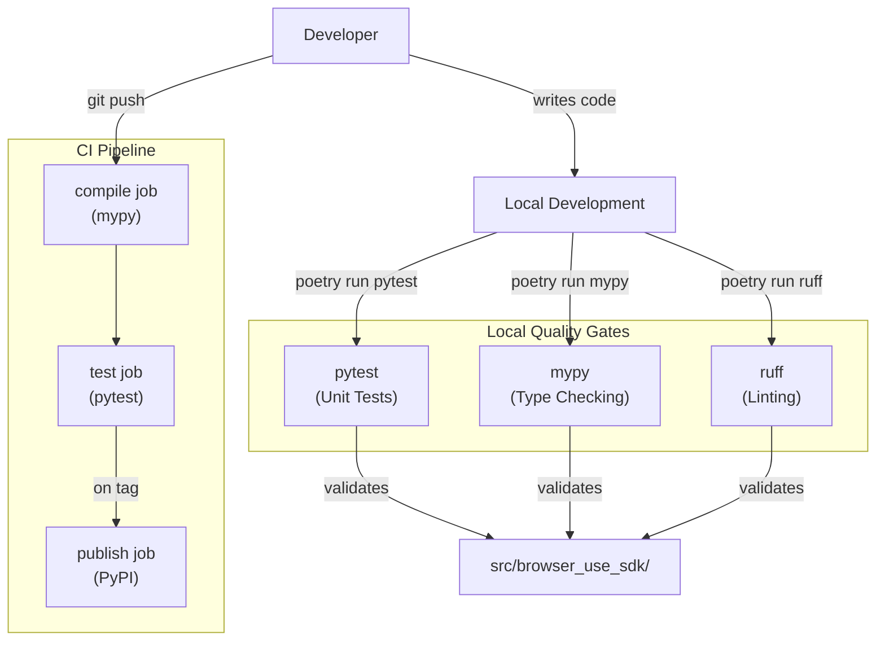
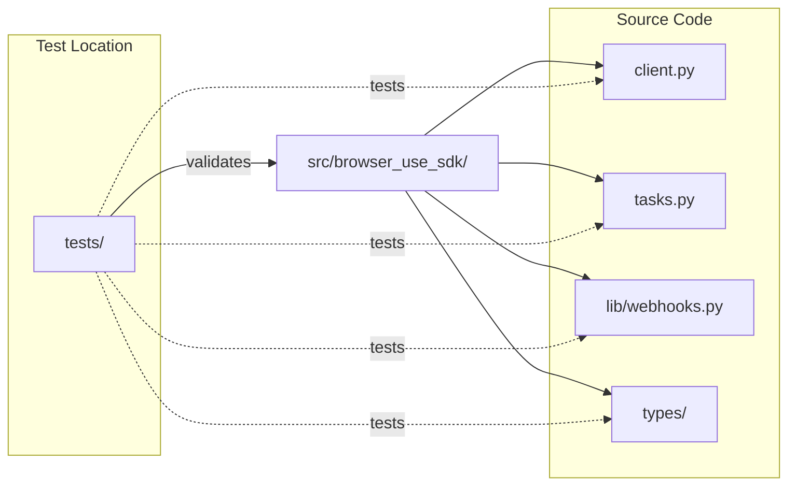
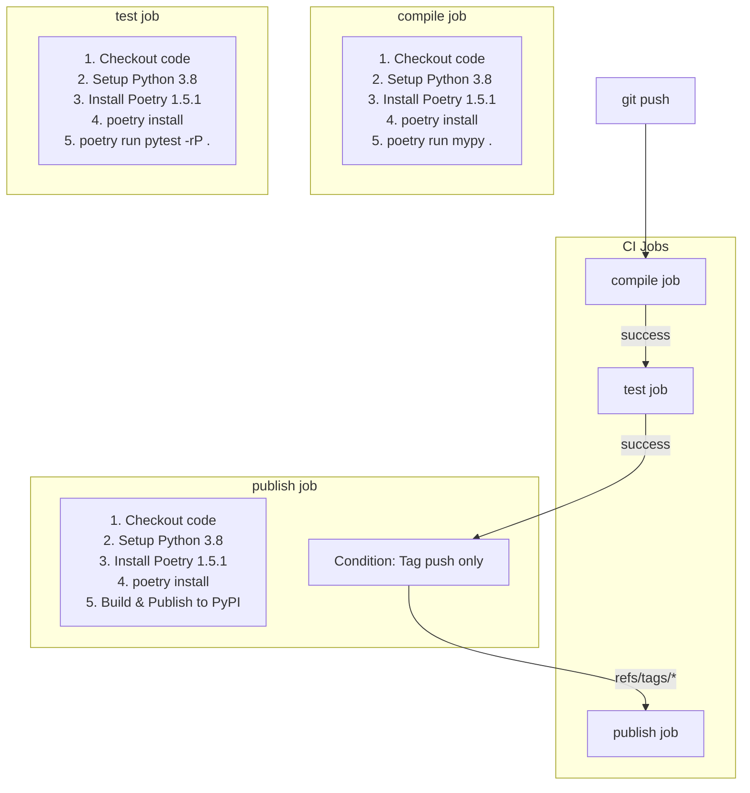
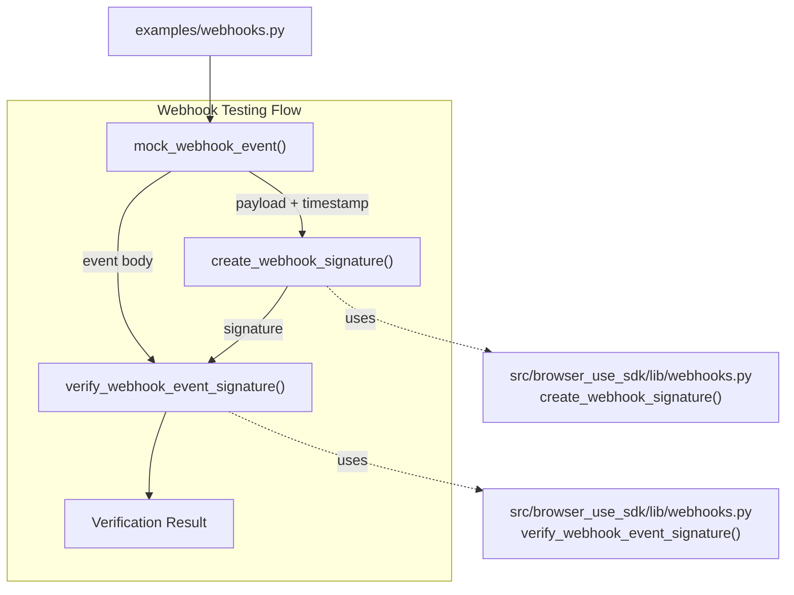
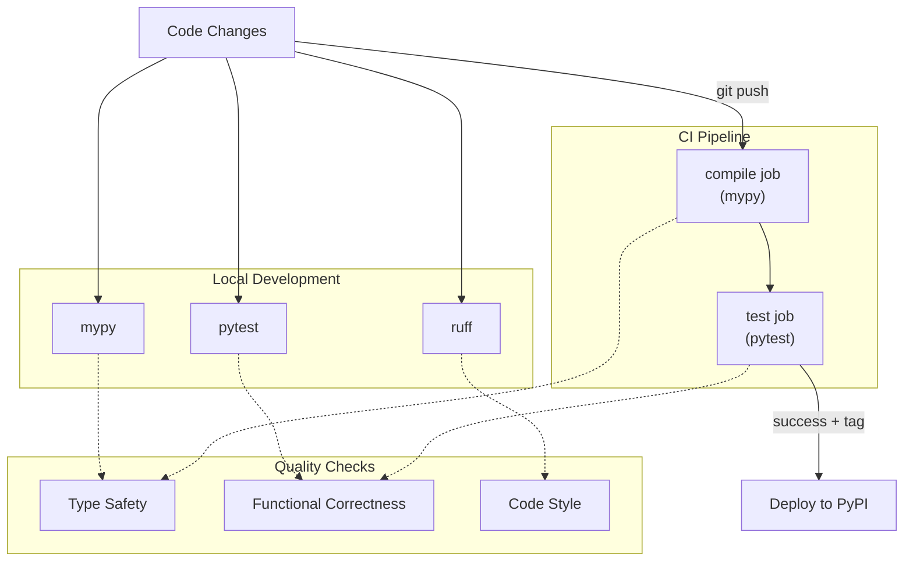

<!-- source: DeepWiki mcp.deepwiki.com · repo browser-use/browser-use-python · page 7.2 Testing · fetched 2026-10-30 -->

# Testing

<details>
<summary>Relevant source files</summary>

The following files were used as context for generating this wiki page:

- [.github/workflows/ci.yml](.github/workflows/ci.yml)
- [examples/webhooks.py](examples/webhooks.py)
- [pyproject.toml](pyproject.toml)
- [src/browser_use_sdk/lib/webhooks.py](src/browser_use_sdk/lib/webhooks.py)
- [src/browser_use_sdk/version.py](src/browser_use_sdk/version.py)

</details>


This document describes the testing strategy, tools, and procedures used in the browser-use-sdk project. It covers how to run tests locally, the structure of the test suite, static analysis tools, and the continuous integration pipeline that ensures code quality.

For information about the project structure and organization, see [Project Structure](#7.1). For details on the release process and how tests integrate into publishing, see [Release Management](#7.3).

---

## Testing Strategy Overview

The browser-use-sdk employs a multi-layered testing and quality assurance strategy consisting of:

| Layer | Tool | Purpose |
|-------|------|---------|
| Unit Tests | pytest | Verify functional correctness of SDK components |
| Async Tests | pytest-asyncio | Test asynchronous client operations |
| Type Checking | mypy | Ensure type safety and catch type errors |
| Code Linting | ruff | Enforce code style and catch common errors |
| CI/CD Pipeline | GitHub Actions | Automate testing on every push |



**Sources:** [pyproject.toml:43-53](), [.github/workflows/ci.yml:1-62]()

---

## Test Tools and Configuration

### pytest Configuration

The test framework is configured in `pyproject.toml` using the `[tool.pytest.ini_options]` section:

| Configuration | Value | Purpose |
|--------------|-------|---------|
| `testpaths` | `["tests"]` | Location of test files |
| `asyncio_mode` | `"auto"` | Automatic async test detection |

**Sources:** [pyproject.toml:51-53]()

### pytest Dependencies

The following pytest-related packages are installed as development dependencies:

| Package | Version | Purpose |
|---------|---------|---------|
| `pytest` | `^7.4.0` | Core testing framework |
| `pytest-asyncio` | `^0.23.5` | Async test support |
| `python-dateutil` | `^2.9.0` | Date parsing utilities for tests |
| `types-python-dateutil` | `^2.9.0.20240316` | Type stubs for mypy |

**Sources:** [pyproject.toml:45-48]()

### Type Checking Configuration

Type checking is performed using `mypy` with Pydantic plugin support:

```toml
[tool.mypy]
plugins = ["pydantic.mypy"]
```

The `pydantic.mypy` plugin enables proper type checking for Pydantic models used throughout the SDK, including data models and webhook event schemas.

**Sources:** [pyproject.toml:55-56]()

### Linting Configuration

Code linting uses `ruff` with the following configuration:

| Setting | Value | Description |
|---------|-------|-------------|
| `line-length` | `120` | Maximum line length |
| `select` | `E`, `F`, `I` | Error categories to check |
| `ignore` | Multiple codes | Specific rules to skip |

The selected error categories are:
- **E**: pycodestyle errors (code style issues)
- **F**: pyflakes (logical errors, unused imports)
- **I**: isort (import ordering)

Ignored rules include common pragmatic exceptions like `E501` (line too long) and `F841` (unused local variable).

**Sources:** [pyproject.toml:58-77]()

---

## Running Tests Locally

### Prerequisites

Install all development dependencies using Poetry:

```bash
poetry install
```

This installs the SDK package along with all testing tools defined in `[tool.poetry.group.dev.dependencies]`.

### Running Unit Tests

Execute the full test suite:

```bash
poetry run pytest -rP .
```

The `-rP` flag displays a summary of passed tests, and `.` runs all tests in the current directory.

### Running Type Checks

Run mypy to validate type annotations:

```bash
poetry run mypy .
```

This checks all Python files in the project, including source code in `src/browser_use_sdk/` and examples.

### Running Linter

Execute ruff to check code style:

```bash
ruff check .
```

Or to automatically fix issues where possible:

```bash
ruff check --fix .
```

**Sources:** [.github/workflows/ci.yml:18-37]()

---

## Test Organization



The test suite is organized in the `tests/` directory, configured via the `testpaths` option in pytest settings. Test files should mirror the structure of the source code they validate.

**Sources:** [pyproject.toml:51-53]()

### Async Test Support

The SDK includes both synchronous and asynchronous client interfaces. The `pytest-asyncio` plugin with `asyncio_mode = "auto"` automatically detects and runs async test functions:

```python
async def test_async_operation():
    # pytest-asyncio handles the event loop
    result = await some_async_function()
    assert result is not None
```

**Sources:** [pyproject.toml:46](), [pyproject.toml:53]()

---

## Continuous Integration Pipeline

The CI/CD pipeline is defined in `.github/workflows/ci.yml` and consists of three jobs that run sequentially:



**Sources:** [.github/workflows/ci.yml:1-62]()

### Compile Job

The `compile` job validates type safety using mypy:

| Step | Command | Purpose |
|------|---------|---------|
| Checkout | `actions/checkout@v4` | Clone repository |
| Setup Python | `actions/setup-python@v4` | Install Python 3.8 |
| Bootstrap Poetry | `curl -sSL ... \| python - -y --version 1.5.1` | Install Poetry 1.5.1 |
| Install Dependencies | `poetry install` | Install all dependencies |
| Type Check | `poetry run mypy .` | Run type checking |

**Sources:** [.github/workflows/ci.yml:5-20]()

### Test Job

The `test` job executes the pytest suite:

| Step | Command | Purpose |
|------|---------|---------|
| Checkout | `actions/checkout@v4` | Clone repository |
| Setup Python | `actions/setup-python@v4` | Install Python 3.8 |
| Bootstrap Poetry | `curl -sSL ... \| python - -y --version 1.5.1` | Install Poetry 1.5.1 |
| Install Dependencies | `poetry install` | Install all dependencies |
| Run Tests | `poetry run pytest -rP .` | Execute test suite |

**Sources:** [.github/workflows/ci.yml:21-37]()

### Publish Job

The `publish` job only runs on tag pushes (e.g., `refs/tags/v2.0.4`) and depends on both `compile` and `test` jobs succeeding. It builds the package and publishes it to PyPI using credentials stored in GitHub secrets.

**Sources:** [.github/workflows/ci.yml:39-61]()

---

## Testing Webhooks

While the main test suite resides in `tests/`, webhook functionality can be validated using the example script provided:



The webhook example demonstrates:

1. **Signature Generation**: Using `create_webhook_signature()` to generate HMAC-SHA256 signatures [src/browser_use_sdk/lib/webhooks.py:56-76]()
2. **Signature Verification**: Using `verify_webhook_event_signature()` to validate incoming webhook events [src/browser_use_sdk/lib/webhooks.py:79-136]()
3. **Event Parsing**: Type-safe parsing of webhook payloads into Pydantic models

**Sources:** [examples/webhooks.py:1-66](), [src/browser_use_sdk/lib/webhooks.py:56-136]()

---

## Writing Tests

### Test File Naming

Test files should follow pytest's discovery conventions:
- Located in `tests/` directory
- Named with `test_*.py` or `*_test.py` pattern
- Contain functions named `test_*`

### Testing Async Code

For testing asynchronous SDK methods (e.g., `AsyncBrowserUse` client operations):

```python
async def test_async_client_operation():
    """Test an async client method."""
    # pytest-asyncio handles the event loop automatically
    client = AsyncBrowserUse(api_key="test_key")
    result = await client.tasks.create(...)
    assert result is not None
```

The `asyncio_mode = "auto"` setting ensures async test functions are automatically detected and executed with proper event loop management.

### Type Hints in Tests

Tests should include type hints for better IDE support and to benefit from mypy validation:

```python
from browser_use_sdk import BrowserUse
from browser_use_sdk.types import TaskView

def test_task_creation() -> None:
    """Test creating a task."""
    client: BrowserUse = BrowserUse(api_key="test_key")
    task: TaskView = client.tasks.create(task="test task")
    assert task.id is not None
```

**Sources:** [pyproject.toml:51-56]()

---

## Quality Gates Summary



All quality gates must pass before code can be merged or published:

1. **Type Safety**: Enforced by mypy in both local development and CI
2. **Functional Correctness**: Validated by pytest suite
3. **Code Style**: Maintained by ruff linter

**Sources:** [pyproject.toml:43-77](), [.github/workflows/ci.yml:1-62]()

---

