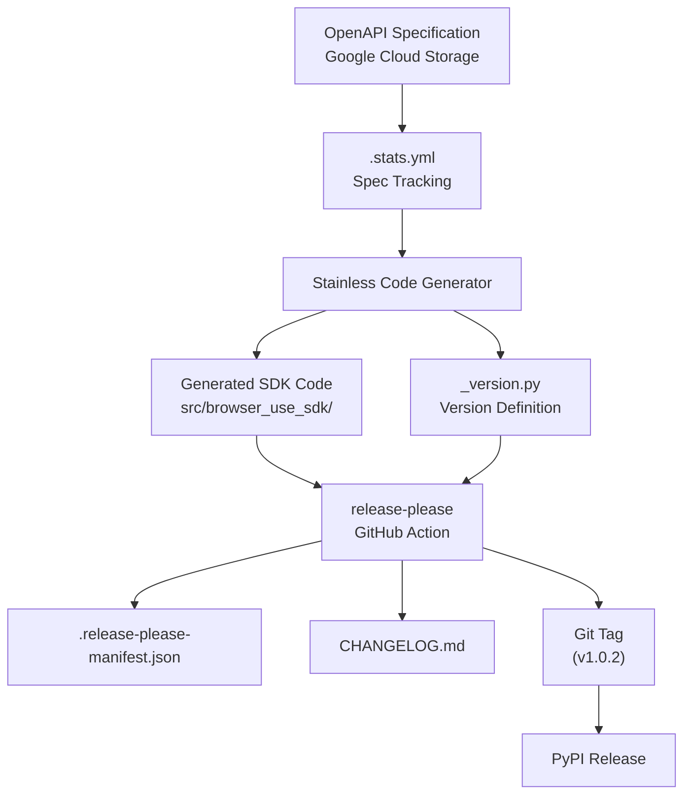
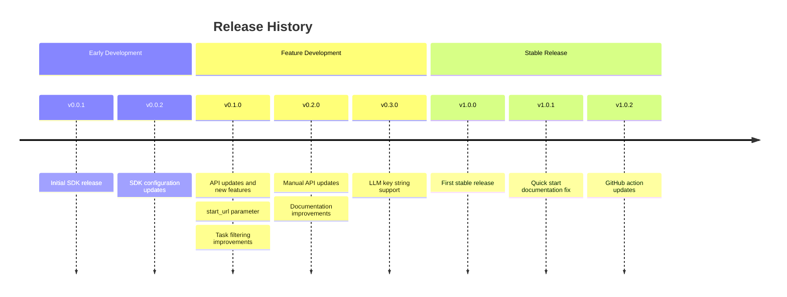
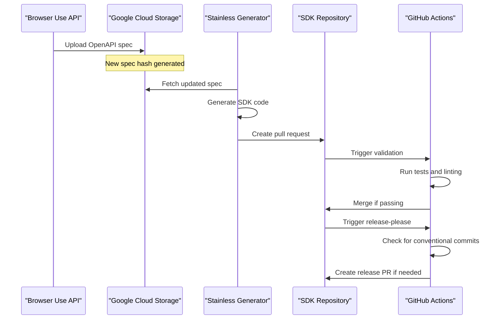
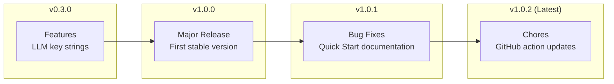
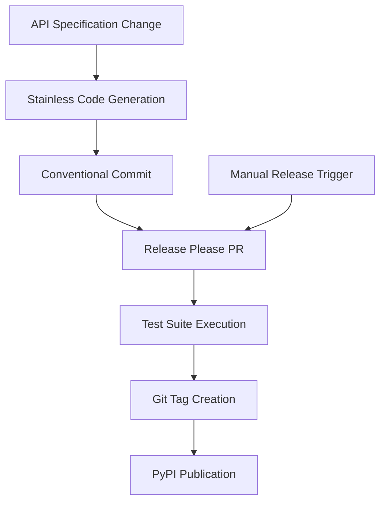

<!-- source: DeepWiki mcp.deepwiki.com · repo browser-use/browser-use-python · page 7.3 Release Management · fetched 2026-10-30 -->

# Release Management

<details>
<summary>Relevant source files</summary>

The following files were used as context for generating this wiki page:

- [.github/workflows/ci.yml](.github/workflows/ci.yml)
- [pyproject.toml](pyproject.toml)
- [src/browser_use_sdk/version.py](src/browser_use_sdk/version.py)

</details>


This document covers the automated release management process for the browser-use-sdk, including version control, OpenAPI specification synchronization, and the code generation pipeline that maintains the SDK. This covers the technical infrastructure that enables automated SDK updates when the underlying Browser Use API changes.

For information about the overall development workflow and project structure, see [Project Structure](#7.1). For testing procedures that are part of the release pipeline, see [Testing](#7.2).

## Release Process Overview

The browser-use-sdk follows an automated release management strategy that integrates OpenAPI specification updates with semantic versioning and automated code generation. The process ensures that SDK releases stay synchronized with the Browser Use API while maintaining backward compatibility.



Sources: [.stats.yml:1-5](), [src/browser_use_sdk/_version.py:1-5](), [.release-please-manifest.json:1-3](), [CHANGELOG.md:1-69]()

## Version Management

The SDK uses **release-please** for automated version management with semantic versioning. The current version is tracked in multiple locations and kept synchronized through the release process.

### Version Tracking Files

| File | Purpose | Current Version |
|------|---------|----------------|
| `.release-please-manifest.json` | Release-please configuration | 1.0.2 |
| `src/browser_use_sdk/_version.py` | Runtime version definition | 1.0.2 |
| `CHANGELOG.md` | Human-readable release history | 1.0.2 |

The version in `_version.py` includes a release-please marker comment to ensure automatic updates:

```python
__version__ = "1.0.2"  # x-release-please-version
```

Sources: [.release-please-manifest.json:1-3](), [src/browser_use_sdk/_version.py:4](), [CHANGELOG.md:3]()

### Semantic Versioning Strategy

Based on the changelog history, the project follows semantic versioning with these patterns:

- **Major versions** (1.x.x): Breaking changes or major milestones
- **Minor versions** (x.1.x): New features and API updates
- **Patch versions** (x.x.1): Bug fixes and documentation improvements



Sources: [CHANGELOG.md:19-69]()

## OpenAPI Integration and Code Generation

The SDK is generated from an OpenAPI specification hosted on Google Cloud Storage using the Stainless code generation platform. This ensures the SDK stays synchronized with the Browser Use API.

### OpenAPI Specification Tracking

The `.stats.yml` file tracks the current OpenAPI specification state:

```yaml
configured_endpoints: 26
openapi_spec_url: https://storage.googleapis.com/stainless-sdk-openapi-specs/browser-use%2Fbrowser-use-814bdd9f98b750d42a2b713a0a12b14fc5a0241ff820b2fbc7666ab2e9a5443f.yml
openapi_spec_hash: 0dae4d4d33a3ec93e470f9546e43fad3
config_hash: dd3e22b635fa0eb9a7c741a8aaca2a7f
```

### Code Generation Pipeline



Sources: [.stats.yml:2-4]()

## Changelog Management

The changelog follows the **Keep a Changelog** format with automatic generation through release-please. Each release includes categorized changes based on conventional commit types.

### Change Categories

The changelog organizes changes into these categories:

- **Features**: New functionality (feat: commits)
- **Bug Fixes**: Error corrections (fix: commits)  
- **Chores**: Maintenance tasks (chore: commits)
- **Internal**: Code generation updates

### Recent Release Pattern



Sources: [CHANGELOG.md:3-30]()

## Automated Release Pipeline

The release pipeline integrates multiple automated systems to ensure consistent and reliable releases:

### Pipeline Components

1. **OpenAPI Change Detection**: Monitors specification hash changes
2. **Code Generation**: Automatic SDK updates via Stainless
3. **Version Bumping**: Semantic version increments via release-please
4. **Changelog Generation**: Automatic change documentation
5. **Distribution**: PyPI package publishing

### Release Triggers



The system ensures that all releases are:
- **Tested**: Full test suite execution before release
- **Documented**: Automatic changelog generation
- **Versioned**: Semantic versioning compliance
- **Distributed**: Automatic PyPI publishing

Sources: [.stats.yml:1-5](), [.release-please-manifest.json:1-3](), [CHANGELOG.md:1-69](), [src/browser_use_sdk/_version.py:1-5]()