# Page: Overview

# Overview

<details>
<summary>Relevant source files</summary>

The following files were used as context for generating this wiki page:

- [README.md](README.md)
- [pyproject.toml](pyproject.toml)

</details>


## Purpose and Scope

The browser-use-sdk is the official Python library for interfacing with the Browser Use Cloud platform, providing developers with programmatic access to AI-powered browser automation capabilities. This document covers the high-level architecture, core components, and execution patterns of the SDK.

For detailed API reference, see [Client API Reference](#4). For installation and basic usage patterns, see [Getting Started](#2). For advanced features like webhooks and structured output, see [Advanced Features](#5).

## System Architecture

The browser-use-sdk implements a client-server architecture where Python applications communicate with the Browser Use Cloud platform through a REST API. The SDK provides both synchronous and asynchronous client interfaces for different use cases.

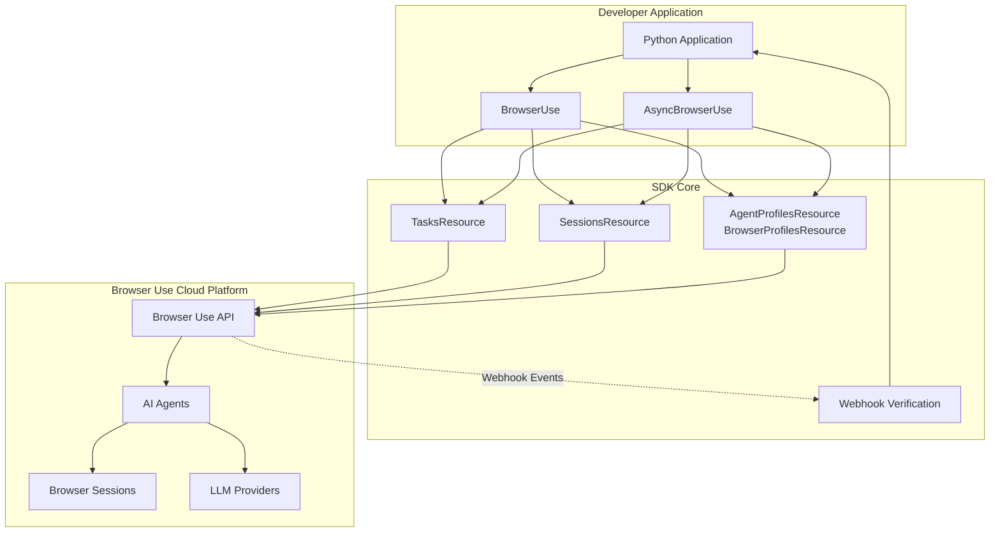

Sources: [README.md:1-392](), [src/browser_use_sdk/_version.py:1-5](), [tests/test_client.py:24-35]()

## Core Client Classes

The SDK provides two primary client classes that expose identical functionality through different execution models:

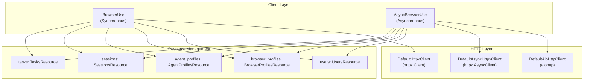

Sources: [README.md:16-18](), [README.md:144-166](), [README.md:168-199](), [tests/test_client.py:61-63](), [tests/test_client.py:868-870]()

### Authentication and Configuration

Both client classes require API key authentication and support various configuration options:

| Configuration | Environment Variable | Description |
|---------------|---------------------|-------------|
| API Key | `BROWSER_USE_API_KEY` | Required for authentication |
| Base URL | `BROWSER_USE_BASE_URL` | Cloud platform endpoint |
| Timeout | N/A | Request timeout configuration |
| Max Retries | N/A | Retry behavior for failed requests |
| HTTP Client | N/A | Custom httpx client instance |

Sources: [tests/test_client.py:341-347](), [tests/test_client.py:558-561](), [tests/test_client.py:269-282]()

## Task Execution Patterns

The SDK supports multiple patterns for executing browser automation tasks, each suited to different use cases:

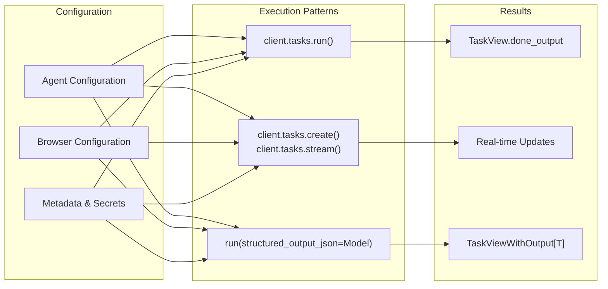

Sources: [README.md:15-25](), [README.md:57-98](), [README.md:29-55]()

### Simple Task Execution

The most straightforward pattern uses the `run()` method for one-shot task execution:

```python
client.tasks.run(task="Search for the top 10 Hacker News posts")
```

Sources: [README.md:20-22]()

### Streaming Execution

For long-running tasks requiring real-time updates, the SDK provides streaming capabilities:

```python
task = client.tasks.create(task="...")
for update in client.tasks.stream(task.id):
    print(f"{update.status}: {update.steps[-1].next_goal}")
```

Sources: [README.md:73-83]()

### Structured Output

Tasks can return structured data using Pydantic models for type safety:

```python
result = client.tasks.run(
    task="Find top 10 articles",
    structured_output_json=SearchResult
)
```

Sources: [README.md:42-47]()

## Webhook Integration

The SDK provides webhook signature verification for real-time task notifications:

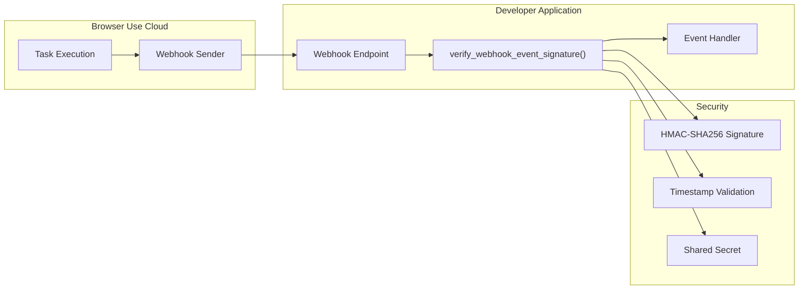

Sources: [README.md:100-140](), [README.md:124-129]()

## Error Handling and Resilience

The SDK implements comprehensive error handling with automatic retry mechanisms:

| Error Type | Status Code | Retry Behavior |
|------------|-------------|----------------|
| `APIConnectionError` | N/A | Automatic retry |
| `RateLimitError` | 429 | Automatic retry with backoff |
| `InternalServerError` | ≥500 | Automatic retry |
| `AuthenticationError` | 401 | No retry |
| `NotFoundError` | 404 | No retry |

Default retry configuration includes 2 retries with exponential backoff for transient failures.

Sources: [README.md:203-267](), [pyproject.toml:10-17]()

## Development and Code Generation

The SDK is generated from OpenAPI specifications using the Stainless code generator, ensuring type safety and API consistency:

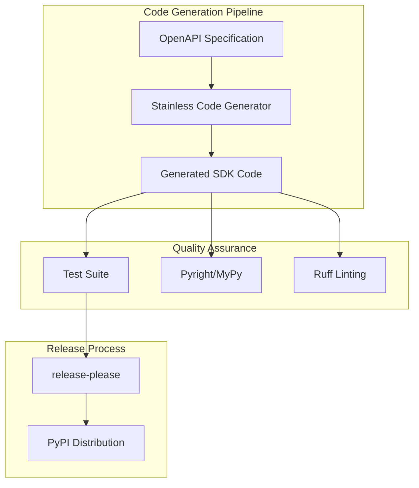

Sources: [src/browser_use_sdk/_version.py:1-2](), [pyproject.toml:44-61](), [CHANGELOG.md:1-69]()

## Dependencies and Platform Support

The SDK supports Python 3.8+ with the following core dependencies:

- `httpx` (0.23.0+): HTTP client for API communication  
- `pydantic` (1.9.0+): Data validation and serialization
- `typing-extensions` (4.10+): Enhanced type annotations
- `anyio` (3.5.0+): Async compatibility layer

Optional dependencies include `aiohttp` for enhanced async performance.

Sources: [pyproject.toml:10-17](), [pyproject.toml:18](), [pyproject.toml:41-42](), [README.md:385-387]()

---

# Page: Getting Started

# Getting Started

<details>
<summary>Relevant source files</summary>

The following files were used as context for generating this wiki page:

- [README.md](README.md)
- [pyproject.toml](pyproject.toml)

</details>


This page guides you through installing the browser-use-sdk Python library, setting up authentication, and executing your first browser automation tasks. It covers the essential setup steps and basic usage patterns needed to start automating web browsers using AI agents.

For detailed information about task management and advanced execution patterns, see [Task Management API](#4.1). For webhook setup and event handling, see [Webhooks](#5.1). For comprehensive usage examples, see [Examples](#6).

## Installation

Install the browser-use-sdk from PyPI using pip:

```bash
pip install browser-use-sdk
```

For asynchronous operations with improved performance, you can optionally install the aiohttp backend:

```bash
pip install browser-use-sdk[aiohttp]
```

Sources: [README.md:5-7](), [README.md:174-177]()

## Authentication Setup

The browser-use-sdk requires an API key from Browser Use Cloud to authenticate requests:

1. **Get your API key** from [Browser Use Cloud](https://cloud.browser-use.com)
2. **Set the API key** using one of these methods:

### Environment Variable (Recommended)

```bash
export BROWSER_USE_API_KEY="bu_..."
```

### Direct Initialization

```python
from browser_use_sdk import BrowserUse

client = BrowserUse(api_key="bu_...")
```

Sources: [README.md:11](), [README.md:16-18](), [examples/create.py:9-10]()

## Client Initialization

The SDK provides two main client classes for different execution patterns:

### Synchronous Client

```python
from browser_use_sdk import BrowserUse

# Uses BROWSER_USE_API_KEY environment variable
client = BrowserUse()

# Or with explicit API key
client = BrowserUse(api_key="bu_...")
```

### Asynchronous Client

```python
import asyncio
from browser_use_sdk import AsyncBrowserUse

async def main():
    client = AsyncBrowserUse()
    # Your async code here

asyncio.run(main())
```

### Asynchronous Client with AioHTTP

```python
from browser_use_sdk import AsyncBrowserUse, DefaultAioHttpClient

async def main():
    async with AsyncBrowserUse(
        api_key="bu_...",
        http_client=DefaultAioHttpClient(),
    ) as client:
        # Your async code here
```

Sources: [README.md:144-154](), [README.md:179-199](), [examples/create.py:7-10](), [tests/test_client.py:62]()

## Basic Task Execution

### Client-to-Code Entity Mapping

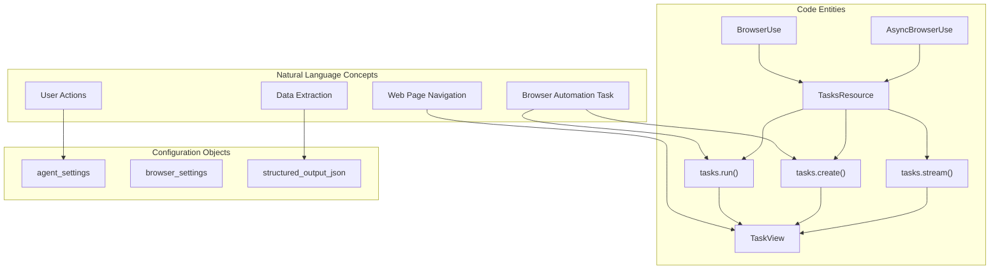

Sources: [README.md:15-25](), [examples/run.py:14-29](), [examples/create.py:14-25]()

### Simple Task Execution

The most straightforward way to execute a browser automation task:

```python
from browser_use_sdk import BrowserUse

client = BrowserUse()

result = client.tasks.run(
    task="Search for the top 10 Hacker News posts and return the title and url."
)

print(result.done_output)
```

This pattern blocks until the task completes and returns the final result in `result.done_output`.

Sources: [README.md:15-25](), [examples/run.py:14-29]()

### Task Execution Flow

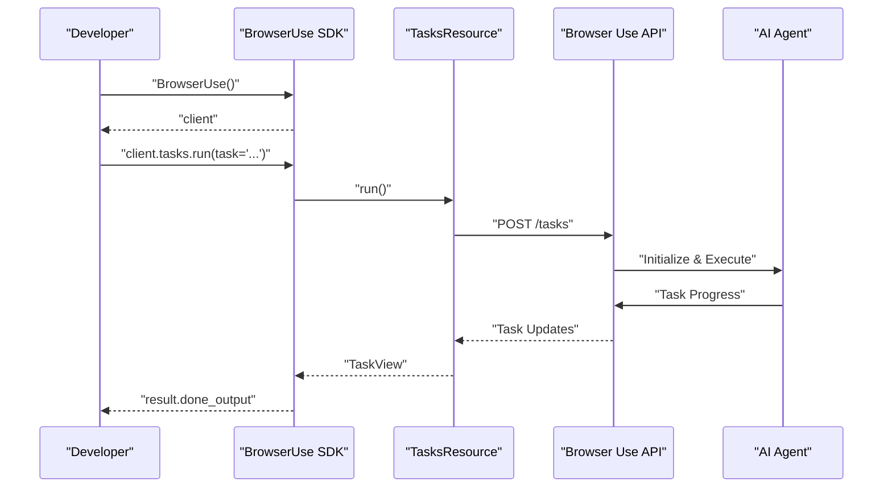

Sources: [README.md:20-24](), [examples/run.py:15-28]()

### Structured Output with Pydantic

For type-safe data extraction, use Pydantic models to define the expected output structure:

```python
from typing import List
from pydantic import BaseModel
from browser_use_sdk import BrowserUse

class HackerNewsPost(BaseModel):
    title: str
    url: str

class SearchResult(BaseModel):
    posts: List[HackerNewsPost]

client = BrowserUse()

result = client.tasks.run(
    task="Find top 10 Hacker News articles and return the title and url.",
    structured_output_json=SearchResult,
)

if result.parsed_output is not None:
    for post in result.parsed_output.posts:
        print(f" - {post.title} - {post.url}")
```

Sources: [README.md:29-55](), [examples/run.py:32-58]()

### Agent and Browser Configuration

Customize the AI agent and browser behavior using configuration parameters:

```python
result = client.tasks.run(
    task="Your automation task",
    agent_settings={"llm": "gpt-4.1"},
    browser_settings={"profile": "default"},
    metadata={"custom_key": "custom_value"}
)
```

| Parameter | Type | Description |
|-----------|------|-------------|
| `task` | `str` | Natural language description of the automation task |
| `agent_settings` | `dict` | AI agent configuration including LLM selection |
| `browser_settings` | `dict` | Browser profile and session settings |
| `structured_output_json` | `Type[BaseModel]` | Pydantic model for structured output |
| `metadata` | `dict` | Custom metadata attached to the task |

Sources: [examples/create.py:19](), [examples/run.py:19](), [examples/create.py:41]()

## Asynchronous Execution

For concurrent operations or when integrating with async frameworks:

```python
import asyncio
from browser_use_sdk import AsyncBrowserUse

async def main():
    client = AsyncBrowserUse()
    
    result = await client.tasks.run(
        task="Search for the top 10 Hacker News posts and return the title and url."
    )
    
    print(result.done_output)

asyncio.run(main())
```

The asynchronous client provides identical functionality to the synchronous version, with all methods requiring `await`.

Sources: [README.md:142-166]()

## Error Handling

The SDK provides specific exception types for different error conditions:

```python
import browser_use_sdk
from browser_use_sdk import BrowserUse

client = BrowserUse()

try:
    result = client.tasks.run(task="Your task")
except browser_use_sdk.APIConnectionError as e:
    print("Network connection error")
except browser_use_sdk.AuthenticationError as e:
    print("Invalid API key")
except browser_use_sdk.RateLimitError as e:
    print("Rate limit exceeded")
except browser_use_sdk.APIStatusError as e:
    print(f"API error: {e.status_code}")
```

| Status Code | Exception Type |
|-------------|----------------|
| 400 | `BadRequestError` |
| 401 | `AuthenticationError` |
| 403 | `PermissionDeniedError` |
| 404 | `NotFoundError` |
| 422 | `UnprocessableEntityError` |
| 429 | `RateLimitError` |
| >=500 | `InternalServerError` |

Sources: [README.md:212-244]()

## Next Steps

Once you have completed the basic setup:

- **Learn about task lifecycle management**: See [Tasks](#3.1) for detailed information about task creation, monitoring, and lifecycle management
- **Explore real-time task monitoring**: See [Task Streaming](#5.3) for streaming task updates and progress monitoring
- **Set up webhook notifications**: See [Webhooks](#5.1) for receiving real-time task status updates
- **Review complete examples**: See [Synchronous Examples](#6.1) and [Asynchronous Examples](#6.2) for comprehensive usage patterns
- **Understand the complete API**: See [Client API Reference](#4) for full method documentation

Sources: [README.md:27]()

---

# Page: Core Concepts

# Core Concepts

<details>
<summary>Relevant source files</summary>

The following files were used as context for generating this wiki page:

- [README.md](README.md)
- [src/browser_use_sdk/types/__init__.py](src/browser_use_sdk/types/__init__.py)
- [src/browser_use_sdk/types/task_item_view.py](src/browser_use_sdk/types/task_item_view.py)
- [src/browser_use_sdk/types/task_view.py](src/browser_use_sdk/types/task_view.py)

</details>


This document explains the fundamental concepts underlying the browser-use-python SDK, including tasks, sessions, profiles, and the data models that represent them. It provides a high-level overview of how these components work together to enable browser automation via the BrowserUse Cloud API.

For detailed information about specific concepts, see:
- [Tasks](#3.1) - In-depth coverage of task creation, management, and lifecycle
- [Sessions and Profiles](#3.2) - Detailed explanation of execution contexts and browser profiles
- [Data Models and Types](#3.3) - Complete reference for all data structures used in the SDK

## Fundamental Architecture

The browser-use-python SDK is built around a small set of core abstractions that enable programmatic browser automation. The primary concepts are:

1. **Tasks** - Units of browser automation work with specific goals
2. **Sessions** - Execution contexts that manage browser state and lifecycle
3. **Profiles** - Persistent browser configurations and stored data
4. **Data Models** - Strongly-typed representations of API resources

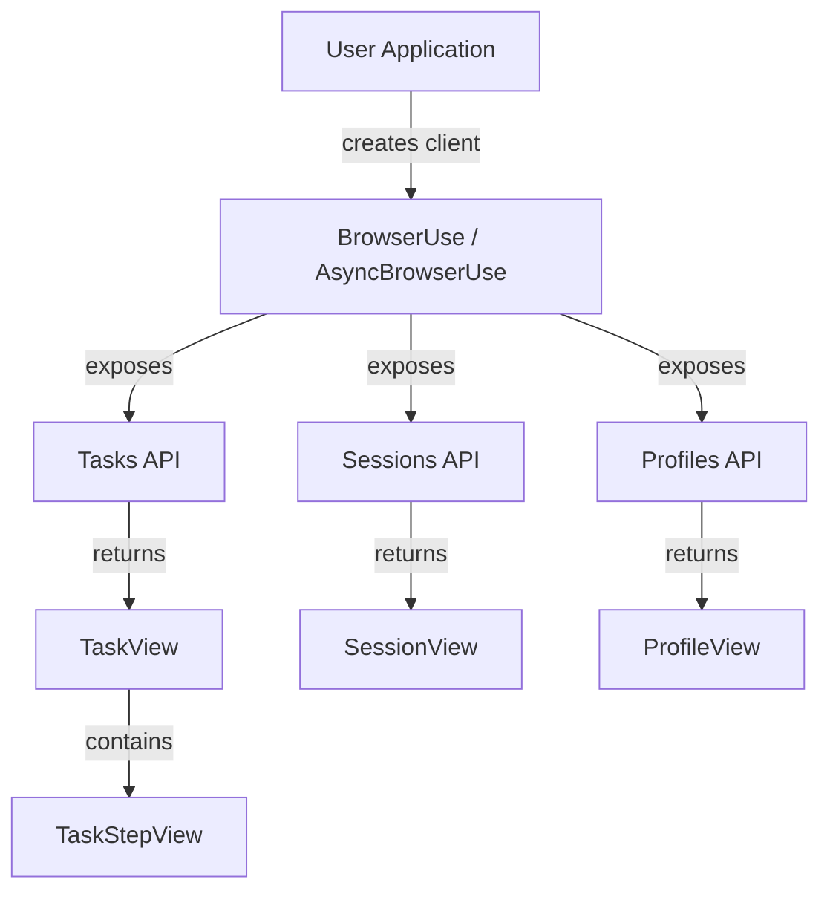

**Core SDK Architecture: Client and Resource APIs**

The SDK client ([src/browser_use_sdk/client.py]()) exposes separate API clients for each resource type. All API operations return strongly-typed data models defined in [src/browser_use_sdk/types/]().

Sources: [README.md:1-200](), [src/browser_use_sdk/types/task_view.py:1-88]()

## Tasks: The Central Abstraction

A **task** represents a single browser automation job with a specific goal. Each task is defined by a natural language prompt that describes what the agent should accomplish. Tasks are the primary way users interact with the BrowserUse system.

### Task Structure

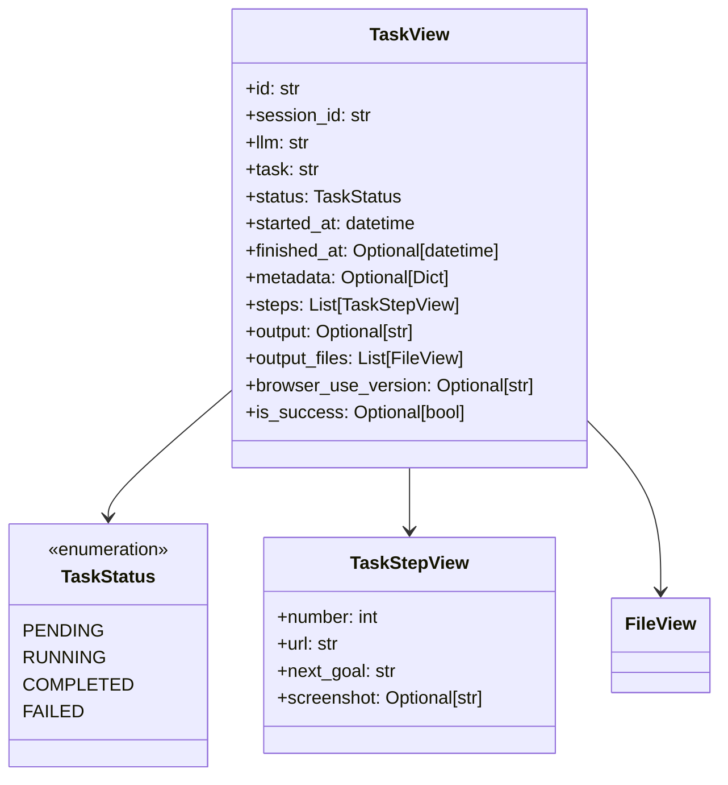

**TaskView Data Model Structure**

The `TaskView` class ([src/browser_use_sdk/types/task_view.py:16-88]()) is the primary representation of a task. Key fields include:

| Field | Type | Purpose |
|-------|------|---------|
| `id` | `str` | Unique task identifier |
| `session_id` | `str` | Associated session for browser context |
| `llm` | `str` | LLM model used (e.g., "gpt-4.1") |
| `task` | `str` | Natural language task description |
| `status` | `TaskStatus` | Current execution state |
| `steps` | `List[TaskStepView]` | Execution steps taken by the agent |
| `output` | `Optional[str]` | Final result or parsed data |
| `is_success` | `Optional[bool]` | Self-reported success indicator |

Sources: [src/browser_use_sdk/types/task_view.py:16-88](), [src/browser_use_sdk/types/task_item_view.py:14-84]()

### Task Creation and Execution

Tasks are created through the `tasks.create_task()` method and can include optional parameters for structured output, metadata, and LLM selection:

```python
# Basic task creation
task = client.tasks.create_task(
    task="Search for the top 10 Hacker News posts and return the title and url.",
    llm="gpt-4.1"
)
```

The SDK provides multiple patterns for task execution:
- **Blocking completion**: `task.complete()` waits for task to finish
- **Streaming updates**: `task.stream()` yields real-time progress
- **Polling**: `client.tasks.get_task(task_id)` retrieves current state

Sources: [README.md:29-42](), [README.md:162-181]()

## Sessions: Execution Context

A **session** represents a browser execution context. Each task is associated with a session, which maintains browser state, cookies, and navigation history throughout the task lifecycle. Sessions can be:

- **Ephemeral**: Created automatically and destroyed after task completion
- **Persistent**: Explicitly created and reused across multiple tasks

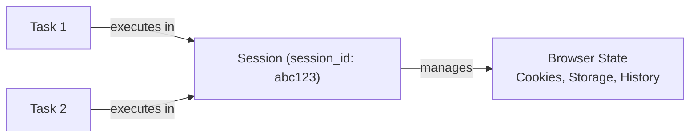

**Session Management and Task Association**

When a task specifies a `session_id`, it executes within that session's browser context, allowing state to persist across multiple tasks. The `session_id` field in `TaskView` ([src/browser_use_sdk/types/task_view.py:26]()) links each task to its execution session.

Sources: [src/browser_use_sdk/types/task_view.py:26](), [src/browser_use_sdk/types/task_item_view.py:24-27]()

## Profiles: Browser Configuration

A **profile** is a persistent browser configuration that stores settings, extensions, and user data. Profiles allow tasks to:

- Maintain logged-in state across sessions
- Use specific browser configurations
- Preserve cookies and local storage
- Apply custom browser extensions

Profiles are managed through the `profiles` API and can be associated with sessions to provide a specific browser environment for task execution.

Sources: [README.md:1-200]()

## Task Lifecycle and State Transitions

Tasks progress through a well-defined lifecycle from creation to completion:

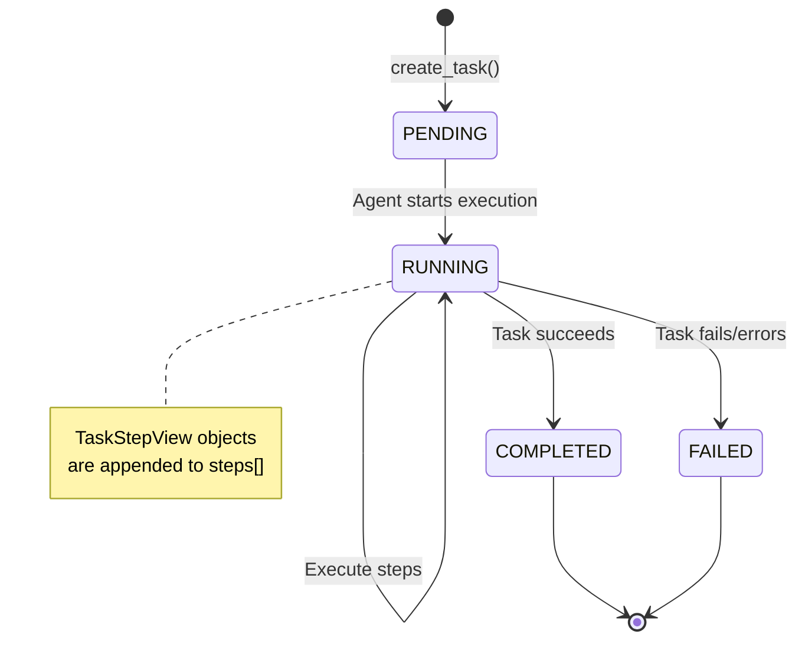

**Task State Transitions**

The `TaskStatus` enum defines the possible states. During execution, the `steps` field ([src/browser_use_sdk/types/task_view.py:59]()) is progressively populated with `TaskStepView` objects representing each action taken by the agent.

### Task Timestamps

Tasks track execution timing through two datetime fields:

- `started_at` ([src/browser_use_sdk/types/task_view.py:42-45]()): UTC timestamp when task began execution
- `finished_at` ([src/browser_use_sdk/types/task_view.py:47-52]()): UTC timestamp when task completed (or `None` if still running)

These timestamps enable duration calculation and execution monitoring.

Sources: [src/browser_use_sdk/types/task_view.py:37-52](), [src/browser_use_sdk/types/task_item_view.py:39-50]()

## Real-time Updates via Streaming

The SDK provides a streaming interface for receiving real-time task progress updates without manual polling:

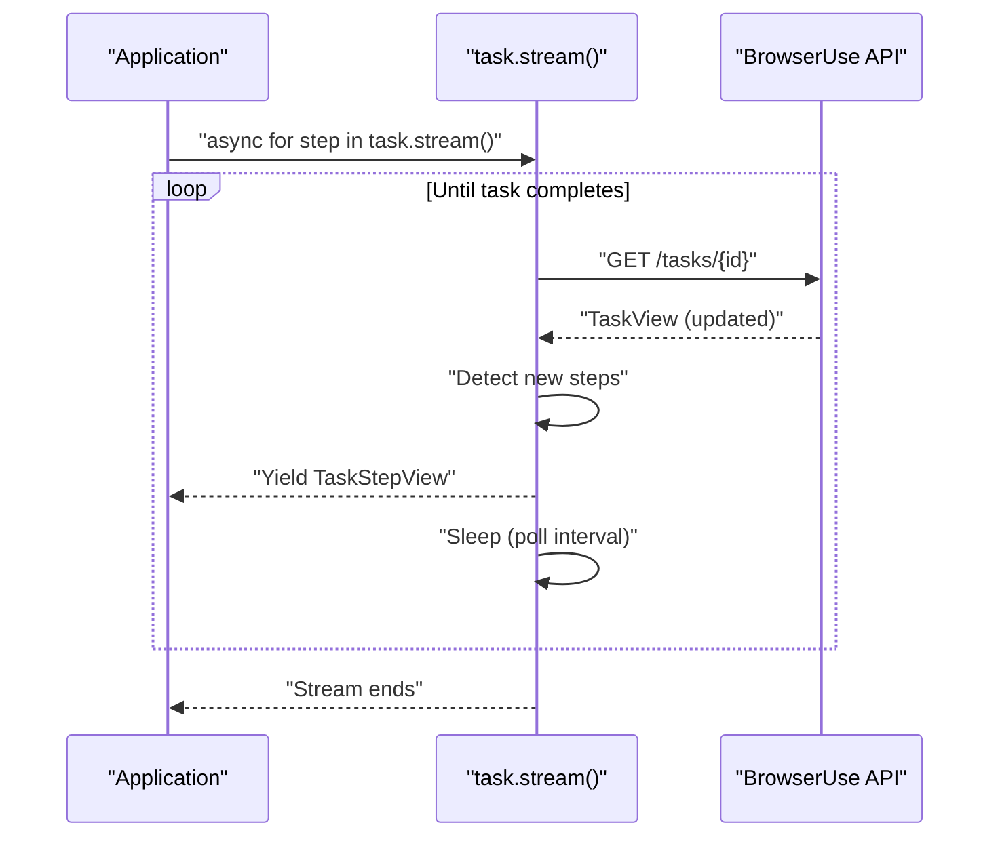

**Streaming Implementation Pattern**

The `.stream()` method ([README.md:84-114]()) returns an async generator that automatically polls the API and yields `TaskStepView` objects as the agent progresses through the task.

### Streaming Usage Pattern

```python
async for step in task.stream():
    print(f"Step {step.number}: {step.url} ({step.next_goal})")
```

This pattern allows applications to display live progress updates without implementing manual polling logic.

Sources: [README.md:80-114]()

## Structured Output with Pydantic Schemas

Tasks can return structured data by specifying a Pydantic model as the `schema` parameter. The SDK automatically parses the task output into the specified model:

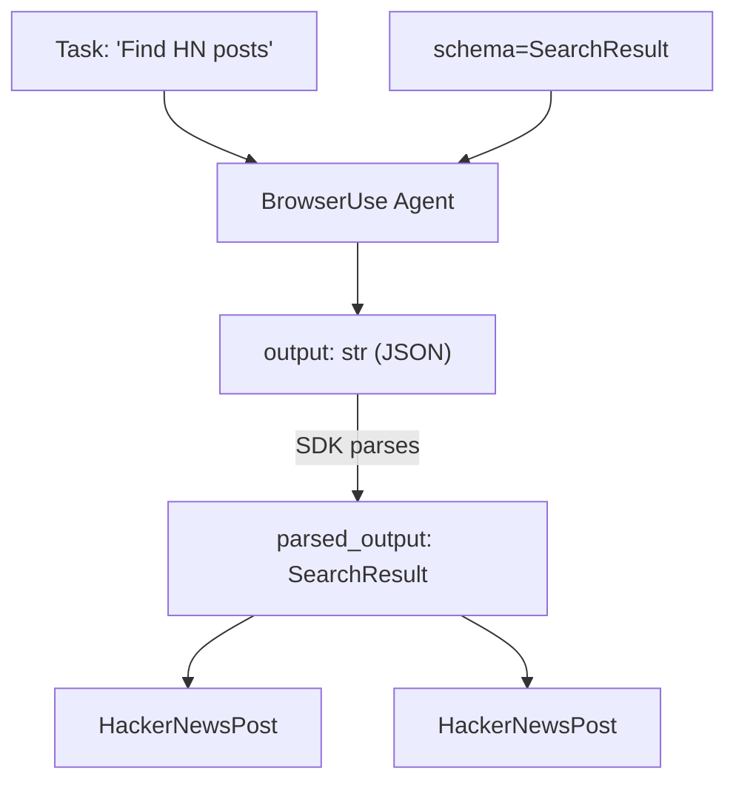

**Structured Output Data Flow**

When a `schema` is provided to `create_task()`, the agent formats its output as JSON matching the schema. The SDK parses this and populates the `parsed_output` field with a validated Pydantic instance.

### Schema Definition Example

The `output` field ([src/browser_use_sdk/types/task_view.py:60-63]()) contains the raw string output, while `parsed_output` (when using schemas) contains the validated Pydantic model instance. This is demonstrated in [README.md:50-78]():

```python
class HackerNewsPost(BaseModel):
    title: str
    url: str

class SearchResult(BaseModel):
    posts: List[HackerNewsPost]

task = await client.tasks.create_task(
    task="Find top 10 Hacker News articles",
    schema=SearchResult,
)
result = await task.complete()
# result.parsed_output is now a SearchResult instance
```

Sources: [README.md:46-78](), [src/browser_use_sdk/types/task_view.py:60-63]()

## Task Metadata and Custom Fields

Tasks support arbitrary metadata through the `metadata` field ([src/browser_use_sdk/types/task_view.py:54-57]()):

```python
task = client.tasks.create_task(
    task="...",
    metadata={"user_id": "123", "source": "api", "priority": "high"}
)
```

This `Dict[str, Any]` field allows applications to attach custom data to tasks for tracking, filtering, or business logic purposes. The metadata is stored with the task and returned in both `TaskView` and `TaskItemView` representations.

Sources: [src/browser_use_sdk/types/task_view.py:54-57](), [src/browser_use_sdk/types/task_item_view.py:52-55]()

## Task Output Artifacts

In addition to text output, tasks can produce files that are accessible through the `output_files` field ([src/browser_use_sdk/types/task_view.py:65]()). This field contains a list of `FileView` objects representing screenshots, downloads, or other artifacts generated during task execution.

### Success Indicator

The `is_success` field ([src/browser_use_sdk/types/task_view.py:73-78]()) is a self-reported boolean indicating whether the agent believes it successfully completed the task. This is distinct from the `status` field, which tracks execution state. A task can have `status=COMPLETED` but `is_success=False` if the agent finished execution but failed to achieve the goal.

Sources: [src/browser_use_sdk/types/task_view.py:65-78](), [src/browser_use_sdk/types/task_item_view.py:62-74]()

## Data Model Variants

The SDK provides two representations of tasks:

| Model | Use Case | Fields |
|-------|----------|--------|
| `TaskView` | Detailed single task retrieval | Full details including `steps`, `output_files` |
| `TaskItemView` | List operations | Lightweight, excludes `steps` and `output_files` |

`TaskItemView` ([src/browser_use_sdk/types/task_item_view.py:14-84]()) is optimized for listing many tasks by omitting large fields like the step-by-step history. Both models share core fields like `id`, `session_id`, `status`, `output`, and `is_success`.

Sources: [src/browser_use_sdk/types/task_view.py:16-88](), [src/browser_use_sdk/types/task_item_view.py:14-84]()

## Version Tracking

The `browser_use_version` field ([src/browser_use_sdk/types/task_view.py:66-71]()) tracks which version of the underlying browser-use library was used to execute the task. This is useful for debugging and understanding behavior changes across versions. Older tasks may not have this field populated.

Sources: [src/browser_use_sdk/types/task_view.py:66-71](), [src/browser_use_sdk/types/task_item_view.py:62-67]()

---

# Page: Tasks

# Tasks

<details>
<summary>Relevant source files</summary>

The following files were used as context for generating this wiki page:

- [README.md](README.md)
- [src/browser_use_sdk/tasks/raw_client.py](src/browser_use_sdk/tasks/raw_client.py)
- [src/browser_use_sdk/types/task_item_view.py](src/browser_use_sdk/types/task_item_view.py)
- [src/browser_use_sdk/types/task_view.py](src/browser_use_sdk/types/task_view.py)
- [src/browser_use_sdk/types/too_many_concurrent_active_sessions_error.py](src/browser_use_sdk/types/too_many_concurrent_active_sessions_error.py)

</details>


This document covers the core task functionality in the browser-use-sdk, including task creation, execution, monitoring, and management. Tasks represent individual AI agent jobs that perform web automation within browser sessions.

For information about session and profile management, see [Sessions and Profiles](#3.2). For webhook notifications about task events, see [Webhooks](#5.1). For structured output configuration, see [Structured Output](#5.2). For real-time task monitoring, see [Task Streaming](#5.3).

## Overview

Tasks are the fundamental unit of work in the browser-use-sdk. Each task represents a specific instruction given to an AI agent, such as "fill out this form" or "extract data from this website". Tasks execute within browser sessions and can either start new sessions or continue existing ones.

The task system provides two main interfaces: `TasksResource` for synchronous operations and `AsyncTasksResource` for asynchronous operations, both located in [src/browser_use_sdk/resources/tasks.py]().

Sources: [src/browser_use_sdk/resources/tasks.py:41-42](), [src/browser_use_sdk/resources/tasks.py:835-836]()

## Task Lifecycle

### Task States

Tasks progress through a defined lifecycle with the following states:

| State | Description |
|-------|-------------|
| `started` | Task is currently running |
| `paused` | Task execution temporarily suspended (can be resumed) |
| `finished` | Task completed successfully |
| `stopped` | Task manually terminated (cannot be resumed) |

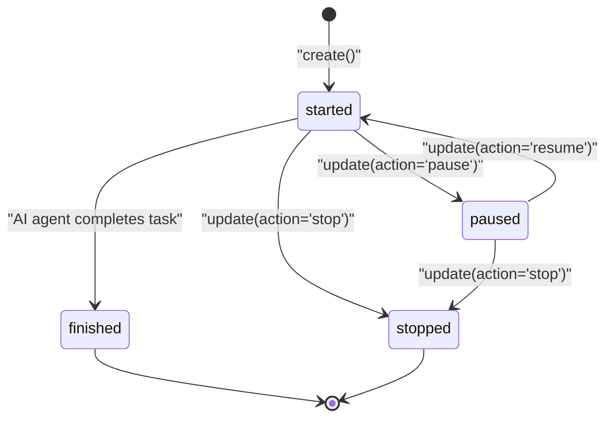

**Task Lifecycle State Machine**

Sources: [src/browser_use_sdk/types/task_view.py:56-63](), [src/browser_use_sdk/resources/tasks.py:524](), [src/browser_use_sdk/resources/tasks.py:1325]()

### Task Execution Flow

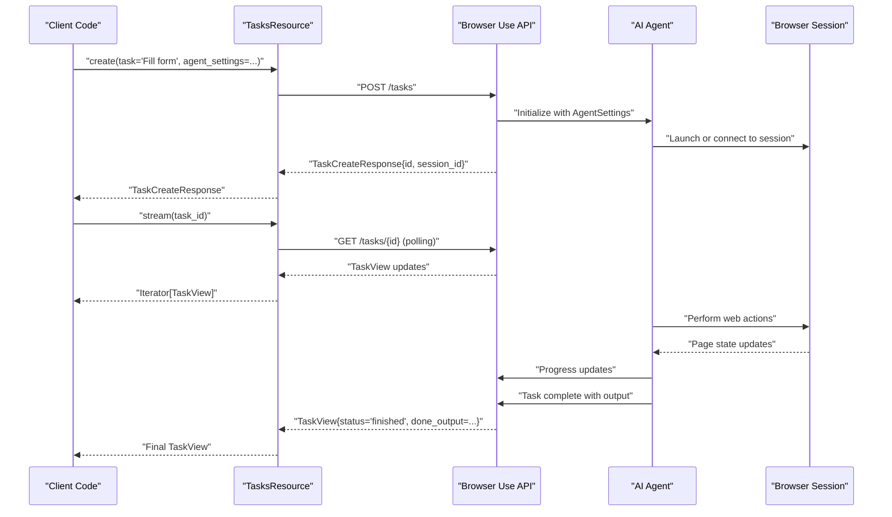

**Task Execution Sequence with Code Entities**

Sources: [src/browser_use_sdk/resources/tasks.py:199-307](), [src/browser_use_sdk/resources/tasks.py:444-483]()

## Task Execution Patterns

### Simple Task Execution

The `run()` method provides a simplified interface that combines task creation, execution, and completion waiting:

```python
# Synchronous execution
result = client.tasks.run(
    task="Navigate to example.com and extract the page title",
    agent_settings={"llm": "gpt-4o"},
    browser_settings={"profile_id": "my-profile"}
)

# Asynchronous execution
result = await client.tasks.run(
    task="Fill out the contact form",
    agent_settings={"llm": "gpt-4o"}
)
```

The `run()` method internally calls `create()` followed by `stream()` and returns when the task reaches `finished` status.

Sources: [src/browser_use_sdk/resources/tasks.py:99-159](), [src/browser_use_sdk/resources/tasks.py:893-953]()

### Streaming Task Execution

For real-time monitoring, use the `create()` and `stream()` methods separately:

```python
# Create task
task_response = client.tasks.create(
    task="Extract product data from e-commerce site",
    agent_settings={"llm": "gpt-4o", "start_url": "https://example.com"}
)

# Stream progress updates
for task_view in client.tasks.stream(task_response.id):
    print(f"Status: {task_view.status}, Steps: {len(task_view.steps)}")
    if task_view.status == "finished":
        break
```

The `stream()` method uses polling via the private `_watch()` method with hash-based change detection to efficiently stream updates.

Sources: [src/browser_use_sdk/resources/tasks.py:444-483](), [src/browser_use_sdk/resources/tasks.py:485-518]()

### Structured Output Execution

Tasks can return structured data using Pydantic models:

```python
from pydantic import BaseModel

class ProductData(BaseModel):
    name: str
    price: float
    in_stock: bool

# Returns TaskViewWithOutput[ProductData] with parsed_output field
result = client.tasks.run(
    task="Extract product information",
    structured_output_json=ProductData
)

product = result.parsed_output  # Type: ProductData
```

Structured output is handled by overloaded methods that accept `type[BaseModel]` parameters and return `TaskViewWithOutput[T]` objects.

Sources: [src/browser_use_sdk/resources/tasks.py:80-97](), [src/browser_use_sdk/lib/parse.py:26]()

## Task Configuration

### Agent Settings

The `AgentSettings` class configures the AI agent behavior:

| Parameter | Type | Description |
|-----------|------|-------------|
| `llm` | `Literal` | LLM model selection (gpt-4o, claude-3-5-sonnet, etc.) |
| `profile_id` | `Optional[str]` | Agent profile ID for custom behavior |
| `start_url` | `Optional[str]` | Initial URL (not modified as a step) |

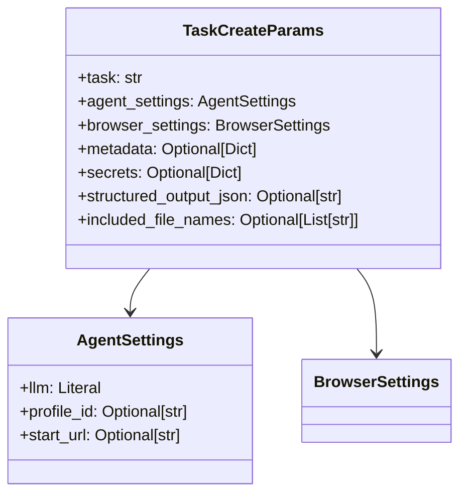

**Task Configuration Class Structure**

Sources: [src/browser_use_sdk/types/task_create_params.py:41-59](), [src/browser_use_sdk/types/task_create_params.py:13-39]()

### Browser Settings

The `BrowserSettings` class controls browser session behavior:

| Parameter | Type | Description |
|-----------|------|-------------|
| `session_id` | `Optional[str]` | Continue existing session |
| `profile_id` | `Optional[str]` | Browser profile for new session |

Use `session_id` to continue an existing browser session (no additional startup costs) or `profile_id` to start a new session with specific browser configuration.

Sources: [src/browser_use_sdk/types/task_create_params.py:61-64]()

### File and Metadata Configuration

Tasks support additional configuration options:

- **File Uploads**: `included_file_names` references files uploaded to your account
- **Metadata**: `metadata` adds custom key-value pairs for tracking
- **Secrets**: `secrets` provides secure configuration values to the agent
- **Structured Output**: `structured_output_json` defines expected response format

Sources: [src/browser_use_sdk/types/task_create_params.py:32-38]()

## Task Monitoring and Control

### Task Information Retrieval

The `retrieve()` method fetches current task status and details:

```python
task_view = client.tasks.retrieve(task_id)

print(f"Status: {task_view.status}")
print(f"Steps completed: {len(task_view.steps)}")
print(f"Output files: {len(task_view.output_files)}")
```

The `TaskView` object contains comprehensive task information including session details, execution steps, and file references.

Sources: [src/browser_use_sdk/resources/tasks.py:336-414](), [src/browser_use_sdk/types/task_view.py:34-80]()

### Task Control Operations

The `update()` method controls task execution:

| Action | Description |
|--------|-------------|
| `stop` | Terminate current task |
| `pause` | Suspend task (resumable) |
| `resume` | Continue paused task |
| `stop_task_and_session` | Stop task and end browser session |

```python
# Pause a running task
client.tasks.update(task_id, action="pause")

# Resume a paused task
client.tasks.update(task_id, action="resume")

# Stop task and session
client.tasks.update(task_id, action="stop_task_and_session")
```

Sources: [src/browser_use_sdk/resources/tasks.py:520-586]()

### Task Listing and Filtering

The `list()` method provides paginated access to tasks with filtering options:

```python
# List recent tasks
tasks = client.tasks.list(page_size=20)

# Filter by status
running_tasks = client.tasks.list(filter_by="started")

# Filter by session
session_tasks = client.tasks.list(session_id="session-123")

# Date range filtering
recent_tasks = client.tasks.list(
    after="2024-01-01T00:00:00Z",
    before="2024-01-31T23:59:59Z"
)
```

Sources: [src/browser_use_sdk/resources/tasks.py:588-654]()

## File Handling

### Task Logs

The `get_logs()` method provides access to detailed execution logs:

```python
logs_response = client.tasks.get_logs(task_id)
download_url = logs_response.download_url
```

Task logs contain step-by-step reasoning, actions taken, error messages, and performance metrics useful for debugging and optimization.

Sources: [src/browser_use_sdk/resources/tasks.py:656-715]()

### Output Files

AI agents can generate various output files during execution. Access them via `get_output_file()`:

```python
# Get specific output file
file_response = client.tasks.get_output_file(
    task_id=task_id,
    file_id=file_id
)
download_url = file_response.download_url
```

Output files include screenshots, extracted data (CSV/JSON), generated reports, and downloaded web content.

Sources: [src/browser_use_sdk/resources/tasks.py:717-775]()

### User Uploaded Files

Access files that were uploaded for the task via `get_user_uploaded_file()`:

```python
# Get user uploaded file used in task
file_response = client.tasks.get_user_uploaded_file(
    task_id=task_id,
    file_id=file_id
)
download_url = file_response.download_url
```

These are files referenced by `included_file_names` during task creation.

Sources: [src/browser_use_sdk/resources/tasks.py:777-832]()

## Implementation Details

### Resource Class Hierarchy

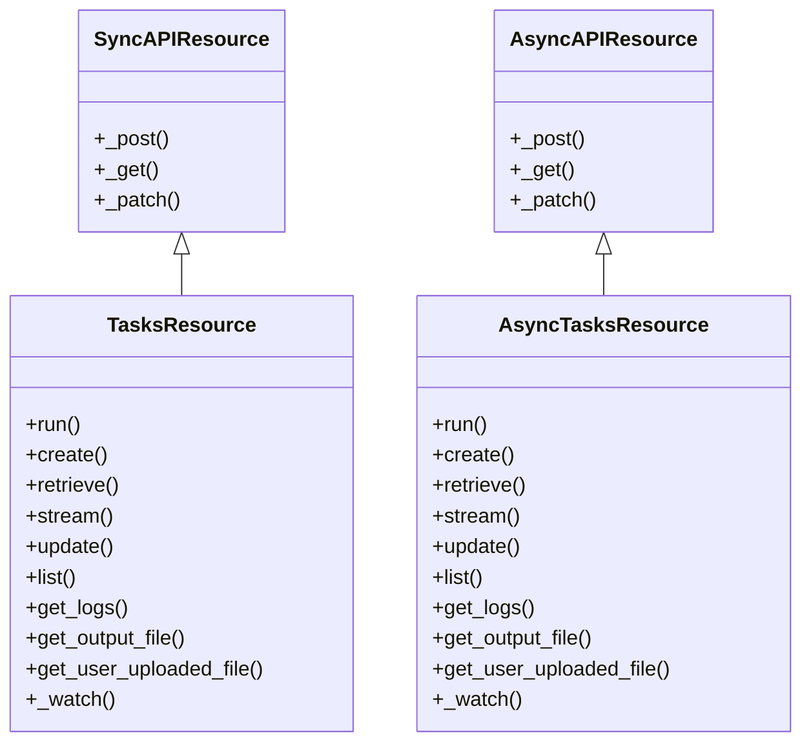

**Tasks Resource Class Hierarchy**

### Streaming Implementation

The streaming functionality uses a polling-based approach with hash-based change detection:

1. `stream()` calls the private `_watch()` method
2. `_watch()` polls `retrieve()` at regular intervals (default 1 second)
3. `hash_task_view()` detects changes to avoid duplicate updates
4. Streaming stops when task reaches terminal state (`finished`, `stopped`, `paused`)

The async implementation includes additional state checking and uses `asyncio.sleep()` for non-blocking waits.

Sources: [src/browser_use_sdk/resources/tasks.py:485-518](), [src/browser_use_sdk/resources/tasks.py:1279-1319](), [src/browser_use_sdk/lib/parse.py:26]()

### Type Safety and Overloads

The task methods use Python's `@overload` decorator to provide type-safe interfaces for structured output:

- Methods without `structured_output_json` return `TaskView`
- Methods with `structured_output_json: type[T]` return `TaskViewWithOutput[T]`
- Runtime logic handles both cases in a single implementation

This enables full type checking while maintaining a clean API.

Sources: [src/browser_use_sdk/resources/tasks.py:61-97](), [src/browser_use_sdk/resources/tasks.py:309-347]()

---

# Page: Sessions and Profiles

# Sessions and Profiles

<details>
<summary>Relevant source files</summary>

The following files were used as context for generating this wiki page:

- [src/browser_use_sdk/sessions/client.py](src/browser_use_sdk/sessions/client.py)
- [src/browser_use_sdk/types/session_list_response.py](src/browser_use_sdk/types/session_list_response.py)

</details>


## Purpose and Scope

This page explains the core concepts of **sessions** and **browser profiles** in the browser-use SDK. It covers what these entities are, how they relate to each other and to tasks, and their role in managing browser automation workflows. For detailed API documentation on session and profile management methods, see [Session and Profile Management](#4.2). For information about tasks and their execution, see [Tasks](#3.1).

---

## Overview

Sessions and profiles are fundamental building blocks for organizing browser automation work in the browser-use SDK. A **session** represents an active browser instance running on the BrowserUse Cloud platform, while a **profile** provides persistent browser state (cookies, local storage, authentication, etc.) that can be reused across multiple sessions.

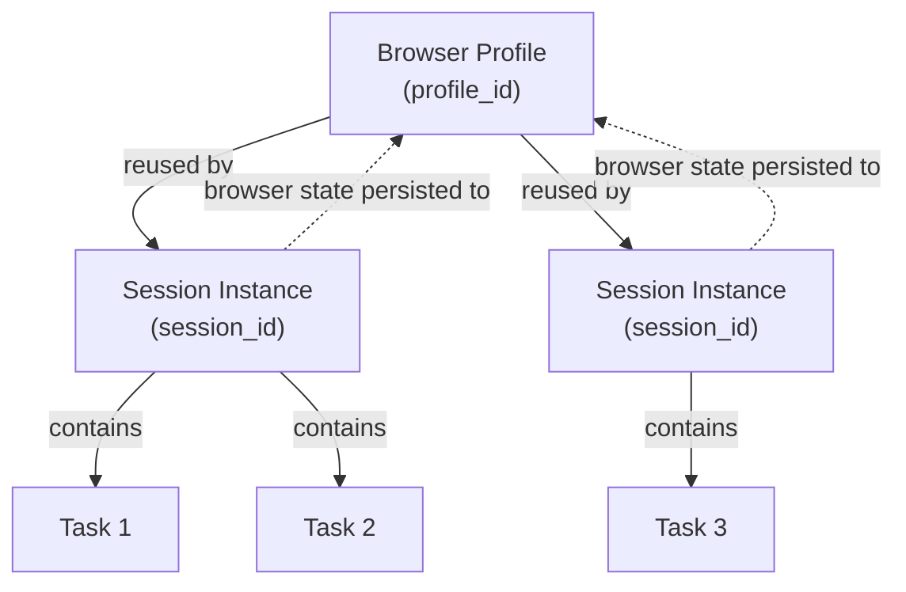

**Sources:** [src/browser_use_sdk/sessions/client.py:75-113]()

---

## Sessions

### What is a Session?

A **session** is a browser instance that runs on the BrowserUse Cloud infrastructure. Each session:

- Has a unique `session_id` identifier
- Maintains browser state (tabs, cookies, DOM, etc.) during its lifetime
- Can execute one or more tasks sequentially
- May be associated with a browser profile for state persistence
- Can be configured with proxy settings for geo-location

Sessions are represented in code by the `SessionView` and `SessionItemView` types, which contain session metadata including status, URLs, and associated task information.

### Session States

Sessions have a lifecycle tracked through `SessionStatus`:

| Status | Description |
|--------|-------------|
| `ACTIVE` | Session is running and can execute tasks |
| `STOPPED` | Session has been terminated |
| `PENDING` | Session is being provisioned |
| `FAILED` | Session failed to initialize |

**Sources:** [src/browser_use_sdk/sessions/client.py:1-13](), [src/browser_use_sdk/types/session_view.py]()

### Session Creation

Sessions are created via the `create_session()` method on both `SessionsClient` and `AsyncSessionsClient`. At creation time, you can specify:

- **`profile_id`** (optional): The ID of a browser profile to associate with the session
- **`proxy_country_code`** (optional): Country code for proxy location (type: `ProxyCountryCode`)

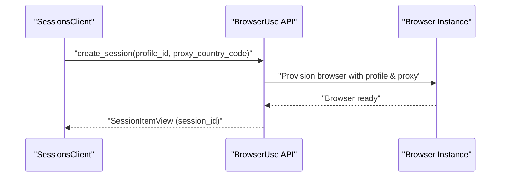

**Sources:** [src/browser_use_sdk/sessions/client.py:75-113](), [src/browser_use_sdk/sessions/client.py:337-383]()

### Session Lifecycle Management

The SDK provides methods to manage the session lifecycle:

| Method | Description | Returns |
|--------|-------------|---------|
| `list_sessions()` | Get paginated list of sessions with optional status filtering | `SessionListResponse` |
| `create_session()` | Create a new session | `SessionItemView` |
| `get_session()` | Get detailed session information | `SessionView` |
| `update_session()` | Stop a session and all its running tasks | `SessionView` |

**Sources:** [src/browser_use_sdk/sessions/client.py:34-175]()

---

## Browser Profiles

### What is a Browser Profile?

A **browser profile** is a persistent container for browser state that can be reused across multiple sessions. Profiles store:

- Cookies and authentication tokens
- Local storage and session storage
- Browser history
- Cache
- Extension state
- User preferences

Profiles enable use cases such as:
- Maintaining logged-in state across sessions
- Reusing authentication without re-login
- Preserving site-specific settings
- Testing with consistent user state

### Profile Association

When creating a session, you can optionally specify a `profile_id` to associate the session with an existing profile. If no profile is specified, the session runs in an ephemeral state without persistence.

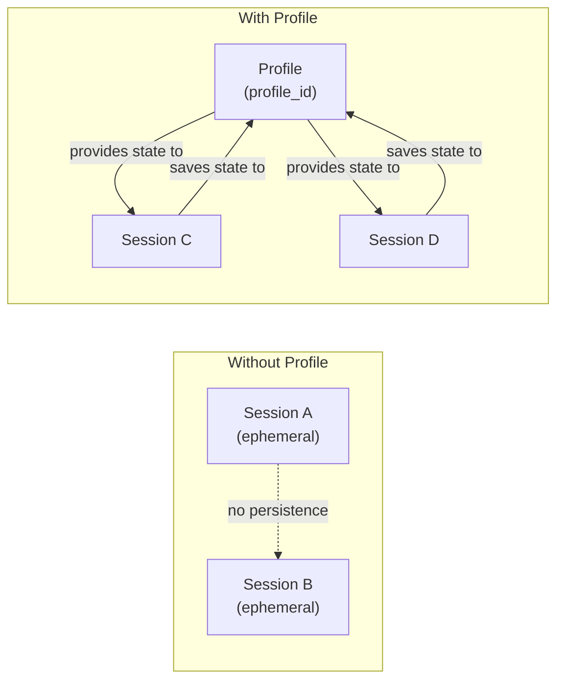

**Sources:** [src/browser_use_sdk/sessions/client.py:78-88](), [src/browser_use_sdk/sessions/client.py:349-350]()

### Profile Management

Profile creation and management is handled through the `ProfilesClient` (documented in detail in [Session and Profile Management](#4.2)). The profile ID can then be passed to `create_session()` to associate a session with that profile.

**Sources:** [src/browser_use_sdk/profiles/client.py]()

---

## Session-Task Relationship

Sessions and tasks have a one-to-many relationship: a single session can contain and execute multiple tasks. Tasks are executed sequentially within a session, maintaining browser state between tasks.

```mermaid
graph TD
    Session["Session<br/>(session_id: 's123')"]
    Task1["Task 1<br/>(task_id: 't1')<br/>status: COMPLETED"]
    Task2["Task 2<br/>(task_id: 't2')<br/>status: RUNNING"]
    Task3["Task 3<br/>(task_id: 't3')<br/>status: PENDING"]
    
    Session -->|"contains"| Task1
    Session -->|"contains"| Task2
    Session -->|"contains"| Task3
    
    Task1 -->|"state flows to"| Task2
    Task2 -->|"state flows to"| Task3
```

### Retrieving Session Information

The `SessionView` type returned by `get_session()` contains comprehensive information about the session including:

- Session ID and status
- Associated profile ID (if any)
- Proxy configuration
- List of tasks executed in the session
- URLs for accessing the session

This allows you to monitor all tasks within a session and understand the complete execution context.

**Sources:** [src/browser_use_sdk/sessions/client.py:115-143](), [src/browser_use_sdk/types/session_view.py]()

---

## Session Sharing

Sessions can be shared publicly via a share URL, enabling others to view the session execution without authentication. This is useful for:

- Debugging and troubleshooting
- Demonstrating automation workflows
- Sharing results with team members
- Creating public examples

```mermaid
graph LR
    Session["Session<br/>(session_id)"]
    Share["ShareView<br/>(share URL)"]
    Stats["Usage Statistics<br/>(views, access count)"]
    
    Session -->|"create_session_public_share()"| Share
    Share -->|"contains"| Stats
    Session -->|"get_session_public_share()"| Share
    Session -->|"delete_session_public_share()"| Share
```

### Share Management Methods

| Method | Purpose | Returns |
|--------|---------|---------|
| `create_session_public_share()` | Create or return existing public share | `ShareView` |
| `get_session_public_share()` | Get existing public share information | `ShareView` |
| `delete_session_public_share()` | Remove public share access | `None` |

The `ShareView` object contains the public URL and usage statistics for the shared session.

**Sources:** [src/browser_use_sdk/sessions/client.py:177-270](), [src/browser_use_sdk/sessions/client.py:465-582]()

---

## Proxy Configuration

Sessions can be configured to use proxies for geo-location and IP address management. When creating a session, you can specify a `proxy_country_code` parameter to route the browser traffic through a specific country.

```mermaid
graph LR
    CreateReq["create_session()<br/>proxy_country_code='US'"]
    Session["Session Instance"]
    Proxy["US Proxy Server"]
    Target["Target Website"]
    
    CreateReq -->|"provisions"| Session
    Session -->|"routes through"| Proxy
    Proxy -->|"accesses"| Target
    Target -.->|"sees US IP"| Proxy
```

The `ProxyCountryCode` type defines valid country codes that can be used for proxy configuration. This feature is useful for:

- Testing geo-restricted content
- Simulating users from different regions
- Accessing region-specific services
- Bypassing IP-based restrictions

**Sources:** [src/browser_use_sdk/sessions/client.py:79-80](), [src/browser_use_sdk/sessions/client.py:340-342](), [src/browser_use_sdk/types/proxy_country_code.py]()

---

## Code Entity Reference

The following table maps conceptual entities to their code implementations:

| Concept | Primary Type | Client Methods | Location |
|---------|--------------|----------------|----------|
| Session | `SessionView`, `SessionItemView` | `create_session()`, `get_session()`, `update_session()`, `list_sessions()` | [src/browser_use_sdk/sessions/client.py:19-271]() |
| Profile | `ProfileView` (implied) | Via `ProfilesClient` | [src/browser_use_sdk/profiles/client.py]() |
| Session List | `SessionListResponse` | `list_sessions()` | [src/browser_use_sdk/types/session_list_response.py:13-46]() |
| Session Status | `SessionStatus` | Used in filtering and status tracking | [src/browser_use_sdk/types/session_status.py]() |
| Session Share | `ShareView` | `create_session_public_share()`, `get_session_public_share()`, `delete_session_public_share()` | [src/browser_use_sdk/sessions/client.py:177-270]() |
| Proxy Config | `ProxyCountryCode` | Parameter in `create_session()` | [src/browser_use_sdk/types/proxy_country_code.py]() |

**Sources:** [src/browser_use_sdk/sessions/client.py:1-583](), [src/browser_use_sdk/types/session_list_response.py:1-46]()

---

## Pagination

Session lists are paginated for efficient retrieval. The `list_sessions()` method accepts pagination parameters:

| Parameter | Type | Description |
|-----------|------|-------------|
| `page_size` | `int` (optional) | Number of items per page |
| `page_number` | `int` (optional) | Page number to retrieve (0-indexed) |
| `filter_by` | `SessionStatus` (optional) | Filter sessions by status |

The response (`SessionListResponse`) includes pagination metadata:

- `items`: List of `SessionItemView` objects for the current page
- `total_items`: Total number of sessions matching the filter
- `page_number`: Current page number
- `page_size`: Number of items per page

**Sources:** [src/browser_use_sdk/sessions/client.py:34-73](), [src/browser_use_sdk/types/session_list_response.py:13-46]()

---

# Page: Data Models and Types

# Data Models and Types

<details>
<summary>Relevant source files</summary>

The following files were used as context for generating this wiki page:

- [src/browser_use_sdk/types/__init__.py](src/browser_use_sdk/types/__init__.py)
- [src/browser_use_sdk/types/task_item_view.py](src/browser_use_sdk/types/task_item_view.py)
- [src/browser_use_sdk/types/task_view.py](src/browser_use_sdk/types/task_view.py)

</details>


This page provides an overview of the type system, data models, and parameter structures used throughout the browser-use-sdk. It covers the organizational patterns, base types, and conventions that define how data flows through the SDK.

For specific usage of these types in task operations, see [Tasks](#3.1). For API method signatures that use these types, see [Client API Reference](#4). For advanced type-safe output handling, see [Structured Output](#5.2).

## Type System Overview

The browser-use-sdk uses a comprehensive type system built on Pydantic models to provide type safety and runtime validation. All types are automatically generated from an API definition using Fern and organized into distinct categories based on their purpose. The SDK supports both Pydantic v1 and v2 with conditional configuration.

```mermaid
graph TB
    subgraph "Type Categories"
        ViewModels["View Models<br/>*View classes"]
        ParamTypes["Parameter Types<br/>*Params classes"]
        ResponseTypes["Response Types<br/>*Response classes"]
        StatusEnums["Status Enums<br/>TaskStatus, SessionStatus"]
        FileTypes["File Types<br/>FileView"]
    end
    
    subgraph "Core Base Types"
        UncheckedBaseModel["UncheckedBaseModel<br/>from core.unchecked_base_model"]
        PydanticField["pydantic.Field()<br/>for field definitions"]
        FieldMetadata["FieldMetadata<br/>for aliases and metadata"]
        TypedDict["TypedDict<br/>for parameters"]
    end
    
    subgraph "Generated Structure"
        FernGenerator["Fern API Definition<br/>Source of truth"]
        IndividualFiles["Individual type files<br/>task_view.py, task_item_view.py, etc."]
        TypesPackage["types/ package<br/>Auto-generated models"]
    end
    
    ViewModels --> UncheckedBaseModel
    ViewModels --> PydanticField
    ViewModels --> FieldMetadata
    ParamTypes --> TypedDict
    ResponseTypes --> UncheckedBaseModel
    StatusEnums --> UncheckedBaseModel
    FileTypes --> UncheckedBaseModel
    
    FernGenerator --> TypesPackage
    TypesPackage --> IndividualFiles
    IndividualFiles --> ViewModels
    IndividualFiles --> ParamTypes
    IndividualFiles --> ResponseTypes
```

**Sources:** [src/browser_use_sdk/types/task_view.py:1-11](), [src/browser_use_sdk/types/task_item_view.py:1-12]()

## View Models

View models represent data entities returned by the API. These models use `BaseModel` as their foundation and include field aliases to map between Python naming conventions and API field names.

### Task Data Models

```mermaid
graph TB
    subgraph "Task View Hierarchy"
        TaskView["TaskView<br/>Complete task details"]
        TaskItemView["TaskItemView<br/>List item representation"]
        TaskStepView["TaskStepView<br/>Individual step data"]
        FileView["FileView<br/>Output file data"]
    end
    
    subgraph "TaskView Exclusive"
        StepsField["steps: List[TaskStepView]"]
        OutputFilesField["output_files: List[FileView]"]
    end
    
    subgraph "Shared Fields"
        CoreFields["id: str<br/>task: str<br/>status: TaskStatus<br/>llm: str<br/>session_id: str"]
        TimeFields["started_at: datetime<br/>finished_at: Optional[datetime]"]
        OutputFields["output: Optional[str]<br/>is_success: Optional[bool]<br/>browser_use_version: Optional[str]"]
        MetadataField["metadata: Optional[Dict[str, Any]]"]
    end
    
    subgraph "Field Patterns"
        AliasPattern["Field aliases via FieldMetadata:<br/>started_at -> startedAt<br/>finished_at -> finishedAt<br/>session_id -> sessionId<br/>output_files -> outputFiles<br/>browser_use_version -> browserUseVersion<br/>is_success -> isSuccess"]
    end
    
    TaskView --> CoreFields
    TaskView --> StepsField
    TaskView --> OutputFilesField
    TaskItemView --> CoreFields
    CoreFields --> TimeFields
    CoreFields --> OutputFields
    CoreFields --> MetadataField
    TimeFields --> AliasPattern
    OutputFields --> AliasPattern
```

#### TaskView

The `TaskView` class represents complete task execution details with all steps and output files. It extends `UncheckedBaseModel` and is immutable (frozen).

| Field | Type | Alias | Description |
|-------|------|-------|-------------|
| `id` | `str` | - | Unique task identifier |
| `session_id` | `str` | `sessionId` | Associated browser session ID |
| `llm` | `str` | - | LLM model string identifier |
| `task` | `str` | - | Task prompt/instruction |
| `status` | `TaskStatus` | - | Current execution status |
| `started_at` | `datetime` | `startedAt` | Naive UTC timestamp of task start |
| `finished_at` | `Optional[datetime]` | `finishedAt` | Naive UTC timestamp of completion (None if running) |
| `metadata` | `Optional[Dict[str, Any]]` | - | User-provided task metadata |
| `steps` | `List[TaskStepView]` | - | Execution steps taken |
| `output` | `Optional[str]` | - | Final task result/output |
| `output_files` | `List[FileView]` | `outputFiles` | Files produced by the task |
| `browser_use_version` | `Optional[str]` | `browserUseVersion` | Version of browser-use used |
| `is_success` | `Optional[bool]` | `isSuccess` | Agent-reported success status |

**Sources:** [src/browser_use_sdk/types/task_view.py:16-87]()

#### TaskItemView

The `TaskItemView` class provides a lighter representation for task lists, omitting the detailed steps and output files.

| Field | Type | Alias | Description |
|-------|------|-------|-------------|
| `id` | `str` | - | Unique task identifier |
| `session_id` | `str` | `sessionId` | Associated browser session ID |
| `llm` | `str` | - | LLM model string identifier |
| `task` | `str` | - | Task prompt/instruction |
| `status` | `TaskStatus` | - | Current execution status |
| `started_at` | `datetime` | `startedAt` | Naive UTC timestamp of task start |
| `finished_at` | `Optional[datetime]` | `finishedAt` | Naive UTC timestamp of completion |
| `metadata` | `Optional[Dict[str, Any]]` | - | User-provided task metadata |
| `output` | `Optional[str]` | - | Final task result/output |
| `browser_use_version` | `Optional[str]` | `browserUseVersion` | Version of browser-use used |
| `is_success` | `Optional[bool]` | `isSuccess` | Agent-reported success status |

**Sources:** [src/browser_use_sdk/types/task_item_view.py:14-83]()

### Session and Profile Models

```mermaid
graph TB
    subgraph "Session Management"
        SessionView["SessionView<br/>Browser session data"]
        SessionStatus["SessionStatus<br/>ACTIVE | STOPPED"]
    end
    
    subgraph "Profile Management"
        AgentProfileView["AgentProfileView<br/>AI agent configuration"]
        BrowserProfileView["BrowserProfileView<br/>Browser settings"]
        ProxyCountryCode["ProxyCountryCode<br/>Geographic proxy options"]
    end
    
    subgraph "Common Patterns"
        ViewPattern["All views extend BaseModel<br/>Include id, timestamps<br/>Use field aliases<br/>Optional metadata fields"]
    end
    
    SessionView --> ViewPattern
    AgentProfileView --> ViewPattern
    BrowserProfileView --> ViewPattern
    SessionView --> SessionStatus
```

**Sources:** [src/browser_use_sdk/types/__init__.py:8,13,19]()

## Parameter Types

Parameter types define the structure for API method inputs. They use `TypedDict` with `total=False` to allow optional parameters and include `PropertyInfo` for field validation and aliases.

### Query and Filter Parameters

```mermaid
graph TB
    subgraph "List Parameters Pattern"
        TaskListParams["TaskListParams<br/>Task filtering/pagination"]
        SessionListParams["SessionListParams<br/>Session filtering/pagination"]
        AgentProfileListParams["AgentProfileListParams<br/>Profile filtering/pagination"]
        BrowserProfileListParams["BrowserProfileListParams<br/>Browser filtering/pagination"]
    end
    
    subgraph "Common Fields"
        PaginationFields["page_number: int<br/>page_size: int"]
        FilterFields["filter_by: Optional[Status]<br/>Enum-based filtering"]
        TimeFields["after: datetime<br/>before: datetime<br/>ISO8601 format"]
    end
    
    subgraph "Parameter Patterns"
        TypedDictBase["TypedDict with total=False<br/>All fields optional"]
        PropertyInfoUsage["PropertyInfo for aliases<br/>Format specifications"]
        AnnotatedTypes["Annotated types for<br/>validation metadata"]
    end
    
    TaskListParams --> PaginationFields
    TaskListParams --> FilterFields
    TaskListParams --> TimeFields
    SessionListParams --> PaginationFields
    SessionListParams --> FilterFields
    
    PaginationFields --> TypedDictBase
    FilterFields --> PropertyInfoUsage
    TimeFields --> AnnotatedTypes
```

The `TaskListParams` demonstrates the parameter pattern:

```python
class TaskListParams(TypedDict, total=False):
    page_number: Annotated[int, PropertyInfo(alias="pageNumber")]
    page_size: Annotated[int, PropertyInfo(alias="pageSize")]
    filter_by: Annotated[Optional[TaskStatus], PropertyInfo(alias="filterBy")]
    after: Annotated[Union[str, datetime, None], PropertyInfo(format="iso8601")]
    before: Annotated[Union[str, datetime, None], PropertyInfo(format="iso8601")]
    session_id: Annotated[Optional[str], PropertyInfo(alias="sessionId")]
```

**Sources:** [src/browser_use_sdk/types/task_list_params.py:1-34](), [src/browser_use_sdk/types/session_list_params.py:1-25]()

### Create and Update Parameters

```mermaid
graph LR
    subgraph "Mutation Parameters"
        TaskCreateParams["TaskCreateParams<br/>Task creation data"]
        TaskUpdateParams["TaskUpdateParams<br/>Task modification data"]
        SessionUpdateParams["SessionUpdateParams<br/>Session changes"]
    end
    
    subgraph "Profile Parameters"
        AgentProfileCreateParams["AgentProfileCreateParams<br/>Agent configuration"]
        AgentProfileUpdateParams["AgentProfileUpdateParams<br/>Agent updates"]
        BrowserProfileCreateParams["BrowserProfileCreateParams<br/>Browser configuration"]
        BrowserProfileUpdateParams["BrowserProfileUpdateParams<br/>Browser updates"]
    end
    
    subgraph "Parameter Structure"
        RequiredFields["Required creation fields<br/>task, instructions, etc."]
        OptionalFields["Optional configuration<br/>metadata, settings, etc."]
        UpdateFields["Partial update fields<br/>All typically optional"]
    end
    
    TaskCreateParams --> RequiredFields
    TaskUpdateParams --> UpdateFields
    AgentProfileCreateParams --> RequiredFields
    AgentProfileUpdateParams --> UpdateFields
```

**Sources:** [src/browser_use_sdk/types/__init__.py:15,17,22,25,27,29,31]()

## Response Types

Response types wrap API responses and provide structured access to returned data. They typically include the primary data along with pagination metadata for list operations.

### List Response Pattern

```mermaid
graph TB
    subgraph "List Response Types"
        TaskListResponse["TaskListResponse<br/>Paginated task results"]
        SessionListResponse["SessionListResponse<br/>Paginated session results"]
        AgentProfileListResponse["AgentProfileListResponse<br/>Paginated profile results"]
        BrowserProfileListResponse["BrowserProfileListResponse<br/>Paginated browser results"]
    end
    
    subgraph "Response Structure"
        DataField["data: List[*View]<br/>Primary result array"]
        MetaField["Pagination metadata<br/>total_count, has_more, etc."]
        ResponseBase["BaseModel foundation<br/>Type safety and validation"]
    end
    
    subgraph "Single Item Responses"
        TaskCreateResponse["TaskCreateResponse<br/>Created task data"]
        TaskGetLogsResponse["TaskGetLogsResponse<br/>Task execution logs"]
        FileResponses["TaskGetOutputFileResponse<br/>TaskGetUserUploadedFileResponse"]
    end
    
    TaskListResponse --> DataField
    SessionListResponse --> DataField
    DataField --> ResponseBase
    MetaField --> ResponseBase
    
    TaskCreateResponse --> ResponseBase
    FileResponses --> ResponseBase
```

**Sources:** [src/browser_use_sdk/types/__init__.py:16,21,26,30,32,33]()

## Status Enumerations

The SDK uses string-based enumerations to represent state information with clear documentation of possible values.

```mermaid
graph LR
    subgraph "Task Lifecycle"
        TaskStatus["TaskStatus<br/>STARTED | PAUSED<br/>FINISHED | STOPPED"]
        TaskStates["STARTED: Currently running<br/>PAUSED: Temporarily paused<br/>FINISHED: Successfully completed<br/>STOPPED: Manually terminated"]
    end
    
    subgraph "Session Lifecycle"
        SessionStatus["SessionStatus<br/>ACTIVE | STOPPED"]
        SessionStates["ACTIVE: Browser running<br/>STOPPED: Browser terminated"]
    end
    
    subgraph "Geographic Options"
        ProxyCountryCode["ProxyCountryCode<br/>Country code enumeration<br/>for proxy selection"]
    end
    
    TaskStatus --> TaskStates
    SessionStatus --> SessionStates
```

**Sources:** [src/browser_use_sdk/types/__init__.py:7,9,14](), [src/browser_use_sdk/types/task_item_view.py:25-32]()

## Type Organization and Patterns

### File Structure and Exports

```mermaid
graph TB
    subgraph "Type Module Organization"
        TypesInit["types/__init__.py<br/>Central type exports"]
        IndividualFiles["Individual type files<br/>One class per file"]
        NamingConvention["snake_case filenames<br/>PascalCase class names"]
    end
    
    subgraph "Import Patterns"
        ExplicitExports["Explicit __all__ declarations<br/>Type safety in imports"]
        AsImports["Import as same name<br/>from .task_view import TaskView as TaskView"]
        AutoGenerated["Generated from OpenAPI<br/>Stainless code generation"]
    end
    
    subgraph "Base Infrastructure"
        BaseModelImport["from .._models import BaseModel"]
        UtilsImport["from .._utils import PropertyInfo"]
        PydanticImport["from pydantic import Field as FieldInfo"]
    end
    
    TypesInit --> IndividualFiles
    IndividualFiles --> NamingConvention
    ExplicitExports --> AutoGenerated
    AsImports --> AutoGenerated
    
    BaseModelImport --> IndividualFiles
    UtilsImport --> IndividualFiles
    PydanticImport --> IndividualFiles
```

### Common Type Patterns

| Pattern | Purpose | Example |
|---------|---------|---------|
| `*View` classes | Data representation | `TaskView`, `SessionView` |
| `*Params` classes | Input parameters | `TaskCreateParams`, `TaskListParams` |
| `*Response` classes | API responses | `TaskListResponse`, `TaskCreateResponse` |
| Field aliases | API compatibility | `started_at` → `startedAt` |
| Optional fields | Flexible data models | `Optional[str]`, `Optional[datetime]` |
| Annotated types | Validation metadata | `Annotated[int, PropertyInfo(...)]` |
| TypedDict with `total=False` | Optional parameters | All parameter classes |

**Sources:** [src/browser_use_sdk/types/__init__.py:1-34](), [src/browser_use_sdk/types/task_item_view.py:1-8](), [src/browser_use_sdk/types/task_list_params.py:1-11]()

---

# Page: Client API Reference

# Client API Reference

<details>
<summary>Relevant source files</summary>

The following files were used as context for generating this wiki page:

- [README.md](README.md)
- [reference.md](reference.md)
- [src/browser_use_sdk/core/client_wrapper.py](src/browser_use_sdk/core/client_wrapper.py)
- [src/browser_use_sdk/types/task_view.py](src/browser_use_sdk/types/task_view.py)

</details>


This document provides a comprehensive reference for the `BrowserUse` and `AsyncBrowserUse` client interfaces in the browser-use-sdk. It covers client instantiation, resource management, configuration options, and response handling patterns.

For detailed information about task execution patterns, see [Task Management API](#4.1). For session and profile management specifics, see [Session and Profile Management](#4.2). For advanced features like webhooks and structured output, see [Advanced Features](#5).

## Client Classes Overview

The browser-use-sdk provides two primary client classes that expose identical functionality through synchronous and asynchronous interfaces:

- **`BrowserUse`** - Synchronous client for blocking operations
- **`AsyncBrowserUse`** - Asynchronous client for non-blocking operations

Both clients provide access to resource managers that handle different aspects of the Browser Use platform:

| Resource | Purpose | Key Operations |
|----------|---------|----------------|
| `tasks` | AI agent task execution | `run()`, `create()`, `stream()`, `retrieve()` |
| `sessions` | Browser session management | `retrieve()`, `update()`, `list()`, `delete()` |
| `browser_profiles` | Browser configuration profiles | `create()`, `retrieve()`, `update()`, `list()`, `delete()` |
| `agent_profiles` | AI agent behavior profiles | `create()`, `retrieve()`, `update()`, `list()`, `delete()` |
| `users` | User account management | `me.retrieve()`, `me.files.create_presigned_url()` |

Sources: [src/browser_use_sdk/resources/tasks.py:41-833](), [api.md:1-116](), [README.md:15-26]()

## Client Architecture

```mermaid
graph TB
    subgraph "Client Layer"
        BU["BrowserUse"]
        ABU["AsyncBrowserUse"]
    end
    
    subgraph "Resource Layer"
        TR["TasksResource"]
        ATR["AsyncTasksResource"]
        SR["SessionsResource"]
        BPR["BrowserProfilesResource"]
        APR["AgentProfilesResource"]
        UR["UsersResource"]
    end
    
    subgraph "HTTP Layer"
        SC["SyncAPIResource"]
        AC["AsyncAPIResource"]
        HTTP["httpx.Client / httpx.AsyncClient"]
    end
    
    subgraph "Core Operations"
        CREATE["create()"]
        RETRIEVE["retrieve()"]
        UPDATE["update()"]
        LIST["list()"]
        DELETE["delete()"]
        RUN["run()"]
        STREAM["stream()"]
    end
    
    BU --> TR
    BU --> SR
    BU --> BPR
    BU --> APR
    BU --> UR
    
    ABU --> ATR
    ABU --> SR
    ABU --> BPR
    ABU --> APR
    ABU --> UR
    
    TR --> SC
    ATR --> AC
    SR --> SC
    BPR --> SC
    APR --> SC
    UR --> SC
    
    SC --> HTTP
    AC --> HTTP
    
    TR --> CREATE
    TR --> RETRIEVE
    TR --> RUN
    TR --> STREAM
    SR --> UPDATE
    SR --> LIST
    SR --> DELETE
```

Sources: [src/browser_use_sdk/resources/tasks.py:41-42](), [src/browser_use_sdk/resources/tasks.py:835-836]()

## Client Instantiation

### Basic Initialization

```python
from browser_use_sdk import BrowserUse, AsyncBrowserUse

# Synchronous client
client = BrowserUse(api_key="bu_...")

# Asynchronous client  
async_client = AsyncBrowserUse(api_key="bu_...")
```

### Configuration Parameters

| Parameter | Type | Description | Default |
|-----------|------|-------------|---------|
| `api_key` | `str` | Browser Use API key | From `BROWSER_USE_API_KEY` env var |
| `base_url` | `str` | API base URL | From `BROWSER_USE_BASE_URL` env var |
| `timeout` | `httpx.Timeout` | Request timeout configuration | 60 seconds |
| `max_retries` | `int` | Maximum retry attempts | 2 |
| `default_headers` | `Dict[str, str]` | Default headers for all requests | `{}` |
| `default_query` | `Dict[str, str]` | Default query parameters | `{}` |
| `http_client` | `httpx.Client` | Custom HTTP client instance | Auto-created |

Sources: [tests/test_client.py:269-276](), [tests/test_client.py:318-324](), [README.md:254-267]()

## Resource Interface Pattern

All resource managers follow a consistent interface pattern with both synchronous and asynchronous variants:

```mermaid
graph LR
    subgraph "Resource Manager Interface"
        RM["ResourceManager"]
        WRR["with_raw_response"]
        WSR["with_streaming_response"]
    end
    
    subgraph "Core Methods"
        C["create()"]
        R["retrieve()"]
        U["update()"]
        L["list()"]
        D["delete()"]
    end
    
    subgraph "Special Methods"
        RUN["run()"]
        STR["stream()"]
        GL["get_logs()"]
        GOF["get_output_file()"]
    end
    
    RM --> WRR
    RM --> WSR
    RM --> C
    RM --> R
    RM --> U
    RM --> L
    RM --> D
    
    RM --> RUN
    RM --> STR
    RM --> GL
    RM --> GOF
```

### Response Wrappers

Each resource provides response wrapper access:

- **`with_raw_response`** - Returns raw `httpx.Response` objects
- **`with_streaming_response`** - Returns streaming response objects without eager body reading

```python
# Raw response access
response = client.tasks.with_raw_response.create(task="example")
print(response.headers.get('X-My-Header'))
task = response.parse()

# Streaming response access  
with client.tasks.with_streaming_response.create(task="example") as response:
    # Process response incrementally
    pass
```

Sources: [src/browser_use_sdk/resources/tasks.py:42-59](), [README.md:322-340]()

## Core Client Operations

### Request Building and Configuration

```mermaid
graph TD
    subgraph "Request Construction"
        FRO["FinalRequestOptions"]
        BR["_build_request()"]
        REQ["httpx.Request"]
    end
    
    subgraph "Request Components"
        METHOD["method"]
        URL["url"]
        HEADERS["headers"]
        PARAMS["params"]
        BODY["json_data"]
        TIMEOUT["timeout"]
    end
    
    subgraph "Client Configuration"
        DH["default_headers"]
        DQ["default_query"]
        BU["base_url"]
        TO["timeout"]
        MR["max_retries"]
    end
    
    FRO --> BR
    BR --> REQ
    
    METHOD --> FRO
    URL --> FRO
    HEADERS --> FRO
    PARAMS --> FRO
    BODY --> FRO
    TIMEOUT --> FRO
    
    DH --> BR
    DQ --> BR
    BU --> BR
    TO --> BR
    MR --> BR
```

### Method Overloading Pattern

The SDK uses method overloading extensively to provide type-safe interfaces for different use cases:

```python
# Basic task creation
task = client.tasks.create(task="Search for news")

# Task creation with structured output
class NewsResult(BaseModel):
    headlines: List[str]

task = client.tasks.create(
    task="Search for news",
    structured_output_json=NewsResult
)
```

This pattern is implemented through `@overload` decorators that provide different type signatures while maintaining a single implementation.

Sources: [src/browser_use_sdk/resources/tasks.py:61-97](), [src/browser_use_sdk/resources/tasks.py:161-197]()

## Error Handling and Retries

### Exception Hierarchy

| Exception | Status Codes | Description |
|-----------|--------------|-------------|
| `APIConnectionError` | N/A | Network connectivity issues |
| `APITimeoutError` | N/A | Request timeout exceeded |
| `BadRequestError` | 400 | Invalid request parameters |
| `AuthenticationError` | 401 | Invalid or missing API key |
| `PermissionDeniedError` | 403 | Insufficient permissions |
| `NotFoundError` | 404 | Resource not found |
| `UnprocessableEntityError` | 422 | Invalid request data |
| `RateLimitError` | 429 | API rate limit exceeded |
| `InternalServerError` | ≥500 | Server-side errors |

### Retry Configuration

The client automatically retries certain types of errors with exponential backoff:

- Connection errors
- 408 Request Timeout
- 409 Conflict  
- 429 Rate Limit
- ≥500 Internal Server Errors

```python
# Configure retry behavior
client = BrowserUse(
    api_key="bu_...",
    max_retries=5  # Override default of 2
)

# Per-request retry override
client.with_options(max_retries=0).tasks.create(task="example")
```

Sources: [README.md:203-267](), [tests/test_client.py:722-740]()

## Client Configuration Methods

### Dynamic Configuration

```python
# Client copying with new configuration
new_client = client.copy(
    timeout=httpx.Timeout(30.0),
    max_retries=5,
    default_headers={"X-Custom": "value"}
)

# Per-request configuration
response = client.with_options(
    timeout=10.0,
    extra_headers={"X-Request-ID": "123"}
).tasks.create(task="example")
```

### Context Manager Support

Both client types support context manager protocols for proper resource cleanup:

```python
# Synchronous context manager
with BrowserUse(api_key="bu_...") as client:
    result = client.tasks.run(task="example")

# Asynchronous context manager  
async with AsyncBrowserUse(api_key="bu_...") as client:
    result = await client.tasks.run(task="example")
```

Sources: [tests/test_client.py:649-656](), [tests/test_client.py:1461-1467](), [README.md:373-383]()

## HTTP Client Customization

### Custom HTTP Clients

```python
import httpx
from browser_use_sdk import BrowserUse, DefaultHttpxClient

# Custom httpx client
client = BrowserUse(
    api_key="bu_...",
    http_client=DefaultHttpxClient(
        proxy="http://proxy.example.com",
        transport=httpx.HTTPTransport(local_address="0.0.0.0")
    )
)

# aiohttp support for async clients
from browser_use_sdk import AsyncBrowserUse, DefaultAioHttpClient

async with AsyncBrowserUse(
    api_key="bu_...",
    http_client=DefaultAioHttpClient()
) as client:
    result = await client.tasks.run(task="example")
```

### Connection Management

The SDK manages HTTP connections automatically but provides control over connection lifecycle:

- Clients close connections when garbage collected
- Context managers ensure proper cleanup
- Connection pooling is handled by the underlying HTTP client
- Open connection tracking for debugging and testing

Sources: [README.md:344-370](), [README.md:168-199](), [tests/test_client.py:53-59]()

---

# Page: Task Management API

# Task Management API

<details>
<summary>Relevant source files</summary>

The following files were used as context for generating this wiki page:

- [reference.md](reference.md)
- [src/browser_use_sdk/tasks/raw_client.py](src/browser_use_sdk/tasks/raw_client.py)
- [src/browser_use_sdk/types/task_item_view.py](src/browser_use_sdk/types/task_item_view.py)
- [src/browser_use_sdk/types/task_view.py](src/browser_use_sdk/types/task_view.py)
- [src/browser_use_sdk/types/too_many_concurrent_active_sessions_error.py](src/browser_use_sdk/types/too_many_concurrent_active_sessions_error.py)

</details>


## Purpose and Scope

This document provides a comprehensive reference for the Task Management API, which enables creating, retrieving, updating, and monitoring AI agent tasks through the BrowserUse SDK. The API is exposed through the `tasks` sub-client on the main SDK client instances (`BrowserUse` and `AsyncBrowserUse`).

For conceptual information about tasks and their lifecycle, see [Tasks](#3.1). For advanced streaming capabilities, see [Task Streaming](#5.3). For structured output configuration, see [Structured Output](#5.2).

## Overview

The Task Management API provides methods to:

- Create new tasks with configurable agent parameters
- List and filter existing tasks
- Retrieve detailed task information including steps and outputs
- Control task execution (stop, pause, resume)
- Access task execution logs

Both synchronous and asynchronous client implementations are available through `RawTasksClient` and `AsyncRawTasksClient` respectively.

**Sources:** [src/browser_use_sdk/tasks/raw_client.py:1-912]()

## Client Architecture

```mermaid
graph TD
    BrowserUse["BrowserUse<br/>(Sync Client)"]
    AsyncBrowserUse["AsyncBrowserUse<br/>(Async Client)"]
    
    RawTasksClient["RawTasksClient"]
    AsyncRawTasksClient["AsyncRawTasksClient"]
    
    SyncClientWrapper["SyncClientWrapper<br/>(httpx sync)"]
    AsyncClientWrapper["AsyncClientWrapper<br/>(httpx async)"]
    
    API["BrowserUse Cloud API<br/>/tasks endpoints"]
    
    BrowserUse -->|"exposes .tasks"| RawTasksClient
    AsyncBrowserUse -->|"exposes .tasks"| AsyncRawTasksClient
    
    RawTasksClient -->|uses| SyncClientWrapper
    AsyncRawTasksClient -->|uses| AsyncClientWrapper
    
    SyncClientWrapper -->|"HTTP requests"| API
    AsyncClientWrapper -->|"HTTP requests"| API
```

The task management functionality is accessed through the `tasks` attribute on the main client. Both synchronous and asynchronous variants provide identical method signatures, differing only in their execution model.

**Sources:** [src/browser_use_sdk/tasks/raw_client.py:32-34](), [src/browser_use_sdk/tasks/raw_client.py:473-475]()

## Core Methods

### Method Overview

| Method | HTTP Verb | Endpoint | Purpose |
|--------|-----------|----------|---------|
| `list_tasks()` | GET | `/tasks` | Get paginated list of tasks with filtering |
| `create_task()` | POST | `/tasks` | Create and start a new task |
| `get_task()` | GET | `/tasks/{task_id}` | Get detailed task information |
| `update_task()` | PATCH | `/tasks/{task_id}` | Control task execution |
| `get_task_logs()` | GET | `/tasks/{task_id}/logs` | Get task execution logs |

**Sources:** [src/browser_use_sdk/tasks/raw_client.py:36-471]()

## Method Details

### list_tasks()

```mermaid
graph LR
    Client["client.tasks.list_tasks()"]
    API["GET /tasks"]
    Response["TaskListResponse"]
    TaskItemView["List[TaskItemView]"]
    
    Client -->|"query params"| API
    API -->|returns| Response
    Response -->|contains| TaskItemView
```

Retrieves a paginated list of tasks with optional filtering capabilities.

**Method Signature:**
```python
def list_tasks(
    self,
    *,
    page_size: Optional[int] = None,
    page_number: Optional[int] = None,
    session_id: Optional[str] = None,
    filter_by: Optional[TaskStatus] = None,
    after: Optional[dt.datetime] = None,
    before: Optional[dt.datetime] = None,
    request_options: Optional[RequestOptions] = None,
) -> HttpResponse[TaskListResponse]
```

**Parameters:**

| Parameter | Type | Description |
|-----------|------|-------------|
| `page_size` | `Optional[int]` | Number of tasks per page |
| `page_number` | `Optional[int]` | Page number to retrieve (1-indexed) |
| `session_id` | `Optional[str]` | Filter tasks by session ID |
| `filter_by` | `Optional[TaskStatus]` | Filter by task status (e.g., running, completed) |
| `after` | `Optional[dt.datetime]` | Filter tasks started after this timestamp |
| `before` | `Optional[dt.datetime]` | Filter tasks started before this timestamp |
| `request_options` | `Optional[RequestOptions]` | Request-specific configuration |

**Returns:** `HttpResponse[TaskListResponse]` containing a list of `TaskItemView` objects

**Raises:**
- `UnprocessableEntityError` (422) - Invalid request parameters

**Sources:** [src/browser_use_sdk/tasks/raw_client.py:36-109](), [reference.md:64-169]()

### create_task()

```mermaid
graph TD
    CreateTask["create_task()"]
    Params["Task Parameters"]
    
    TaskPrompt["task: str<br/>(required)"]
    LLM["llm: SupportedLlMs"]
    StartURL["start_url: str"]
    MaxSteps["max_steps: int"]
    StructuredOutput["structured_output: str"]
    SessionID["session_id: str"]
    Metadata["metadata: Dict"]
    Secrets["secrets: Dict"]
    AgentConfig["Agent Config<br/>(highlight, flash, thinking, vision)"]
    
    CreateTask --> Params
    Params --> TaskPrompt
    Params --> LLM
    Params --> StartURL
    Params --> MaxSteps
    Params --> StructuredOutput
    Params --> SessionID
    Params --> Metadata
    Params --> Secrets
    Params --> AgentConfig
    
    CreateTask -->|"POST /tasks"| API["BrowserUse API"]
    API -->|returns| TaskCreatedResponse["TaskCreatedResponse<br/>{id, session_id}"]
```

Creates and starts a new task. Can either auto-create a new session or run in an existing session.

**Method Signature:**
```python
def create_task(
    self,
    *,
    task: str,
    llm: Optional[SupportedLlMs] = OMIT,
    start_url: Optional[str] = OMIT,
    max_steps: Optional[int] = OMIT,
    structured_output: Optional[str] = OMIT,
    session_id: Optional[str] = OMIT,
    metadata: Optional[Dict[str, Optional[str]]] = OMIT,
    secrets: Optional[Dict[str, Optional[str]]] = OMIT,
    allowed_domains: Optional[Sequence[str]] = OMIT,
    highlight_elements: Optional[bool] = OMIT,
    flash_mode: Optional[bool] = OMIT,
    thinking: Optional[bool] = OMIT,
    vision: Optional[bool] = OMIT,
    system_prompt_extension: Optional[str] = OMIT,
    request_options: Optional[RequestOptions] = None,
) -> HttpResponse[TaskCreatedResponse]
```

**Parameters:**

| Parameter | Type | Required | Description |
|-----------|------|----------|-------------|
| `task` | `str` | Yes | Task prompt/instruction for the agent |
| `llm` | `Optional[SupportedLlMs]` | No | LLM model to use |
| `start_url` | `Optional[str]` | No | Starting URL for the task |
| `max_steps` | `Optional[int]` | No | Maximum agent steps before stopping |
| `structured_output` | `Optional[str]` | No | JSON schema for structured output |
| `session_id` | `Optional[str]` | No | Existing session ID to use |
| `metadata` | `Optional[Dict]` | No | Custom metadata for the task |
| `secrets` | `Optional[Dict]` | No | Secrets accessible to the agent |
| `allowed_domains` | `Optional[Sequence[str]]` | No | Domain whitelist for the task |
| `highlight_elements` | `Optional[bool]` | No | Highlight interactive elements |
| `flash_mode` | `Optional[bool]` | No | Enable flash mode |
| `thinking` | `Optional[bool]` | No | Enable thinking mode |
| `vision` | `Optional[bool]` | No | Enable vision capabilities |
| `system_prompt_extension` | `Optional[str]` | No | Additional system prompt text |

**Returns:** `HttpResponse[TaskCreatedResponse]` containing task ID and session ID

**Raises:**
- `BadRequestError` (400) - Invalid request data
- `NotFoundError` (404) - Session not found (if session_id provided)
- `UnprocessableEntityError` (422) - Validation error
- `TooManyRequestsError` (429) - Too many concurrent active sessions

**Sources:** [src/browser_use_sdk/tasks/raw_client.py:111-269](), [reference.md:172-345]()

### get_task()

```mermaid
graph LR
    GetTask["get_task(task_id)"]
    API["GET /tasks/{task_id}"]
    TaskView["TaskView"]
    
    Steps["steps: List[TaskStepView]"]
    OutputFiles["output_files: List[FileView]"]
    Status["status: TaskStatus"]
    Output["output: str"]
    
    GetTask -->|task_id| API
    API -->|returns| TaskView
    TaskView --> Steps
    TaskView --> OutputFiles
    TaskView --> Status
    TaskView --> Output
```

Retrieves detailed information about a specific task, including its execution steps, status, and outputs.

**Method Signature:**
```python
def get_task(
    self,
    task_id: str,
    *,
    request_options: Optional[RequestOptions] = None
) -> HttpResponse[TaskView]
```

**Parameters:**

| Parameter | Type | Description |
|-----------|------|-------------|
| `task_id` | `str` | Unique identifier of the task |
| `request_options` | `Optional[RequestOptions]` | Request-specific configuration |

**Returns:** `HttpResponse[TaskView]` with complete task information

**Raises:**
- `NotFoundError` (404) - Task not found
- `UnprocessableEntityError` (422) - Invalid task ID format

**Sources:** [src/browser_use_sdk/tasks/raw_client.py:271-329](), [reference.md:348-415]()

### update_task()

```mermaid
graph TD
    UpdateTask["update_task(task_id, action)"]
    
    Actions["TaskUpdateAction"]
    Stop["stop"]
    Pause["pause"]
    Resume["resume"]
    StopSession["stopTaskAndSession"]
    
    API["PATCH /tasks/{task_id}"]
    Result["Updated TaskView"]
    
    UpdateTask --> Actions
    Actions --> Stop
    Actions --> Pause
    Actions --> Resume
    Actions --> StopSession
    
    UpdateTask -->|action| API
    API -->|returns| Result
```

Controls task execution by performing actions like stop, pause, or resume.

**Method Signature:**
```python
def update_task(
    self,
    task_id: str,
    *,
    action: TaskUpdateAction,
    request_options: Optional[RequestOptions] = None
) -> HttpResponse[TaskView]
```

**Parameters:**

| Parameter | Type | Description |
|-----------|------|-------------|
| `task_id` | `str` | Unique identifier of the task |
| `action` | `TaskUpdateAction` | Action to perform (`"stop"`, `"pause"`, `"resume"`, `"stopTaskAndSession"`) |
| `request_options` | `Optional[RequestOptions]` | Request-specific configuration |

**Returns:** `HttpResponse[TaskView]` with updated task state

**Raises:**
- `NotFoundError` (404) - Task not found
- `UnprocessableEntityError` (422) - Invalid action or task state

**Sources:** [src/browser_use_sdk/tasks/raw_client.py:331-399](), [reference.md:418-494]()

### get_task_logs()

Retrieves a secure presigned URL for downloading detailed task execution logs.

**Method Signature:**
```python
def get_task_logs(
    self,
    task_id: str,
    *,
    request_options: Optional[RequestOptions] = None
) -> HttpResponse[TaskLogFileResponse]
```

**Parameters:**

| Parameter | Type | Description |
|-----------|------|-------------|
| `task_id` | `str` | Unique identifier of the task |
| `request_options` | `Optional[RequestOptions]` | Request-specific configuration |

**Returns:** `HttpResponse[TaskLogFileResponse]` containing presigned download URL

**Raises:**
- `NotFoundError` (404) - Task not found
- `UnprocessableEntityError` (422) - Invalid task ID format
- `InternalServerError` (500) - Log generation failed

**Sources:** [src/browser_use_sdk/tasks/raw_client.py:401-470](), [reference.md:497-564]()

## Data Models

### TaskView

The primary model representing a complete task with all execution details.

**Key Fields:**

| Field | Type | Description |
|-------|------|-------------|
| `id` | `str` | Unique task identifier |
| `session_id` | `str` | Associated session ID |
| `llm` | `str` | LLM model used |
| `task` | `str` | Original task prompt |
| `status` | `TaskStatus` | Current execution status |
| `started_at` | `datetime` | Task start timestamp (naive UTC) |
| `finished_at` | `Optional[datetime]` | Task completion timestamp |
| `metadata` | `Optional[Dict]` | User-defined metadata |
| `steps` | `List[TaskStepView]` | Execution steps |
| `output` | `Optional[str]` | Final task output |
| `output_files` | `List[FileView]` | Generated output files |
| `browser_use_version` | `Optional[str]` | Browser-use version |
| `is_success` | `Optional[bool]` | Self-reported success status |

**Sources:** [src/browser_use_sdk/types/task_view.py:16-87]()

### TaskItemView

A lightweight task representation used in list responses, excluding the `steps` and `output_files` fields.

**Sources:** [src/browser_use_sdk/types/task_item_view.py:14-83]()

### TaskStatus

Enumeration of possible task states. Common values include:
- `"running"` - Task is currently executing
- `"completed"` - Task has finished
- `"failed"` - Task encountered an error
- `"stopped"` - Task was stopped by user
- `"paused"` - Task is paused

**Sources:** [src/browser_use_sdk/types/task_view.py:37-40]()

## Error Handling

```mermaid
graph TD
    Request["API Request"]
    
    Success["Success<br/>200-299"]
    BadRequest["BadRequestError<br/>400"]
    NotFound["NotFoundError<br/>404"]
    Validation["UnprocessableEntityError<br/>422"]
    RateLimit["TooManyRequestsError<br/>429"]
    ServerError["InternalServerError<br/>500"]
    
    Request --> Success
    Request --> BadRequest
    Request --> NotFound
    Request --> Validation
    Request --> RateLimit
    Request --> ServerError
    
    BadRequest -->|"create_task"| InvalidData["Invalid task data"]
    NotFound -->|"get_task, update_task"| NoTask["Task or session not found"]
    Validation -->|"all methods"| ParamError["Parameter validation failed"]
    RateLimit -->|"create_task"| ConcurrentLimit["TooManyConcurrentActiveSessionsError"]
    ServerError -->|"get_task_logs"| LogFail["Log generation failed"]
```

All methods raise typed exceptions that can be caught and handled:

**Common Exception Types:**

| Exception | Status Code | When Raised |
|-----------|-------------|-------------|
| `BadRequestError` | 400 | Invalid request data format |
| `NotFoundError` | 404 | Task or session not found |
| `UnprocessableEntityError` | 422 | Validation failed |
| `TooManyRequestsError` | 429 | Concurrent session limit exceeded |
| `InternalServerError` | 500 | Server-side processing error |
| `ApiError` | Various | Generic API error fallback |

**Sources:** [src/browser_use_sdk/tasks/raw_client.py:7-27](), [src/browser_use_sdk/types/too_many_concurrent_active_sessions_error.py:10-24]()

## Async Client

The `AsyncRawTasksClient` provides identical functionality with async/await support. All methods have the same signatures but are defined as `async def` and return `AsyncHttpResponse` instead of `HttpResponse`.

**Usage Pattern:**
```python
# Async usage
async with AsyncBrowserUse(api_key="...") as client:
    response = await client.tasks.get_task("task_id")
    task = response.data
```

**Sources:** [src/browser_use_sdk/tasks/raw_client.py:473-911]()

## Request Flow

```mermaid
sequenceDiagram
    participant App as "Application"
    participant Client as "RawTasksClient"
    participant Wrapper as "SyncClientWrapper"
    participant HTTP as "httpx.Client"
    participant API as "BrowserUse API"
    
    App->>Client: create_task(task="...")
    Client->>Client: Validate parameters
    Client->>Wrapper: httpx_client.request()
    Wrapper->>HTTP: POST /tasks
    HTTP->>API: HTTP Request
    API-->>HTTP: 200 + TaskCreatedResponse
    HTTP-->>Wrapper: Response
    Wrapper->>Client: Response data
    Client->>Client: construct_type(TaskCreatedResponse)
    Client-->>App: HttpResponse[TaskCreatedResponse]
    
    App->>Client: get_task(task_id)
    Client->>Wrapper: httpx_client.request()
    Wrapper->>HTTP: GET /tasks/{id}
    HTTP->>API: HTTP Request
    API-->>HTTP: 200 + TaskView
    HTTP-->>Wrapper: Response
    Wrapper->>Client: Response data
    Client->>Client: construct_type(TaskView)
    Client-->>App: HttpResponse[TaskView]
```

The client handles request serialization, response deserialization, and error mapping automatically. The `HttpResponse` wrapper provides access to both the raw response object and the parsed data model.

**Sources:** [src/browser_use_sdk/tasks/raw_client.py:72-109](), [src/browser_use_sdk/tasks/raw_client.py:187-269]()

---

# Page: Session and Profile Management

# Session and Profile Management

<details>
<summary>Relevant source files</summary>

The following files were used as context for generating this wiki page:

- [reference.md](reference.md)
- [src/browser_use_sdk/sessions/client.py](src/browser_use_sdk/sessions/client.py)
- [src/browser_use_sdk/types/session_list_response.py](src/browser_use_sdk/types/session_list_response.py)

</details>


This document provides complete API reference documentation for managing sessions, agent profiles, and browser profiles in the browser-use-sdk. These APIs allow you to create, retrieve, update, list, and delete persistent configurations that control browser behavior and agent capabilities.

For conceptual explanations of sessions and profiles, see [Sessions and Profiles](#3.2). For task-specific operations, see [Task Management API](#4.1).

## Overview

The browser-use-sdk provides three primary resource management APIs:

| Resource Type | Purpose | Key Use Cases |
|---------------|---------|---------------|
| **Sessions** | Manage browser session lifecycle and sharing | Control browser instances, enable public sharing |
| **Agent Profiles** | Configure AI agent behavior and capabilities | Set custom prompts, domain restrictions, agent limits |
| **Browser Profiles** | Define browser environment settings | Configure proxies, viewports, mobile emulation |

All three resource types follow consistent CRUD patterns and are available through both synchronous and asynchronous client interfaces.

## Session Management API

Sessions represent active browser instances managed by the Browser Use platform. The `SessionsResource` provides methods to control session lifecycle and enable public sharing capabilities.

### Core Session Operations

```python
# Available through client.sessions
client.sessions.retrieve(session_id)      # Get session details
client.sessions.update(session_id, **params)  # Modify session state  
client.sessions.list(**params)            # List user sessions
client.sessions.delete(session_id)        # Terminate session
```

### Session Status Management

The `update` method accepts an `action` parameter to control session state:

```python
# Stop a running session
session = client.sessions.update(
    session_id="session-uuid",
    action="stop"
)
```

### Session Filtering and Pagination

The `list` method supports filtering and pagination:

```python
# List active sessions with pagination
sessions = client.sessions.list(
    filter_by="active",
    page_number=1,
    page_size=10
)
```

### Public Sharing

Sessions include a nested `public_share` resource for creating shareable links:

```python
# Create public share link
share = client.sessions.public_share.create(session_id)

# Retrieve existing share
share = client.sessions.public_share.retrieve(session_id)

# Remove public sharing
client.sessions.public_share.delete(session_id)
```

**Sources:** [api.md:56-84](), [tests/api_resources/test_sessions.py:25-189](), [tests/api_resources/sessions/test_public_share.py:22-144]()

## Agent Profiles API

Agent profiles define the behavior and capabilities of AI agents. The `AgentProfilesResource` manages reusable agent configurations that can be applied to tasks.

### Profile CRUD Operations

```python
# Create new agent profile
profile = client.agent_profiles.create(
    name="Custom Agent",
    description="Specialized for e-commerce tasks",
    max_agent_steps=50,
    allowed_domains=["example.com", "shop.example.com"]
)

# Retrieve existing profile
profile = client.agent_profiles.retrieve("profile-uuid")

# Update profile configuration
profile = client.agent_profiles.update(
    profile_id="profile-uuid",
    flash_mode=True,
    vision=True,
    thinking=True
)

# List all profiles
profiles = client.agent_profiles.list(page_size=20)

# Delete profile
client.agent_profiles.delete("profile-uuid")
```

### Agent Configuration Options

| Parameter | Type | Description |
|-----------|------|-------------|
| `name` | string | Profile display name (required for creation) |
| `description` | string | Profile description |
| `max_agent_steps` | integer | Maximum steps agent can take |
| `allowed_domains` | list[string] | Domains agent can access |
| `custom_system_prompt_extension` | string | Additional system prompt text |
| `flash_mode` | boolean | Enable faster processing mode |
| `highlight_elements` | boolean | Highlight interactive elements |
| `thinking` | boolean | Enable agent reasoning display |
| `vision` | boolean | Enable visual processing capabilities |

**Sources:** [api.md:101-115](), [tests/api_resources/test_agent_profiles.py:25-487]()

## Browser Profiles API

Browser profiles configure the browser environment and network settings. The `BrowserProfilesResource` manages reusable browser configurations for different automation scenarios.

### Browser Configuration Management

```python
# Create browser profile with proxy
profile = client.browser_profiles.create(
    name="Mobile US Profile",
    is_mobile=True,
    proxy=True,
    proxy_country_code="us",
    browser_viewport_width=375,
    browser_viewport_height=812,
    ad_blocker=True,
    store_cache=True,
    persist=True
)

# Update existing profile
profile = client.browser_profiles.update(
    profile_id="profile-uuid",
    ad_blocker=False,
    store_cache=False
)
```

### Browser Environment Options

| Parameter | Type | Description |
|-----------|------|-------------|
| `name` | string | Profile display name (required for creation) |
| `description` | string | Profile description |
| `browser_viewport_width` | integer | Browser window width in pixels |
| `browser_viewport_height` | integer | Browser window height in pixels |
| `is_mobile` | boolean | Enable mobile device emulation |
| `proxy` | boolean | Enable proxy usage |
| `proxy_country_code` | ProxyCountryCode | Proxy server country (e.g., "us", "uk") |
| `ad_blocker` | boolean | Enable ad blocking |
| `store_cache` | boolean | Persist browser cache between sessions |
| `persist` | boolean | Maintain profile data across tasks |

**Sources:** [api.md:85-99](), [tests/api_resources/test_browser_profiles.py:25-491]()

## API Client Architecture

```mermaid
graph TB
    subgraph "Client Interfaces"
        BrowserUse["BrowserUse<br/>(Synchronous)"]
        AsyncBrowserUse["AsyncBrowserUse<br/>(Asynchronous)"]
    end
    
    subgraph "Resource Managers"
        SessionsResource["SessionsResource<br/>client.sessions"]
        AgentProfilesResource["AgentProfilesResource<br/>client.agent_profiles"]
        BrowserProfilesResource["BrowserProfilesResource<br/>client.browser_profiles"]
        PublicShareResource["PublicShareResource<br/>client.sessions.public_share"]
    end
    
    subgraph "CRUD Operations"
        create["create()"]
        retrieve["retrieve()"]
        update["update()"]
        list["list()"]
        delete["delete()"]
    end
    
    subgraph "Response Models"
        SessionView["SessionView"]
        AgentProfileView["AgentProfileView"]
        BrowserProfileView["BrowserProfileView"]
        ShareView["ShareView"]
        ListResponses["SessionListResponse<br/>AgentProfileListResponse<br/>BrowserProfileListResponse"]
    end
    
    BrowserUse --> SessionsResource
    BrowserUse --> AgentProfilesResource
    BrowserUse --> BrowserProfilesResource
    
    AsyncBrowserUse --> SessionsResource
    AsyncBrowserUse --> AgentProfilesResource
    AsyncBrowserUse --> BrowserProfilesResource
    
    SessionsResource --> PublicShareResource
    
    SessionsResource --> create
    SessionsResource --> retrieve
    SessionsResource --> update
    SessionsResource --> list
    SessionsResource --> delete
    
    AgentProfilesResource --> create
    AgentProfilesResource --> retrieve
    AgentProfilesResource --> update
    AgentProfilesResource --> list
    AgentProfilesResource --> delete
    
    BrowserProfilesResource --> create
    BrowserProfilesResource --> retrieve
    BrowserProfilesResource --> update
    BrowserProfilesResource --> list
    BrowserProfilesResource --> delete
    
    create --> SessionView
    create --> AgentProfileView
    create --> BrowserProfileView
    
    retrieve --> SessionView
    retrieve --> AgentProfileView
    retrieve --> BrowserProfileView
    
    update --> SessionView
    update --> AgentProfileView
    update --> BrowserProfileView
    
    list --> ListResponses
    
    PublicShareResource --> ShareView
```

**Sources:** [api.md:56-115](), [tests/api_resources/test_sessions.py](), [tests/api_resources/test_agent_profiles.py](), [tests/api_resources/test_browser_profiles.py]()

## Resource Method Patterns

```mermaid
sequenceDiagram
    participant Client as "BrowserUse Client"
    participant Sessions as "SessionsResource"
    participant AgentProfiles as "AgentProfilesResource" 
    participant BrowserProfiles as "BrowserProfilesResource"
    participant API as "Browser Use API"
    
    Note over Client,API: "Profile Creation Pattern"
    Client->>AgentProfiles: "create(name='Custom Agent')"
    AgentProfiles->>API: "POST /agent-profiles"
    API-->>AgentProfiles: "AgentProfileView"
    AgentProfiles-->>Client: "AgentProfileView"
    
    Note over Client,API: "Browser Profile Configuration"
    Client->>BrowserProfiles: "create(name='Mobile', is_mobile=True)"
    BrowserProfiles->>API: "POST /browser-profiles"
    API-->>BrowserProfiles: "BrowserProfileView"
    BrowserProfiles-->>Client: "BrowserProfileView"
    
    Note over Client,API: "Session Management"
    Client->>Sessions: "update(session_id, action='stop')"
    Sessions->>API: "PATCH /sessions/{session_id}"
    API-->>Sessions: "SessionView"
    Sessions-->>Client: "SessionView"
    
    Note over Client,API: "Public Sharing"
    Client->>Sessions: "public_share.create(session_id)"
    Sessions->>API: "POST /sessions/{session_id}/public-share"
    API-->>Sessions: "ShareView"
    Sessions-->>Client: "ShareView"
```

**Sources:** [api.md:56-115](), [tests/api_resources/test_sessions.py:67-72](), [tests/api_resources/test_agent_profiles.py:25-29](), [tests/api_resources/test_browser_profiles.py:25-29]()

## Common Response Handling

All resource methods support the standard response handling patterns:

### Raw Response Access
```python
# Access raw HTTP response
response = client.sessions.with_raw_response.retrieve(session_id)
assert response.http_request.headers.get("X-Stainless-Lang") == "python"
session = response.parse()
```

### Streaming Response
```python
# Stream response for large operations
with client.browser_profiles.with_streaming_response.list() as response:
    profiles = response.parse()
```

### Error Handling
```python
# Empty values raise ValueError
with pytest.raises(ValueError, match=r"Expected a non-empty value"):
    client.agent_profiles.retrieve("")
```

**Sources:** [tests/api_resources/test_sessions.py:33-55](), [tests/api_resources/test_agent_profiles.py:83-105](), [tests/api_resources/test_browser_profiles.py:84-106]()

## Pagination and Filtering

List operations support consistent pagination parameters:

| Parameter | Type | Description |
|-----------|------|-------------|
| `page_number` | integer | Page number (1-indexed) |
| `page_size` | integer | Number of items per page |
| `filter_by` | string | Filter criteria (sessions only: "active") |

```python
# Example pagination usage
sessions = client.sessions.list(
    filter_by="active",
    page_number=2, 
    page_size=25
)

agent_profiles = client.agent_profiles.list(
    page_number=1,
    page_size=50
)
```

**Sources:** [tests/api_resources/test_sessions.py:119-125](), [tests/api_resources/test_agent_profiles.py:182-187](), [tests/api_resources/test_browser_profiles.py:183-189]()

---

# Page: Advanced Features

# Advanced Features

<details>
<summary>Relevant source files</summary>

The following files were used as context for generating this wiki page:

- [README.md](README.md)
- [examples/webhooks.py](examples/webhooks.py)
- [src/browser_use_sdk/lib/webhooks.py](src/browser_use_sdk/lib/webhooks.py)

</details>


The browser-use-sdk provides advanced features beyond basic task execution that enable production-ready applications. This section introduces three key capabilities:

1. **Webhooks** - Receive real-time event notifications about task status changes with cryptographic signature verification
2. **Structured Output** - Extract type-safe task results using Pydantic models
3. **Task Streaming** - Monitor task execution progress in real-time through iterator-based APIs

These features work together to create responsive, type-safe applications with secure event handling. The following sections provide an overview of each capability, with detailed documentation in their respective subsections.

**Sources:** [README.md:46-156]()
</str>

<old_str>
## Structured Output Overview

Structured output allows you to specify a Pydantic model as a `schema` parameter when creating tasks, ensuring that task results are returned as validated Python objects instead of raw strings.

### Type-Safe Result Extraction

When you provide a Pydantic `BaseModel` class to `client.tasks.create_task()`, the SDK automatically validates the task output against your schema:

```mermaid
graph LR
    Schema["Pydantic BaseModel schema"] --> CreateTask["client.tasks.create_task(schema=Model)"]
    CreateTask --> TaskView["TaskView object"]
    TaskView --> Complete["task.complete()"]
    Complete --> ParsedOutput["result.parsed_output: Model | None"]
    
    subgraph "Validation"
        RawOutput["task.output (string)"] --> Validate["Model.model_validate()"]
        Validate --> ParsedOutput
    end
```

**Sources:** [README.md:46-78]()

### Usage Pattern

The structured output feature works with both synchronous and asynchronous clients:

| Method | Parameter | Result Field |
|--------|-----------|--------------|
| `create_task(schema=Model)` | Pydantic `BaseModel` class | `result.parsed_output: Model \| None` |
| `task.complete()` | Returns result with validated output | Access via `result.parsed_output` |
| `task.stream()` | Works with structured output | Each update includes parsed output when available |

The `parsed_output` field contains a validated instance of your Pydantic model if parsing succeeds, or `None` if validation fails. The raw string output remains available in the `output` field.

For detailed information on schema definition, validation behavior, and error handling, see [Structured Output](#5.2).

**Sources:** [README.md:46-78](), [README.md:62-76]()
</old_str>
<new_str>
## Webhooks Overview

The SDK provides a webhook system for receiving asynchronous notifications from BrowserUse Cloud when task status changes occur. Instead of polling for updates, your application can expose an HTTP endpoint that receives push notifications.

### Webhook Integration Pattern

The webhook system uses HMAC-SHA256 signature verification to ensure event authenticity:

```mermaid
sequenceDiagram
    participant Cloud as "BrowserUse Cloud"
    participant Endpoint as "Your Webhook Endpoint"
    participant SDK as "verify_webhook_event_signature()"
    
    Cloud->>Endpoint: "POST /webhook"
    Note over Cloud,Endpoint: "Headers: X-Browser-Use-Timestamp, X-Browser-Use-Signature"
    Endpoint->>SDK: "verify_webhook_event_signature(body, signature, timestamp, secret)"
    alt "Valid Signature"
        SDK-->>Endpoint: "Webhook object"
        Endpoint->>Endpoint: "Process event"
    else "Invalid Signature"
        SDK-->>Endpoint: "None"
        Endpoint->>Endpoint: "Reject request"
    end
```

**Sources:** [README.md:116-156](), [src/browser_use_sdk/lib/webhooks.py:79-136]()

### Basic Usage

The SDK provides the `verify_webhook_event_signature()` function to validate incoming webhook requests:

| Component | Purpose |
|-----------|---------|
| `verify_webhook_event_signature()` | Validates webhook signature and parses event payload |
| `Webhook` union type | Type-safe representation of all webhook event types |
| `X-Browser-Use-Signature` header | Contains HMAC-SHA256 signature |
| `X-Browser-Use-Timestamp` header | Contains event timestamp |

For detailed webhook implementation including event types, signature creation, and security considerations, see [Webhooks](#5.1).

**Sources:** [src/browser_use_sdk/lib/webhooks.py:51-52](), [src/browser_use_sdk/lib/webhooks.py:79-86](), [examples/webhooks.py:1-66]()

## Webhooks

The browser-use-sdk provides a secure webhook system for receiving real-time notifications about task status changes. Webhooks use HMAC-SHA256 signature verification to ensure authenticity and prevent tampering.

### Webhook Event Types

The system supports two primary webhook event types defined in the `Webhook` union type:

| Event Type | Class | Purpose |
|------------|--------|---------|
| `test` | `WebhookTest` | Webhook endpoint testing |
| `agent.task.status_update` | `WebhookAgentTaskStatusUpdate` | Task status change notifications |

### Webhook Verification Flow

```mermaid
sequenceDiagram
    participant BrowserUse as "Browser Use Cloud"
    participant App as "Your Application"
    participant SDK as "webhook verification"
    
    BrowserUse->>App: "POST /webhook with signature"
    App->>SDK: "verify_webhook_event_signature()"
    SDK->>SDK: "create_webhook_signature(payload, timestamp, secret)"
    SDK->>SDK: "hmac.compare_digest(expected, calculated)"
    alt "Signature Valid"
        SDK-->>App: "Webhook object (WebhookTest | WebhookAgentTaskStatusUpdate)"
        App->>App: "Process event"
    else "Signature Invalid"
        SDK-->>App: "None"
        App->>App: "Reject request"
    end
```

**Sources:** [src/browser_use_sdk/lib/webhooks.py:79-136](), [tests/test_webhooks.py:46-66]()

### Security Implementation

The webhook signature system uses a specific message format and HMAC-SHA256 algorithm:

```mermaid
graph LR
    Timestamp["timestamp string"] --> Message["message = timestamp + '.' + payload_json"]
    Payload["webhook payload"] --> JSON["JSON.dumps(payload, sort_keys=True)"]
    JSON --> Message
    Message --> HMAC["HMAC-SHA256(message, secret)"]
    Secret["shared secret"] --> HMAC
    HMAC --> Signature["hexdigest signature"]
```

The `create_webhook_signature()` function implements this by creating a deterministic JSON representation and computing the HMAC signature. The `verify_webhook_event_signature()` function reconstructs the signature and uses `hmac.compare_digest()` for timing-safe comparison.

**Sources:** [src/browser_use_sdk/lib/webhooks.py:56-76](), [src/browser_use_sdk/lib/webhooks.py:126-131]()

## Structured Output

Structured output enables type-safe extraction of task results using Pydantic models. This feature transforms free-form AI responses into validated Python objects.

### Type-Safe Task Results

```mermaid
graph TB
    Task["client.tasks.create(structured_output_json=Model)"] --> TaskView["TaskView"]
    TaskView --> Stream["client.tasks.stream(task_id, structured_output_json=Model)"]
    Stream --> TaskViewWithOutput["TaskViewWithOutput[T]"]
    
    subgraph "Type System"
        Model["Pydantic BaseModel"] --> T["Generic Type T"]
        T --> ParsedOutput["parsed_output: Union[T, None]"]
    end
    
    TaskViewWithOutput --> ParsedOutput
    TaskView --> BaseTaskView["base TaskView fields"]
    TaskViewWithOutput --> BaseTaskView
```

**Sources:** [src/browser_use_sdk/lib/parse.py:13-19](), [examples/stream.py:44-76]()

The `TaskViewWithOutput[T]` class extends the base `TaskView` with a `parsed_output` field containing the validated Pydantic model instance. This provides compile-time type checking and runtime validation.

### Structured Output Data Flow

```mermaid
sequenceDiagram
    participant Client as "client.tasks"
    participant API as "Browser Use API"  
    participant Parser as "TaskViewWithOutput[T]"
    participant Model as "Pydantic Model"
    
    Client->>API: "create(structured_output_json=Model)"
    API-->>Client: "TaskView with raw done_output"
    Client->>Parser: "stream(task_id, structured_output_json=Model)"
    Parser->>Model: "Model.model_validate(done_output)"
    alt "Validation Success"
        Model-->>Parser: "Validated instance"
        Parser-->>Client: "TaskViewWithOutput[T] with parsed_output"
    else "Validation Error"
        Parser-->>Client: "TaskViewWithOutput[T] with parsed_output=None"
    end
```

**Sources:** [examples/stream.py:62-71](), [src/browser_use_sdk/lib/parse.py:10-19]()

## Task Streaming

Task streaming provides real-time monitoring of task execution progress through the `client.tasks.stream()` method. This enables responsive user interfaces and real-time progress tracking.

### Streaming Architecture

```mermaid
graph TB
    subgraph "Client Side"
        Stream["client.tasks.stream(task_id)"] --> Iterator["Iterator[TaskView]"]
        Iterator --> StatusCheck["status check"]
        Iterator --> StepAccess["steps[-1] access"]
        Iterator --> ActionList["action enumeration"]
    end
    
    subgraph "Task Progress"
        Steps["task.steps[]"] --> LastStep["steps[-1]"]
        LastStep --> URL["last_step.url"]
        LastStep --> Goal["last_step.next_goal"] 
        LastStep --> Actions["last_step.actions[]"]
    end
    
    subgraph "Completion States"
        Status["task.status"] --> Finished["'finished'"]
        Finished --> Output["task.done_output"]
    end
    
    Iterator --> Steps
    StatusCheck --> Status
```

**Sources:** [examples/stream.py:15-40](), [examples/stream.py:25-35]()

### Streaming with Structured Output

The streaming API supports both regular text output and structured Pydantic model output:

| Method | Return Type | Use Case |
|--------|-------------|----------|
| `stream(task_id)` | `Iterator[TaskView]` | Real-time progress with text output |
| `stream(task_id, structured_output_json=Model)` | `Iterator[TaskViewWithOutput[T]]` | Real-time progress with validated objects |

The structured streaming variant combines real-time progress monitoring with type-safe output parsing, enabling responsive applications with validated data structures.

**Sources:** [examples/stream.py:62-76](), [src/browser_use_sdk/lib/parse.py:13-19]()

### Change Detection

The streaming system uses content hashing for efficient change detection through the `hash_task_view()` function, which creates SHA256 hashes of serialized `TaskView` objects using a custom JSON encoder that handles datetime serialization.

**Sources:** [src/browser_use_sdk/lib/parse.py:31-35](), [src/browser_use_sdk/lib/parse.py:21-28]()

---

# Page: Webhooks

# Webhooks

<details>
<summary>Relevant source files</summary>

The following files were used as context for generating this wiki page:

- [README.md](README.md)
- [examples/webhooks.py](examples/webhooks.py)
- [src/browser_use_sdk/lib/webhooks.py](src/browser_use_sdk/lib/webhooks.py)

</details>


Webhooks provide real-time event notifications from Browser Use Cloud to your application. This document covers webhook setup, event verification, and handling different webhook event types using the browser-use-sdk.

For information about streaming task updates directly via polling, see [Task Streaming](#5.3). For structured output handling, see [Structured Output](#5.2).

## Overview

The Browser Use Cloud platform sends HTTP POST requests to your configured webhook endpoints when significant events occur, such as task status changes. The SDK provides utilities for verifying webhook authenticity and parsing event payloads.

```mermaid
sequenceDiagram
    participant Cloud as "Browser Use Cloud"
    participant App as "Your Application"
    participant SDK as "browser_use_sdk"
    
    Cloud->>App: "POST /webhook"
    Note over Cloud,App: "Headers: X-Browser-Use-Timestamp, X-Browser-Use-Signature"
    App->>SDK: "verify_webhook_event_signature()"
    SDK->>SDK: "HMAC-SHA256 verification"
    SDK->>App: "Verified Webhook object"
    App->>App: "Handle event"
```

**Webhook Event Flow**

Sources: [src/browser_use_sdk/lib/webhooks.py:79-136](), [README.md:100-140]()

## Webhook Event Types

The SDK defines two primary webhook event types, both implementing a common structure with `type`, `timestamp`, and `payload` fields.

### Test Events

Test webhooks are used to verify endpoint connectivity and configuration.

```mermaid
classDiagram
    class WebhookTest {
        +type: "test"
        +timestamp: datetime
        +payload: WebhookTestPayload
    }
    
    class WebhookTestPayload {
        +test: "ok"
    }
    
    WebhookTest --> WebhookTestPayload
```

**Test Webhook Structure**

### Task Status Updates

Agent task status update webhooks notify when task execution state changes.

```mermaid
classDiagram
    class WebhookAgentTaskStatusUpdate {
        +type: "agent.task.status_update"
        +timestamp: datetime
        +payload: WebhookAgentTaskStatusUpdatePayload
    }
    
    class WebhookAgentTaskStatusUpdatePayload {
        +session_id: str
        +task_id: str
        +status: StatusLiteral
        +metadata: Optional[Dict]
    }
    
    class StatusLiteral {
        <<"enumeration">>
        initializing
        started
        paused
        stopped
        finished
    }
    
    WebhookAgentTaskStatusUpdate --> WebhookAgentTaskStatusUpdatePayload
    WebhookAgentTaskStatusUpdatePayload --> StatusLiteral
```

**Task Status Update Structure**

Sources: [src/browser_use_sdk/lib/webhooks.py:16-51]()

## Security and Verification

Webhook security relies on HMAC-SHA256 signatures and timestamp validation to prevent replay attacks and ensure authenticity.

### Signature Generation

The `create_webhook_signature()` function generates signatures using a deterministic process:

```mermaid
flowchart TD
    A["payload: Dict"] --> B["json.dumps(payload, separators=(',', ':'), sort_keys=True)"]
    C["timestamp: str"] --> D["message = f'{timestamp}.{json_dump}'"]
    E["secret: str"] --> F["hmac.new(secret.encode(), message.encode(), hashlib.sha256)"]
    B --> D
    D --> F
    F --> G["signature = hmac_obj.hexdigest()"]
```

**Signature Generation Process**

### Verification Process

The `verify_webhook_event_signature()` function performs comprehensive validation:

```mermaid
flowchart TD
    A["Webhook Request"] --> B["Parse JSON body"]
    B --> C{"Try WebhookTest parsing"}
    C -->|Success| D["Parse as WebhookTest"]
    C -->|Fail| E{"Try WebhookAgentTaskStatusUpdate parsing"}
    E -->|Success| F["Parse as WebhookAgentTaskStatusUpdate"]
    E -->|Fail| G["Return None"]
    
    D --> H["Extract payload"]
    F --> H
    H --> I["Calculate expected signature"]
    I --> J["hmac.compare_digest(expected, received)"]
    J -->|Match| K["Return verified webhook"]
    J -->|No match| L["Return None"]
```

**Webhook Verification Flow**

Sources: [src/browser_use_sdk/lib/webhooks.py:56-136]()

## Implementation Example

Here's a complete webhook handler implementation using FastAPI:

```python
from browser_use_sdk.lib.webhooks import verify_webhook_event_signature
from fastapi import FastAPI, Request, HTTPException

@app.post('/webhook')
async def webhook(request: Request):
    body = await request.json()
    timestamp = request.headers.get('X-Browser-Use-Timestamp')
    signature = request.headers.get('X-Browser-Use-Signature')
    
    verified_webhook = verify_webhook_event_signature(
        body=body,
        timestamp=timestamp,
        secret=SECRET_KEY,
        expected_signature=signature,
    )
    
    if verified_webhook is None:
        raise HTTPException(status_code=400, detail="Invalid webhook")
    
    # Handle verified webhook
    return {'status': 'success'}
```

### Event Handling Pattern

```mermaid
flowchart TD
    A["Verified Webhook"] --> B{"webhook.type == 'test'"}
    B -->|Yes| C["Handle test event"]
    B -->|No| D{"webhook.type == 'agent.task.status_update'"}
    D -->|Yes| E["Extract task_id, session_id, status"]
    D -->|No| F["Unknown event type"]
    
    E --> G{"status == 'finished'"}
    G -->|Yes| H["Process completion"]
    G -->|No| I["Update progress tracking"]
```

**Event Type Dispatch Pattern**

Sources: [README.md:106-136](), [examples/webhooks.py:44-65]()

## Code Entity Reference

| Component | File Location | Purpose |
|-----------|---------------|---------|
| `WebhookTest` | [src/browser_use_sdk/lib/webhooks.py:22-27]() | Test webhook event model |
| `WebhookAgentTaskStatusUpdate` | [src/browser_use_sdk/lib/webhooks.py:42-47]() | Task status update event model |
| `create_webhook_signature` | [src/browser_use_sdk/lib/webhooks.py:56-76]() | HMAC-SHA256 signature generation |
| `verify_webhook_event_signature` | [src/browser_use_sdk/lib/webhooks.py:79-136]() | Webhook verification and parsing |
| `Webhook` | [src/browser_use_sdk/lib/webhooks.py:51]() | Union type for all webhook events |

### Header Constants

Webhook requests include standard headers for verification:

- `X-Browser-Use-Timestamp`: ISO format timestamp
- `X-Browser-Use-Signature`: HMAC-SHA256 signature hex string

Sources: [src/browser_use_sdk/lib/webhooks.py:1-137](), [tests/test_webhooks.py:1-152](), [examples/webhooks.py:1-66]()

---

# Page: Structured Output

# Structured Output

<details>
<summary>Relevant source files</summary>

The following files were used as context for generating this wiki page:

- [README.md](README.md)
- [examples/async_run.py](examples/async_run.py)
- [examples/run.py](examples/run.py)
- [examples/stream.py](examples/stream.py)

</details>


This page describes how to use Pydantic schemas to obtain structured, validated output from tasks executed by the BrowserUse SDK. The SDK provides first-class support for defining output schemas using Pydantic models, which are then parsed and validated automatically from the task results.

For information about task creation and lifecycle, see [Tasks](#3.1). For information about streaming task progress, see [Task Streaming](#5.3).

---

## Overview

The BrowserUse SDK allows you to specify a Pydantic schema when creating a task. When provided, the SDK instructs the agent to format its output according to the schema, then automatically parses and validates the result. This eliminates manual parsing of unstructured text output and provides type-safe access to task results.

### Key Concepts

| Concept | Description |
|---------|-------------|
| `schema` parameter | Accepts a Pydantic `BaseModel` class to define expected output structure |
| `parsed_output` attribute | Contains the validated Pydantic model instance after task completion |
| `output` attribute | Contains the raw string output (always available, regardless of schema) |
| Automatic parsing | The SDK handles JSON parsing and Pydantic validation transparently |

Sources: [README.md:46-78](), [examples/run.py:34-62]()

---

## Data Flow: Structured vs Unstructured Output

The following diagram illustrates how structured output differs from unstructured output in the task execution flow:

```mermaid
graph TD
    CreateTask["create_task()"]
    WithSchema{"schema parameter<br/>provided?"}
    TaskExecution["Task executes<br/>in BrowserUse Cloud"]
    AgentOutput["Agent generates output"]
    StructuredFormat["Output formatted<br/>as JSON"]
    UnstructuredFormat["Output as<br/>plain text"]
    SDKParse["SDK parses JSON<br/>and validates with Pydantic"]
    TaskResult["TaskResult object"]
    ParsedOutput["parsed_output:<br/>Pydantic model"]
    RawOutput["output: str"]
    
    CreateTask --> WithSchema
    WithSchema -->|"Yes"| TaskExecution
    WithSchema -->|"No"| TaskExecution
    TaskExecution --> AgentOutput
    AgentOutput --> StructuredFormat
    AgentOutput --> UnstructuredFormat
    StructuredFormat --> SDKParse
    SDKParse --> TaskResult
    UnstructuredFormat --> TaskResult
    TaskResult --> ParsedOutput
    TaskResult --> RawOutput
```

Sources: [README.md:46-78](), [examples/run.py:14-62]()

---

## Defining Pydantic Schemas

Schemas are defined as standard Pydantic `BaseModel` classes. The SDK supports nested models, lists, and all standard Pydantic field types.

### Example Schema Definition

The following structure is used throughout the examples in the codebase:

```python
class HackerNewsPost(BaseModel):
    title: str
    url: str

class SearchResult(BaseModel):
    posts: List[HackerNewsPost]
```

This nested structure demonstrates:
- A child model (`HackerNewsPost`) with simple string fields
- A parent model (`SearchResult`) containing a list of child models
- Type annotations that Pydantic uses for validation

Sources: [README.md:55-60](), [examples/run.py:36-41](), [examples/stream.py:35-40](), [examples/async_run.py:34-39]()

---

## Creating Tasks with Schemas

To use structured output, pass the Pydantic model class (not an instance) to the `schema` parameter when calling `create_task()`.

### Synchronous Task Creation

```python
# From examples/run.py
task = client.tasks.create_task(
    task="""
    Find top 10 Hacker News articles and return the title and url.
    """,
    llm="gpt-4.1",
    schema=SearchResult,  # Pass the class, not an instance
)
```

### Asynchronous Task Creation

```python
# From examples/async_run.py
task = await client.tasks.create_task(
    task="""
    Find top 10 Hacker News articles and return the title and url.
    """,
    llm="gpt-4.1",
    schema=SearchResult,
)
```

Sources: [examples/run.py:43-49](), [examples/async_run.py:41-47](), [README.md:63-68]()

---

## Task Creation API Mapping

The following diagram maps the natural language concepts to the actual code entities involved in structured task creation:

```mermaid
classDiagram
    class BrowserUse {
        +tasks: TasksClient
    }
    class AsyncBrowserUse {
        +tasks: TasksClient
    }
    class TasksClient {
        +create_task(task: str, schema: Type~BaseModel~)
    }
    class Task {
        +id: str
        +complete() TaskResult
        +stream() Iterator
    }
    class TaskResult {
        +output: str
        +parsed_output: Optional~BaseModel~
    }
    class BaseModel {
        <<pydantic>>
    }
    class SearchResult {
        +posts: List~HackerNewsPost~
    }
    class HackerNewsPost {
        +title: str
        +url: str
    }
    
    BrowserUse --> TasksClient
    AsyncBrowserUse --> TasksClient
    TasksClient --> Task
    Task --> TaskResult
    TaskResult --> BaseModel
    SearchResult --|> BaseModel
    HackerNewsPost --|> BaseModel
    SearchResult --> HackerNewsPost
```

Sources: [README.md:30-42](), [examples/run.py:8-49](), [examples/async_run.py:9-47]()

---

## Accessing Parsed Output

After task completion, the result contains two output attributes:

| Attribute | Type | Description |
|-----------|------|-------------|
| `output` | `str` | Raw string output from the agent (always present) |
| `parsed_output` | `Optional[BaseModel]` | Validated Pydantic model instance (only if schema was provided) |

### Synchronous Access Pattern

The following pattern from [examples/run.py:51-58]() demonstrates accessing parsed output:

```python
result = task.complete()

if result.parsed_output is not None:
    for post in result.parsed_output.posts:
        print(f" - {post.title} - {post.url}")
```

### Asynchronous Access Pattern

The async version from [examples/async_run.py:49-56]() follows the same pattern:

```python
result = await task.complete()

if result.parsed_output is not None:
    print("Structured Task Output:")
    for post in result.parsed_output.posts:
        print(f" - {post.title} - {post.url}")
```

The `parsed_output` attribute is typed as `Optional[BaseModel]`, so checking for `None` is necessary before accessing model attributes.

Sources: [examples/run.py:51-58](), [examples/async_run.py:49-56](), [README.md:72-75]()

---

## Structured Output with Streaming

Structured output can be combined with task streaming to get real-time progress updates while still receiving a validated result at the end.

### Streaming Pattern

The following sequence diagram illustrates the streaming flow with structured output:

```mermaid
sequenceDiagram
    participant Client as "Python Client"
    participant SDK as "TasksClient"
    participant Task as "Task object"
    participant Stream as "stream() iterator"
    participant Complete as "complete() method"
    
    Client->>SDK: "create_task(schema=SearchResult)"
    SDK-->>Client: "Task instance"
    Client->>Task: "stream()"
    Task-->>Stream: "Iterator[TaskStepView]"
    
    loop "Each step"
        Stream-->>Client: "TaskStepView"
        Client->>Client: "Display progress"
    end
    
    Client->>Task: "complete()"
    Task-->>Complete: "TaskResult"
    Complete-->>Client: "result.parsed_output"
    Client->>Client: "Access validated data"
```

### Code Pattern

From [examples/stream.py:42-59]():

```python
task = client.tasks.create_task(
    task="""
    Find top 10 Hacker News articles and return the title and url.
    """,
    llm="gpt-4.1",
    schema=SearchResult,
)

for step in task.stream():
    print(f"Step {step.number}: {step.url} ({step.next_goal})")

result = task.complete()

if result.parsed_output is not None:
    for post in result.parsed_output.posts:
        print(f" - {post.title} - {post.url}")
```

The streaming provides progress updates via `TaskStepView` objects, while `complete()` returns the final validated output.

Sources: [examples/stream.py:42-59](), [README.md:86-114]()

---

## Structured vs Unstructured Output Comparison

The following table compares tasks created with and without schemas:

| Aspect | Without Schema | With Schema |
|--------|---------------|-------------|
| `schema` parameter | Not provided or `None` | Pydantic `BaseModel` class |
| Agent instruction | Generate free-form text | Generate JSON matching schema |
| `result.output` | Contains full text output | Contains JSON string |
| `result.parsed_output` | Always `None` | Validated Pydantic instance or `None` |
| Type safety | Manual parsing required | Automatic validation |
| Error handling | String processing errors | Pydantic validation errors |

### Unstructured Example

From [examples/run.py:14-28]():

```python
task = client.tasks.create_task(
    task="""
    Find top 10 Hacker News articles and return the title and url.
    """,
    llm="gemini-2.5-flash",
)

result = task.complete()
print(result.output)  # Raw text output
# result.parsed_output is None
```

### Structured Example

From [examples/run.py:43-58]():

```python
task = client.tasks.create_task(
    task="""
    Find top 10 Hacker News articles and return the title and url.
    """,
    llm="gpt-4.1",
    schema=SearchResult,
)

result = task.complete()
if result.parsed_output is not None:
    # Type-safe access to validated data
    for post in result.parsed_output.posts:
        print(f" - {post.title} - {post.url}")
```

Sources: [examples/run.py:14-62]()

---

## Error Handling Considerations

### Validation Failures

When the agent's output doesn't match the provided schema, the SDK's Pydantic validation may fail. In such cases:
- The task may complete with an error status
- `parsed_output` will be `None`
- `output` will still contain the raw response

### Null Checking Pattern

Always check if `parsed_output` is not `None` before accessing its attributes:

```python
result = task.complete()

if result.parsed_output is not None:
    # Safe to access typed attributes
    for post in result.parsed_output.posts:
        process(post)
else:
    # Handle parsing failure
    print(f"Failed to parse output: {result.output}")
```

This pattern is consistently used across all examples in the codebase.

Sources: [examples/run.py:55-58](), [examples/async_run.py:53-56](), [examples/stream.py:57-59]()

---

## Usage Patterns Summary

The following diagram summarizes the common usage patterns for structured output:

```mermaid
graph TD
    Start["Start"]
    DefineSchema["Define Pydantic Schema<br/>(BaseModel classes)"]
    SyncOrAsync{"Sync or<br/>Async?"}
    StreamOrComplete{"Streaming<br/>or Direct?"}
    
    CreateTaskSync["client.tasks.create_task(<br/>schema=YourSchema)"]
    CreateTaskAsync["await client.tasks.create_task(<br/>schema=YourSchema)"]
    
    Stream["for step in task.stream()"]
    Complete["result = task.complete()"]
    StreamAsync["async for step in task.stream()"]
    CompleteAsync["result = await task.complete()"]
    
    CheckParsed{"result.parsed_output<br/>is not None?"}
    AccessData["Access typed attributes<br/>(e.g., result.parsed_output.posts)"]
    HandleError["Handle error<br/>(check result.output)"]
    
    Start --> DefineSchema
    DefineSchema --> SyncOrAsync
    
    SyncOrAsync -->|"Sync"| StreamOrComplete
    SyncOrAsync -->|"Async"| StreamOrComplete
    
    StreamOrComplete -->|"Direct"| CreateTaskSync
    StreamOrComplete -->|"Direct"| CreateTaskAsync
    StreamOrComplete -->|"Stream"| CreateTaskSync
    StreamOrComplete -->|"Stream"| CreateTaskAsync
    
    CreateTaskSync --> Complete
    CreateTaskAsync --> CompleteAsync
    CreateTaskSync --> Stream
    CreateTaskAsync --> StreamAsync
    
    Stream --> Complete
    StreamAsync --> CompleteAsync
    
    Complete --> CheckParsed
    CompleteAsync --> CheckParsed
    
    CheckParsed -->|"Yes"| AccessData
    CheckParsed -->|"No"| HandleError
```

Sources: [examples/run.py:34-62](), [examples/async_run.py:33-59](), [examples/stream.py:34-64]()

---

## Complete Example Reference

For complete working examples demonstrating structured output:

- **Synchronous direct completion**: [examples/run.py:34-62]()
- **Synchronous with streaming**: [examples/stream.py:34-64]()
- **Asynchronous direct completion**: [examples/async_run.py:33-59]()
- **README example**: [README.md:46-78]()

All examples follow the same pattern:
1. Define nested Pydantic models
2. Pass the root model to `schema` parameter
3. Check `parsed_output` for `None`
4. Access validated, typed data

Sources: [examples/run.py](), [examples/stream.py](), [examples/async_run.py](), [README.md]()

---

# Page: Task Streaming

# Task Streaming

<details>
<summary>Relevant source files</summary>

The following files were used as context for generating this wiki page:

- [README.md](README.md)
- [examples/async_stream.py](examples/async_stream.py)
- [examples/stream.py](examples/stream.py)

</details>


This document covers the real-time monitoring capabilities of the browser-use-sdk through streaming APIs. Task streaming allows developers to receive live updates about task execution progress, status changes, and results as they happen.

For information about structured output handling, see [Structured Output](#5.2). For basic task management operations, see [Task Management API](#4.1).

## Overview

Task streaming provides real-time visibility into task execution through iterator-based APIs. The streaming system polls the task status and yields updates only when changes occur, implementing efficient change detection through content hashing.

The streaming functionality is available in both synchronous and asynchronous variants, supporting regular task monitoring and structured output parsing with full type safety.

**Sources**: [src/browser_use_sdk/resources/tasks.py:444-484](), [src/browser_use_sdk/resources/tasks.py:1239-1277]()

## Streaming Architecture

```mermaid
graph TB
    subgraph "Client Layer"
        SC["TasksResource.stream()"]
        ASC["AsyncTasksResource.stream()"]
    end
    
    subgraph "Polling Implementation"
        SW["TasksResource._watch()"]
        ASW["AsyncTasksResource._watch()"]
        HTF["hash_task_view()"]
    end
    
    subgraph "API Layer"
        Retrieve["TasksResource.retrieve()"]
        ARetrieve["AsyncTasksResource.retrieve()"]
        API["/tasks/{task_id}"]
    end
    
    subgraph "Response Processing"
        TV["TaskView"]
        TVWO["TaskViewWithOutput[T]"]
        SO["Structured Output Parsing"]
    end
    
    SC --> SW
    ASC --> ASW
    SW --> Retrieve
    ASW --> ARetrieve
    Retrieve --> API
    ARetrieve --> API
    
    SW --> HTF
    ASW --> HTF
    HTF -->|"Change Detection"| SW
    HTF -->|"Change Detection"| ASW
    
    API --> TV
    TV --> SO
    SO --> TVWO
    TV -->|"Regular Output"| SC
    TVWO -->|"Structured Output"| SC
    TV -->|"Regular Output"| ASC
    TVWO -->|"Structured Output"| ASC
```

The streaming system implements a polling-based approach with intelligent change detection. The `hash_task_view()` function computes content hashes to ensure updates are only yielded when task state actually changes.

**Sources**: [src/browser_use_sdk/resources/tasks.py:485-519](), [src/browser_use_sdk/resources/tasks.py:1279-1320](), [src/browser_use_sdk/lib/parse.py:26]()

## Core Streaming Methods

### Synchronous Streaming

The `TasksResource.stream()` method provides synchronous task monitoring through Python iterators:

| Method Signature | Return Type | Purpose |
|-----------------|-------------|---------|
| `stream(task_id)` | `Iterator[TaskView]` | Regular task monitoring |
| `stream(task_id, structured_output_json=T)` | `Iterator[TaskViewWithOutput[T]]` | Structured output monitoring |

The synchronous implementation uses `time.sleep()` for interval-based polling and terminates when the task reaches a "finished" status.

**Sources**: [src/browser_use_sdk/resources/tasks.py:444-484](), [src/browser_use_sdk/resources/tasks.py:485-519]()

### Asynchronous Streaming

The `AsyncTasksResource.stream()` method provides asynchronous task monitoring with non-blocking iteration:

| Method Signature | Return Type | Purpose |
|-----------------|-------------|---------|
| `stream(task_id)` | `AsyncIterator[TaskView]` | Async regular monitoring |
| `stream(task_id, structured_output_json=T)` | `AsyncIterator[TaskViewWithOutput[T]]` | Async structured monitoring |

The async implementation uses `asyncio.sleep()` and includes additional status checks for paused and stopped states.

**Sources**: [src/browser_use_sdk/resources/tasks.py:1239-1277](), [src/browser_use_sdk/resources/tasks.py:1279-1320]()

## Streaming Flow

```mermaid
sequenceDiagram
    participant Client as "Client Code"
    participant Stream as "stream()"
    participant Watch as "_watch()"
    participant Retrieve as "retrieve()"
    participant Hash as "hash_task_view()"
    participant API as "Browser Use API"
    
    Client->>Stream: "stream(task_id)"
    Stream->>Watch: "Start polling loop"
    
    loop "Until task finished"
        Watch->>Retrieve: "Get current state"
        Retrieve->>API: "GET /tasks/{task_id}"
        API-->>Retrieve: "TaskView"
        Retrieve-->>Watch: "TaskView"
        
        Watch->>Hash: "hash_task_view(res)"
        Hash-->>Watch: "content_hash"
        
        alt "Hash changed or first iteration"
            Watch-->>Stream: "yield TaskView"
            Stream-->>Client: "TaskView update"
        else "No changes"
            Watch->>Watch: "Skip yield"
        end
        
        alt "Task not finished"
            Watch->>Watch: "sleep(interval)"
        else "Task finished"
            Watch->>Watch: "break loop"
        end
    end
```

The streaming flow implements efficient polling with change detection to minimize unnecessary updates while ensuring all significant state changes are captured.

**Sources**: [src/browser_use_sdk/resources/tasks.py:500-518](), [src/browser_use_sdk/resources/tasks.py:1294-1319]()

## Usage Patterns

### Basic Task Streaming

```python
# From examples/stream.py
task = client.tasks.create(task="Find top 10 Hacker News articles")
for res in client.tasks.stream(task.id):
    print(res.status)
    if res.status == "finished":
        print(res.done_output)
```

### Structured Output Streaming

```python
# From examples/stream.py with structured output
for res in client.tasks.stream(task.id, structured_output_json=SearchResult):
    if res.status == "finished" and res.parsed_output:
        for post in res.parsed_output.posts:
            print(f"{post.title} - {post.url}")
```

### Asynchronous Streaming

```python
# From examples/async_stream.py
async for res in client.tasks.stream(task.id):
    print(f"Status: {res.status}")
    if len(res.steps) > 0:
        last_step = res.steps[-1]
        print(f"Step: {last_step.url} ({last_step.next_goal})")
```

**Sources**: [examples/stream.py:25-36](), [examples/stream.py:62-71](), [examples/async_stream.py:26-35]()

## Change Detection Mechanism

```mermaid
graph LR
    subgraph "Hash-Based Change Detection"
        TV1["TaskView (t1)"]
        TV2["TaskView (t2)"]
        HF["hash_task_view()"]
        HC["Hash Comparison"]
        YD["Yield Decision"]
    end
    
    TV1 --> HF
    TV2 --> HF
    HF --> HC
    HC -->|"Hash Changed"| YD
    HC -->|"Hash Same"| Skip["Skip Update"]
    YD --> Yield["yield TaskView"]
    
    subgraph "Hash Components"
        Status["task.status"]
        Steps["task.steps"]
        Output["task.done_output"]
        Progress["task.progress"]
    end
    
    Status --> HF
    Steps --> HF
    Output --> HF
    Progress --> HF
```

The change detection system uses the `hash_task_view()` function to compute content-based hashes, ensuring streaming clients only receive updates when meaningful task state changes occur.

**Sources**: [src/browser_use_sdk/lib/parse.py:26](), [src/browser_use_sdk/resources/tasks.py:509-513](), [src/browser_use_sdk/resources/tasks.py:1303-1306]()

## Structured Output Integration

Task streaming seamlessly integrates with structured output parsing, providing type-safe iteration over parsed results. When a structured output type is specified, the streaming system automatically parses the `done_output` field and yields `TaskViewWithOutput[T]` instances.

The structured output integration supports:
- Generic type parameters for compile-time type safety
- Automatic JSON schema validation through Pydantic models
- Graceful handling of null outputs during task execution

**Sources**: [src/browser_use_sdk/resources/tasks.py:467-480](), [src/browser_use_sdk/resources/tasks.py:1262-1275]()

## Polling Configuration

| Parameter | Default | Sync Location | Async Location |
|-----------|---------|---------------|----------------|
| `interval` | 1.0 seconds | [tasks.py:488]() | [tasks.py:1282]() |
| Hash storage | `hash: str \| None` | [tasks.py:498]() | [tasks.py:1292]() |
| Termination conditions | "finished" | [tasks.py:515-516]() | [tasks.py:1308-1319]() |

The async implementation includes additional termination conditions for "paused" and "stopped" states, providing more granular control over streaming lifecycle management.

**Sources**: [src/browser_use_sdk/resources/tasks.py:485-519](), [src/browser_use_sdk/resources/tasks.py:1279-1320]()

---

# Page: Examples

# Examples

<details>
<summary>Relevant source files</summary>

The following files were used as context for generating this wiki page:

- [README.md](README.md)
- [examples/async_retrieve.py](examples/async_retrieve.py)
- [examples/async_run.py](examples/async_run.py)
- [examples/async_stream.py](examples/async_stream.py)
- [examples/async_watch.py](examples/async_watch.py)
- [examples/retrieve.py](examples/retrieve.py)
- [examples/run.py](examples/run.py)
- [examples/stream.py](examples/stream.py)
- [examples/watch.py](examples/watch.py)

</details>


This page provides an overview of the practical code examples included in the `browser-use-python` repository. These examples demonstrate how to use the SDK in various scenarios, including basic task execution, streaming updates, manual polling, and structured output parsing. Each example is implemented in both synchronous and asynchronous variants to support different application architectures.

For detailed walkthroughs of synchronous usage patterns, see [Synchronous Examples](#6.1). For asynchronous usage patterns, see [Asynchronous Examples](#6.2). For information about core SDK concepts referenced in these examples, see [Core Concepts](#3).

**Sources:** [README.md:1-200](), [examples/run.py:1-63](), [examples/async_run.py:1-70]()

## Example Directory Structure

The examples directory contains executable Python scripts that demonstrate SDK functionality. All examples are designed to be run directly using the shebang `#!/usr/bin/env -S poetry run python` and import the API key from a shared `api` module.

```mermaid
graph TD
    examples["examples/"]
    
    subgraph "Synchronous Examples"
        run["run.py"]
        stream["stream.py"]
        retrieve["retrieve.py"]
        watch["watch.py"]
    end
    
    subgraph "Asynchronous Examples"
        async_run["async_run.py"]
        async_stream["async_stream.py"]
        async_retrieve["async_retrieve.py"]
        async_watch["async_watch.py"]
    end
    
    examples --> run
    examples --> stream
    examples --> retrieve
    examples --> watch
    examples --> async_run
    examples --> async_stream
    examples --> async_retrieve
    examples --> async_watch
```

**Sources:** [examples/run.py:1-1](), [examples/stream.py:1-1](), [examples/retrieve.py:1-1](), [examples/watch.py:1-1](), [examples/async_run.py:1-1](), [examples/async_stream.py:1-1](), [examples/async_retrieve.py:1-1](), [examples/async_watch.py:1-1]()

## Example Categories

The examples are organized by interaction pattern rather than by feature. Each pattern is available in both synchronous and asynchronous forms.

| Pattern | Synchronous File | Asynchronous File | Description |
|---------|-----------------|-------------------|-------------|
| **Basic Execution** | `run.py` | `async_run.py` | Creates tasks and waits for completion using `task.complete()` method |
| **Streaming Steps** | `stream.py` | `async_stream.py` | Iterates over task steps as they occur using `task.stream()` generator |
| **Manual Polling** | `retrieve.py` | `async_retrieve.py` | Manually polls task status using `client.tasks.get_task()` in a loop |
| **Watch Status** | `watch.py` | `async_watch.py` | Watches for task status changes using `task.watch()` generator |

Each example demonstrates both regular (string output) and structured (Pydantic schema) task variants.

**Sources:** [examples/run.py:14-62](), [examples/stream.py:14-64](), [examples/retrieve.py:15-89](), [examples/watch.py:14-73](), [examples/async_run.py:15-69](), [examples/async_stream.py:15-80](), [examples/async_retrieve.py:15-97](), [examples/async_watch.py:15-80]()

## Example Task Definition

All examples use a consistent task definition to demonstrate SDK functionality: searching for the top 10 Hacker News articles and returning their titles and URLs. This task is executed with two variants:

1. **Regular Task**: Returns unstructured string output using `llm="gemini-2.5-flash"`
2. **Structured Task**: Returns parsed Pydantic objects using `llm="gpt-4.1"` and a `SearchResult` schema

The structured task uses the following Pydantic models defined in multiple example files:

```python
class HackerNewsPost(BaseModel):
    title: str
    url: str

class SearchResult(BaseModel):
    posts: List[HackerNewsPost]
```

**Sources:** [examples/run.py:16-19](), [examples/run.py:36-48](), [examples/stream.py:16-19](), [examples/stream.py:35-48]()

## Client Initialization Pattern

All examples initialize the SDK client using the same pattern. The synchronous examples use the `BrowserUse` client class, while asynchronous examples use `AsyncBrowserUse`:

- Synchronous: `client = BrowserUse(api_key=API_KEY)` ([examples/run.py:10]())
- Asynchronous: `client = AsyncBrowserUse(api_key=API_KEY)` ([examples/async_run.py:11]())

Both clients expose the same API surface but differ in their return types (synchronous methods vs. coroutines).

**Sources:** [examples/run.py:8-10](), [examples/async_run.py:9-11]()

## Example Workflow Mapping

The following diagram shows how different examples map to SDK API methods and workflow patterns:

```mermaid
graph LR
    subgraph "Example Files"
        run["run.py / async_run.py"]
        stream["stream.py / async_stream.py"]
        retrieve["retrieve.py / async_retrieve.py"]
        watch["watch.py / async_watch.py"]
    end
    
    subgraph "SDK Methods"
        create["client.tasks.create_task()"]
        complete["task.complete()"]
        streamMethod["task.stream()"]
        getTask["client.tasks.get_task()"]
        watchMethod["task.watch()"]
    end
    
    subgraph "Interaction Patterns"
        blocking["Blocking Wait"]
        stepByStep["Step-by-Step Updates"]
        manualPolling["Manual Status Polling"]
        statusWatch["Status Change Watching"]
    end
    
    run --> create
    run --> complete
    complete --> blocking
    
    stream --> create
    stream --> streamMethod
    streamMethod --> stepByStep
    
    retrieve --> create
    retrieve --> getTask
    getTask --> manualPolling
    
    watch --> create
    watch --> watchMethod
    watchMethod --> statusWatch
```

**Sources:** [examples/run.py:15-28](), [examples/stream.py:14-27](), [examples/retrieve.py:15-40](), [examples/watch.py:14-32]()

## Task Completion Methods

The SDK provides three distinct methods for tracking task progress, each demonstrated by a corresponding example:

### task.complete()
Blocks until the task finishes and returns the final `TaskView` object. Used in [examples/run.py:24]() and [examples/async_run.py:25]().

### task.stream()
Returns a generator that yields `TaskStepView` objects as each step completes. After iteration completes, `task.complete()` can be called to retrieve the final result. Used in [examples/stream.py:24-25]() and [examples/async_stream.py:25]().

### task.watch()
Returns a generator that yields `TaskView` objects whenever the task status changes. Used in [examples/watch.py:24]() and [examples/async_watch.py:25]().

### Manual Polling with get_task()
The client method `client.tasks.get_task(task_id)` can be called repeatedly in a custom polling loop. Used in [examples/retrieve.py:32-38]() and [examples/async_retrieve.py:32-38]().

**Sources:** [examples/run.py:24](), [examples/stream.py:24-27](), [examples/retrieve.py:30-38](), [examples/watch.py:22-29]()

## Structured Output Handling

All examples demonstrate structured output parsing by providing a Pydantic schema to `create_task()`. When a schema is provided:

1. The `schema` parameter is passed to `client.tasks.create_task()` ([examples/run.py:48]())
2. The returned task object includes `parsed_output` attribute of the schema type
3. For `get_task()` polling, the schema must also be passed to the retrieval method ([examples/retrieve.py:72]())

The parsed output is accessed via the `parsed_output` attribute on the result:

- In `run.py`: `result.parsed_output` after `task.complete()` ([examples/run.py:55-57]())
- In `stream.py`: `result.parsed_output` after iteration completes ([examples/stream.py:58-59]())
- In `retrieve.py`: `structured_status.parsed_output` in the polling loop ([examples/retrieve.py:76-80]())

**Sources:** [examples/run.py:42-59](), [examples/stream.py:42-61](), [examples/retrieve.py:46-86]()

## Code Entity to Example Mapping

The following diagram maps SDK code entities to the examples that demonstrate their usage:

```mermaid
graph TD
    subgraph "SDK Client Classes"
        BrowserUse["BrowserUse"]
        AsyncBrowserUse["AsyncBrowserUse"]
    end
    
    subgraph "Task API Methods"
        create_task["tasks.create_task()"]
        get_task["tasks.get_task()"]
    end
    
    subgraph "Task Instance Methods"
        complete["task.complete()"]
        stream["task.stream()"]
        watch["task.watch()"]
    end
    
    subgraph "Synchronous Examples"
        runSync["run.py"]
        streamSync["stream.py"]
        retrieveSync["retrieve.py"]
        watchSync["watch.py"]
    end
    
    subgraph "Asynchronous Examples"
        runAsync["async_run.py"]
        streamAsync["async_stream.py"]
        retrieveAsync["async_retrieve.py"]
        watchAsync["async_watch.py"]
    end
    
    BrowserUse --> runSync
    BrowserUse --> streamSync
    BrowserUse --> retrieveSync
    BrowserUse --> watchSync
    
    AsyncBrowserUse --> runAsync
    AsyncBrowserUse --> streamAsync
    AsyncBrowserUse --> retrieveAsync
    AsyncBrowserUse --> watchAsync
    
    create_task --> runSync
    create_task --> streamSync
    create_task --> retrieveSync
    create_task --> watchSync
    create_task --> runAsync
    create_task --> streamAsync
    create_task --> retrieveAsync
    create_task --> watchAsync
    
    complete --> runSync
    complete --> streamSync
    complete --> runAsync
    complete --> streamAsync
    
    stream --> streamSync
    stream --> streamAsync
    
    watch --> watchSync
    watch --> watchAsync
    
    get_task --> retrieveSync
    get_task --> retrieveAsync
```

**Sources:** [examples/run.py:8-62](), [examples/stream.py:8-64](), [examples/retrieve.py:9-89](), [examples/watch.py:8-73](), [examples/async_run.py:9-69](), [examples/async_stream.py:9-80](), [examples/async_retrieve.py:9-97](), [examples/async_watch.py:9-80]()

## Example Function Organization

Each example file contains two functions demonstrating the same interaction pattern with different output types:

| File | Regular Task Function | Structured Task Function |
|------|----------------------|--------------------------|
| `run.py` | `run_regular_task()` | `run_structured_task()` |
| `stream.py` | `stream_regular_task()` | `stream_structured_task()` |
| `retrieve.py` | `retrieve_regular_task()` | `retrieve_structured_task()` |
| `watch.py` | `watch_regular_task()` | `watch_structured_task()` |
| `async_run.py` | `run_regular_task()` (async) | `run_structured_task()` (async) |
| `async_stream.py` | `stream_regular_task()` (async) | `stream_structured_task()` (async) |
| `async_retrieve.py` | `retrieve_regular_task()` (async) | `retrieve_structured_task()` (async) |
| `async_watch.py` | `watch_regular_task()` (async) | `watch_structured_task()` (async) |

Both functions are called sequentially in each example file to demonstrate both output modes.

**Sources:** [examples/run.py:14-62](), [examples/stream.py:14-64](), [examples/retrieve.py:15-89](), [examples/watch.py:14-73](), [examples/async_run.py:15-69](), [examples/async_stream.py:15-80](), [examples/async_retrieve.py:15-97](), [examples/async_watch.py:15-80]()

## Async Example Coordination

The asynchronous examples demonstrate concurrent task execution using `asyncio.gather()`. The main function in async examples runs both regular and structured tasks concurrently:

```python
async def main() -> None:
    await asyncio.gather(
        run_regular_task(),
        run_structured_task(),
    )
```

This pattern is used in [examples/async_run.py:61-66](), [examples/async_stream.py:72-77](), [examples/async_retrieve.py:89-94](), and [examples/async_watch.py:72-77]() to show how multiple tasks can be managed simultaneously in asynchronous code.

**Sources:** [examples/async_run.py:61-69](), [examples/async_stream.py:72-80](), [examples/async_retrieve.py:89-97](), [examples/async_watch.py:72-80]()

## Output Patterns

The examples demonstrate different approaches to displaying task progress and results:

### Basic Execution Pattern
Prints the task ID, then waits for completion and prints the final output:
- [examples/run.py:22-26]() (sync)
- [examples/async_run.py:23-27]() (async)

### Streaming Pattern
Prints the task ID, then prints each step's details (number, URL, next goal) as it occurs:
- [examples/stream.py:22-25]() (sync)
- [examples/async_stream.py:23-26]() (async)

### Manual Polling Pattern
Prints the task ID, then prints the status on each poll until finished:
- [examples/retrieve.py:29-38]() (sync)
- [examples/async_retrieve.py:29-38]() (async)

### Watch Pattern
Prints the task ID, then prints the status whenever it changes:
- [examples/watch.py:22-29]() (sync)
- [examples/async_watch.py:23-30]() (async)

**Sources:** [examples/run.py:22-28](), [examples/stream.py:22-27](), [examples/retrieve.py:29-40](), [examples/watch.py:22-31](), [examples/async_run.py:23-29](), [examples/async_stream.py:23-33](), [examples/async_retrieve.py:29-40](), [examples/async_watch.py:23-32]()

---

# Page: Synchronous Examples

# Synchronous Examples

<details>
<summary>Relevant source files</summary>

The following files were used as context for generating this wiki page:

- [examples/async_watch.py](examples/async_watch.py)
- [examples/retrieve.py](examples/retrieve.py)
- [examples/run.py](examples/run.py)
- [examples/stream.py](examples/stream.py)
- [examples/watch.py](examples/watch.py)

</details>


This document provides comprehensive examples for using the synchronous `BrowserUse` client to interact with browser automation tasks. These examples demonstrate the core synchronous patterns for task creation, execution monitoring, and result handling.

For asynchronous operations and concurrent task management, see [Asynchronous Examples](#6.2). For detailed API reference documentation, see [Task Management API](#4.1).

## Client Initialization

All synchronous examples begin with initializing the `BrowserUse` client with an API key.

```python
from browser_use_sdk import BrowserUse

client = BrowserUse(api_key=API_KEY)
```

Sources: [examples/run.py:8-10](), [examples/retrieve.py:9-11](), [examples/stream.py:8-10](), [examples/watch.py:8-10]()
</thinking>


## Task Execution Patterns

The synchronous SDK provides four primary patterns for task execution, each suited to different use cases and requirements for monitoring task progress.

### Task Execution Flow

```mermaid
graph TD
    subgraph "Client & Task Methods"
        create_task["client.tasks.create_task()"]
        complete["task.complete()"]
        get_task["client.tasks.get_task()"]
        stream["task.stream()"]
        watch["task.watch()"]
    end
    
    subgraph "Execution Patterns"
        CompletePattern["Complete Pattern"]
        PollingPattern["Polling Pattern"]
        StreamPattern["Stream Pattern"]
        WatchPattern["Watch Pattern"]
    end
    
    subgraph "Result Types"
        TaskObject["Task object"]
        TaskView["TaskView"]
        TaskStepView["TaskStepView iterator"]
        StatusUpdates["Status updates iterator"]
    end
    
    create_task --> CompletePattern
    create_task --> PollingPattern
    create_task --> StreamPattern
    create_task --> WatchPattern
    
    complete --> CompletePattern
    get_task --> PollingPattern
    stream --> StreamPattern
    watch --> WatchPattern
    
    CompletePattern --> TaskView
    PollingPattern --> TaskView
    StreamPattern --> TaskStepView
    WatchPattern --> StatusUpdates
```

Sources: [examples/run.py](), [examples/retrieve.py](), [examples/stream.py](), [examples/watch.py]()

### Complete Pattern

The `task.complete()` method provides the simplest synchronous execution pattern, blocking until the task completes and returning the final result.

**Regular Task Example:**
```python
task = client.tasks.create_task(
    task="Find top 10 Hacker News articles and return the title and url.",
    llm="gemini-2.5-flash",
)

print(f"Task ID: {task.id}")

result = task.complete()

print(result.output)
```

Sources: [examples/run.py:14-28]()

### Polling Pattern

For scenarios requiring manual control over task monitoring, the polling pattern provides explicit task lifecycle management using `client.tasks.get_task()`.

**Polling Implementation:**
```python
task = client.tasks.create_task(
    task="Find top 10 Hacker News articles and return the title and url.",
    llm="gemini-2.5-flash",
)

print(f"Task ID: {task.id}")

while True:
    regular_status = client.tasks.get_task(task.id)
    print(regular_status.status)
    if regular_status.status == "finished":
        print(regular_status.output)
        break
    time.sleep(1)
```

Sources: [examples/retrieve.py:15-40]()

### Stream Pattern

The streaming pattern provides real-time step-by-step updates as the task progresses through the browser automation workflow using `task.stream()`.

**Streaming Implementation:**
```python
task = client.tasks.create_task(
    task="Find top 10 Hacker News articles and return the title and url.",
    llm="gemini-2.5-flash",
)

print(f"Task ID: {task.id}")

for step in task.stream():
    print(f"Step {step.number}: {step.url} ({step.next_goal})")

print("Regular: DONE")
```

Sources: [examples/stream.py:14-30]()

### Watch Pattern

The watch pattern polls the task status at regular intervals, returning updated `TaskView` objects. This is useful when you need periodic status updates but don't need step-by-step detail like streaming provides.

**Watch Implementation:**
```python
task = client.tasks.create_task(
    task="Find top 10 Hacker News articles and return the title and url.",
    llm="gemini-2.5-flash",
)

print(f"Task ID: {task.id}")

for state in task.watch():
    print(f"Regular Task Status: {state.status}")
    
    if state.status == "finished":
        print(f"Regular Task Output: {state.output}")
        break

print("Regular: DONE")
```

Sources: [examples/watch.py:14-34]()

## Structured Output Examples

All execution patterns support structured output using Pydantic models for type-safe result parsing. The `schema` parameter enables automatic JSON parsing and validation.

### Structured Output Data Models

```mermaid
graph TD
    subgraph "Pydantic Models"
        HackerNewsPost["HackerNewsPost"]
        SearchResult["SearchResult"]
    end
    
    subgraph "Model Fields"
        title["title: str"]
        url["url: str"]
        posts["posts: List[HackerNewsPost]"]
    end
    
    subgraph "Task Methods with Structured Output"
        create_task_schema["client.tasks.create_task(schema=SearchResult)"]
        get_task_schema["client.tasks.get_task(schema=SearchResult)"]
    end
    
    subgraph "Result Types"
        TaskObject["Task object"]
        TaskView["TaskView"]
        parsed_output["parsed_output: SearchResult"]
    end
    
    HackerNewsPost --> title
    HackerNewsPost --> url
    SearchResult --> posts
    posts --> HackerNewsPost
    
    create_task_schema --> TaskObject
    get_task_schema --> TaskView
    TaskObject --> parsed_output
    TaskView --> parsed_output
```

Sources: [examples/run.py:36-41](), [examples/retrieve.py:54-59](), [examples/stream.py:35-41](), [examples/watch.py:39-44]()

### Structured Complete Pattern

```python
class HackerNewsPost(BaseModel):
    title: str
    url: str

class SearchResult(BaseModel):
    posts: List[HackerNewsPost]

task = client.tasks.create_task(
    task="Find top 10 Hacker News articles and return the title and url.",
    llm="gpt-4.1",
    schema=SearchResult,
)

print(f"Task ID: {task.id}")

result = task.complete()

if result.parsed_output is not None:
    for post in result.parsed_output.posts:
        print(f" - {post.title} - {post.url}")
```

Sources: [examples/run.py:35-62]()

### Structured Polling Pattern

```python
task = client.tasks.create_task(
    task="Find top 10 Hacker News articles and return the title and url.",
    llm="gpt-4.1",
    schema=SearchResult,
)

print(f"Task ID: {task.id}")

while True:
    structured_status = client.tasks.get_task(task_id=task.id, schema=SearchResult)
    print(structured_status.status)
    
    if structured_status.status == "finished":
        if structured_status.parsed_output is None:
            print("No output")
        else:
            for post in structured_status.parsed_output.posts:
                print(f" - {post.title} - {post.url}")
        break
    
    time.sleep(1)
```

Sources: [examples/retrieve.py:46-89]()

### Structured Streaming Pattern

```python
task = client.tasks.create_task(
    task="Find top 10 Hacker News articles and return the title and url.",
    llm="gpt-4.1",
    schema=SearchResult,
)

print(f"Task ID: {task.id}")

for step in task.stream():
    print(f"Step {step.number}: {step.url} ({step.next_goal})")

result = task.complete()

if result.parsed_output is not None:
    for post in result.parsed_output.posts:
        print(f" - {post.title} - {post.url}")
```

Sources: [examples/stream.py:34-64]()

### Structured Watch Pattern

```python
task = client.tasks.create_task(
    task="Find top 10 Hacker News articles and return the title and url.",
    llm="gpt-4.1",
    schema=SearchResult,
)

print(f"Task ID: {task.id}")

for state in task.watch():
    print(f"Structured Task Status: {state.status}")
    
    if state.status == "finished":
        print(f"Structured Task Output: {state.output}")
        
        if state.parsed_output is not None:
            for post in state.parsed_output.posts:
                print(f" - {post.title} - {post.url}")
        else:
            print("No output...")
        
        break
```

Sources: [examples/watch.py:38-73]()

## LLM Configuration

All examples demonstrate configuring the LLM model for task execution using the `llm` parameter in `create_task()`.

### LLM Configuration Options

| Parameter | Example Value | LLM Provider |
|-----------|---------------|--------------|
| `llm` | `"gemini-2.5-flash"` | Google Gemini |
| `llm` | `"gpt-4.1"` | OpenAI GPT |

Sources: [examples/run.py:19](), [examples/run.py:46](), [examples/stream.py:19](), [examples/retrieve.py:26](), [examples/retrieve.py:65]()

## Common Implementation Patterns

### Error Handling and Status Checking

All synchronous patterns rely on checking the `status` field to determine task completion:

```python
# Polling pattern
if regular_status.status == "finished":
    print(regular_status.done_output)

# Streaming pattern  
if res.status == "finished":
    print(res.done_output)
```

### Output Validation

When using structured output, always check for `None` values in `parsed_output`:

```python
if structured_result.parsed_output is not None:
    # Process structured data
    for post in structured_result.parsed_output.posts:
        print(f" - {post.title} - {post.url}")
```

### Sleep Intervals for Polling

Manual polling implementations should include appropriate sleep intervals to avoid excessive API calls:

```python
time.sleep(1)  # 1-second interval between polls
```

Sources: [examples/retrieve.py:38](), [examples/retrieve.py:84]()

---

# Page: Asynchronous Examples

# Asynchronous Examples

<details>
<summary>Relevant source files</summary>

The following files were used as context for generating this wiki page:

- [examples/async_retrieve.py](examples/async_retrieve.py)
- [examples/async_run.py](examples/async_run.py)
- [examples/async_stream.py](examples/async_stream.py)
- [examples/async_watch.py](examples/async_watch.py)
- [examples/watch.py](examples/watch.py)

</details>


This page demonstrates how to use the `AsyncBrowserUse` client for concurrent browser automation operations. The asynchronous client enables efficient execution of multiple tasks simultaneously and provides non-blocking interfaces for task monitoring.

For synchronous usage patterns, see [Synchronous Examples](#6.1). For detailed information about task streaming capabilities, see [Task Streaming](#5.3). For structured output configuration, see [Structured Output](#5.2).

## Client Initialization

The `AsyncBrowserUse` client is initialized the same way as the synchronous client, automatically reading the API key from the `BROWSER_USE_API_KEY` environment variable.

```python
from browser_use_sdk import AsyncBrowserUse
client = AsyncBrowserUse()
```

**Sources:** [examples/async_create.py:8-11](), [examples/async_retrieve.py:8-11](), [examples/async_run.py:8-11](), [examples/async_stream.py:8-12]()

## Core Async Patterns

### Async Task Execution Flow

```mermaid
sequenceDiagram
    participant App as "Application"
    participant AsyncClient as "AsyncBrowserUse"
    participant TasksResource as "client.tasks"
    participant API as "Browser Use API"
    participant Agent as "AI Agent"
    
    App->>AsyncClient: "await client.tasks.create()"
    AsyncClient->>TasksResource: "create(task, agent_settings)"
    TasksResource->>API: "POST /tasks"
    API->>Agent: "Initialize Agent"
    TasksResource-->>App: "TaskView"
    
    par Concurrent Operations
        App->>TasksResource: "await client.tasks.stream(id)"
        TasksResource->>API: "GET /tasks/{id}/stream"
        API-->>TasksResource: "Task Updates"
        TasksResource-->>App: "AsyncIterator[TaskView]"
    and
        App->>TasksResource: "await client.tasks.retrieve(id)"
        TasksResource->>API: "GET /tasks/{id}"
        API-->>TasksResource: "Current Status"
        TasksResource-->>App: "TaskView"
    end
```

**Sources:** [examples/async_create.py:15-24](), [examples/async_retrieve.py:22-28](), [examples/async_stream.py:16-25]()

### Create and Monitor Pattern

The basic pattern creates a task and returns immediately without waiting for completion:

```python
async def create_regular_task() -> None:
    res = await client.tasks.create(
        task="Find top 10 Hacker News articles and return the title and url.",
        agent_settings={"llm": "gemini-2.5-flash"},
    )
    print(f"Task ID: {res.id}")
```

**Sources:** [examples/async_create.py:15-24]()

### Run and Wait Pattern

The `run()` method combines creation and execution, waiting for the task to complete:

```python
async def run_regular_task() -> None:
    result = await client.tasks.run(
        task="Find top 10 Hacker News articles and return the title and url.",
        agent_settings={"llm": "gemini-2.5-flash"},
    )
    print(f"Task Output: {result.done_output}")
```

**Sources:** [examples/async_run.py:15-27]()

### Polling with Retrieve Pattern

For manual status monitoring, use `retrieve()` with polling:

```python
async def retrieve_with_polling() -> None:
    task = await client.tasks.create(
        task="Find top 10 Hacker News articles and return the title and url.",
        agent_settings={"llm": "gemini-2.5-flash"},
    )
    
    while True:
        status = await client.tasks.retrieve(task.id)
        if status.status == "finished":
            print(f"Output: {status.done_output}")
            break
        await asyncio.sleep(1)
```

**Sources:** [examples/async_retrieve.py:22-40]()

### Streaming Pattern

For real-time progress monitoring, use the streaming interface:

```python
async def stream_task_progress() -> None:
    task = await client.tasks.create(
        task="Find top 10 Hacker News articles and return the title and url.",
        agent_settings=AgentSettings(llm="gemini-2.5-flash"),
    )
    
    async for update in client.tasks.stream(task.id):
        print(f"Status: {update.status}")
        if len(update.steps) > 0:
            last_step = update.steps[-1]
            print(f"Step: {last_step.url} ({last_step.next_goal})")
```

**Sources:** [examples/async_stream.py:16-35]()

## Concurrent Task Execution

### Async Task Coordination Patterns

```mermaid
graph TD
    subgraph "Concurrent Execution"
        main["main()"]
        gather["asyncio.gather()"]
        task1["create_regular_task()"]
        task2["create_structured_task()"]
        task3["stream_regular_task()"]
        task4["retrieve_regular_task()"]
    end
    
    subgraph "AsyncBrowserUse Operations"
        create["client.tasks.create()"]
        run["client.tasks.run()"]
        retrieve["client.tasks.retrieve()"]
        stream["client.tasks.stream()"]
    end
    
    subgraph "Task States"
        pending["pending"]
        running["running"]
        finished["finished"]
        failed["failed"]
    end
    
    main --> gather
    gather --> task1
    gather --> task2
    gather --> task3
    gather --> task4
    
    task1 --> create
    task2 --> run
    task3 --> stream
    task4 --> retrieve
    
    create --> pending
    pending --> running
    running --> finished
    running --> failed
```

**Sources:** [examples/async_create.py:49-54](), [examples/async_run.py:57-62](), [examples/async_retrieve.py:89-94](), [examples/async_stream.py:74-79]()

### Parallel Task Execution

All async examples use `asyncio.gather()` to run multiple tasks concurrently:

```python
async def main() -> None:
    await asyncio.gather(
        create_regular_task(),
        create_structured_task(),
    )
```

This pattern allows multiple browser automation tasks to execute simultaneously, significantly improving throughput for batch operations.

**Sources:** [examples/async_create.py:49-54](), [examples/async_run.py:57-62](), [examples/async_retrieve.py:89-94](), [examples/async_stream.py:74-79]()

## Structured Output with Async

### Async Structured Output Patterns

```mermaid
graph LR
    subgraph "Pydantic Models"
        HackerNewsPost["HackerNewsPost"]
        SearchResult["SearchResult"]
        posts["posts: List[HackerNewsPost]"]
    end
    
    subgraph "Async Methods"
        create_structured["client.tasks.create(structured_output_json=SearchResult)"]
        run_structured["client.tasks.run(structured_output_json=SearchResult)"]
        retrieve_structured["client.tasks.retrieve(structured_output_json=SearchResult)"]
        stream_structured["client.tasks.stream(structured_output_json=SearchResult)"]
    end
    
    subgraph "Response Types"
        TaskView["TaskView"]
        TaskViewWithOutput["TaskViewWithOutput[SearchResult]"]
        parsed_output["parsed_output: SearchResult"]
    end
    
    SearchResult --> posts
    posts --> HackerNewsPost
    
    create_structured --> TaskView
    run_structured --> TaskViewWithOutput
    retrieve_structured --> TaskViewWithOutput
    stream_structured --> TaskViewWithOutput
    
    TaskViewWithOutput --> parsed_output
    parsed_output --> SearchResult
```

**Sources:** [examples/async_create.py:27-43](), [examples/async_run.py:31-54](), [examples/async_retrieve.py:51-83](), [examples/async_stream.py:39-68]()

### Structured Output Creation

Define Pydantic models for type-safe output parsing:

```python
class HackerNewsPost(BaseModel):
    title: str
    url: str

class SearchResult(BaseModel):
    posts: List[HackerNewsPost]

# Create task with structured output
res = await client.tasks.create(
    task="Find top 10 Hacker News articles and return the title and url.",
    agent_settings={"llm": "gpt-4.1"},
    structured_output_json=SearchResult,
)
```

**Sources:** [examples/async_create.py:28-43]()

### Structured Output Retrieval

When retrieving structured tasks, pass the model class to get typed results:

```python
status = await client.tasks.retrieve(
    task_id=task.id, 
    structured_output_json=SearchResult
)

if status.status == "finished" and status.parsed_output:
    for post in status.parsed_output.posts:
        print(f"- {post.title} - {post.url}")
```

**Sources:** [examples/async_retrieve.py:69-77]()

### Structured Output Streaming

Streaming also supports structured output with type-safe parsing:

```python
async for update in client.tasks.stream(task.id, structured_output_json=SearchResult):
    if update.status == "finished" and update.parsed_output:
        for post in update.parsed_output.posts:
            print(f"- {post.title} - {post.url}")
```

**Sources:** [examples/async_stream.py:57-65]()

## Error Handling Considerations

### Async Exception Patterns

When using concurrent execution with `asyncio.gather()`, exceptions in any task will propagate and cancel other running tasks unless properly handled. Consider using `asyncio.gather(..., return_exceptions=True)` for fault tolerance in production scenarios.

For long-running operations like polling or streaming, implement exponential backoff and timeout mechanisms to handle network interruptions gracefully.

**Sources:** [examples/async_retrieve.py:31-38](), [examples/async_stream.py:26-35]()

## Performance Optimization

| Pattern | Use Case | Concurrency | Resource Usage |
|---------|----------|-------------|----------------|
| `create()` | Fire-and-forget | High | Low |
| `run()` | Simple execution | Medium | Medium |
| `retrieve()` with polling | Custom monitoring | Low | Medium |
| `stream()` | Real-time updates | Medium | High |

The async client is particularly effective for:
- Batch processing multiple independent tasks
- Real-time monitoring of long-running browser automations
- Building responsive applications that don't block on browser operations

**Sources:** [examples/async_create.py:49-54](), [examples/async_run.py:57-62](), [examples/async_retrieve.py:89-94](), [examples/async_stream.py:74-79]()

---

# Page: Development

# Development

<details>
<summary>Relevant source files</summary>

The following files were used as context for generating this wiki page:

- [.github/workflows/ci.yml](.github/workflows/ci.yml)
- [poetry.lock](poetry.lock)
- [pyproject.toml](pyproject.toml)
- [src/browser_use_sdk/version.py](src/browser_use_sdk/version.py)

</details>


This page provides information for contributors and developers working on the `browser-use-sdk` itself. It covers the development environment, build system, testing infrastructure, and CI/CD pipeline.

For information about using the SDK in your applications, see [Getting Started](#2). For details about the SDK's API structure, see [Client API Reference](#4).

## Overview

The `browser-use-sdk` is a Python package that provides a client library for interacting with the BrowserUse API. The development workflow emphasizes code quality through automated testing, type checking, and linting.

### Development Architecture

The following diagram shows the key components of the development infrastructure:

```mermaid
graph TB
    subgraph "Source Code"
        SrcCode["src/browser_use_sdk/"]
        Client["BrowserUse & AsyncBrowserUse classes"]
        Resources["API resource modules"]
        Types["Type definitions"]
        Utils["Utility modules"]
    end
    
    subgraph "Configuration"
        PyProject["pyproject.toml"]
        PoetryLock["poetry.lock"]
    end
    
    subgraph "Quality Tools"
        Mypy["mypy - Type checking"]
        Ruff["ruff - Linting & formatting"]
        Pytest["pytest - Testing"]
    end
    
    subgraph "CI Pipeline"
        CompileJob["compile job - Type checking"]
        TestJob["test job - Run tests"]
        PublishJob["publish job - Publish to PyPI"]
    end
    
    SrcCode --> Client
    SrcCode --> Resources
    SrcCode --> Types
    SrcCode --> Utils
    
    PyProject --> Mypy
    PyProject --> Ruff
    PyProject --> Pytest
    
    Mypy --> CompileJob
    Pytest --> TestJob
    CompileJob --> PublishJob
    TestJob --> PublishJob
```

Sources: [pyproject.toml:1-85](), [.github/workflows/ci.yml:1-62]()

### Build System Components

The project uses Poetry as the primary dependency management and build tool:

| Component | Tool | Purpose |
|-----------|------|---------|
| Build System | `poetry-core` | Package building and distribution |
| Dependency Management | `poetry` | Python environment and dependency resolution |
| Type Checking | `mypy` | Static type analysis with Pydantic plugin |
| Code Formatting | `ruff` | Code linting and import sorting |
| Testing | `pytest` + `pytest-asyncio` | Synchronous and asynchronous testing |
| CI/CD | GitHub Actions | Automated quality gates and publishing |

Sources: [pyproject.toml:4-6](), [pyproject.toml:36-49](), [pyproject.toml:82-84]()

## Development Environment Setup

### Prerequisites

The development environment requires the following tools and versions:

| Requirement | Version | Purpose |
|-------------|---------|---------|
| Python | `^3.8` | Base language requirement |
| Poetry | `1.5.1` | Dependency management |
| httpx | `>=0.21.2` | HTTP client library |
| pydantic | `>= 1.9.2` | Data validation |
| mypy | `==1.13.0` | Type checking |
| pytest | `^7.4.0` | Testing framework |
| ruff | `==0.11.5` | Linting and formatting |

Sources: [pyproject.toml:36-49](), [.github/workflows/ci.yml:16]()

### Installation

To set up the development environment:

1. Install Poetry (version 1.5.1 or compatible):
   ```bash
   curl -sSL https://install.python-poetry.org | python - -y --version 1.5.1
   ```

2. Install dependencies:
   ```bash
   poetry install
   ```

3. Verify installation:
   ```bash
   poetry run python -c "import browser_use_sdk; print(browser_use_sdk.__version__)"
   ```

Sources: [.github/workflows/ci.yml:14-18](), [.github/workflows/ci.yml:30-34]()

### Development Workflow

The typical development workflow involves making changes, running quality checks locally, and submitting changes through CI:

```mermaid
sequenceDiagram
    participant Dev as "Developer"
    participant Local as "Local Environment"
    participant CI as "GitHub Actions"
    participant PyPI as "PyPI Registry"
    
    Dev->>Local: "Make code changes"
    Dev->>Local: "poetry run mypy ."
    Dev->>Local: "poetry run pytest"
    
    Dev->>CI: "git push / create PR"
    CI->>CI: "Run compile job (mypy)"
    CI->>CI: "Run test job (pytest)"
    
    alt On tag push
        CI->>CI: "Run publish job"
        CI->>PyPI: "poetry publish --build"
    end
```

Sources: [.github/workflows/ci.yml:1-62]()

## Testing

### Test Configuration

The project uses `pytest` with async support for testing. The configuration is defined in `pyproject.toml`:

```mermaid
graph LR
    subgraph "pytest Configuration"
        PyProject["pyproject.toml"]
        TestPaths["testpaths = ['tests']"]
        AsyncMode["asyncio_mode = 'auto'"]
    end
    
    subgraph "Test Execution"
        Pytest["pytest"]
        AsyncIO["pytest-asyncio"]
    end
    
    PyProject --> TestPaths
    PyProject --> AsyncMode
    TestPaths --> Pytest
    AsyncMode --> AsyncIO
```

| Configuration Key | Value | Purpose |
|------------------|-------|---------|
| `testpaths` | `["tests"]` | Directory containing test files |
| `asyncio_mode` | `"auto"` | Automatically detect and run async tests |

Sources: [pyproject.toml:51-53]()

### Running Tests

To run the test suite:

```bash
# Run all tests
poetry run pytest -rP .

# Run tests with verbose output
poetry run pytest -v

# Run tests in a specific file
poetry run pytest tests/specific_test.py
```

The `-rP` flag is used in CI to show extra test summary info for passed tests.

Sources: [.github/workflows/ci.yml:36-37]()

## Continuous Integration

The project uses GitHub Actions for CI/CD. The workflow is triggered on every push and defines three jobs that run sequentially.

### CI Pipeline

The CI pipeline consists of three jobs:

```mermaid
graph TB
    subgraph "CI Workflow (.github/workflows/ci.yml)"
        Push["git push event"]
        
        subgraph "Job: compile"
            CompileCheckout["Checkout code"]
            CompileSetup["Setup Python 3.8"]
            CompilePoetry["Bootstrap Poetry 1.5.1"]
            CompileInstall["poetry install"]
            CompileMypy["poetry run mypy ."]
        end
        
        subgraph "Job: test"
            TestCheckout["Checkout code"]
            TestSetup["Setup Python 3.8"]
            TestPoetry["Bootstrap Poetry 1.5.1"]
            TestInstall["poetry install"]
            TestRun["poetry run pytest -rP ."]
        end
        
        subgraph "Job: publish"
            PublishCheckout["Checkout code"]
            PublishSetup["Setup Python 3.8"]
            PublishPoetry["Bootstrap Poetry 1.5.1"]
            PublishInstall["poetry install"]
            PublishBuild["poetry publish --build"]
        end
    end
    
    Push --> CompileCheckout
    CompileCheckout --> CompileSetup
    CompileSetup --> CompilePoetry
    CompilePoetry --> CompileInstall
    CompileInstall --> CompileMypy
    
    Push --> TestCheckout
    TestCheckout --> TestSetup
    TestSetup --> TestPoetry
    TestPoetry --> TestInstall
    TestInstall --> TestRun
    
    CompileMypy --> PublishCheckout
    TestRun --> PublishCheckout
    PublishCheckout --> PublishSetup
    PublishSetup --> PublishPoetry
    PublishPoetry --> PublishInstall
    PublishInstall --> PublishBuild
```

Sources: [.github/workflows/ci.yml:1-62]()

### Job Details

The CI workflow defines the following jobs:

| Job | Trigger | Steps | Purpose |
|-----|---------|-------|---------|
| `compile` | On push | Setup Python, install Poetry, run mypy | Type check the codebase |
| `test` | On push | Setup Python, install Poetry, run pytest | Execute test suite |
| `publish` | On tag push | Setup Python, install Poetry, build and publish | Publish package to PyPI |

The `publish` job only runs when a tag matching `refs/tags/*` is pushed and requires both `compile` and `test` jobs to pass.

Sources: [.github/workflows/ci.yml:5-21](), [.github/workflows/ci.yml:22-38](), [.github/workflows/ci.yml:39-61]()

### CI Environment

Each job uses the following configuration:

- **Runner**: `ubuntu-latest`
- **Python Version**: `3.8`
- **Poetry Version**: `1.5.1`

Sources: [.github/workflows/ci.yml:6](), [.github/workflows/ci.yml:11-13](), [.github/workflows/ci.yml:14-16]()

## Code Quality Standards

### Type Checking Configuration

The project enforces strict type checking with `pyright`:

```
typeCheckingMode = "strict"
pythonVersion = "3.8"
reportImplicitOverride = true
```

Sources: [pyproject.toml:140-154]()

### Linting Rules

Ruff is configured with specific rule sets:

- **Import Sorting**: `isort` rules for consistent imports
- **Code Quality**: `bugbear` rules for common Python issues  
- **Unused Code**: Detection of unused imports and arguments
- **Print Statements**: Flagged in non-script files

Sources: [pyproject.toml:167-186](), [pyproject.toml:207-211]()

### Package Structure

The built package follows Python standards:

```
src/browser_use_sdk/           # Main package source
├── _client.py                 # Generated client classes
├── resources/                 # Generated resource modules
├── types/                     # Generated type definitions
└── _utils.py                  # Utility functions
```

Sources: [pyproject.toml:96-102](), [pyproject.toml:106-117]()

---

# Page: Project Structure

# Project Structure

<details>
<summary>Relevant source files</summary>

The following files were used as context for generating this wiki page:

- [.fernignore](.fernignore)
- [assets/cloud-banner-python.png](assets/cloud-banner-python.png)
- [poetry.lock](poetry.lock)
- [pyproject.toml](pyproject.toml)

</details>


This document provides an overview of the browser-use-sdk codebase organization, build system, development tools, and code generation workflow. It covers the technical infrastructure that supports SDK development and maintenance.

For information about using the SDK APIs, see [Client API Reference](#4). For testing procedures, see [Testing](#7.2). For release processes, see [Release Management](#7.3).

## Directory Structure

The browser-use-sdk follows a standard Python package layout with automated code generation from OpenAPI specifications:

```mermaid
graph TD
    Root["/"] --> Source["src/"]
    Root --> Examples["examples/"]
    Root --> Tests["tests/"]
    Root --> Scripts["scripts/"]
    Root --> Bin["bin/"]
    Root --> Config["Configuration Files"]
    
    Source --> SDK["browser_use_sdk/"]
    SDK --> Version["_version.py"]
    SDK --> Client["_client.py"]
    SDK --> Resources["resources/"]
    SDK --> Types["types/"]
    
    Config --> PyProject["pyproject.toml"]
    Config --> Stats[".stats.yml"]
    Config --> MyPy["mypy.ini"]
    Config --> NoxFile["noxfile.py"]
    
    Resources --> Tasks["tasks.py"]
    Resources --> Sessions["sessions.py"]
    Resources --> Profiles["browser_profiles.py"]
    Resources --> Agents["agent_profiles.py"]
    Resources --> Users["users.py"]
```

**Sources:** [pyproject.toml:97-117]()

## Source Code Organization

The main SDK source code resides in `src/browser_use_sdk/` and follows Stainless-generated patterns:

| Component | Path | Purpose |
|-----------|------|---------|
| Core Client | `src/browser_use_sdk/_client.py` | Main `BrowserUse` and `AsyncBrowserUse` classes |
| Version Info | `src/browser_use_sdk/_version.py` | Package version and metadata |
| Resources | `src/browser_use_sdk/resources/` | API resource managers for tasks, sessions, profiles |
| Type Definitions | `src/browser_use_sdk/types/` | Pydantic models and type annotations |
| Public API | `src/browser_use_sdk/__init__.py` | Exported classes and functions |

The codebase is primarily auto-generated from OpenAPI specifications, with minimal custom code:

```mermaid
graph LR
    OpenAPI["OpenAPI Spec<br/>Google Cloud Storage"] --> Stainless["Stainless Generator"]
    Stainless --> Client["_client.py"]
    Stainless --> Resources["resources/*.py"]
    Stainless --> Types["types/*.py"]
    
    Manual["Manual Code"] --> Version["_version.py"]
    Manual --> Init["__init__.py"]
    Manual --> Examples["examples/"]
    Manual --> Tests["tests/"]
```

**Sources:** [src/browser_use_sdk/_version.py:1-5](), [.stats.yml:1-5]()

## Build System and Dependencies

The project uses modern Python tooling configured in `pyproject.toml`:

### Package Management
- **Build Backend:** `hatchling` for PEP 517 compliant builds
- **Dependency Manager:** Rye for development dependency management
- **Package Source:** Source code in `src/` layout

```mermaid
graph TD
    PyProject["pyproject.toml"] --> BuildConfig["[build-system]"]
    PyProject --> ProjectConfig["[project]"]
    PyProject --> RyeConfig["[tool.rye]"]
    
    BuildConfig --> Hatchling["hatchling==1.26.3"]
    BuildConfig --> ReadmeHook["hatch-fancy-pypi-readme"]
    
    ProjectConfig --> CoreDeps["Core Dependencies"]
    ProjectConfig --> OptionalDeps["Optional Dependencies"]
    
    CoreDeps --> HTTPX["httpx>=0.23.0"]
    CoreDeps --> Pydantic["pydantic>=1.9.0"]
    CoreDeps --> TypingExt["typing-extensions>=4.10"]
    CoreDeps --> AnyIO["anyio>=3.5.0"]
    
    RyeConfig --> DevDeps["Development Dependencies"]
    DevDeps --> TypeCheck["pyright==1.1.399, mypy"]
    DevDeps --> Testing["pytest, pytest-asyncio"]
    DevDeps --> Linting["ruff"]
```

### Core Dependencies
The SDK has minimal runtime dependencies focused on HTTP communication and type safety:

| Dependency | Version Constraint | Purpose |
|------------|-------------------|---------|
| `httpx` | `>=0.23.0, <1` | HTTP client for API communication |
| `pydantic` | `>=1.9.0, <3` | Data validation and serialization |
| `typing-extensions` | `>=4.10, <5` | Enhanced type annotations |
| `anyio` | `>=3.5.0, <5` | Async compatibility layer |

**Sources:** [pyproject.toml:10-17](), [pyproject.toml:92-94](), [pyproject.toml:101-102]()

## Development Tooling

The project includes comprehensive development tooling configured through Rye scripts:

### Code Quality Pipeline
```mermaid
graph LR
    Format["rye run format"] --> FormatRuff["ruff format"]
    Format --> FormatDocs["format docs"]
    Format --> FixRuff["ruff check --fix"]
    
    Lint["rye run lint"] --> CheckRuff["ruff check"]
    Lint --> TypeCheck["typecheck"]
    Lint --> CheckImport["check:importable"]
    
    TypeCheck --> PyRight["pyright"]
    TypeCheck --> MyPy["mypy"]
```

### Development Scripts
The project defines several Rye scripts for common development tasks:

| Script | Command | Purpose |
|--------|---------|---------|
| `format` | Chain of formatting commands | Auto-format code and docs |
| `lint` | Chain of linting commands | Check code quality and types |
| `typecheck` | PyRight + MyPy | Comprehensive type checking |
| `check:importable` | Python import test | Verify package imports correctly |

### Tool Configuration
- **Ruff:** Line length 120, Python 3.8+ target, isort integration
- **PyRight:** Strict type checking mode, Python 3.8 baseline
- **MyPy:** Additional type validation
- **Pytest:** Auto-discovery in `tests/`, parallel execution with `pytest-xdist`

**Sources:** [pyproject.toml:63-90](), [pyproject.toml:140-158](), [pyproject.toml:159-212]()

## Code Generation Workflow

The SDK uses Stainless for automated code generation from OpenAPI specifications:

```mermaid
graph TD
    APISpec["OpenAPI Specification<br/>Google Cloud Storage"] --> StatsFile[".stats.yml"]
    StatsFile --> StainlessGen["Stainless Generator"]
    
    StainlessGen --> GeneratedCode["Generated SDK Code"]
    StainlessGen --> VersionUpdate["_version.py updates"]
    
    GeneratedCode --> ClientCode["_client.py<br/>BrowserUse classes"]
    GeneratedCode --> ResourceCode["resources/<br/>API managers"]
    GeneratedCode --> TypeCode["types/<br/>Pydantic models"]
    
    VersionUpdate --> ReleaseProcess["Release Management"]
    ReleaseProcess --> PyPI["PyPI Publication"]
```

### OpenAPI Tracking
The `.stats.yml` file tracks the OpenAPI specification state:
- **Spec URL:** Google Cloud Storage location
- **Spec Hash:** Content verification (`0dae4d4d33a3ec93e470f9546e43fad3`)
- **Config Hash:** Generation configuration tracking
- **Endpoints:** Currently 26 configured endpoints

**Sources:** [.stats.yml:1-5](), [src/browser_use_sdk/_version.py:1-5]()

## Quality Assurance

The project maintains high code quality through multiple validation layers:

### Testing Framework
```mermaid
graph TD
    TestConfig["pytest.ini_options"] --> TestPaths["testpaths = tests"]
    TestConfig --> Parallel["pytest-xdist for parallel execution"]
    TestConfig --> AsyncSupport["asyncio_mode = auto"]
    TestConfig --> FailFast["xfail_strict = true"]
    
    DevDeps["Development Dependencies"] --> TestFramework["pytest + pytest-asyncio"]
    DevDeps --> MockingTools["respx for HTTP mocking"]
    DevDeps --> TestUtils["time-machine, dirty-equals"]
```

### Type Safety
- **PyRight:** Strict mode type checking with Python 3.8 baseline
- **MyPy:** Additional type validation for comprehensive coverage
- **Import Verification:** Automated import testing via `check:importable` script

### Code Standards
- **Ruff:** Comprehensive linting with custom rule selection
- **Formatting:** Automated code formatting with docstring support
- **Import Organization:** Length-sorted imports with first-party package recognition

**Sources:** [pyproject.toml:130-138](), [pyproject.toml:47-61](), [pyproject.toml:167-186]()

---

# Page: Testing

# Testing

<details>
<summary>Relevant source files</summary>

The following files were used as context for generating this wiki page:

- [.github/workflows/ci.yml](.github/workflows/ci.yml)
- [examples/webhooks.py](examples/webhooks.py)
- [pyproject.toml](pyproject.toml)
- [src/browser_use_sdk/lib/webhooks.py](src/browser_use_sdk/lib/webhooks.py)
- [src/browser_use_sdk/version.py](src/browser_use_sdk/version.py)

</details>


This document describes the testing strategy, tools, and procedures used in the browser-use-sdk project. It covers how to run tests locally, the structure of the test suite, static analysis tools, and the continuous integration pipeline that ensures code quality.

For information about the project structure and organization, see [Project Structure](#7.1). For details on the release process and how tests integrate into publishing, see [Release Management](#7.3).

---

## Testing Strategy Overview

The browser-use-sdk employs a multi-layered testing and quality assurance strategy consisting of:

| Layer | Tool | Purpose |
|-------|------|---------|
| Unit Tests | pytest | Verify functional correctness of SDK components |
| Async Tests | pytest-asyncio | Test asynchronous client operations |
| Type Checking | mypy | Ensure type safety and catch type errors |
| Code Linting | ruff | Enforce code style and catch common errors |
| CI/CD Pipeline | GitHub Actions | Automate testing on every push |

```mermaid
graph TD
    Dev["Developer"]
    Local["Local Development"]
    
    subgraph "Local Quality Gates"
        Pytest["pytest<br/>(Unit Tests)"]
        Mypy["mypy<br/>(Type Checking)"]
        Ruff["ruff<br/>(Linting)"]
    end
    
    subgraph "CI Pipeline"
        CompileJob["compile job<br/>(mypy)"]
        TestJob["test job<br/>(pytest)"]
        PublishJob["publish job<br/>(PyPI)"]
    end
    
    Dev -->|"writes code"| Local
    Local -->|"poetry run pytest"| Pytest
    Local -->|"poetry run mypy"| Mypy
    Local -->|"poetry run ruff"| Ruff
    
    Dev -->|"git push"| CompileJob
    CompileJob --> TestJob
    TestJob -->|"on tag"| PublishJob
    
    Pytest -->|"validates"| Source["src/browser_use_sdk/"]
    Mypy -->|"validates"| Source
    Ruff -->|"validates"| Source
```

**Sources:** [pyproject.toml:43-53](), [.github/workflows/ci.yml:1-62]()

---

## Test Tools and Configuration

### pytest Configuration

The test framework is configured in `pyproject.toml` using the `[tool.pytest.ini_options]` section:

| Configuration | Value | Purpose |
|--------------|-------|---------|
| `testpaths` | `["tests"]` | Location of test files |
| `asyncio_mode` | `"auto"` | Automatic async test detection |

**Sources:** [pyproject.toml:51-53]()

### pytest Dependencies

The following pytest-related packages are installed as development dependencies:

| Package | Version | Purpose |
|---------|---------|---------|
| `pytest` | `^7.4.0` | Core testing framework |
| `pytest-asyncio` | `^0.23.5` | Async test support |
| `python-dateutil` | `^2.9.0` | Date parsing utilities for tests |
| `types-python-dateutil` | `^2.9.0.20240316` | Type stubs for mypy |

**Sources:** [pyproject.toml:45-48]()

### Type Checking Configuration

Type checking is performed using `mypy` with Pydantic plugin support:

```toml
[tool.mypy]
plugins = ["pydantic.mypy"]
```

The `pydantic.mypy` plugin enables proper type checking for Pydantic models used throughout the SDK, including data models and webhook event schemas.

**Sources:** [pyproject.toml:55-56]()

### Linting Configuration

Code linting uses `ruff` with the following configuration:

| Setting | Value | Description |
|---------|-------|-------------|
| `line-length` | `120` | Maximum line length |
| `select` | `E`, `F`, `I` | Error categories to check |
| `ignore` | Multiple codes | Specific rules to skip |

The selected error categories are:
- **E**: pycodestyle errors (code style issues)
- **F**: pyflakes (logical errors, unused imports)
- **I**: isort (import ordering)

Ignored rules include common pragmatic exceptions like `E501` (line too long) and `F841` (unused local variable).

**Sources:** [pyproject.toml:58-77]()

---

## Running Tests Locally

### Prerequisites

Install all development dependencies using Poetry:

```bash
poetry install
```

This installs the SDK package along with all testing tools defined in `[tool.poetry.group.dev.dependencies]`.

### Running Unit Tests

Execute the full test suite:

```bash
poetry run pytest -rP .
```

The `-rP` flag displays a summary of passed tests, and `.` runs all tests in the current directory.

### Running Type Checks

Run mypy to validate type annotations:

```bash
poetry run mypy .
```

This checks all Python files in the project, including source code in `src/browser_use_sdk/` and examples.

### Running Linter

Execute ruff to check code style:

```bash
ruff check .
```

Or to automatically fix issues where possible:

```bash
ruff check --fix .
```

**Sources:** [.github/workflows/ci.yml:18-37]()

---

## Test Organization

```mermaid
graph LR
    TestsDir["tests/"]
    SrcDir["src/browser_use_sdk/"]
    
    TestsDir -->|"validates"| SrcDir
    
    subgraph "Test Location"
        TestsDir
    end
    
    subgraph "Source Code"
        Client["client.py"]
        Tasks["tasks.py"]
        Webhooks["lib/webhooks.py"]
        Types["types/"]
    end
    
    SrcDir --> Client
    SrcDir --> Tasks
    SrcDir --> Webhooks
    SrcDir --> Types
    
    TestsDir -.->|"tests"| Client
    TestsDir -.->|"tests"| Tasks
    TestsDir -.->|"tests"| Webhooks
    TestsDir -.->|"tests"| Types
```

The test suite is organized in the `tests/` directory, configured via the `testpaths` option in pytest settings. Test files should mirror the structure of the source code they validate.

**Sources:** [pyproject.toml:51-53]()

### Async Test Support

The SDK includes both synchronous and asynchronous client interfaces. The `pytest-asyncio` plugin with `asyncio_mode = "auto"` automatically detects and runs async test functions:

```python
async def test_async_operation():
    # pytest-asyncio handles the event loop
    result = await some_async_function()
    assert result is not None
```

**Sources:** [pyproject.toml:46](), [pyproject.toml:53]()

---

## Continuous Integration Pipeline

The CI/CD pipeline is defined in `.github/workflows/ci.yml` and consists of three jobs that run sequentially:

```mermaid
flowchart TD
    Push["git push"]
    
    subgraph "CI Jobs"
        Compile["compile job"]
        Test["test job"]
        Publish["publish job"]
    end
    
    subgraph "compile job"
        CompileSteps["1. Checkout code<br/>2. Setup Python 3.8<br/>3. Install Poetry 1.5.1<br/>4. poetry install<br/>5. poetry run mypy ."]
    end
    
    subgraph "test job"
        TestSteps["1. Checkout code<br/>2. Setup Python 3.8<br/>3. Install Poetry 1.5.1<br/>4. poetry install<br/>5. poetry run pytest -rP ."]
    end
    
    subgraph "publish job"
        PublishSteps["1. Checkout code<br/>2. Setup Python 3.8<br/>3. Install Poetry 1.5.1<br/>4. poetry install<br/>5. Build & Publish to PyPI"]
        PublishCond["Condition: Tag push only"]
    end
    
    Push --> Compile
    Compile -->|"success"| Test
    Test -->|"success"| PublishCond
    PublishCond -->|"refs/tags/*"| Publish
```

**Sources:** [.github/workflows/ci.yml:1-62]()

### Compile Job

The `compile` job validates type safety using mypy:

| Step | Command | Purpose |
|------|---------|---------|
| Checkout | `actions/checkout@v4` | Clone repository |
| Setup Python | `actions/setup-python@v4` | Install Python 3.8 |
| Bootstrap Poetry | `curl -sSL ... \| python - -y --version 1.5.1` | Install Poetry 1.5.1 |
| Install Dependencies | `poetry install` | Install all dependencies |
| Type Check | `poetry run mypy .` | Run type checking |

**Sources:** [.github/workflows/ci.yml:5-20]()

### Test Job

The `test` job executes the pytest suite:

| Step | Command | Purpose |
|------|---------|---------|
| Checkout | `actions/checkout@v4` | Clone repository |
| Setup Python | `actions/setup-python@v4` | Install Python 3.8 |
| Bootstrap Poetry | `curl -sSL ... \| python - -y --version 1.5.1` | Install Poetry 1.5.1 |
| Install Dependencies | `poetry install` | Install all dependencies |
| Run Tests | `poetry run pytest -rP .` | Execute test suite |

**Sources:** [.github/workflows/ci.yml:21-37]()

### Publish Job

The `publish` job only runs on tag pushes (e.g., `refs/tags/v2.0.4`) and depends on both `compile` and `test` jobs succeeding. It builds the package and publishes it to PyPI using credentials stored in GitHub secrets.

**Sources:** [.github/workflows/ci.yml:39-61]()

---

## Testing Webhooks

While the main test suite resides in `tests/`, webhook functionality can be validated using the example script provided:

```mermaid
graph TD
    WebhookEx["examples/webhooks.py"]
    
    subgraph "Webhook Testing Flow"
        MockEvent["mock_webhook_event()"]
        CreateSig["create_webhook_signature()"]
        VerifySig["verify_webhook_event_signature()"]
        Result["Verification Result"]
    end
    
    WebhookEx --> MockEvent
    MockEvent -->|"payload + timestamp"| CreateSig
    CreateSig -->|"signature"| VerifySig
    MockEvent -->|"event body"| VerifySig
    VerifySig --> Result
    
    SigFunc["src/browser_use_sdk/lib/webhooks.py<br/>create_webhook_signature()"]
    VerifyFunc["src/browser_use_sdk/lib/webhooks.py<br/>verify_webhook_event_signature()"]
    
    CreateSig -.->|"uses"| SigFunc
    VerifySig -.->|"uses"| VerifyFunc
```

The webhook example demonstrates:

1. **Signature Generation**: Using `create_webhook_signature()` to generate HMAC-SHA256 signatures [src/browser_use_sdk/lib/webhooks.py:56-76]()
2. **Signature Verification**: Using `verify_webhook_event_signature()` to validate incoming webhook events [src/browser_use_sdk/lib/webhooks.py:79-136]()
3. **Event Parsing**: Type-safe parsing of webhook payloads into Pydantic models

**Sources:** [examples/webhooks.py:1-66](), [src/browser_use_sdk/lib/webhooks.py:56-136]()

---

## Writing Tests

### Test File Naming

Test files should follow pytest's discovery conventions:
- Located in `tests/` directory
- Named with `test_*.py` or `*_test.py` pattern
- Contain functions named `test_*`

### Testing Async Code

For testing asynchronous SDK methods (e.g., `AsyncBrowserUse` client operations):

```python
async def test_async_client_operation():
    """Test an async client method."""
    # pytest-asyncio handles the event loop automatically
    client = AsyncBrowserUse(api_key="test_key")
    result = await client.tasks.create(...)
    assert result is not None
```

The `asyncio_mode = "auto"` setting ensures async test functions are automatically detected and executed with proper event loop management.

### Type Hints in Tests

Tests should include type hints for better IDE support and to benefit from mypy validation:

```python
from browser_use_sdk import BrowserUse
from browser_use_sdk.types import TaskView

def test_task_creation() -> None:
    """Test creating a task."""
    client: BrowserUse = BrowserUse(api_key="test_key")
    task: TaskView = client.tasks.create(task="test task")
    assert task.id is not None
```

**Sources:** [pyproject.toml:51-56]()

---

## Quality Gates Summary

```mermaid
graph TD
    Code["Code Changes"]
    
    subgraph "Local Development"
        LocalTest["pytest"]
        LocalType["mypy"]
        LocalLint["ruff"]
    end
    
    subgraph "CI Pipeline"
        CICompile["compile job<br/>(mypy)"]
        CITest["test job<br/>(pytest)"]
    end
    
    subgraph "Quality Checks"
        TypeSafety["Type Safety"]
        FunctionalCorr["Functional Correctness"]
        CodeStyle["Code Style"]
    end
    
    Code --> LocalTest
    Code --> LocalType
    Code --> LocalLint
    
    Code -->|"git push"| CICompile
    CICompile --> CITest
    
    LocalType -.-> TypeSafety
    CICompile -.-> TypeSafety
    
    LocalTest -.-> FunctionalCorr
    CITest -.-> FunctionalCorr
    
    LocalLint -.-> CodeStyle
    
    CITest -->|"success + tag"| Deploy["Deploy to PyPI"]
```

All quality gates must pass before code can be merged or published:

1. **Type Safety**: Enforced by mypy in both local development and CI
2. **Functional Correctness**: Validated by pytest suite
3. **Code Style**: Maintained by ruff linter

**Sources:** [pyproject.toml:43-77](), [.github/workflows/ci.yml:1-62]()

---

# Page: Release Management

# Release Management

<details>
<summary>Relevant source files</summary>

The following files were used as context for generating this wiki page:

- [.github/workflows/ci.yml](.github/workflows/ci.yml)
- [pyproject.toml](pyproject.toml)
- [src/browser_use_sdk/version.py](src/browser_use_sdk/version.py)

</details>


This document covers the automated release management process for the browser-use-sdk, including version control, OpenAPI specification synchronization, and the code generation pipeline that maintains the SDK. This covers the technical infrastructure that enables automated SDK updates when the underlying Browser Use API changes.

For information about the overall development workflow and project structure, see [Project Structure](#7.1). For testing procedures that are part of the release pipeline, see [Testing](#7.2).

## Release Process Overview

The browser-use-sdk follows an automated release management strategy that integrates OpenAPI specification updates with semantic versioning and automated code generation. The process ensures that SDK releases stay synchronized with the Browser Use API while maintaining backward compatibility.

```mermaid
flowchart TD
    OpenAPISpec["OpenAPI Specification<br/>Google Cloud Storage"] 
    StatsYML[".stats.yml<br/>Spec Tracking"]
    StainlessGen["Stainless Code Generator"]
    
    SDKCode["Generated SDK Code<br/>src/browser_use_sdk/"]
    VersionPy["_version.py<br/>Version Definition"]
    
    ReleasePlease["release-please<br/>GitHub Action"]
    ReleaseManifest[".release-please-manifest.json"]
    Changelog["CHANGELOG.md"]
    
    GitTag["Git Tag<br/>(v1.0.2)"]
    PyPIRelease["PyPI Release"]
    
    OpenAPISpec --> StatsYML
    StatsYML --> StainlessGen
    StainlessGen --> SDKCode
    StainlessGen --> VersionPy
    
    SDKCode --> ReleasePlease
    VersionPy --> ReleasePlease
    ReleasePlease --> ReleaseManifest
    ReleasePlease --> Changelog
    ReleasePlease --> GitTag
    GitTag --> PyPIRelease
```

Sources: [.stats.yml:1-5](), [src/browser_use_sdk/_version.py:1-5](), [.release-please-manifest.json:1-3](), [CHANGELOG.md:1-69]()

## Version Management

The SDK uses **release-please** for automated version management with semantic versioning. The current version is tracked in multiple locations and kept synchronized through the release process.

### Version Tracking Files

| File | Purpose | Current Version |
|------|---------|----------------|
| `.release-please-manifest.json` | Release-please configuration | 1.0.2 |
| `src/browser_use_sdk/_version.py` | Runtime version definition | 1.0.2 |
| `CHANGELOG.md` | Human-readable release history | 1.0.2 |

The version in `_version.py` includes a release-please marker comment to ensure automatic updates:

```python
__version__ = "1.0.2"  # x-release-please-version
```

Sources: [.release-please-manifest.json:1-3](), [src/browser_use_sdk/_version.py:4](), [CHANGELOG.md:3]()

### Semantic Versioning Strategy

Based on the changelog history, the project follows semantic versioning with these patterns:

- **Major versions** (1.x.x): Breaking changes or major milestones
- **Minor versions** (x.1.x): New features and API updates
- **Patch versions** (x.x.1): Bug fixes and documentation improvements

```mermaid
timeline
    title Release History
    
    section Early Development
        v0.0.1 : Initial SDK release
        v0.0.2 : SDK configuration updates
    
    section Feature Development  
        v0.1.0 : API updates and new features
               : start_url parameter
               : Task filtering improvements
        v0.2.0 : Manual API updates
               : Documentation improvements
        v0.3.0 : LLM key string support
    
    section Stable Release
        v1.0.0 : First stable release
        v1.0.1 : Quick start documentation fix
        v1.0.2 : GitHub action updates
```

Sources: [CHANGELOG.md:19-69]()

## OpenAPI Integration and Code Generation

The SDK is generated from an OpenAPI specification hosted on Google Cloud Storage using the Stainless code generation platform. This ensures the SDK stays synchronized with the Browser Use API.

### OpenAPI Specification Tracking

The `.stats.yml` file tracks the current OpenAPI specification state:

```yaml
configured_endpoints: 26
openapi_spec_url: https://storage.googleapis.com/stainless-sdk-openapi-specs/browser-use%2Fbrowser-use-814bdd9f98b750d42a2b713a0a12b14fc5a0241ff820b2fbc7666ab2e9a5443f.yml
openapi_spec_hash: 0dae4d4d33a3ec93e470f9546e43fad3
config_hash: dd3e22b635fa0eb9a7c741a8aaca2a7f
```

### Code Generation Pipeline

```mermaid
sequenceDiagram
    participant API as "Browser Use API"
    participant GCS as "Google Cloud Storage"
    participant Stainless as "Stainless Generator"
    participant Repo as "SDK Repository"
    participant CI as "GitHub Actions"
    
    API->>GCS: Upload OpenAPI spec
    Note over GCS: New spec hash generated
    
    Stainless->>GCS: Fetch updated spec
    Stainless->>Stainless: Generate SDK code
    Stainless->>Repo: Create pull request
    
    Repo->>CI: Trigger validation
    CI->>CI: Run tests and linting
    CI->>Repo: Merge if passing
    
    Repo->>CI: Trigger release-please
    CI->>CI: Check for conventional commits
    CI->>Repo: Create release PR if needed
```

Sources: [.stats.yml:2-4]()

## Changelog Management

The changelog follows the **Keep a Changelog** format with automatic generation through release-please. Each release includes categorized changes based on conventional commit types.

### Change Categories

The changelog organizes changes into these categories:

- **Features**: New functionality (feat: commits)
- **Bug Fixes**: Error corrections (fix: commits)  
- **Chores**: Maintenance tasks (chore: commits)
- **Internal**: Code generation updates

### Recent Release Pattern

```mermaid
graph LR
    subgraph "v1.0.2 (Latest)"
        Chores102["Chores<br/>GitHub action updates"]
    end
    
    subgraph "v1.0.1"
        BugFix101["Bug Fixes<br/>Quick Start documentation"]
    end
    
    subgraph "v1.0.0"
        Major100["Major Release<br/>First stable version"]
    end
    
    subgraph "v0.3.0"
        Feature030["Features<br/>LLM key strings"]
    end
    
    Feature030 --> Major100
    Major100 --> BugFix101
    BugFix101 --> Chores102
```

Sources: [CHANGELOG.md:3-30]()

## Automated Release Pipeline

The release pipeline integrates multiple automated systems to ensure consistent and reliable releases:

### Pipeline Components

1. **OpenAPI Change Detection**: Monitors specification hash changes
2. **Code Generation**: Automatic SDK updates via Stainless
3. **Version Bumping**: Semantic version increments via release-please
4. **Changelog Generation**: Automatic change documentation
5. **Distribution**: PyPI package publishing

### Release Triggers

```mermaid
flowchart TD
    APIChange["API Specification Change"]
    ConventionalCommit["Conventional Commit"]
    ManualTrigger["Manual Release Trigger"]
    
    CodeGen["Stainless Code Generation"]
    ReleasePR["Release Please PR"]
    
    TestSuite["Test Suite Execution"]
    ReleaseTag["Git Tag Creation"]
    PyPIPublish["PyPI Publication"]
    
    APIChange --> CodeGen
    CodeGen --> ConventionalCommit
    ConventionalCommit --> ReleasePR
    ManualTrigger --> ReleasePR
    
    ReleasePR --> TestSuite
    TestSuite --> ReleaseTag
    ReleaseTag --> PyPIPublish
```

The system ensures that all releases are:
- **Tested**: Full test suite execution before release
- **Documented**: Automatic changelog generation
- **Versioned**: Semantic versioning compliance
- **Distributed**: Automatic PyPI publishing

Sources: [.stats.yml:1-5](), [.release-please-manifest.json:1-3](), [CHANGELOG.md:1-69](), [src/browser_use_sdk/_version.py:1-5]()