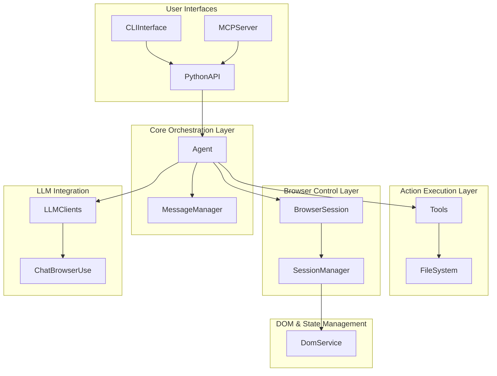
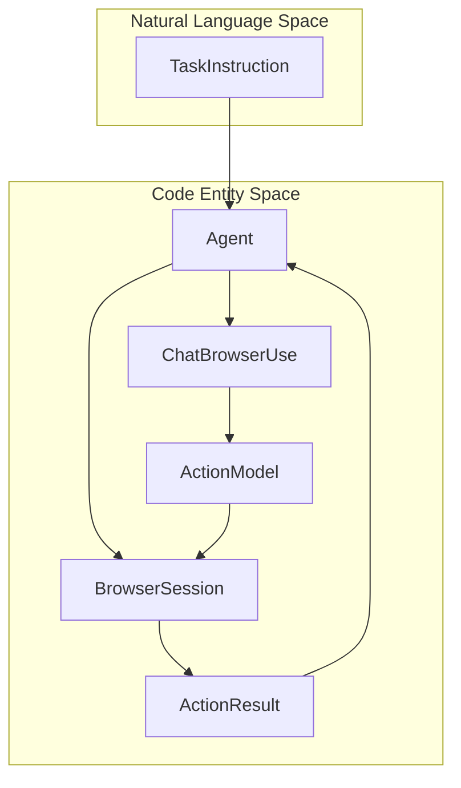
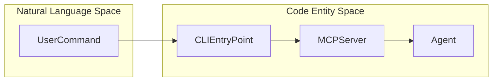

<!-- source: DeepWiki mcp.deepwiki.com · repo browser-use/browser-use · page 1 Overview · fetched 2026-10-30 -->

# Overview

Relevant source files

The following files were used as context for generating this wiki page:

- [README.md](README.md)
- [browser_use/__init__.py](browser_use/__init__.py)
- [browser_use/llm/__init__.py](browser_use/llm/__init__.py)
- [browser_use/llm/models.py](browser_use/llm/models.py)
- [static/readme/README.md](static/readme/README.md)
- [static/readme/which-product-dark.svg](static/readme/which-product-dark.svg)
- [static/readme/which-product-light.svg](static/readme/which-product-light.svg)
- [tests/ci/models/test_llm_model_factory.py](tests/ci/models/test_llm_model_factory.py)

Browser-use is an open-source Python framework that enables Large Language Models (LLMs) to autonomously control and interact with web browsers. The framework provides a complete system for building AI agents that can navigate websites, extract information, fill forms, and perform complex multi-step browser automation tasks by mimicking human interaction—clicking, typing, and scrolling.

**Sources:** [README.md:42-50](), [browser_use/__init__.py:75-113]()

## Core Purpose

Browser-use bridges the gap between LLMs and web browsers by:

1.  **Translating web pages into LLM-readable format**: The DOM processing pipeline converts raw HTML/CSS/JavaScript into structured text with interactive element indices, significantly reducing token usage compared to raw HTML.
2.  **Executing LLM decisions as browser actions**: Actions like `click`, `type`, `navigate`, and `extract` are translated to Chrome DevTools Protocol (CDP) commands.
3.  **Managing execution state**: The `Agent` system tracks conversation history, detects loops, and maintains context across multi-step tasks.
4.  **Supporting multiple deployment modes**: Local development, cloud-based browsers via `use_cloud=True`, and production-ready infrastructure via the CLI and Model Context Protocol (MCP) integrations.

**Sources:** [README.md:41-98](), [browser_use/__init__.py:75-113]()

## Child Pages and Detailed Guides

This overview introduces the high-level architecture and concepts of browser-use. For detailed technical information, consult the following child pages:
- **System Architecture**: High-level overview of the layered architecture (Agent orchestration, Browser control, DOM processing, and LLM integration) — see [System Architecture](#1.1)
- **Installation and Setup**: Guide for installing browser-use via `pip`/`uv`, setting up API keys, and initial configuration — see [Installation and Setup](#1.2)
- **Quick Start Examples**: Simple code examples showing basic `Agent` usage, browser automation tasks, and common patterns — see [Quick Start Examples](#1.3)

**Sources:** [README.md:73-151](), [browser_use/__init__.py:75-113]()

## System Architecture Overview

Browser-use is built on a modular, layered architecture that separates orchestration, browser control, DOM processing, and LLM communication.

**Sources:** [browser_use/__init__.py:75-135](), [browser_use/llm/models.py:17-23]()

## Code Entity Space Mapping

### Agent Execution Flow

The following diagram bridges the natural language task instruction to the concrete code entities involved in execution:

**Sources:** [browser_use/__init__.py:78-86](), [browser_use/llm/models.py:83-86]()

### CLI and Interface Mapping

The following diagram maps CLI invocation to the underlying internal server and agent orchestration classes:

**Sources:** [browser_use/__init__.py:78](), [README.md:85-92]()

## Project Interfaces

Browser-use offers several ways to interact with the system:

1.  **Python API**: The primary integration vector using the `Agent` and `BrowserSession` classes.
2.  **CLI**: Terminal interface for direct browser control and task execution.
3.  **MCP Server**: Exposes tools to MCP-compatible clients like Claude Desktop.
4.  **TUI**: A terminal-based user interface for interactive task input and live logging.

**Sources:** [README.md:140-151](), [browser_use/__init__.py:75-113]()

---

