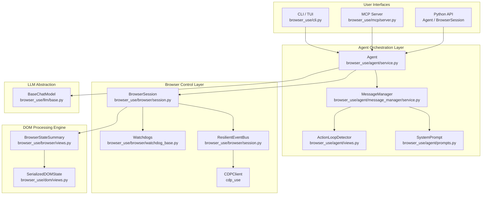
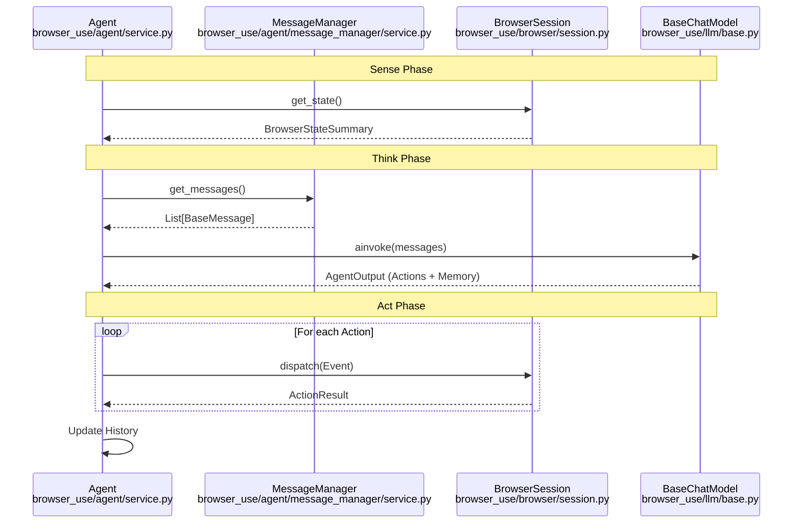
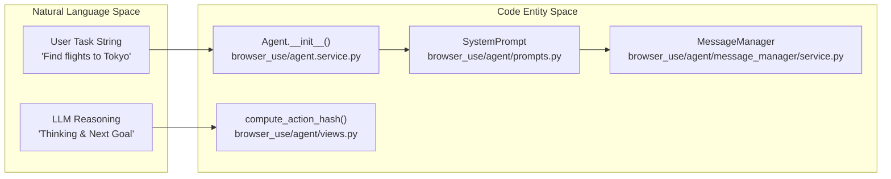
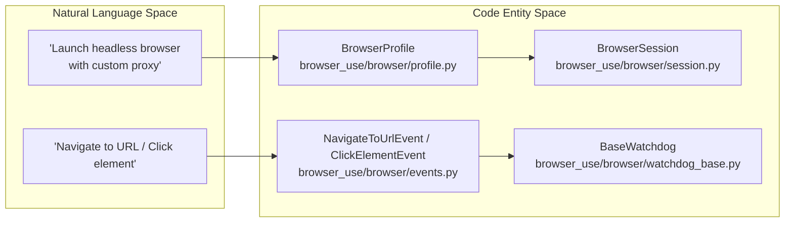

<!-- source: DeepWiki mcp.deepwiki.com · repo browser-use/browser-use · page 1.1 System Architecture · fetched 2026-10-30 -->

# System Architecture

Relevant source files

The following files were used as context for generating this wiki page:

- [browser_use/agent/message_manager/service.py](browser_use/agent/message_manager/service.py)
- [browser_use/agent/message_manager/views.py](browser_use/agent/message_manager/views.py)
- [browser_use/agent/prompts.py](browser_use/agent/prompts.py)
- [browser_use/agent/service.py](browser_use/agent/service.py)
- [browser_use/agent/views.py](browser_use/agent/views.py)
- [browser_use/browser/events.py](browser_use/browser/events.py)
- [browser_use/browser/profile.py](browser_use/browser/profile.py)
- [browser_use/browser/session.py](browser_use/browser/session.py)
- [browser_use/browser/views.py](browser_use/browser/views.py)
- [browser_use/browser/watchdog_base.py](browser_use/browser/watchdog_base.py)

## Purpose and Scope

This page provides a comprehensive overview of the `browser-use` system architecture, detailing the interaction between high-level AI orchestration and low-level browser control. The library is designed as a layered framework that transforms natural language instructions into precise browser actions using an iterative sense-think-act loop.

Key architectural pillars include:
- **Agent Orchestration**: Managing the execution loop, message history, and LLM context via the `Agent` class (`browser_use/agent/service.py`) [browser_use/agent/service.py:133-206]().
- **Browser Control**: Event-driven session management and CDP integration through `BrowserSession` (`browser_use/browser/session.py`) [browser_use/browser/session.py:134-185]().
- **DOM Processing**: Multi-stage pipeline for converting complex web pages into LLM-consumable state (`BrowserStateSummary`).
- **LLM Integration**: Provider-agnostic interface with structured output enforcement supporting OpenAI, Anthropic, Google, and others.

Sources: [browser_use/agent/service.py:133-206](), [browser_use/browser/session.py:134-185]()

---

## High-Level Architecture

The system is organized into specialized layers that decouple reasoning from execution.

### System Architecture Overview

Sources: [browser_use/agent/service.py:133-206](), [browser_use/agent/message_manager/service.py:104-148](), [browser_use/browser/session.py:134-185]()

---

## Component Responsibilities

| Component | Class | Primary Responsibility |
|-----------|-------|----------------------|
| **Agent** | `Agent` | Coordinates the `step()` loop, LLM inference, and action dispatch. |
| **Message Manager** | `MessageManager` | Manages conversation history, state pruning, and prompt assembly. |
| **Browser Session** | `BrowserSession` | Orchestrates browser lifecycle, profile config, and event-driven control. |
| **Watchdog Base** | `BaseWatchdog` | Monitors browser state changes and dispatches event handlers via `ResilientEventBus`. |
| **Action Loop Detector** | `ActionLoopDetector` | Tracks repetition and page stagnation to nudge the LLM. |
| **Message History** | `MessageHistory` | Stores system, state, and context messages in order. |

Sources: [browser_use/agent/service.py:133-206](), [browser_use/agent/message_manager/service.py:104-148](), [browser_use/browser/watchdog_base.py:15-39]()

---

## Core Data Flows: The Sense-Think-Act Loop

The `Agent.step()` method is the heart of the system, executing an iterative loop until completion.

Sources: [browser_use/agent/service.py:133-206](), [browser_use/agent/message_manager/service.py:104-148](), [browser_use/browser/session.py:134-185]()

---

## Bridge: Natural Language Space to Code Entity Space (Agent Execution)

This diagram maps high-level user intents and natural language instructions to concrete Python classes, functions, and files within the agent orchestration pipeline.

Sources: [browser_use/agent/service.py:133-206](), [browser_use/agent/prompts.py:28-60](), [browser_use/agent/views.py:151-155]()

---

## Bridge: Natural Language Space to Code Entity Space (Browser Control & Lifecycle)

This diagram maps browser automation requirements to underlying browser configuration classes and CDP event dispatch entities.

Sources: [browser_use/browser/profile.py:124-165](), [browser_use/browser/session.py:134-185](), [browser_use/browser/events.py:110-146](), [browser_use/browser/watchdog_base.py:15-39]()

---

## DOM Processing and Browser State

The system transforms raw browser data into a compact, semantic representation suitable for LLMs. 
- **BrowserStateSummary**: Aggregates DOM state, URL, title, tabs, viewport metrics, and screenshots (`browser_use/browser/views.py`) [browser_use/browser/views.py:91-114]().
- **PageInfo**: Computes viewport dimensions, total page dimensions, scroll positions, and directional offsets [browser_use/browser/views.py:44-67]().

Sources: [browser_use/browser/views.py:44-114]()

---

## Message and Context Management

The `MessageManager` ensures the LLM stays within token limits while retaining critical task context.

### Context Compaction
- **MessageCompactionSettings**: Configures automatic summarization of older history into a `compacted_memory` block based on character or token counts (`browser_use/agent/views.py`) [browser_use/agent/views.py:35-56]().

### Loop Detection
- **ActionLoopDetector**: Tracks action repetition and page stagnation using `compute_action_hash` to normalize action parameters (`browser_use/agent/views.py`) [browser_use/agent/views.py:110-165]().

Sources: [browser_use/agent/views.py:35-56](), [browser_use/agent/views.py:110-165]()

---

## Configuration and Resilience

The system is designed for production stability through robust event handling and configuration options.

### Key Configurations
- **AgentSettings**: Configures `use_vision`, `max_failures`, `use_judge`, `enable_planning`, and timeouts (`browser_use/agent/views.py`) [browser_use/agent/views.py:59-94]().
- **Browser Profile**: Manages Chrome arguments (`CHROME_DEFAULT_ARGS`, `CHROME_HEADLESS_ARGS`, `CHROME_DOCKER_ARGS`), extensions, and proxy settings (`browser_use/browser/profile.py`) [browser_use/browser/profile.py:124-165]().

### Resilience Mechanisms
- **ResilientEventBus**: Inherits from `EventBus` to provide robust step execution and prevent assertions during warm-Lambda resumes or torn-down buses (`browser_use/browser/session.py`) [browser_use/browser/session.py:106-133]().
- **Circuit Breakers**: Watchdog event handlers verify CDP connectivity before execution to avoid hanging on broken WebSocket connections (`browser_use/browser/watchdog_base.py`) [browser_use/browser/watchdog_base.py:93-123]().

Sources: [browser_use/agent/views.py:59-94](), [browser_use/browser/profile.py:124-165](), [browser_use/browser/session.py:106-133](), [browser_use/browser/watchdog_base.py:93-123]()

---

