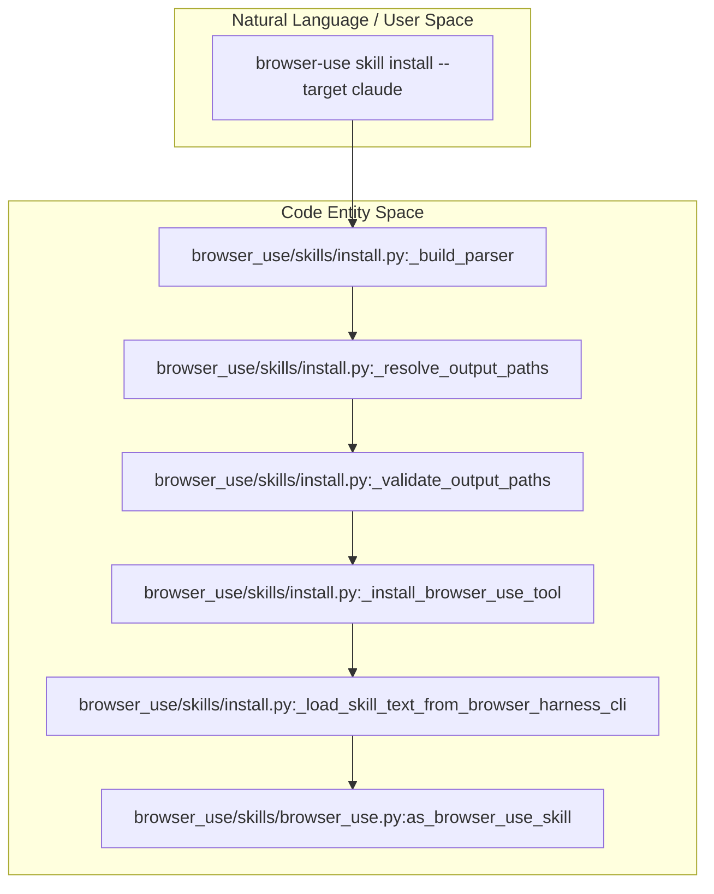
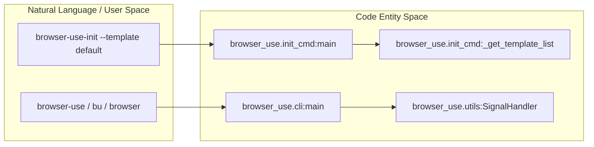

<!-- source: DeepWiki mcp.deepwiki.com · repo browser-use/browser-use · page 1.2 Installation and Setup · fetched 2026-10-30 -->

# Installation and Setup

<details>
<summary>Relevant source files</summary>

The following files were used as context for generating this wiki page:

- [browser_use/init_cmd.py](browser_use/init_cmd.py)
- [browser_use/skills/browser-use/SKILL.md](browser_use/skills/browser-use/SKILL.md)
- [browser_use/skills/browser_use.py](browser_use/skills/browser_use.py)
- [browser_use/skills/install.py](browser_use/skills/install.py)
- [pyproject.toml](pyproject.toml)
- [skills/browser-use/SKILL.md](skills/browser-use/SKILL.md)
- [skills/remote-browser/SKILL.md](skills/remote-browser/SKILL.md)
- [tests/ci/test_browser_use_skill_install_docs.py](tests/ci/test_browser_use_skill_install_docs.py)

</details>


This page provides a comprehensive guide for installing `browser-use`, configuring system dependencies, setting up API keys, managing assistant skills, and initializing projects using the CLI and environment configuration system.

---

## Package Installation and Dependency Management

The `browser-use` package requires Python ≥3.11 (`requires-python = ">=3.11,<4.0"` [pyproject.toml:7]()). The standard and recommended installation method leverages `uv` for fast dependency resolution and isolated environment execution.

### Standard Installation with uv

```bash
# Initialize a new project and add browser-use
uv init && uv add browser-use && uv sync

# Install core CLI tool and dependencies
uv tool install browser-use
```

### Installation with pip

For standard Python environments:

```bash
pip install browser-use
```

### Optional Dependencies

The package defines multiple optional dependency groups in `pyproject.toml` to support specialized integrations [pyproject.toml:61-89]():

| Dependency Group | Command | Purpose |
|-----------------|---------|---------|
| `cli` | `pip install "browser-use[cli]"` | Terminal UI and CLI support [pyproject.toml:61]() |
| `core` | `pip install "browser-use[core]"` | Platform-specific core binaries [pyproject.toml:63-69]() |
| `aws` | `pip install "browser-use[aws]"` | AWS Bedrock support via `boto3` [pyproject.toml:70]() |
| `oci` | `pip install "browser-use[oci]"` | Oracle Cloud Infrastructure support [pyproject.toml:71]() |
| `video` | `pip install "browser-use[video]"` | Video recording via `imageio` and `numpy` [pyproject.toml:72]() |
| `eval` | `pip install "browser-use[eval]"` | Evaluation tools and `lmnr` integration [pyproject.toml:82-87]() |
| `all` | `pip install "browser-use[all]"` | Combines cli, examples, aws, and oci optional groups [pyproject.toml:89]() |

**Sources:** [pyproject.toml:1-89]()

---

## Skill Installation and Assistant Integration

The package supports registering its agent skill definition into various assistant configurations (such as Claude, Cursor, Codex, OpenClaw, etc.) via the `browser-use skill install` command [browser_use/skills/install.py:25-34]().

### Assistant Targets
The CLI command resolves target directories dynamically through `TARGET_DIR_BUILDERS` [browser_use/skills/install.py:25-34]():
- `agents`, `claude`, `codex`, `copilot`, `cursor`, `gemini`, `openclaw`: mapped to `~/.<assistant>/skills/browser-use/SKILL.md` [browser_use/skills/install.py:21-32]().
- `opencode`: mapped to XDG config paths (`~/.config/opencode/skills/browser-use/SKILL.md`) [browser_use/skills/install.py:33]().

The installation handler checks for `uv` availability, executes `uv tool install --python 3.12 --upgrade --force browser-use` [browser_use/skills/install.py:66-74](), loads the skill text from the package or harness (`_load_skill_text_from_browser_harness_cli`) [browser_use/skills/install.py:76-89](), and writes out `SKILL.md` files [browser_use/skills/install.py:177-180]().

Title: Skill Installation Pipeline (Natural Language to Code Entity Space)


**Sources:** [browser_use/skills/install.py:25-182](), [browser_use/skills/browser_use.py:32-75]()

---

## Template Generation and Initialization

To quickly bootstrap automation projects, `browser-use` provides a standalone initialization command (`browser-use-init`) implemented in `browser_use/init_cmd.py` [browser_use/init_cmd.py:191-222]().

The tool fetches template metadata and files from the remote template repository (`TEMPLATE_REPO_URL`) [browser_use/init_cmd.py:28-48](), presents an interactive template selector using `InquirerPy` styled with browser-use orange themes (`inquirer_style`) [browser_use/init_cmd.py:105-113](), and writes out the configured file locally with safety overwrite prompts (`_write_init_file`) [browser_use/init_cmd.py:170-188]().

**Sources:** [browser_use/init_cmd.py:28-222]()

---

## API Key and Environment Configuration

### Provider Keys
Browser-use relies on environment variables for authenticating with LLM providers:
- OpenAI: `OPENAI_API_KEY`
- Anthropic: `ANTHROPIC_API_KEY`
- Google Gemini: `GOOGLE_API_KEY`
- Browser Use Cloud: `BROWSER_USE_API_KEY`

These are typically loaded via `.env` files using `python-dotenv` at runtime.

---

## CLI Entry Points and Verification

The package defines several standard script entry points in `pyproject.toml` [pyproject.toml:104-108]():
- `browser-use = "browser_use.cli:main"` [pyproject.toml:105]()
- `browseruse = "browser_use.cli:main"` [pyproject.toml:106]()
- `bu = "browser_use.cli:main"` [pyproject.toml:107]()
- `browser = "browser_use.cli:main"` [pyproject.toml:108]()

Title: CLI and Initialization Architecture (Natural Language to Code Entity Space)


**Sources:** [pyproject.toml:104-108](), [browser_use/cli.py:1](), [browser_use/init_cmd.py:191-222](), [browser_use/utils.py:127-198]()

---

