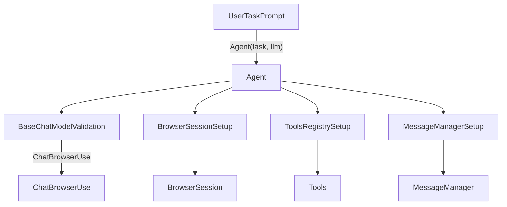
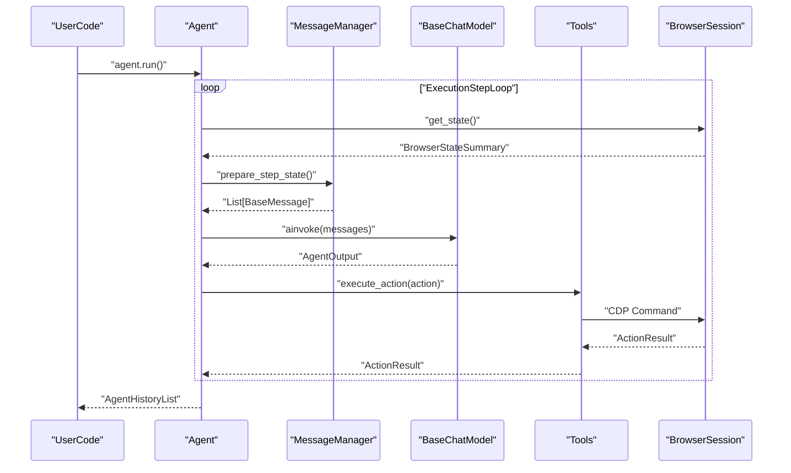

<!-- source: DeepWiki mcp.deepwiki.com · repo browser-use/browser-use · page 1.3 Quick Start Examples · fetched 2026-10-30 -->

# Quick Start Examples

<details>
<summary>Relevant source files</summary>

The following files were used as context for generating this wiki page:

- [examples/browser/cloud_browser.py](examples/browser/cloud_browser.py)
- [examples/demo_mode_example.py](examples/demo_mode_example.py)
- [examples/features/custom_system_prompt.py](examples/features/custom_system_prompt.py)
- [examples/features/initial_actions.py](examples/features/initial_actions.py)
- [examples/features/small_model_for_extraction.py](examples/features/small_model_for_extraction.py)
- [examples/file_system/alphabet_earnings.py](examples/file_system/alphabet_earnings.py)
- [examples/file_system/file_system.py](examples/file_system/file_system.py)
- [examples/getting_started/01_basic_search.py](examples/getting_started/01_basic_search.py)
- [examples/getting_started/02_form_filling.py](examples/getting_started/02_form_filling.py)
- [examples/getting_started/03_data_extraction.py](examples/getting_started/03_data_extraction.py)
- [examples/getting_started/04_multi_step_task.py](examples/getting_started/04_multi_step_task.py)
- [examples/models/browser_use_llm.py](examples/models/browser_use_llm.py)
- [examples/sandbox/example.py](examples/sandbox/example.py)

</details>


This page provides practical code examples showing basic `Agent` usage, task-specific browser automation patterns, file system integration, advanced configurations (such as initial actions and split-model extraction), and cloud or sandbox execution options.

Sources: [examples/getting_started/01_basic_search.py:1-29](), [examples/file_system/file_system.py:1-50]()

---

## Basic Agent Pattern

The simplest agent requires a task string, an LLM instance, and an execution invocation. The recommended default chat model class is `ChatBrowserUse` configured with models like `bu-2-0` or `bu-2-0-mini-preview` [examples/getting_started/01_basic_search.py:21-25](), [examples/models/browser_use_llm.py:22-31]().

### Asynchronous Execution (Recommended)
For modern Python applications, run the agent within an asynchronous event loop via `await agent.run()` [examples/getting_started/01_basic_search.py:21-29]().

```python
import asyncio
from browser_use import Agent, ChatBrowserUse

async def main():
	llm = ChatBrowserUse(model='bu-2-0-mini-preview')
	task = "Search Google for 'what is browser automation' and tell me the top 3 results"
	agent = Agent(task=task, llm=llm)
	await agent.run()

if __name__ == '__main__':
	asyncio.run(main())
```
[examples/getting_started/01_basic_search.py:21-29]()

Sources: [examples/getting_started/01_basic_search.py:21-29](), [examples/models/browser_use_llm.py:22-32]()

---

## Agent Initialization Architecture

The following diagram bridges natural language task specifications to the underlying Python code entities instantiated during setup.

Title: Agent Initialization Flow


Sources: [examples/getting_started/01_basic_search.py:21-25](), [examples/models/browser_use_llm.py:22-32](), [examples/file_system/file_system.py:32-37]()

---

## Task-Specific Automation Patterns

### Form Filling
Navigates to a target URL, fills out multiple form fields using semantic element matching, and submits the form [examples/getting_started/02_form_filling.py:36-47]().

```python
task = """
Go to https://httpbin.org/forms/post and fill out the contact form with:
- Customer name: John Doe
- Telephone: 555-123-4567
- Email: john.doe@example.com
- Size: Medium
- Topping: cheese
- Delivery time: now
- Comments: This is a test form submission

Then submit the form and tell me what response you get.
"""
agent = Agent(task=task, llm=ChatBrowserUse(model='bu-2-0-mini-preview'))
await agent.run()
```
[examples/getting_started/02_form_filling.py:36-51]()

### Data Extraction
Extracts structured information from a web page and returns it in a designated format [examples/getting_started/03_data_extraction.py:36-46]().

```python
task = """
Go to https://quotes.toscrape.com/ and extract the following information:
- The first 5 quotes on the page
- The author of each quote
- The tags associated with each quote

Present the information in a clear, structured format.
"""
agent = Agent(task=task, llm=ChatBrowserUse(model='bu-2-0-mini-preview'))
await agent.run()
```
[examples/getting_started/03_data_extraction.py:36-50]()

### Multi-Step Research Tasks
Chains search queries, cross-domain navigation, and data synthesis [examples/getting_started/04_multi_step_task.py:36-50]().

```python
task = """
1. Search Google for "best Python web scraping libraries 2024"
2. Find a reputable article and extract the top 3 libraries
3. Visit official GitHub pages for each and extract star counts
4. Present a summary comparison.
"""
agent = Agent(task=task, llm=ChatBrowserUse(model='bu-2-0-mini-preview'))
await agent.run()
```
[examples/getting_started/04_multi_step_task.py:36-54]()

### File System Integration & Persistence
Configures local file system storage for the agent to save, append, and read intermediate artifacts like markdown or PDF documents [examples/file_system/file_system.py:20-37]().

```python
task = """
Go to https://mertunsall.github.io/posts/post1.html
Save the title of the article in "data.md"
Then, use append_file to add the first sentence of the article to "data.md"
Then, read the file to see its content and make sure it's correct.
"""
agent = Agent(
	task=task,
	llm=ChatOpenAI(model='gpt-4.1-mini'),
	save_conversation_path='./conversations',
	file_system_path='./fs',
)
await agent.run()
```
[examples/file_system/file_system.py:20-41]()

Sources: [examples/getting_started/02_form_filling.py:36-51](), [examples/getting_started/03_data_extraction.py:36-50](), [examples/getting_started/04_multi_step_task.py:36-54](), [examples/file_system/file_system.py:20-41]()

---

## Advanced Configuration Patterns

### Initial Actions
Seeds the browser session with predefined navigation steps before the LLM takes over control loop execution [examples/features/initial_actions.py:15-23]().

```python
initial_actions = [
	{'navigate': {'url': 'https://www.google.com', 'new_tab': True}},
	{'navigate': {'url': 'https://en.wikipedia.org/wiki/Randomness', 'new_tab': True}},
]
agent = Agent(
	task='What theories are displayed on the page?',
	initial_actions=initial_actions,
	llm=llm,
)
```
[examples/features/initial_actions.py:15-23]()

### Split-Model Execution (`page_extraction_llm`)
Uses a high-capability model for strategic planning and a faster, cost-effective model dedicated solely to page content extraction [examples/features/small_model_for_extraction.py:16-19]().

```python
llm = ChatOpenAI(model='gpt-4.1')
small_llm = ChatOpenAI(model='gpt-4.1-mini')

agent = Agent(
	task='Find founders and extract links',
	llm=llm,
	page_extraction_llm=small_llm,
)
```
[examples/features/small_model_for_extraction.py:16-19]()

### Custom System Prompts
Extends or overrides the default system instruction set provided to the agent [examples/features/custom_system_prompt.py:15-25]().

```python
extend_message = 'REMEMBER: ALWAYS open first a new tab and go to wikipedia.com!'
agent = Agent(
	task='Search for Elon Musk',
	llm=model,
	extend_system_message=extend_message,
)
```
[examples/features/custom_system_prompt.py:15-25]()

Sources: [examples/features/initial_actions.py:15-23](), [examples/features/small_model_for_extraction.py:16-19](), [examples/features/custom_system_prompt.py:15-25]()

---

## Cloud and Sandbox Execution

### Browser Use Cloud
Leverages cloud-hosted browser infrastructure optimized for stealth and scale by setting `use_cloud=True` on the `Browser` configuration [examples/browser/cloud_browser.py:18-26]().

```python
from browser_use import Agent, Browser, ChatBrowserUse

browser = Browser(use_cloud=True)
agent = Agent(
	task='Go to github.com/browser-use/browser-use and tell me the star count',
	llm=ChatBrowserUse(model='bu-2-0-mini-preview'),
	browser=browser,
)
await agent.run()
```
[examples/browser/cloud_browser.py:18-26]()

### Sandbox Decorator Pattern
Executes agent workflows within an isolated sandbox environment using the `@sandbox` decorator [examples/sandbox/example.py:28-44]().

```python
@sandbox(log_level='INFO')
async def run_in_sandbox(browser: Browser):
	agent = Agent(
		task='Check my IP address and location in JSON format',
		browser=browser,
		llm=ChatBrowserUse(model='bu-2-0-mini-preview'),
	)
	res = await agent.run()
	return res.final_result()
```
[examples/sandbox/example.py:28-44]()

Sources: [examples/browser/cloud_browser.py:18-26](), [examples/sandbox/example.py:28-44]()

---

## Agent Execution Lifecycle

The following sequence diagram maps the iterative execution loop to internal code components.

Title: Agent Execution Lifecycle


Sources: [examples/getting_started/01_basic_search.py:25](), [examples/file_system/file_system.py:41]()

---

