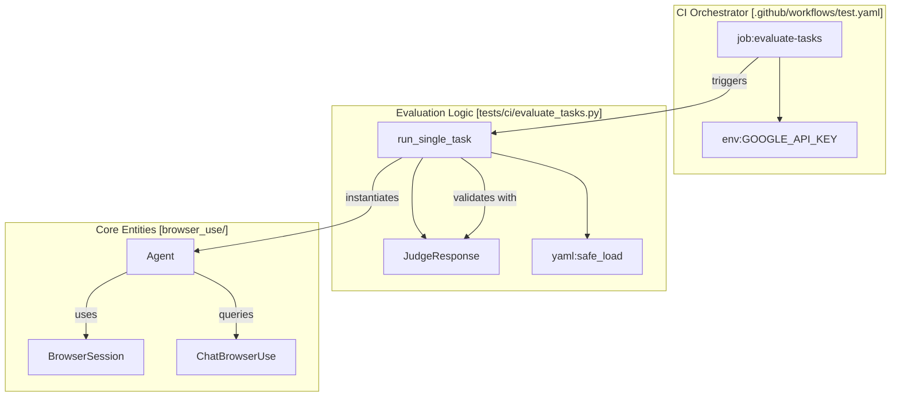
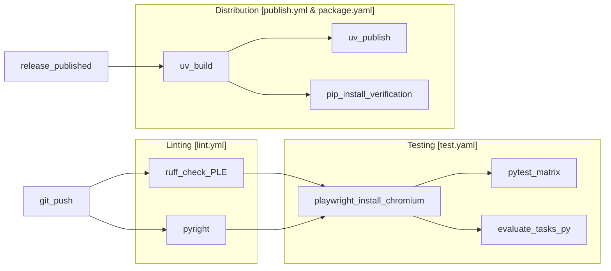

<!-- source: DeepWiki mcp.deepwiki.com · repo browser-use/browser-use · page 10 Development and Testing · fetched 2026-10-30 -->

# Development and Testing

Relevant source files

The following files were used as context for generating this wiki page:

- [.github/workflows/docker.yml](.github/workflows/docker.yml)
- [.github/workflows/install-script.yml](.github/workflows/install-script.yml)
- [.github/workflows/lint.yml](.github/workflows/lint.yml)
- [.github/workflows/package.yaml](.github/workflows/package.yaml)
- [.github/workflows/publish.yml](.github/workflows/publish.yml)
- [.github/workflows/test.yaml](.github/workflows/test.yaml)
- [scripts/sync_browser_harness_skill.py](scripts/sync_browser_harness_skill.py)
- [tests/ci/evaluate_tasks.py](tests/ci/evaluate_tasks.py)

This page documents the testing infrastructure, CI/CD pipelines, Docker builds, and development workflows for the `browser-use` codebase. It covers the dynamic test discovery system, the subprocess-isolated agent evaluation framework, automated quality gates, and containerization strategies.

## Testing Framework

The core testing suite is built on **pytest** and designed for high concurrency. Tests are located in the `tests/ci/` directory and cover browser primitives, action registration, and DOM processing.

*   **Parallel Execution**: Local execution is typically handled via `pytest --numprocesses auto` or through the `bin/test.sh` helper script [bin/test.sh:1-9](). CI utilizes a matrix strategy for file-level parallelism [.github/workflows/test.yaml:98-107]().
*   **Test Discovery**: CI pipelines dynamically discover test files using a shell pipeline (`find tests/ci -name 'test_*.py'`) that generates a JSON matrix for GitHub Actions [.github/workflows/test.yaml:70-71]().
*   **Fixtures and Setup**: Tests utilize `astral-sh/setup-uv` to manage environments and `uvx playwright install chromium` to ensure the browser binary is present [.github/workflows/test.yaml:32-50]().

For detailed configuration, discovery rules, and test categories, see **[Test Framework Overview](#10.1)**.

Sources: [.github/workflows/test.yaml:32-182](), [bin/test.sh:1-9]()

## Agent Task Evaluation System

Beyond unit tests, the system includes an end-to-end evaluation suite in `tests/ci/evaluate_tasks.py`. This system tests the `Agent` class's ability to solve complex natural language tasks defined in YAML formats.

*   **Evaluation Workflow**: The CI pipeline includes an `evaluate-tasks` job that runs after Chromium setup [.github/workflows/test.yaml:184-187]().
*   **Judge LLM**: A `JudgeResponse` Pydantic model is used to parse evaluations from a judge LLM (typically `ChatGoogle` with `gemini-3.1-flash-lite`) which verifies if the agent met the task criteria [tests/ci/evaluate_tasks.py:36-39](), [tests/ci/evaluate_tasks.py:82-82]().
*   **Subprocess Isolation**: To prevent browser session interference and memory leaks, `run_single_task` executes each task in a separate Python process [tests/ci/evaluate_tasks.py:41-44]().

### Evaluation Architecture

Sources: [tests/ci/evaluate_tasks.py:1-209](), [.github/workflows/test.yaml:184-200]()

For details on the task YAML format and judge prompts, see **[Agent Task Evaluation System](#10.2)**.

## CI/CD Pipeline

The project utilizes GitHub Actions for automated linting, testing, and deployment.

*   **Test Matrix**: The `test.yaml` workflow runs discovered tests in parallel across multiple runners [.github/workflows/test.yaml:98-107]().
*   **Caching**: Extensive caching is implemented for `uv` packages, Playwright/Chromium binaries, and browser-use extensions to minimize setup time [.github/workflows/test.yaml:38-47](), [.github/workflows/test.yaml:152-160]().
*   **Quality Gates**: The `lint.yml` workflow enforces syntax checks via `ruff check --select PLE`, type checking via `pyright`, and style via `pre-commit` [.github/workflows/lint.yml:23-54]().
*   **Publishing**: Automated releases to PyPI are handled via the `publish.yml` workflow, which includes a `tag_pre_release` job for automated version bumping using regex patterns [.github/workflows/publish.yml:42-70]().

### CI Pipeline Flow

Sources: [.github/workflows/test.yaml:1-150](), [.github/workflows/lint.yml:1-54](), [.github/workflows/publish.yml:1-110](), [.github/workflows/package.yaml:1-64]()

For details on workflow triggers and matrix configuration, see **[CI/CD Pipeline](#10.3)**.

## Local Development Setup

The development environment is optimized for the `uv` package manager, providing fast dependency resolution and isolated environments.

*   **Helper Scripts**: The `bin/` directory contains shell scripts for common tasks such as `bin/lint.sh`, `bin/test.sh`, and `bin/setup.sh` [bin/lint.sh:1-10](), [bin/test.sh:1-9]().
*   **Pre-commit Hooks**: Enforces code style, formatting, and static analysis locally before commits are finalized [.github/workflows/lint.yml:33-44]().
*   **Skill Synchronization**: The `scripts/sync_browser_harness_skill.py` script ensures that the browser-use skill definitions remain in sync with the upstream repository [scripts/sync_browser_harness_skill.py:47-74]().

For step-by-step setup instructions and environment variable configuration, see **[Local Development Setup](#10.4)**.

Sources: [bin/lint.sh:1-10](), [bin/test.sh:1-9](), [.github/workflows/lint.yml:33-44](), [scripts/sync_browser_harness_skill.py:1-78]()

## Docker and Containerization

Container builds ensure consistent runtime environments across local machines and cloud deployments.

*   **Build Configurations**: The repository provides `Dockerfile` and `Dockerfile.fast` configurations for containerizing agent executions [.github/workflows/docker.yml:65-72]().
*   **Multi-Platform Support**: CI pipelines build and push multi-platform images (`linux/amd64`, `linux/arm64`) to Docker Hub and GHCR [.github/workflows/docker.yml:65-76]().

For container architectures, base image layering, and build scripts, see **[Docker and Containerization](#10.5)**.

Sources: [.github/workflows/docker.yml:1-76]()

---

