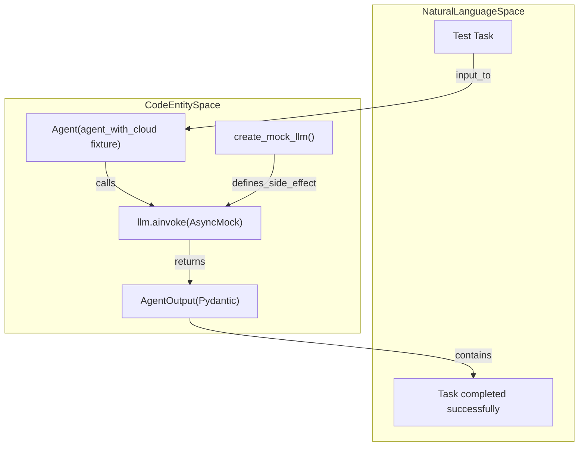
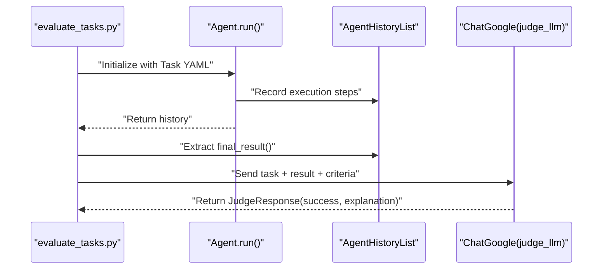

<!-- source: DeepWiki mcp.deepwiki.com · repo browser-use/browser-use · page 10.1 Test Framework Overview · fetched 2026-10-30 -->

# Test Framework Overview

<details>
<summary>Relevant source files</summary>

The following files were used as context for generating this wiki page:

- [browser_use/agent/cloud_events.py](browser_use/agent/cloud_events.py)
- [browser_use/sync/auth.py](browser_use/sync/auth.py)
- [browser_use/sync/service.py](browser_use/sync/service.py)
- [tests/ci/conftest.py](tests/ci/conftest.py)
- [tests/ci/models/model_test_helper.py](tests/ci/models/model_test_helper.py)
- [tests/ci/models/test_llm_anthropic.py](tests/ci/models/test_llm_anthropic.py)
- [tests/ci/models/test_llm_azure.py](tests/ci/models/test_llm_azure.py)
- [tests/ci/models/test_llm_openai.py](tests/ci/models/test_llm_openai.py)
- [tests/ci/test_agent_cloud_events.py](tests/ci/test_agent_cloud_events.py)
- [tests/ci/test_tools.py](tests/ci/test_tools.py)

</details>


The purpose and scope of this document is to outline the testing infrastructure, layout of `tests/ci/`, pytest configuration, custom fixtures, model testing helpers, and local execution workflows for the `browser-use` repository.

## Test Suite Structure

The test infrastructure is primarily located within the `tests/` directory, organized by purpose and execution environment.

| Directory | Purpose | Key Files |
|:---|:---|:---|
| `tests/ci/` | Core test suite executed in GitHub Actions. | `conftest.py` [tests/ci/conftest.py:1-5](), `test_tools.py` [tests/ci/test_tools.py:1-18]() |
| `tests/ci/models/` | Cross-provider LLM integration tests. | `model_test_helper.py` [tests/ci/models/model_test_helper.py:1-12](), `test_llm_openai.py` [tests/ci/models/test_llm_openai.py:1-10]() |
| `tests/ci/browser/` | Browser-specific tests (screenshots, proxies, cloud sessions). | `test_cloud_browser.py`, `test_screenshot.py` |
| `tests/ci/infrastructure/` | Internal system tests (registry, config, URL processing). | `test_config.py`, `test_registry_core.py` |

Sources: [.github/workflows/test.yaml:70-72](), [tests/ci/conftest.py:1-5]()

## Pytest Configuration and Fixtures

The framework uses `tests/ci/conftest.py` to define global fixtures and environment overrides, ensuring tests remain isolated from production services.

### Key Fixtures

*   **`setup_test_environment`**: An autouse fixture that sets critical environment variables, such as `SKIP_LLM_API_KEY_VERIFICATION='true'` and `ANONYMIZED_TELEMETRY='false'`, to prevent external side effects during testing [tests/ci/conftest.py:41-64]().
*   **`browser_session`**: Provides a managed `BrowserSession` instance in headless mode. It handles automatic startup and cleanup via `session.kill()` [tests/ci/conftest.py:157-170]().
*   **`mock_llm`**: Creates an `AsyncMock` of `BaseChatModel`. It uses `create_mock_llm` to simulate LLM responses, allowing tests to verify agent logic without incurring API costs [tests/ci/conftest.py:76-154](), [tests/ci/conftest.py:199-201]().
*   **`cloud_sync`**: Configures a `CloudSync` service pointing to a local `pytest_httpserver` to test event telemetry without hitting the actual Browser Use cloud [tests/ci/conftest.py:175-195]().
*   **`event_collector`**: A helper fixture that captures `BaseEvent` objects dispatched during a test, allowing verification of the event sequence and types [tests/ci/conftest.py:215-238]().

### Data Flow: Mock LLM Interaction
This diagram shows how the `create_mock_llm` function facilitates the interaction between the `Agent` and simulated model responses.


Sources: [tests/ci/conftest.py:76-154](), [tests/ci/conftest.py:205-212]()

## Running Tests Locally

Tests are typically run using `uv` and `pytest`.

### Local Commands
```bash
# Run all CI tests
uv run pytest tests/ci/

# Run specific test file
uv run pytest tests/ci/browser/test_screenshot.py

# Run with specific log level
BROWSER_USE_LOGGING_LEVEL=DEBUG uv run pytest tests/ci/infrastructure/test_config.py
```

Sources: [tests/ci/conftest.py:1-5]()

## Agent Task Evaluation System

Beyond standard unit tests, the framework includes an evaluation system in `tests/ci/evaluate_tasks.py`. This system runs high-level agent tasks in parallel subprocesses and uses a "Judge LLM" to verify the outcome.

### Execution Loop
1.  **Discovery**: Scans `tests/agent_tasks/` for `.yaml` files defining a `task` and `judge_context`.
2.  **Isolation**: Runs each task in a separate subprocess via `run_task_subprocess` to prevent browser session interference.
3.  **Agent Run**: The `Agent` executes the task using the configured provider chat model.
4.  **Judging**: A structured judge model evaluates the history or `agent_output` against the `criteria` provided in the YAML.

### Judge Logic Diagram
This diagram maps the evaluation flow to specific code entities responsible for task validation.


Sources: [browser_use/agent/cloud_events.py:40-42]()

## CI/CD Integration

The GitHub Actions workflow (`.github/workflows/test.yaml`) automates the testing process on every push and pull request.

*   **Matrix Testing**: It dynamically discovers all `test_*.py` files in `tests/ci/` to create a job matrix for parallel execution [.github/workflows/test.yaml:52-107]().
*   **Chromium Caching**: Caches Playwright's Chromium binaries at `~/.cache/ms-playwright` to reduce job setup time [.github/workflows/test.yaml:38-50]().
*   **Cloud Sync Verification**: The system verifies that `CloudSync` correctly dispatches events like `CreateAgentStepEvent` and `UpdateAgentTaskEvent` [browser_use/sync/service.py:16-55](), [browser_use/agent/cloud_events.py:18-60]().
*   **Authentication Flow**: `DeviceAuthClient` is used to manage the OAuth2 device flow, with `get_or_create_device_id` providing persistent identification [browser_use/sync/auth.py:22-45](), [browser_use/sync/auth.py:87-162]().

Sources: [.github/workflows/test.yaml:1-183](), [browser_use/sync/service.py:16-55](), [browser_use/agent/cloud_events.py:18-60](), [browser_use/sync/auth.py:87-162]()

---

