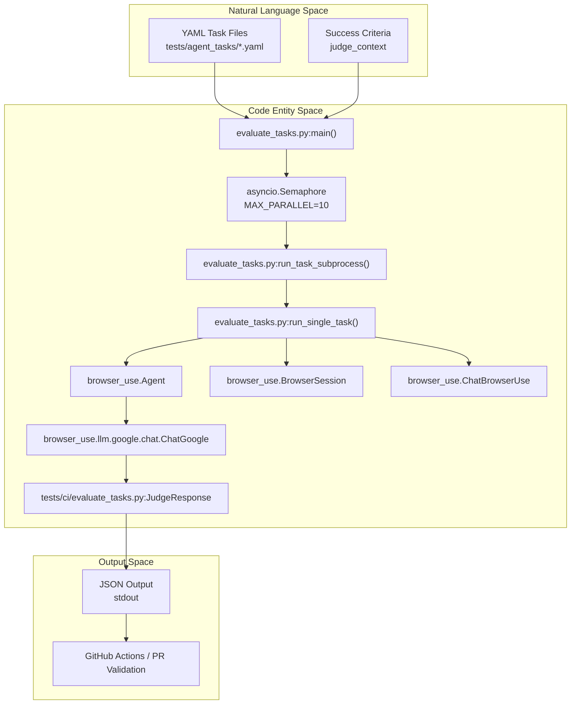
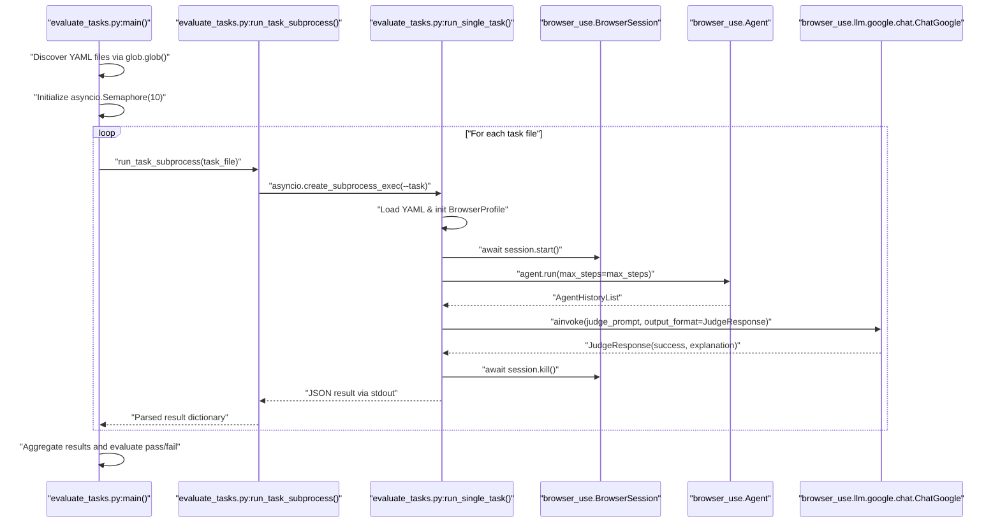
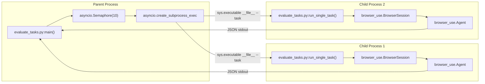
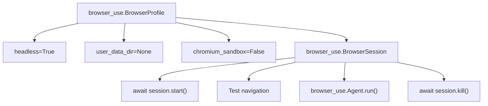
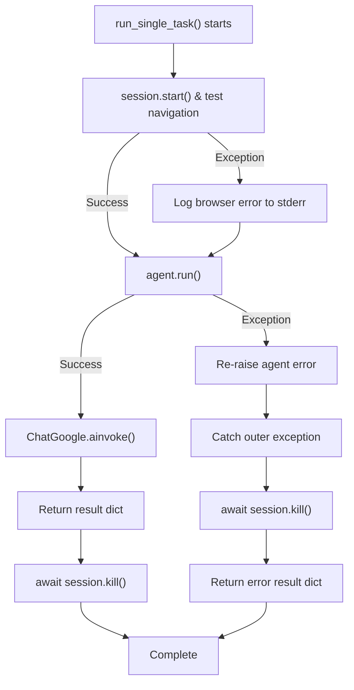
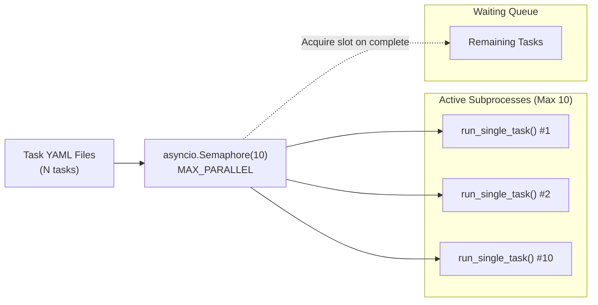

<!-- source: DeepWiki mcp.deepwiki.com · repo browser-use/browser-use · page 10.2 Agent Task Evaluation System · fetched 2026-10-30 -->

# Agent Task Evaluation System

<details>
<summary>Relevant source files</summary>

The following files were used as context for generating this wiki page:

- [.github/workflows/docker.yml](.github/workflows/docker.yml)
- [.github/workflows/eval-on-pr.yml](.github/workflows/eval-on-pr.yml)
- [.github/workflows/install-script.yml](.github/workflows/install-script.yml)
- [.github/workflows/lint.yml](.github/workflows/lint.yml)
- [.github/workflows/package.yaml](.github/workflows/package.yaml)
- [.github/workflows/publish.yml](.github/workflows/publish.yml)
- [.github/workflows/test.yaml](.github/workflows/test.yaml)
- [browser_use/dom/serializer/clickable_elements.py](browser_use/dom/serializer/clickable_elements.py)
- [scripts/sync_browser_harness_skill.py](scripts/sync_browser_harness_skill.py)
- [tests/ci/browser/iframe_template.html](tests/ci/browser/iframe_template.html)
- [tests/ci/browser/test_cross_origin_click.py](tests/ci/browser/test_cross_origin_click.py)
- [tests/ci/browser/test_dom_serializer.py](tests/ci/browser/test_dom_serializer.py)
- [tests/ci/browser/test_page_stacked_template.html](tests/ci/browser/test_page_stacked_template.html)
- [tests/ci/browser/test_page_template.html](tests/ci/browser/test_page_template.html)
- [tests/ci/evaluate_tasks.py](tests/ci/evaluate_tasks.py)

</details>


## Purpose and Scope

The Agent Task Evaluation System provides automated quality assurance for browser automation agents by executing predefined tasks in isolated environments and using a judge LLM (`ChatGoogle`) to score completion success. This module is implemented in `tests/ci/evaluate_tasks.py` and coordinates parallel subprocess execution, capturing agent history (`AgentHistoryList`) and reporting results to CI/CD pipelines.

For unit testing of individual components, see [Testing Framework](10.1). For the broader CI/CD pipeline configuration, see [CI/CD Pipeline](10.3).

Sources: `[tests/ci/evaluate_tasks.py:1-40]()`

---

## System Overview and Architecture

The evaluation system consists of task definitions stored as YAML files, an orchestration script (`tests/ci/evaluate_tasks.py:main()`) that executes tasks in parallel subprocesses via `asyncio.create_subprocess_exec()`, and a judge LLM that grades task outcomes.

### High-Level Architecture



Sources: `[tests/ci/evaluate_tasks.py:26-373]`, `[.github/workflows/eval-on-pr.yml:1-56]()`

---

## Task Definition Format

Tasks are defined in YAML files located in `tests/agent_tasks/`. Each task specifies the agent's objective, success criteria for the judge LLM, and execution constraints.

### Task YAML Structure

| Field | Type | Required | Description |
|-------|------|----------|-------------|
| `task` | string | Yes | Natural language description of the task for `browser_use.Agent` |
| `judge_context` | list[string] | No | Success criteria evaluated by the judge LLM (default: `["The agent must solve the task"]`) |
| `max_steps` | int | No | Maximum agent steps before termination via `Agent.run()` (default: 15) |

Sources: `[tests/ci/evaluate_tasks.py:52-57]`, `[tests/ci/evaluate_tasks.py:28-33]()`

---

## Evaluation Pipeline Architecture

The evaluation pipeline executes tasks through a multi-stage process: task discovery (`glob.glob`), subprocess spawning, browser initialization, agent execution, and judge scoring via `ChatGoogle`.

### Task Execution Flow



Sources: `[tests/ci/evaluate_tasks.py:41-199]`, `[tests/ci/evaluate_tasks.py:201-277]`, `[tests/ci/evaluate_tasks.py:280-342]()`

---

## Subprocess Isolation Pattern

Each task runs in a separate Python subprocess to prevent browser session interference and ensure clean execution environments. This architecture is critical for parallel execution reliability in CI environments.

### Subprocess Architecture

The system uses a two-process pattern: a parent orchestrator process (`main()`) spawns child processes (`run_single_task()`) via `asyncio.create_subprocess_exec()`.



### Subprocess Communication Protocol

Child processes communicate results via JSON printed to `stdout`, while debug logs go to `stderr`:

| Stream | Purpose | Format | Example |
|--------|---------|--------|---------|
| `stdout` | Structured results | JSON | `{"file": "reddit.yaml", "success": true, "explanation": "..."}` |
| `stderr` | Debug logging | Plain text | `[DEBUG] Starting task: reddit.yaml` |

**Code Implementation:**

The parent process spawns subprocesses with the `--task` flag `[tests/ci/evaluate_tasks.py:209-217]()`:

```python
proc = await asyncio.create_subprocess_exec(
    sys.executable,
    __file__,
    '--task',
    task_file,
    stdout=asyncio.subprocess.PIPE,
    stderr=asyncio.subprocess.PIPE,
    env=env,
)
stdout, stderr = await proc.communicate()
```

The child process detects `--task` mode and outputs pure JSON `[tests/ci/evaluate_tasks.py:350-363]()`:

```python
if args.task:
    # Subprocess mode: run a single task and output ONLY JSON
    result = asyncio.run(run_single_task(args.task))
    print(json.dumps(result))  # Pure JSON to stdout
```

Sources: `[tests/ci/evaluate_tasks.py:201-277]`, `[tests/ci/evaluate_tasks.py:345-372]()`

---

## Judge LLM Scoring System

The judge LLM evaluates agent task completion by analyzing the agent's final output against predefined success criteria. This provides objective, automated quality assessment.

### JudgeResponse Schema

The evaluation script uses a Pydantic model (`JudgeResponse`) for structured output validation `[tests/ci/evaluate_tasks.py:36-38()`]:

```python
class JudgeResponse(BaseModel):
	success: bool
	explanation: str
```

### LLM Configuration

| Component | Provider | Model | Purpose |
|-----------|----------|-------|---------|
| Agent LLM | Browser Use | `ChatBrowserUse` | Executes the task via browser automation |
| Judge LLM | Google | `ChatGoogle` (`gemini-3.1-flash-lite`) | Evaluates task completion |

**API Key Fallback Behavior:**

The system gracefully handles missing API keys by marking tasks as skipped `[tests/ci/evaluate_tasks.py:61-80()`]:

- Missing `BROWSER_USE_API_KEY`: Returns `success: True` with explanation "Skipped - API key not available"
- Missing `GOOGLE_API_KEY`: Returns `success: True` with explanation "Skipped - Google API key not available"

Sources: `[tests/ci/evaluate_tasks.py:36-38]`, `[tests/ci/evaluate_tasks.py:61-80]`, `[tests/ci/evaluate_tasks.py:82]`, `[tests/ci/evaluate_tasks.py:157-174]()`

---

## Agent Execution Context

Each task creates an isolated browser environment with specific configurations optimized for CI execution.

### Browser Profile Configuration



**Profile Initialization** `[tests/ci/evaluate_tasks.py:87-93()`]:

```python
profile = BrowserProfile(
    headless=True,
    user_data_dir=None,
    chromium_sandbox=False,  # Disable sandbox for CI environment
)
session = BrowserSession(browser_profile=profile)
```

### Agent Output Extraction

The agent's final result is extracted from history and passed to the judge `[tests/ci/evaluate_tasks.py:113-128()`]:

```python
agent = Agent(task=task, llm=agent_llm, browser_session=session)
history: AgentHistoryList = await agent.run(max_steps=max_steps)
agent_output = history.final_result() or ''
```

Sources: `[tests/ci/evaluate_tasks.py:86-128]`, `[tests/ci/evaluate_tasks.py:140-155]()`

---

## Error Handling and Resilience

The evaluation system includes comprehensive error handling to ensure robust CI execution even when individual tasks encounter exceptions.

### Error Recovery Strategy



Sources: `[tests/ci/evaluate_tasks.py:95-110]`, `[tests/ci/evaluate_tasks.py:115-125]`, `[tests/ci/evaluate_tasks.py:187-198]`, `[tests/ci/evaluate_tasks.py:256-276]()`

---

## Parallel Execution Control

The system limits concurrent task execution via `asyncio.Semaphore` to prevent resource exhaustion and ensure stable evaluation.

### Concurrency Management



**Implementation** `[tests/ci/evaluate_tasks.py:26-27]`, `[tests/ci/evaluate_tasks.py:280-292()`]:

```python
MAX_PARALLEL = 10

async def main():
	semaphore = asyncio.Semaphore(MAX_PARALLEL)
	tasks = [run_task_subprocess(task_file, semaphore) for task_file in TASK_FILES]
	results = await asyncio.gather(*tasks)
```

Sources: `[tests/ci/evaluate_tasks.py:26-27]`, `[tests/ci/evaluate_tasks.py:201-203]`, `[tests/ci/evaluate_tasks.py:280-292]()`

---

## Eval-on-PR Workflow

The evaluation system is integrated into GitHub Actions workflows (`.github/workflows/eval-on-pr.yml`) to trigger remote evaluation platforms upon pull request events.

### Workflow Logic

The workflow checks author permissions (`OWNER`, `MEMBER`, `COLLABORATOR`) and submits a POST request to an external evaluation platform API `[.github/workflows/eval-on-pr.yml:15-44()`]:

```yaml
response=$(curl -X POST \
  "${{ secrets.EVAL_PLATFORM_URL }}/api/triggerInteractionTasksV6" \
  -H "Authorization: Bearer ${{ secrets.EVAL_PLATFORM_KEY }}" \
  -H "Content-Type: application/json" \
  -d "{
    \"commitSha\": \"${{ github.event.pull_request.head.sha }}\",
    \"prNumber\": ${{ github.event.pull_request.number }},
    \"branchName\": \"${{ github.event.pull_request.head.ref }}\",
    \"testCase\": \"${TEST_CASE}\",
    \"githubRepo\": \"${{ github.repository }}\"
  }" -s)
```

Sources: `[.github/workflows/eval-on-pr.yml:1-56]()`

---

