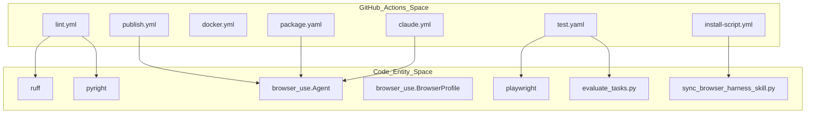
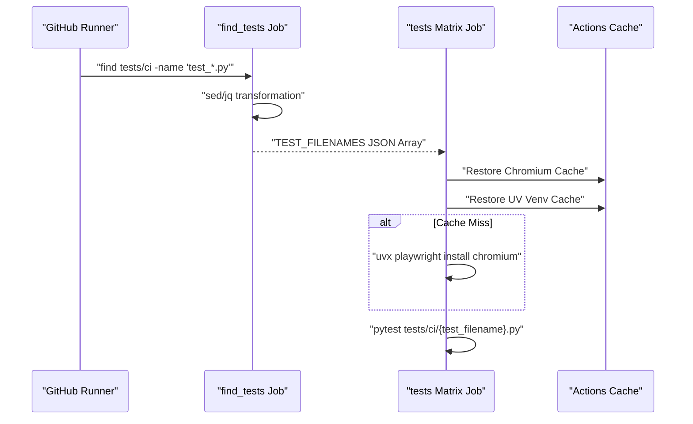
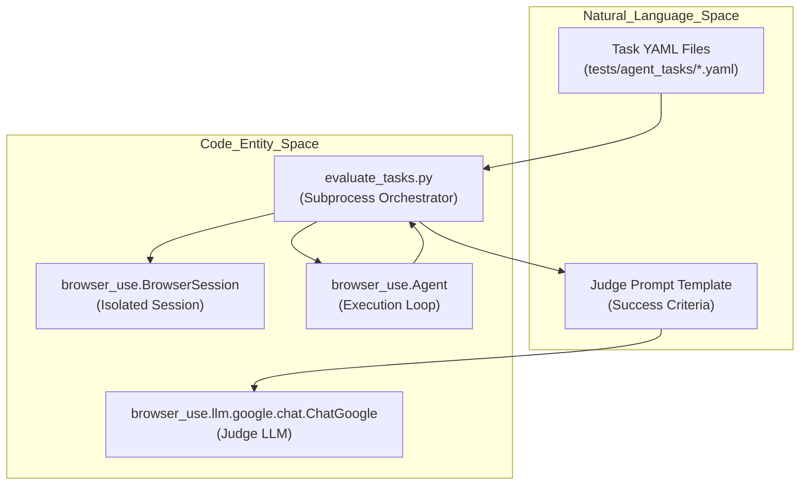

<!-- source: DeepWiki mcp.deepwiki.com · repo browser-use/browser-use · page 10.3 CI/CD Pipeline · fetched 2026-10-30 -->

# CI/CD Pipeline

Relevant source files

The following files were used as context for generating this wiki page:

- [.github/CONTRIBUTING.md](.github/CONTRIBUTING.md)
- [.github/ISSUE_TEMPLATE/1_element_detection_bug.yml](.github/ISSUE_TEMPLATE/1_element_detection_bug.yml)
- [.github/ISSUE_TEMPLATE/2_bug_report.yml](.github/ISSUE_TEMPLATE/2_bug_report.yml)
- [.github/ISSUE_TEMPLATE/3_feature_request.yml](.github/ISSUE_TEMPLATE/3_feature_request.yml)
- [.github/ISSUE_TEMPLATE/4_docs_issue.yml](.github/ISSUE_TEMPLATE/4_docs_issue.yml)
- [.github/workflows/claude.yml](.github/workflows/claude.yml)
- [.github/workflows/docker.yml](.github/workflows/docker.yml)
- [.github/workflows/install-script.yml](.github/workflows/install-script.yml)
- [.github/workflows/lint.yml](.github/workflows/lint.yml)
- [.github/workflows/package.yaml](.github/workflows/package.yaml)
- [.github/workflows/publish.yml](.github/workflows/publish.yml)
- [.github/workflows/test.yaml](.github/workflows/test.yaml)
- [browser_use/integrations/anthropic/tab_state.py](browser_use/integrations/anthropic/tab_state.py)
- [examples/integrations/README.md](examples/integrations/README.md)
- [scripts/sync_browser_harness_skill.py](scripts/sync_browser_harness_skill.py)
- [tests/ci/evaluate_tasks.py](tests/ci/evaluate_tasks.py)

## Purpose and Scope

This document describes the continuous integration and continuous deployment (CI/CD) infrastructure for `browser-use`. The pipeline manages automated testing, code quality enforcement (linting), browser binary caching, Docker image distribution, Python package publishing, automated issue-handling agents, and issue templates. It is designed to ensure high reliability for an AI-powered browser automation framework that depends on complex external components like Chromium and various LLM providers.

---

## CI/CD Architecture Overview

The `browser-use` CI/CD ecosystem is composed of several specialized GitHub Actions workflows and local utility scripts.

**Diagram: CI/CD Workflow and Code Entity Mapping**

Sources: [.github/workflows/test.yaml:1-25](), [.github/workflows/lint.yml:1-18](), [.github/workflows/publish.yml:9-22](), [.github/workflows/package.yaml:1-16](), [.github/workflows/install-script.yml:1-25](), [.github/workflows/claude.yml:1-20]()

---

## Core Test Workflow (`test.yaml`)

The `test.yaml` workflow is the primary quality gate. It handles browser setup, unit/integration test discovery, and agent task evaluation across a dynamically generated test matrix.

### Dynamic Test Discovery and Matrix Execution

Instead of hardcoding test files, the pipeline dynamically discovers tests in the `tests/ci/` directory. This allows the test suite to scale automatically as new test modules are introduced.

1. **Discovery Phase**: The `find_tests` job uses `find` and `jq` to generate a JSON array of test filenames by searching for `test_*.py` files in `tests/ci/`. [.github/workflows/test.yaml:52-71]()
2. **Matrix Phase**: The `tests` job consumes this array to spawn parallel runners for each test file, ensuring high test throughput. [.github/workflows/test.yaml:98-107]()

**Diagram: Test Execution Data Flow**

Sources: [.github/workflows/test.yaml:38-50](), [.github/workflows/test.yaml:70-71](), [.github/workflows/test.yaml:122-131]()

---

## Caching Strategy

Caching is critical for reducing CI runtimes, mitigating rate limits, and handling large external binary payloads such as Chromium and virtual environment states.

| Cache Type | Path | Key Basis | Purpose |
| :--- | :--- | :--- | :--- |
| **Chromium Binaries** | `~/.cache/ms-playwright` | `${{ runner.os }}-${{ runner.arch }}-chromium-${{ steps.week.outputs.number }}` | Avoids downloading Playwright browsers on every run. Rotates weekly. [.github/workflows/test.yaml:38-46]() |
| **UV Venv** | `~/.cache/uv`, `.venv` | `${{ runner.os }}-uv-venv-${{ hashFiles('pyproject.toml') }}` | Speeds up dependency resolution and installation via `uv sync`. [.github/workflows/test.yaml:122-130]() |
| **Browser Extensions** | `~/.config/browseruse/extensions` | `${{ runner.os }}-browseruse-extensions-${{ hashFiles('browser_use/browser/profile.py') }}` | Caches local extension state initialized by `BrowserProfile`. [.github/workflows/test.yaml:152-159]() |

Sources: [.github/workflows/test.yaml:38-46](), [.github/workflows/test.yaml:122-130](), [.github/workflows/test.yaml:152-159]()

---

## Agent Task Evaluation System (`evaluate_tasks.py`)

Beyond traditional unit tests, the repository maintains an agent evaluation system located at `tests/ci/evaluate_tasks.py` that executes end-to-end task configurations.

**Diagram: Task Evaluation to Code Entities**

### Key Architectural Characteristics
* **Subprocess Isolation**: Each YAML task file runs in an independent Python process to prevent cross-contamination of browser profiles or shared memory states. [tests/ci/evaluate_tasks.py:2-5]()
* **Parallel Limits**: Tasks are executed in parallel up to a concurrency ceiling of `MAX_PARALLEL = 10`. [tests/ci/evaluate_tasks.py:27-33]()
* **LLM Evaluation (`ChatGoogle`)**: Once `Agent.run()` completes, a judge model (`gemini-3.1-flash-lite`) validates the resulting `AgentHistoryList` output against success criteria defined in the task definition. [tests/ci/evaluate_tasks.py:82-82](), [tests/ci/evaluate_tasks.py:158-180]()

Sources: [tests/ci/evaluate_tasks.py:1-5](), [tests/ci/evaluate_tasks.py:27-33](), [tests/ci/evaluate_tasks.py:82-82](), [tests/ci/evaluate_tasks.py:158-180]()

---

## Code Quality and Linting (`lint.yml`)

The `lint.yml` workflow enforces code standards via three discrete jobs running in parallel:
1. **`lint-syntax`**: Invokes `ruff check --no-fix --select PLE` to catch syntax errors and fatal parsing issues. [.github/workflows/lint.yml:23-31]()
2. **`lint-style`**: Syncs development dependencies using `uv sync` under Python 3.11 and runs `pre-commit run --all-files`. [.github/workflows/lint.yml:33-44]()
3. **`lint-typecheck`**: Executes `pyright` across the codebase and examples to guarantee static type correctness. [.github/workflows/lint.yml:45-54]()

Sources: [.github/workflows/lint.yml:23-54]()

---

## Packaging and Cross-Platform Testing (`package.yaml`)

The `package.yaml` workflow validates distribution artifacts and verifies installation compatibility across multiple platforms.
* **Build Job (`pip-build`)**: Builds source distributions and wheels using `uv build --python 3.12` and uploads them as GitHub artifacts (`dist-artifact`). [.github/workflows/package.yaml:22-35]()
* **Test Job (`pip-install-on-os-py`)**: Downloads built wheels and tests installation across matrices of operating systems (`ubuntu-latest`, `macos-latest`, `windows-latest`) and Python runtimes (`3.11`, `3.13`). [.github/workflows/package.yaml:36-47]()

Sources: [.github/workflows/package.yaml:1-64]()

---

## Docker Build & Containerization (`docker.yml`)

Docker images are automatically built and pushed to both **Docker Hub** (`browseruse/browseruse`) and **GitHub Container Registry** (`ghcr.io/browser-use/browser-use`) on pushes to primary branches, tags, and releases.
* **Multi-Architecture Support**: Builds targeting `linux/amd64` and `linux/arm64` using Docker Buildx and QEMU. [.github/workflows/docker.yml:32-69]()
* **Registry Caching**: Utilizes remote registry cache layers (`type=registry`) to speed up subsequent image builds. [.github/workflows/docker.yml:75-76]()

Sources: [.github/workflows/docker.yml:1-76]()

---

## Release & PyPI Publishing Pipeline (`publish.yml`)

Triggered on GitHub release publications or manual workflow dispatches, this workflow handles secure publishing to PyPI.
* **Environment Protection Gate**: Verifies that the `release` environment has required reviewers and `prevent_self_review` enabled via GitHub CLI API calls (`gh api`). [.github/workflows/publish.yml:88-109]()
* **Trusted Publishing**: Leverages PyPI OIDC token exchange via `uv publish --trusted-publishing always`. [.github/workflows/publish.yml:137-137]()

Sources: [.github/workflows/publish.yml:1-143]()

---

## Claude Code Automated Agent Workflow (`claude.yml`)

The repository integrates an automated coding assistant workflow (`claude.yml`) that listens to issue comments, pull request reviews, and issue creation events containing the `@claude` trigger token.
* **Execution Environment**: Runs within an isolated GitHub Actions container (`IS_SANDBOX: '1'`) with pre-configured permissions and environment flags. [.github/workflows/claude.yml:28-36]()
* **Custom Instructions**: Instructs the Claude Code action to write failing unit tests in `tests/ci/*.py` prior to code modifications, execute full test suites via `pytest`, and verify formatting with `pre-commit`. [.github/workflows/claude.yml:67-78]()
* **Tool Permissions**: Restricts allowed actions to safe commands (`git`, `uv`, `pytest`, `ruff`, `pyright`, `pre-commit`, `playwright`). [.github/workflows/claude.yml:92-124]()

Sources: [.github/workflows/claude.yml:1-150]()

---

## CLI Installation Verification (`install-script.yml`)

The `install-script.yml` workflow guarantees that the package CLI entrypoints and bundled skill descriptions remain valid across platforms.
* **Skill Sync Check**: Validates skill structure and synchronization by running `python3 scripts/sync_browser_harness_skill.py --check`. [.github/workflows/install-script.yml:34-42]()
* **Cross-OS Installation Test**: Installs the package via `uv pip install` on Ubuntu, macOS, and Windows. [.github/workflows/install-script.yml:43-53]()
* **CLI Entrypoint & Aliases Verification**: Confirms that executable aliases (`browser-use`, `browseruse`, `bu`, `browser`) resolve correctly and respond to help flags. [.github/workflows/install-script.yml:72-83]()

Sources: [.github/workflows/install-script.yml:1-125]()

---

## Issue Templates and Contributing Guides

To maintain consistency and provide structured context for automated triage and human maintainers, the repository provides comprehensive issue templates under `.github/ISSUE_TEMPLATE/`:
* **Bug Report (`2_bug_report.yml`)**: Mandates exact version specifications (`browser-use` version and git commit hash), reproduction steps, failing Python code snippets, LLM models used, and complete `DEBUG` log output. [.github/ISSUE_TEMPLATE/2_bug_report.yml:1-77]()
* **Element Detection Bug (`1_element_detection_bug.yml`)**: Specialized template for AI agent interaction or element detection failures, requiring specific task prompts, snippets of surrounding HTML, and Computed Styles debugging references. [.github/ISSUE_TEMPLATE/1_element_detection_bug.yml:1-114]()
* **Feature Request (`3_feature_request.yml`)**: Captures problem statements, proposed solutions, workarounds attempted, and priority level checkboxes. [.github/ISSUE_TEMPLATE/3_feature_request.yml:1-93]()
* **Documentation Issue (`4_docs_issue.yml`)**: Tracks doc inaccuracies, missing parameters, or broken links with specific page URL pointers. [.github/ISSUE_TEMPLATE/4_docs_issue.yml:1-55]()

Sources: [.github/ISSUE_TEMPLATE/2_bug_report.yml:1-77](), [.github/ISSUE_TEMPLATE/1_element_detection_bug.yml:1-114](), [.github/ISSUE_TEMPLATE/3_feature_request.yml:1-93](), [.github/ISSUE_TEMPLATE/4_docs_issue.yml:1-55]()

---

