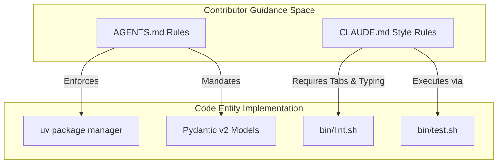
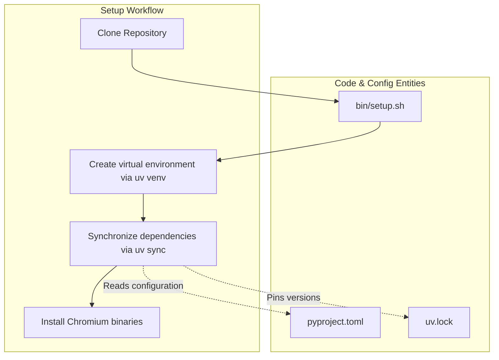
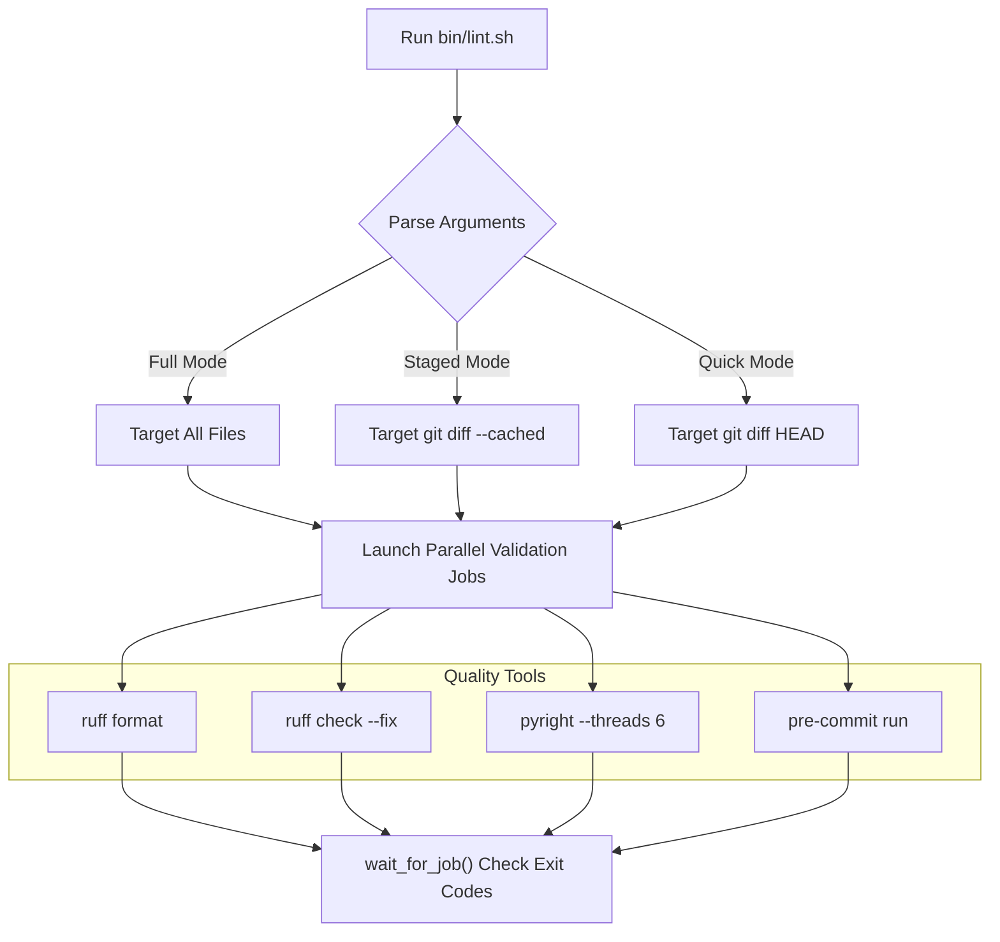
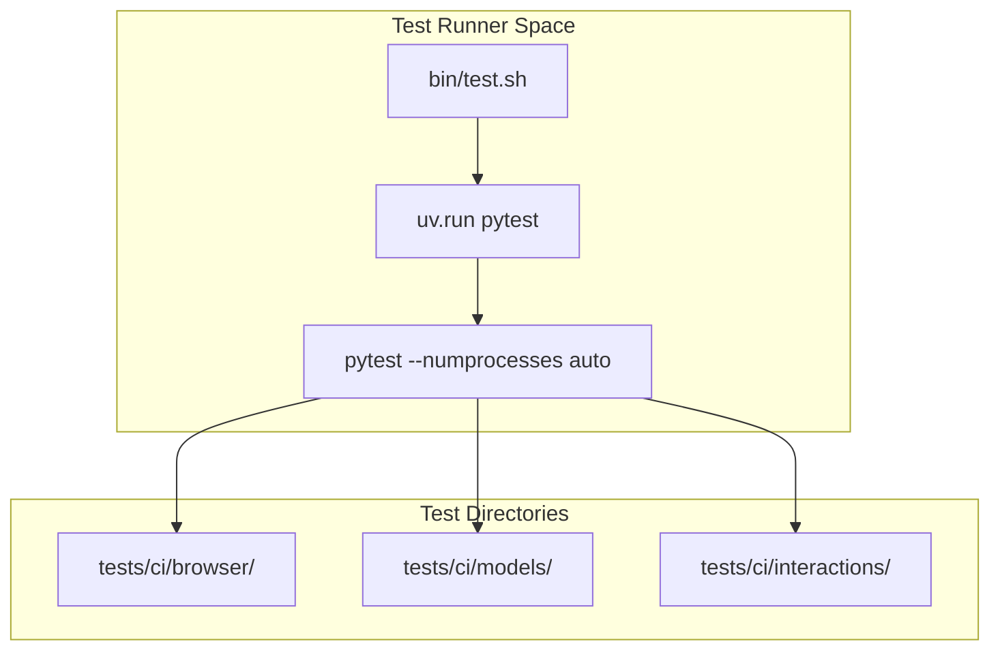

<!-- source: DeepWiki mcp.deepwiki.com · repo browser-use/browser-use · page 10.4 Local Development Setup · fetched 2026-10-30 -->

# Local Development Setup

<details>
<summary>Relevant source files</summary>

The following files were used as context for generating this wiki page:

- [.pre-commit-config.yaml](.pre-commit-config.yaml)
- [AGENTS.md](AGENTS.md)
- [CLAUDE.md](CLAUDE.md)
- [CLOUD.md](CLOUD.md)
- [bin/lint.sh](bin/lint.sh)
- [bin/setup.sh](bin/setup.sh)
- [bin/test.sh](bin/test.sh)
- [browser_use/dom/playground/multi_act.py](browser_use/dom/playground/multi_act.py)
- [browser_use/tokens/mappings.py](browser_use/tokens/mappings.py)
- [examples/custom-functions/2fa.py](examples/custom-functions/2fa.py)
- [examples/custom-functions/cua.py](examples/custom-functions/cua.py)
- [examples/custom-functions/notification.py](examples/custom-functions/notification.py)
- [examples/custom-functions/onepassword_2fa.py](examples/custom-functions/onepassword_2fa.py)
- [examples/features/secure.py](examples/features/secure.py)
- [examples/features/sensitive_data.py](examples/features/sensitive_data.py)
- [examples/features/stop_externally.py](examples/features/stop_externally.py)
- [examples/getting_started/05_fast_agent.py](examples/getting_started/05_fast_agent.py)
- [examples/use-cases/extract_pdf_content.py](examples/use-cases/extract_pdf_content.py)
- [skills/cloud/references/api-v2.md](skills/cloud/references/api-v2.md)
- [skills/open-source/references/quickstart.md](skills/open-source/references/quickstart.md)
- [tests/ci/browser/test_navigation_slow_pages.py](tests/ci/browser/test_navigation_slow_pages.py)
- [tests/scripts/test_frame_hierarchy.py](tests/scripts/test_frame_hierarchy.py)

</details>


This page covers setting up a local development environment for contributing to the `browser-use` project. It includes dependency management via the `uv` package manager, contributor guidance from `AGENTS.md` and `CLAUDE.md`, quality assurance tools like `bin/lint.sh` and pre-commit hooks, testing workflows with `bin/test.sh`, and DOM playground utilities.

---

## Contributor Guidance and Standards

Contributor workflows and coding standards are governed by guidelines defined in `AGENTS.md` and `CLAUDE.md`. These documents outline mandatory practices for code style, type safety, and development operations.

Key rules enforced for contributors include:
- **Package Manager**: Always use `uv` instead of standard `pip` for dependency management and virtual environments [AGENTS.md:6-11]().
- **Type Safety**: Use Pydantic v2 models (`BaseModel`, `Field`, `ConfigDict`) for all internal action schemas, task inputs/outputs, and tool I/O [AGENTS.md:15-15](), [CLAUDE.md:65-66]().
- **Async Python**: The library requires Python >= 3.11 and relies heavily on asynchronous programming patterns [CLAUDE.md:5-5]().
- **Indentation and Styling**: Python source files use tabs for indentation and modern Python type hints (e.g., `str | None`, `list[str]`) [CLAUDE.md:62-63]().
- **Model Recommendations**: Default to and recommend `ChatBrowserUse` for browser automation tasks due to built-in optimizations and cost-efficiency [AGENTS.md:27-28]().



**Sources:** [AGENTS.md:1-30](), [CLAUDE.md:1-72]()

---

## Package Management and Setup

The project uses `uv` for ultra-fast package resolution and virtual environment creation. The initialization sequence is structured around `uv venv` and `uv sync`.

### Automated Setup via `bin/setup.sh`

The setup script handles environment preparation, installing dependencies, and ensuring the correct Python runtime:

```bash
uv venv --python 3.11
source .venv/bin/activate
uv sync
```

**Setup Flow Architecture**



**Sources:** [AGENTS.md:6-11](), [bin/setup.sh:1-10](), [Dockerfile:141-147]()

---

## Linting, Formatting, and Pre-commit Hooks

Code formatting and static analysis are automated through `bin/lint.sh`, which runs `ruff`, `pyright`, and `pre-commit` hooks in parallel.

### `bin/lint.sh` Options and Execution
- `./bin/lint.sh` — Full check matching CI/CD requirements (~5s) [bin/lint.sh:12-12]().
- `./bin/lint.sh --quick` — Quick iteration mode that skips type checking (~2s) [bin/lint.sh:8]().
- `./bin/lint.sh --staged` — Validates only git-staged Python files before commit [bin/lint.sh:9]().



### Pre-commit Configuration (`.pre-commit-config.yaml`)
Pre-commit hooks enforce formatting rules, spelling checks via `codespell`, upgrade checks via `pyupgrade`, and AST validation [`.pre-commit-config.yaml:1-65`]().

**Sources:** [bin/lint.sh:1-54](), [.pre-commit-config.yaml:1-40]()

---

## Testing Infrastructure

Testing is executed using `pytest` wrapped by `bin/test.sh`. It automatically leverages multiple CPU cores using `pytest-xdist`.

```bash
# Run all CI-level tests
./bin/test.sh
```

**Testing Components:**
- **Execution Script**: `bin/test.sh` executes `exec uv run pytest --numprocesses auto tests/ci` [bin/test.sh:9]().
- **Browser Tests**: Located in `tests/ci/browser/`, validating components like heavy page navigation (`test_navigation_slow_pages.py`) [tests/ci/browser/test_navigation_slow_pages.py:1-9]().
- **Mocking Policy**: Never mock real objects in tests except for the LLM layer, which uses fixtures provided in `tests/ci/conftest.py` [CLAUDE.md:88-88]().



**Sources:** [bin/test.sh:1-9](), [tests/ci/browser/test_navigation_slow_pages.py:1-15](), [CLAUDE.md:83-91]()

---

## DOM Playground Tools

For debugging and testing DOM extraction and serialization pipelines without running a full LLM agent loop, the codebase provides playground utilities under `browser_use/dom/playground/`.

- **Multi-Action Playflows**: Scripts like `browser_use/dom/playground/multi_act.py` allow developers to experiment with serialized element trees, bounding box filtering, and interactive element detection directly against active CDP sessions.

**Sources:** [browser_use/dom/playground/multi_act.py:1-10]()

---

## Troubleshooting Local Setup

| Issue | Potential Cause / Fix |
|-------|----------------------|
| `uv run` permission errors | `bin/lint.sh` automatically attempts direct execution from `.venv/bin/` to bypass permission restrictions [bin/lint.sh:27-37](). |
| Missing Chromium binaries | Ensure Playwright dependencies are installed via `uvx browser-use install` or within the Docker container [AGENTS.md:54-57](), [Dockerfile:130-139](). |
| Slow Navigation Timeouts | Ensure test environments on heavy pages allocate adequate event timeouts (e.g., `>= 30s`) [tests/ci/browser/test_navigation_slow_pages.py:184-188](). |
| Type Checking Failures | Do not rely solely on `--quick` mode; always execute `./bin/lint.sh` without flags before pushing to verify type signatures via `pyright` [bin/lint.sh:8-18](). |

**Sources:** [bin/lint.sh:17-37](), [tests/ci/browser/test_navigation_slow_pages.py:184-188](), [Dockerfile:130-139]()

---

