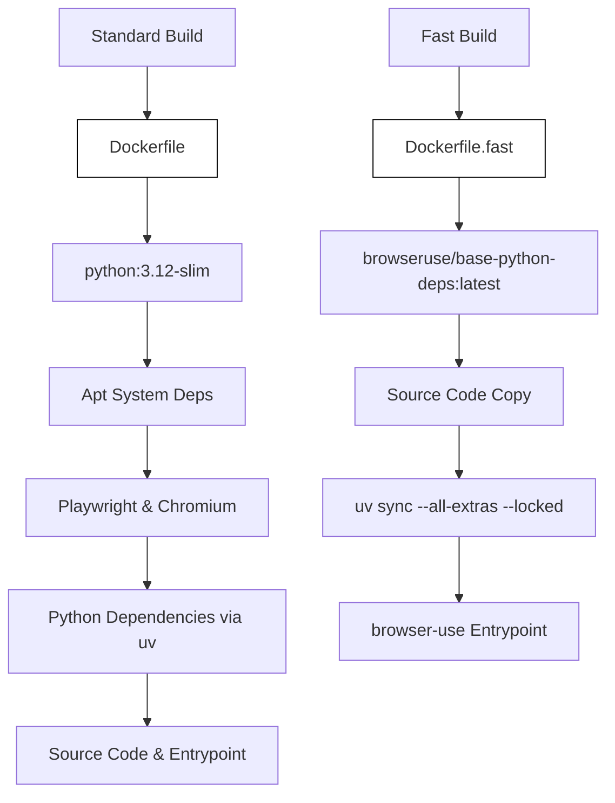
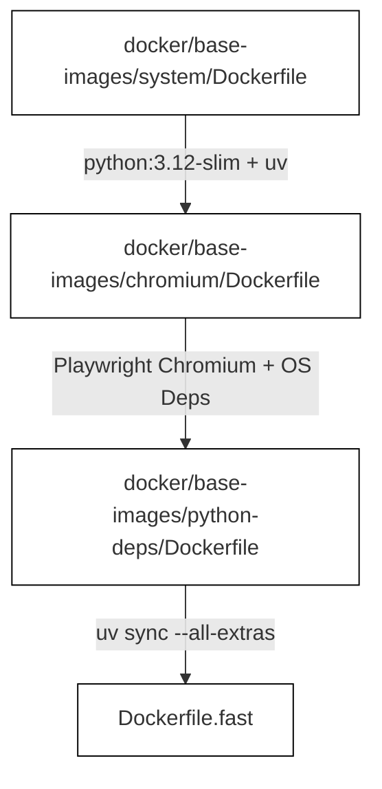

<!-- source: DeepWiki mcp.deepwiki.com · repo browser-use/browser-use · page 10.5 Docker and Containerization · fetched 2026-10-30 -->

# Docker and Containerization

Relevant source files

The following files were used as context for generating this wiki page:

- [.dockerignore](.dockerignore)
- [Dockerfile](Dockerfile)
- [Dockerfile.fast](Dockerfile.fast)
- [docker/README.md](docker/README.md)
- [docker/base-images/chromium/Dockerfile](docker/base-images/chromium/Dockerfile)
- [docker/base-images/python-deps/Dockerfile](docker/base-images/python-deps/Dockerfile)
- [docker/base-images/system/Dockerfile](docker/base-images/system/Dockerfile)
- [docker/build-base-images.sh](docker/build-base-images.sh)

## Purpose and Scope
This document covers the containerization architecture of `browser-use`, detailing the dual build strategies (`Dockerfile` and `Dockerfile.fast`), the layered base image hierarchy (`docker/base-images/`), build orchestration via `docker/build-base-images.sh`, exclusion tuning (`.dockerignore`), and container runtime configuration including UID/GID mapping and volume persistence.

Sources: `Dockerfile`, `Dockerfile.fast`, `docker/README.md` [Dockerfile:1-213](), [Dockerfile.fast:1-31](), [docker/README.md:1-34]()

---

## 1. Build Variants: Standard vs. Fast Containerization
The repository provides two primary Dockerfiles to accommodate different CI/CD and local development needs: a fully self-contained `Dockerfile` and an optimized `Dockerfile.fast` that relies on pre-built base image layers [docker/README.md:18-27]().

### Standard `Dockerfile`
The standard `Dockerfile` [Dockerfile:1-213]() builds the entire environment in a single monolithic process based on `python:3.12-slim` [Dockerfile:20-20](). It configures global locale and Python environment variables (`PYTHONUNBUFFERED=1`, `UV_LINK_MODE=copy`), establishes a non-privileged user (`browseruse`), installs system packages via `apt-get`, and compiles dependencies directly [Dockerfile:45-138](). While self-contained, cold builds take approximately 2 minutes [docker/README.md:32]().

### Fast `Dockerfile.fast`
The `Dockerfile.fast` [Dockerfile.fast:1-31]() leverages pre-built base layers, reducing build times to roughly 30 seconds and incremental code-change rebuilds to ~16 seconds [docker/README.md:33-34](). It inherits from the `base-python-deps` target [Dockerfile.fast:4-4](), configures runtime directories [Dockerfile.fast:10-19](), copies the source code [Dockerfile.fast:21-22](), syncs dependencies using `uv` [Dockerfile.fast:25-26](), and sets the entrypoint to the `browser-use` CLI executable [Dockerfile.fast:31-31]().

*Figure 1: Comparison between standard monolithic builds and fast layered builds.*

Sources: `Dockerfile`, `Dockerfile.fast`, `docker/README.md` [Dockerfile:1-213](), [Dockerfile.fast:1-31](), [docker/README.md:1-34]()

---

## 2. Base Image Layering Architecture (`docker/base-images/`)
To optimize caching and drastically speed up continuous integration and development builds, `browser-use` separates container dependencies into distinct hierarchical base images located in `docker/base-images/` [docker/README.md:1-27]().

### Layer 1: System (`base-images/system/Dockerfile`)
The foundational layer initializes the `python:3.12-slim` image, installs minimal system certificates and networking utilities (`ca-certificates`, `curl`, `wget`), and injects the Astral `uv` package manager binary directly from its official release container [docker/base-images/system/Dockerfile:1-10]().

### Layer 2: Chromium (`base-images/chromium/Dockerfile`)
Extending `base-system`, this layer sets up the browser runtime environment [docker/base-images/chromium/Dockerfile:1-2](). It temporarily installs `playwright`, triggers `playwright install chromium --with-deps --no-shell` into `/opt/playwright`, creates a symbolic link at `/usr/bin/chromium-browser`, and strips out the temporary `playwright` python package while retaining the browser binaries and OS-level shared libraries [docker/base-images/chromium/Dockerfile:7-15]().

### Layer 3: Python Dependencies (`base-images/python-deps/Dockerfile`)
Extending `base-chromium`, this layer copies `pyproject.toml` and `uv.lock`, then runs `uv venv` and `uv sync --all-extras --no-dev --no-install-project --compile-bytecode` to pre-compile and cache all third-party Python dependencies in `/app/.venv` [docker/base-images/python-deps/Dockerfile:1-11]().

*Hierarchy of base image dependencies leading to `Dockerfile.fast`.*

### Build Orchestration Script (`build-base-images.sh`)
The `docker/build-base-images.sh` script automates sequential building and tagging of the base images using Docker Buildx [docker/build-base-images.sh:1-58](). It supports multi-platform compilation (`--platforms`), registry specification (`--registry`), and automated pushing (`--push`) [docker/build-base-images.sh:6-28]().

Sources: `docker/base-images/system/Dockerfile`, `docker/base-images/chromium/Dockerfile`, `docker/base-images/python-deps/Dockerfile`, `docker/build-base-images.sh` [docker/base-images/system/Dockerfile:1-10](), [docker/base-images/chromium/Dockerfile:1-15](), [docker/base-images/python-deps/Dockerfile:1-11](), [docker/build-base-images.sh:1-58]()

---

## 3. Container Runtime Environment & Security
Containers running browser automation require careful permission handling and volume mapping to prevent privilege escalation and persist user data across executions.

### Non-Privileged User Setup
Both `Dockerfile` and `Dockerfile.fast` create a dedicated system user (`browseruse`) mapped to configurable PUID and PGID environment variables (defaulting to `911:911`) [Dockerfile:65-67](), [Dockerfile.fast:8-8](). This aligns with standard Linuxserver.io container conventions, preventing Chromium and Python processes from executing as root:

* System groups `audio` and `video` are assigned to the `browseruse` user [Dockerfile:104](), [Dockerfile.fast:12]() to support hardware acceleration and media streams if available.
* The home directory is initialized with appropriate ownership, and configuration directories are symlinked to the mounted data volume [Dockerfile:107-110](), [Dockerfile.fast:15-19]().

### Runtime Volumes and Ports
* **Volume Persistence**: `/data` is designated as a Docker volume (`VOLUME "$DATA_DIR"`) [Dockerfile.fast:29-29]() to preserve session profiles, downloads, and trajectory histories between runs.
* **Exposed Ports**: Ports `9242` and `9222` are exposed [Dockerfile.fast:30-30]() for remote debugging, Chrome DevTools Protocol (CDP) interactions, and auxiliary service monitoring.

Sources: `Dockerfile`, `Dockerfile.fast` [Dockerfile:101-115](), [Dockerfile.fast:8-31]()

---

## 4. Build Optimization & `.dockerignore`
To minimize build context transfer times and prevent sensitive credentials or local caches from polluting image layers, `.dockerignore` excludes unnecessary files [nuxt/../.dockerignore:1-46]().

Key exclusion categories include:
* **Version Control & Documentation**: `.git/`, `.claude/`, `.github/`, `docs/`, `static/` [nuxt/../.dockerignore:1-4]()
* **Local Caches**: `__pycache__/`, `.venv/`, `.pytest_cache/`, `.mypy_cache/`, `.ruff_cache/` [nuxt/../.dockerignore:6-18]()
* **Artifacts & Data**: Compiled binaries, `.gif`, `.pdf`, `.csv`, `.json`, trajectory logs, and saved profiles (`saved_trajectories/`, `AgentHistory.json`) [nuxt/../.dockerignore:24-44]()
* **Secrets**: `.env`, `secrets.env`, `cookies.json`, `browser_cookies.json`, and cloud authentication keys (`gcp-login.json`) [nuxt/../.dockerignore:36-46]()

Sources: `.dockerignore` [.dockerignore:1-46]()

---

