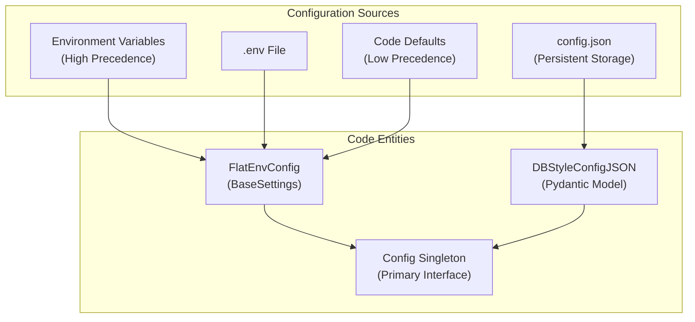
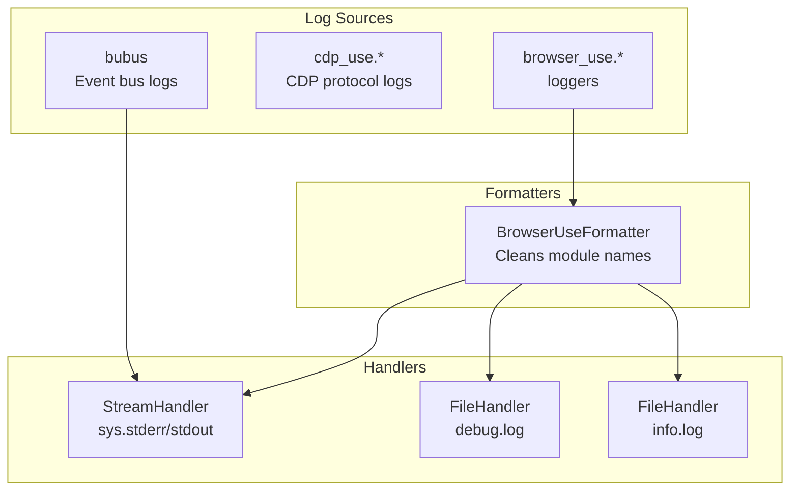
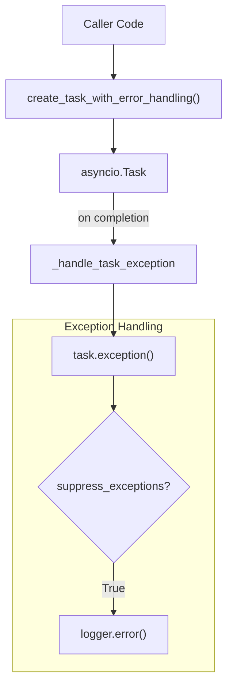
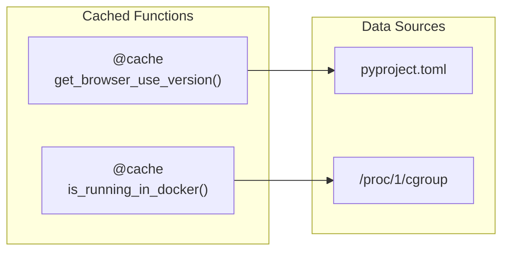
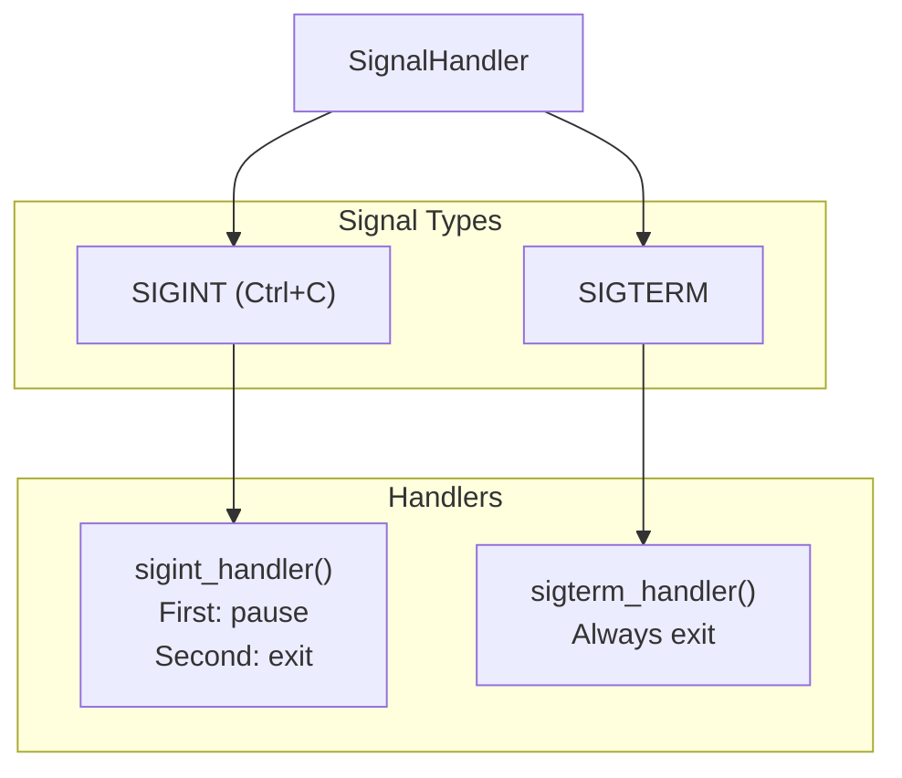
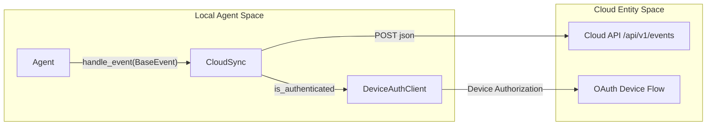

<!-- source: DeepWiki mcp.deepwiki.com · repo browser-use/browser-use · page 11 Advanced Topics · fetched 2026-10-30 -->

# Advanced Topics

Relevant source files

The following files were used as context for generating this wiki page:

- [browser_use/beta/service.py](browser_use/beta/service.py)
- [browser_use/utils.py](browser_use/utils.py)
- [examples/models/browser_use_provider_models.py](examples/models/browser_use_provider_models.py)
- [tests/ci/test_beta_agent.py](tests/ci/test_beta_agent.py)

This section covers advanced operational concerns for browser-use including configuration management, logging infrastructure, error recovery mechanisms, performance optimization strategies, signal handling, telemetry collection, and security considerations. These topics are essential for production deployments, debugging complex issues, and extending browser-use functionality.

For basic setup and usage patterns, see [Installation and Setup](#1.2) and [Quick Start Examples](#1.3). For browser configuration specifics, see [Browser Configuration](#7).

---

## Configuration Management

Browser-use uses a hierarchical configuration system that integrates environment variables, `.env` files, and a database-style JSON configuration. Configuration is loaded from multiple sources with a defined precedence order: environment variables override config file values, which override defaults.

### Configuration Hierarchy

The system utilizes `Pydantic` for robust validation and `pydantic-settings` for environment management via the `FlatEnvConfig` class.

Title: Configuration System Flow

The `Config` class provides backward compatibility by dynamically proxying attribute access to underlying configuration stores [browser_use/config.py:191-236](). It uses dynamic property lookups to re-read values on access, ensuring live reloading without restarting the process [browser_use/config.py:352-398]().

**Sources:** [browser_use/config.py:191-236](), [browser_use/config.py:352-398]()

### Configuration Loading and Migration

The `load_and_migrate_config()` function handles automatic migration from old configuration formats to the current `DBStyleConfigJSON` structure. When an old format is detected, the file is updated or replaced with a fresh default configuration to ensure system stability.

**Sources:** [browser_use/config.py:306-349]()

For details, see [Configuration Management](#11.1).

---

## Logging System

Browser-use implements a multi-destination logging system with support for console output, file logging, and specialized formatting for different components.

### Logging Architecture

Title: Log Routing and Formatting

**Sources:** [browser_use/logging_config.py:64-174]()

### Custom Logging Level: RESULT

The `addLoggingLevel()` function dynamically adds a custom `RESULT` level (value 35) between `WARNING` and `ERROR`. This level is used for high-level agent results while suppressing low-level implementation details.

**Sources:** [browser_use/logging_config.py:13-62]()

### BrowserUseFormatter

The `BrowserUseFormatter` class simplifies logger names for readability (e.g., mapping `browser_use.dom.service` to `dom`) only when `log_level > logging.DEBUG`.

**Sources:** [browser_use/logging_config.py:90-112]()

For details, see [Logging System](#11.2).

---

## Error Recovery and Resilience

Browser-use implements multiple layers of error recovery to maintain operation through browser crashes, network failures, and unexpected states.

### Task Exception Handling

The asynchronous execution patterns wrap background tasks with automatic exception logging and recovery strategies to prevent unhandled task crashes.

Title: Async Task Resilience

**Sources:** [browser_use/utils.py:1-16]()

For details, see [Error Recovery and Resilience](#11.3).

---

## Performance Optimization

Browser-use employs several performance optimization strategies including caching, lazy loading, and efficient async patterns.

### Caching Strategies

The `@cache` decorator from `functools` memoizes expensive operations like environment detection and version checking.

Title: Memoization and Detection

**Sources:** [browser_use/utils.py:10-15]()

For details, see [Performance Optimization](#11.4).

---

## Signal Handling and Graceful Shutdown

The `SignalHandler` class provides cross-platform signal handling with pause/resume functionality and graceful shutdown [browser_use/utils.py:159-182]().

### SignalHandler Architecture

Title: Signal Processing Logic

**Sources:** [browser_use/utils.py:159-182]()

### Terminal Reset and Exit

During a second `Ctrl+C` or a `SIGTERM`, the system executes cleanup routines that attempt to reset terminal escape sequences before terminating execution gracefully.

**Sources:** [browser_use/utils.py:1-16]()

For details, see [Signal Handling and Utilities](#11.5).

---

## Telemetry and Usage Tracking

Browser-use includes anonymized telemetry collection for usage analytics and error tracking via the `ProductTelemetry` service.

### Telemetry Architecture

The `ProductTelemetry` class captures events and forwards them to telemetry endpoints unless anonymized telemetry is disabled via configuration settings.

| Feature | Implementation | Source |
|---------|----------------|--------|
| User ID | Device identification stored locally | [browser_use/beta/service.py:65-66]() |
| Provider | PostHog or internal telemetry service | [browser_use/beta/service.py:65-66]() |
| Event Model | `AgentTelemetryEvent` | [browser_use/beta/service.py:66]() |

**Sources:** [browser_use/beta/service.py:65-66]()

For details, see [Telemetry and Usage Tracking](#11.6).

---

## Security Considerations

Browser-use implements multiple security measures for sensitive data handling, domain isolation, and safe browser operation.

### Sensitive Data Masking

The system includes utilities such as `collect_sensitive_data_values()` [browser_use/utils.py:91-105]() and `redact_sensitive_string()` [browser_use/utils.py:108-122]() which replace sensitive values with placeholders to avoid leaks in LLM logs or history.

**Sources:** [browser_use/utils.py:91-122]()

### URL Validation and Domain Pattern Matching

The codebase uses helper functions such as `is_placeholder_url()` [browser_use/utils.py:29-41]() and `sanitize_url_candidate()` [browser_use/utils.py:47-76]() to validate input and ensure safe navigation behavior.

**Sources:** [browser_use/utils.py:29-76]()

For details, see [Security Considerations](#11.7).

---

## Cloud Sync and Observability

Browser-use supports synchronization with cloud services and third-party observability platforms.

### Cloud Synchronization

The cloud sync infrastructure manages event streaming to remote backends for monitoring and multi-turn execution persistence.

Title: Cloud Synchronization Bridge

**Sources:** [browser_use/beta/service.py:31-37]()

### Observability Integration

The `observability` module provides tracing integrations with `lmnr` (Laminar) when available, capturing spans and attributes for debugging LLM calls and agent execution steps [browser_use/beta/service.py:104-185]().

**Sources:** [browser_use/beta/service.py:104-185]()

For details, see [Cloud Sync and Observability](#11.8).

---

