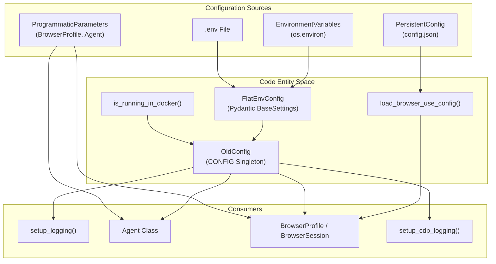
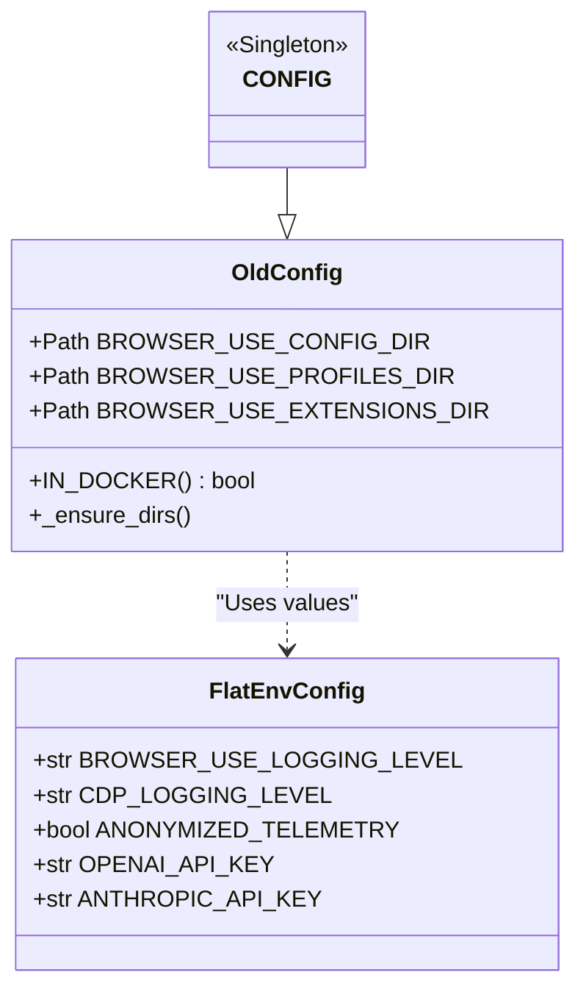
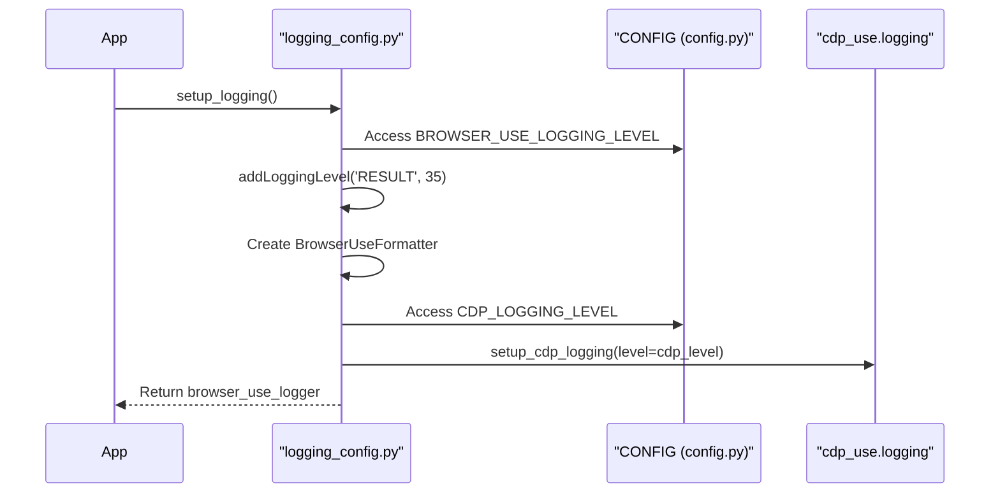

<!-- source: DeepWiki mcp.deepwiki.com · repo browser-use/browser-use · page 11.1 Configuration Management · fetched 2026-10-30 -->

# Configuration Management

Relevant source files

The following files were used as context for generating this wiki page:

- [.env.example](.env.example)
- [browser_use/config.py](browser_use/config.py)
- [browser_use/logging_config.py](browser_use/logging_config.py)
- [tests/ci/test_extension_config.py](tests/ci/test_extension_config.py)

## Purpose and Scope

This page documents the browser-use configuration system, which manages settings through multiple hierarchical sources: environment variables, `.env` files, JSON-based persistent configuration files (`config.json`), and programmatic parameters. The system handles browser profiles, extension settings, LLM credentials, agent parameters, and runtime environment detection (such as containerized Docker runtimes).

For browser-specific settings like Chrome launch arguments and profile options, see **7.1 Chrome Launch Arguments**. For logging-specific configuration, see **11.2 Logging System**.

Sources: [browser_use/config.py:1-213](), [.env.example:1-71](), [tests/ci/test_extension_config.py:1-158]()

---

## Configuration Hierarchy and Precedence

The browser-use configuration framework resolves settings using a strict order of precedence. When a configuration parameter (such as `headless`, `disable_security`, or `enable_default_extensions`) is requested, the system evaluates sources from highest to lowest priority:

1. **Explicit Programmatic Parameters**: Arguments passed directly to constructors (e.g., `BrowserProfile(headless=True)`) or explicit runtime overrides [tests/ci/test_extension_config.py:108-121]().
2. **System Environment Variables**: Active environment variables in `os.environ` (loaded via shell environment or `.env`) [browser_use/config.py:191-194]().
3. **Persisted JSON Configuration (`config.json`)**: Stored configuration values located in the configuration directory (`BROWSER_USE_CONFIG_FILE`) [tests/ci/test_extension_config.py:137-158]().
4. **Default Fallback Values**: Hardcoded defaults or `.env.example` specifications [tests/ci/test_extension_config.py:23-30]().

Title: Configuration Data Flow

Sources: [browser_use/config.py:1-213](), [tests/ci/test_extension_config.py:108-158]()

---

## Configuration Entities and Classes

The system utilizes specialized classes and utility functions to parse, validate, and store settings across the framework.

### FlatEnvConfig
`FlatEnvConfig` is a Pydantic `BaseSettings` subclass that maps environment variables into a flat namespace [browser_use/config.py:191-194](). It reads from `.env`, respects case sensitivity, and defines default variables for logging, telemetry, and API keys [browser_use/config.py:194-213]().

### OldConfig (`CONFIG` Singleton)
Despite its historical name, `OldConfig` is the active configuration manager instantiated as the global `CONFIG` singleton in `browser_use/config.py` [browser_use/config.py:47-51](). It provides lazy-loading properties for environment variables and manages directory trees:
- **`BROWSER_USE_CONFIG_DIR`**: Resolves to `~/.config/browseruse` or respects `XDG_CONFIG_HOME` [browser_use/config.py:96-99]().
- **`BROWSER_USE_PROFILES_DIR`**: Subdirectory for persistent browser user profiles [browser_use/config.py:106-109]().
- **`BROWSER_USE_EXTENSIONS_DIR`**: Subdirectory for unpacked or cached browser extensions [browser_use/config.py:116-119]().

### Docker Detection
The `is_running_in_docker()` cached utility function runs diagnostic checks to determine if the library is executing inside a container, enabling automatic configuration tuning (such as disabling GPU acceleration or adjusting shared memory flags) [browser_use/config.py:19-45]():
- Inspects `/.dockerenv` existence and `/proc/1/cgroup` content [browser_use/config.py:23-26]().
- Inspects PID 1 command-line arguments (`py`, `uv`, `app`) [browser_use/config.py:31-33]().
- Checks for low process counts (`len(psutil.pids()) < 10`) [browser_use/config.py:39-40]().

Title: Config Entity Relationships

Sources: [browser_use/config.py:19-130](), [browser_use/config.py:191-213]()

---

## Extension and Browser Configuration Integration

Browser profiles (`BrowserProfile`) and sessions (`BrowserSession`) integrate with environment variables and persistent configuration to govern features like headless mode, security policies, and extensions [tests/ci/test_extension_config.py:76-98]().

- **Extension Management**: `BROWSER_USE_DISABLE_EXTENSIONS` controls whether default browser extensions are loaded [tests/ci/test_extension_config.py:34]().
- **Security Policies**: `BROWSER_USE_DISABLE_SECURITY` determines if browser security flags (such as web security or CORS restrictions) are bypassed [tests/ci/test_extension_config.py:123-132](). Unset environment variables preserve stored policies in `config.json`, whereas explicit environment variables override stored policies [tests/ci/test_extension_config.py:137-158]().

Sources: [tests/ci/test_extension_config.py:20-158]()

---

## Environment Variables Reference

The following environment variables are supported across `.env` files and the runtime environment:

| Variable | Type | Default | Description |
|----------|------|---------|-------------|
| **Logging** | | | |
| `BROWSER_USE_LOGGING_LEVEL` | `str` | `"info"` | Log level (`"result"`, `"info"`, `"debug"`, `"warning"`, `"error"`) [browser_use/logging_config.py:80-81]() |
| `CDP_LOGGING_LEVEL` | `str` | `"WARNING"` | Chrome DevTools Protocol logging level [browser_use/logging_config.py:178-179]() |
| `BROWSER_USE_DEBUG_LOG_FILE` | `str \| None` | `None` | Optional file path for debug logs [.env.example:10]() |
| `BROWSER_USE_INFO_LOG_FILE` | `str \| None` | `None` | Optional file path for info logs [.env.example:13]() |
| **LLM API Keys** | | | |
| `OPENAI_API_KEY` | `str` | `""` | OpenAI API key [browser_use/config.py:134-135]() |
| `ANTHROPIC_API_KEY` | `str` | `""` | Anthropic Claude API key [browser_use/config.py:138-139]() |
| `GOOGLE_API_KEY` | `str` | `""` | Google Gemini API key [browser_use/config.py:142-143]() |
| `DEEPSEEK_API_KEY` | `str` | `""` | DeepSeek API key [browser_use/config.py:146-147]() |
| `GROK_API_KEY` | `str` | `""` | Grok API key [browser_use/config.py:150-151]() |
| `NOVITA_API_KEY` | `str` | `""` | Novita API key [browser_use/config.py:154-155]() |
| **Browser Settings** | | | |
| `BROWSER_USE_HEADLESS` | `bool` | `false` | Run browser instances in headless mode [.env.example:57]() |
| `BROWSER_USE_DISABLE_EXTENSIONS`| `bool` | `false` | Disable default browser extensions [tests/ci/test_extension_config.py:34]() |
| `BROWSER_USE_DISABLE_SECURITY` | `bool` | `false` | Disable browser security features (e.g., for MCP workflows) [tests/ci/test_extension_config.py:126]() |
| **Runtime & Cloud** | | | |
| `ANONYMIZED_TELEMETRY` | `bool` | `true` | Enable/disable anonymous telemetry collection [.env.example:20]() |
| `BROWSER_USE_API_KEY` | `str` | `""` | Browser Use Cloud API key [.env.example:24]() |
| `IN_DOCKER` | `bool` | Auto | Force or auto-detect Docker container environment [browser_use/config.py:175-176]() |
| `BROWSER_USE_VERSION_CHECK` | `bool` | `true` | Enable/disable version update checks on startup [browser_use/config.py:183-184]() |

Sources: [browser_use/config.py:132-190](), [browser_use/logging_config.py:64-190](), [.env.example:1-71](), [tests/ci/test_extension_config.py:24-158]()

---

## Logging Configuration Integration

The configuration system integrates with `setup_logging()` in `browser_use/logging_config.py`, leveraging `CONFIG.BROWSER_USE_LOGGING_LEVEL` and `CONFIG.CDP_LOGGING_LEVEL` to establish output streams and formatting [browser_use/logging_config.py:64-81]().

Title: Logging Setup Flow

**Key Logging Behaviors**:
- **RESULT Level**: Registers custom level `35` (between INFO and WARNING) to log agent execution outputs [browser_use/logging_config.py:74-76]().
- **CDP Logging**: Configures `cdp_use` and websocket layers using `CONFIG.CDP_LOGGING_LEVEL` [browser_use/logging_config.py:175-185]().
- **Formatter Normalization**: `BrowserUseFormatter` simplifies component logger prefixes (e.g., `browser_use.agent.service` -> `Agent`) during INFO operation, while retaining full dotted modules in DEBUG mode [browser_use/logging_config.py:90-112]().

Sources: [browser_use/logging_config.py:64-185](), [browser_use/config.py:20-46]()

---

