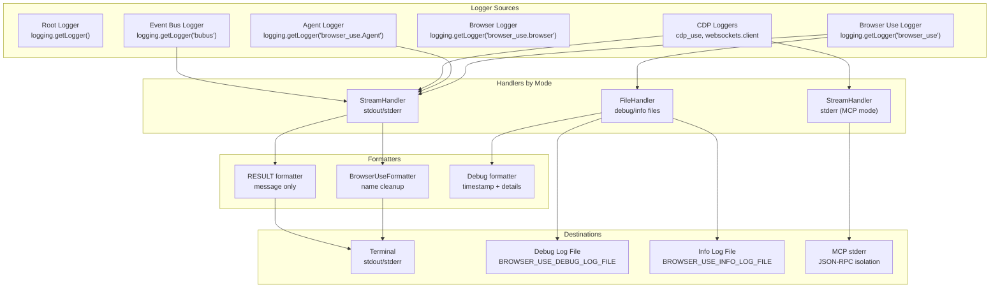
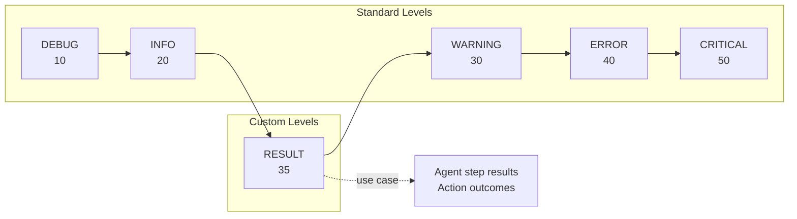
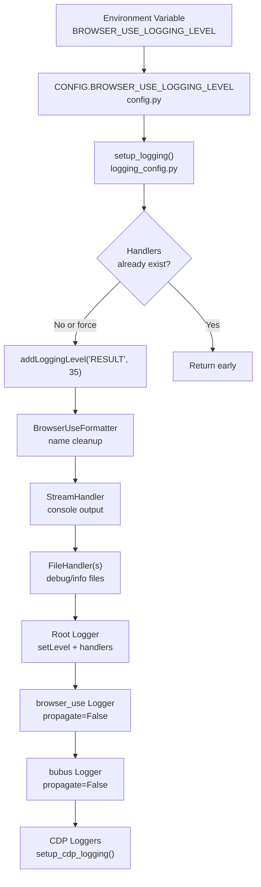
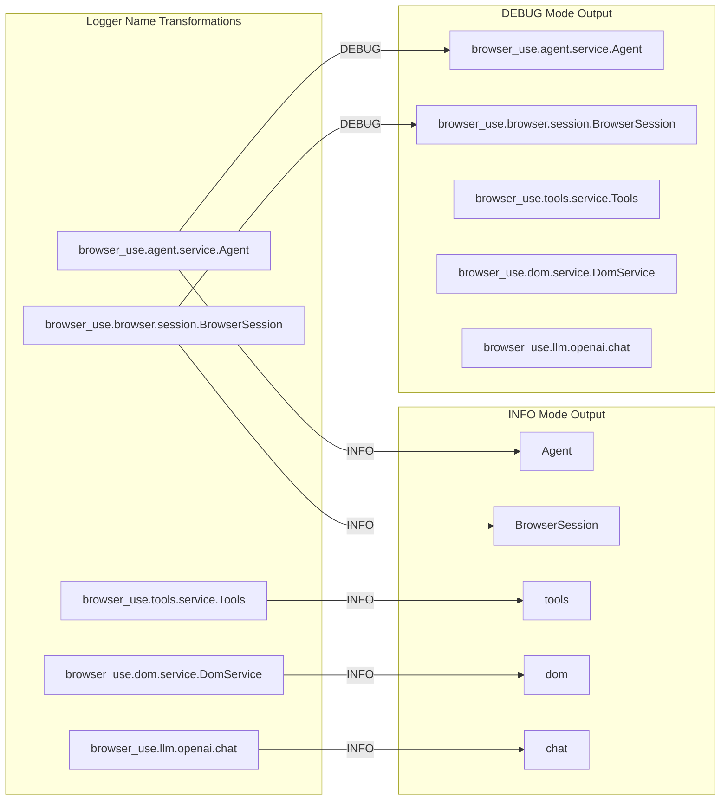

<!-- source: DeepWiki mcp.deepwiki.com · repo browser-use/browser-use · page 11.2 Logging System · fetched 2026-10-30 -->

# Logging System

<details>
<summary>Relevant source files</summary>

The following files were used as context for generating this wiki page:

- [.env.example](.env.example)
- [browser_use/config.py](browser_use/config.py)
- [browser_use/logging_config.py](browser_use/logging_config.py)
- [tests/ci/test_extension_config.py](tests/ci/test_extension_config.py)

</details>


The logging system in `browser-use` provides multi-destination logging capabilities with flexible configuration for different execution contexts (CLI, TUI, MCP server). It supports custom log levels, structured formatters, and context-aware routing to prevent interference between different I/O channels.

---

## Architecture Overview



**Title: Logging System Architecture - Multi-Destination Routing**

The logging system uses Python's standard `logging` module with custom handlers and formatters to route logs to different destinations based on execution context. The system maintains separate logger hierarchies for `browser_use` components, CDP communication, and the internal event bus (`bubus`).

Sources: [browser_use/logging_config.py:1-185](), [browser_use/config.py:197-200]()

---

## Custom Log Levels

The system defines a custom `RESULT` log level between `INFO` (20) and `WARNING` (30) for displaying agent results without verbose logging.



**Title: Log Level Hierarchy**

The `RESULT` level (35) is added via `addLoggingLevel('RESULT', 35)` in [browser_use/logging_config.py:75-78](). This level is used when `BROWSER_USE_LOGGING_LEVEL='result'` to show only agent outcomes without implementation details.

### Implementation of addLoggingLevel
The `addLoggingLevel` function [browser_use/logging_config.py:13-62]() dynamically injects the level into the `logging` module and the `Logger` class. It adds:
- A module-level constant (e.g., `logging.RESULT`) [browser_use/logging_config.py:59]().
- A convenience method on loggers (e.g., `logger.result("msg")`) [browser_use/logging_config.py:60]().
- A module-level convenience function (e.g., `logging.result("msg")`) [browser_use/logging_config.py:61]().

Sources: [browser_use/logging_config.py:13-62](), [browser_use/logging_config.py:75-78]()

---

## Core Logging Setup

### Main Configuration Function

The `setup_logging()` function in [browser_use/logging_config.py:64-185]() is the central configuration point. It supports multiple output streams and optional file logging.

```python
def setup_logging(
    stream=None,              # Output stream (default: sys.stderr)
    log_level=None,           # Override level (default: from CONFIG)
    force_setup=False,        # Force reconfiguration
    debug_log_file=None,      # Path for DEBUG+ logs
    info_log_file=None        # Path for INFO+ logs
)
```

**Configuration Flow:**



**Title: Logging Setup Configuration Flow**

The system allows routing logs to different files based on severity. `BROWSER_USE_DEBUG_LOG_FILE` captures `DEBUG` and above, while `BROWSER_USE_INFO_LOG_FILE` captures `INFO` and above [browser_use/logging_config.py:140-153]().

Sources: [browser_use/logging_config.py:64-185](), [browser_use/config.py:54-55](), [browser_use/config.py:197-200]()

---

## BrowserUseFormatter

The custom `BrowserUseFormatter` class [browser_use/logging_config.py:90-112]() simplifies logger names for readability in `INFO`/`RESULT` modes while preserving full paths in `DEBUG` mode:



**Title: Logger Name Formatting by Level**

The formatter checks `if self.log_level > logging.DEBUG` [browser_use/logging_config.py:97]() to determine whether to clean up names. Cleaned names are extracted from the logger hierarchy:

- `'Agent'` for any logger containing `'Agent'` [browser_use/logging_config.py:99-100]().
- `'BrowserSession'` for loggers containing `'BrowserSession'` [browser_use/logging_config.py:101-102]().
- `'tools'` for loggers containing `'tools'` [browser_use/logging_config.py:103-104]().
- `'dom'` for loggers containing `'dom'` [browser_use/logging_config.py:105-106]().
- Last component for other `browser_use.*` loggers [browser_use/logging_config.py:107-111]().

Sources: [browser_use/logging_config.py:90-112]()

---

## CDP Logging Integration

CDP (Chrome DevTools Protocol) logging is handled via the `CDP_LOGGING_LEVEL` environment variable:

1. **Read CDP level** from `CONFIG.CDP_LOGGING_LEVEL` (default: `'WARNING'`) [browser_use/config.py:198]().
2. **Convert to logging level** via `getattr(logging, cdp_level_str, logging.WARNING)` [browser_use/logging_config.py:179]().
3. **Call setup function** from `cdp_use.logging.setup_cdp_logging` [browser_use/logging_config.py:182-185]().

Sources: [browser_use/logging_config.py:175-185](), [browser_use/config.py:198]()

---

## Multi-Mode Routing and MCP Isolation

The system adapts its logging behavior based on the execution mode to prevent channel interference.

### MCP Mode Isolation
When running as an MCP (Model Context Protocol) server, stdout is reserved for JSON-RPC communication. The logging system must redirect all human-readable logs to stderr to avoid corrupting the protocol stream.
- The `setup_logging` function defaults the stream to `sys.stderr` if not specified [browser_use/logging_config.py:115]().
- In `result` mode, the formatter is simplified to `%(message)s` to provide clean output [browser_use/logging_config.py:128]().

### File Logging
File logging is enabled by passing `debug_log_file` or `info_log_file` to `setup_logging()`. These are typically configured via `.env` variables `BROWSER_USE_DEBUG_LOG_FILE` and `BROWSER_USE_INFO_LOG_FILE` [browser_use/config.py:199-200]().

- **Debug File**: Captures all logs at `DEBUG` level and above, including full timestamps and logger names [browser_use/logging_config.py:140-145]().
- **Info File**: Captures logs at `INFO` level and above [browser_use/logging_config.py:148-153]().

If a debug log file is specified, the root logger level is automatically set to `DEBUG` to ensure all details are captured [browser_use/logging_config.py:156-157]().

Sources: [browser_use/logging_config.py:115-166](), [browser_use/config.py:199-200](), [.env.example:8-13]()

---

