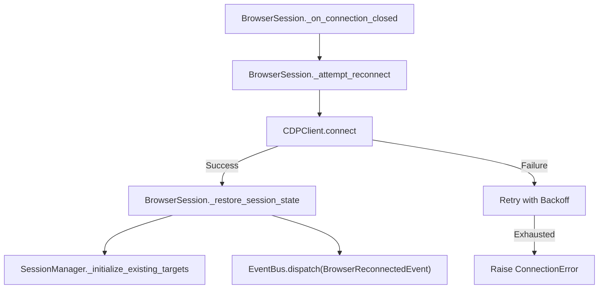
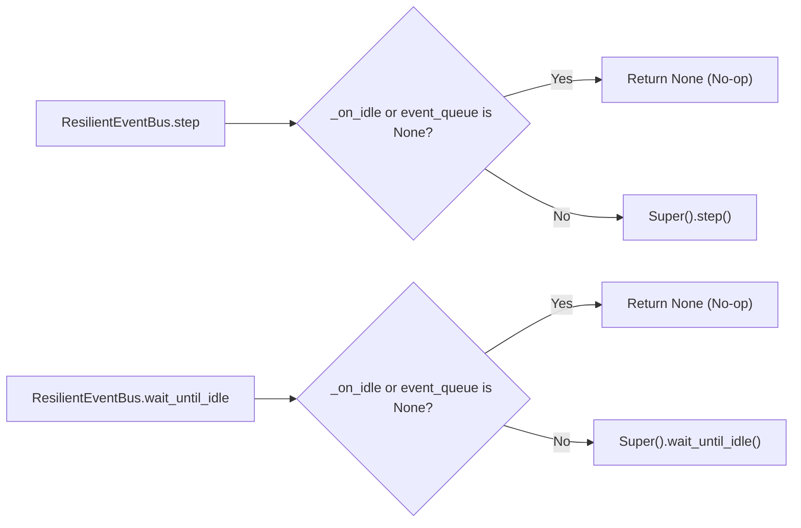
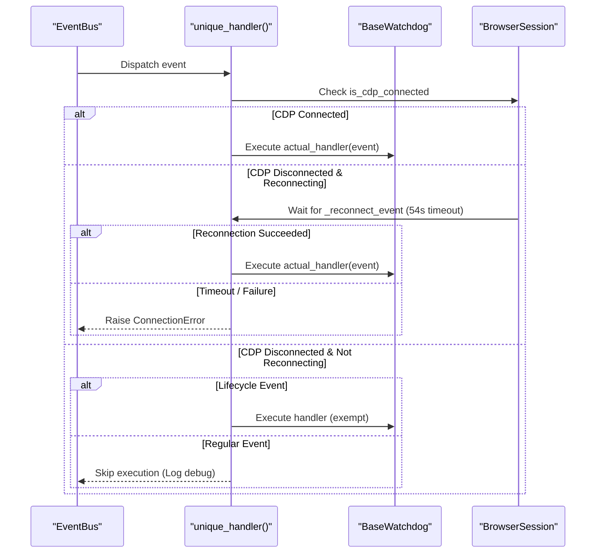

<!-- source: DeepWiki mcp.deepwiki.com · repo browser-use/browser-use · page 11.3 Error Recovery and Resilience · fetched 2026-10-30 -->

# Error Recovery and Resilience

Relevant source files

The following files were used as context for generating this wiki page:

- [browser_use/browser/demo_mode.py](browser_use/browser/demo_mode.py)
- [browser_use/browser/events.py](browser_use/browser/events.py)
- [browser_use/browser/profile.py](browser_use/browser/profile.py)
- [browser_use/browser/session.py](browser_use/browser/session.py)
- [browser_use/browser/session_manager.py](browser_use/browser/session_manager.py)
- [browser_use/browser/watchdog_base.py](browser_use/browser/watchdog_base.py)
- [browser_use/browser/watchdogs/crash_watchdog.py](browser_use/browser/watchdogs/crash_watchdog.py)
- [browser_use/browser/watchdogs/downloads_watchdog.py](browser_use/browser/watchdogs/downloads_watchdog.py)
- [browser_use/browser/watchdogs/popups_watchdog.py](browser_use/browser/watchdogs/popups_watchdog.py)
- [browser_use/browser/watchdogs/security_watchdog.py](browser_use/browser/watchdogs/security_watchdog.py)
- [examples/features/large_blocklist.py](examples/features/large_blocklist.py)
- [tests/ci/security/test_ip_blocking.py](tests/ci/security/test_ip_blocking.py)
- [tests/ci/test_downloads_watchdog.py](tests/ci/test_downloads_watchdog.py)
- [tests/ci/test_remote_download_complete_callback.py](tests/ci/test_remote_download_complete_callback.py)

This page documents the error recovery and resilience mechanisms implemented in `browser-use` to handle browser automation failures, network disruptions, process crashes, and state corruptions gracefully without manual intervention.

---

## Overview

The library employs a multi-layered resilience architecture combining event-driven recovery, circuit breaking, timeouts, and automatic reconnection:

| Recovery Layer | Component / Class | Trigger Condition | Recovery Action / Mechanism |
|---------------|-------------------|-------------------|-----------------------------|
| **WebSocket Reconnection** | `BrowserSession` [browser_use/browser/session.py:134]() | CDP WebSocket connection drop | Exponential backoff retry via `_attempt_reconnect()` [browser_use/browser/session.py:1088]() |
| **Resilient Event Bus** | `ResilientEventBus` [browser_use/browser/session.py:106]() | Warm-Lambda resume / torn-down bus | No-op safe `step()` / `wait_until_idle()` [browser_use/browser/session.py:118-131]() |
| **CDP Request Timeout** | `TimeoutWrappedCDPClient` [browser_use/browser/session.py:23]() | Silent browser hang or proxy stall | Enforces timeout via `asyncio.wait_for` |
| **Circuit Breaker** | `BaseWatchdog` [browser_use/browser/watchdog_base.py:15]() | CDP connection inactive during dispatch | Buffers/waits or skips non-lifecycle handlers [browser_use/browser/watchdog_base.py:94-123]() |
| **Focus Recovery** | `SessionManager` [browser_use/browser/session_manager.py:19]() | Stale or detached target focus access | Automatic focus redirection / cleanup via `_recover_agent_focus` [browser_use/browser/session_manager.py:159-181]() |
| **Crash Detection** | `CrashWatchdog` [browser_use/browser/watchdogs/crash_watchdog.py:38]() | `TargetCrashedEvent` received | Dispatches `BrowserErrorEvent` and triggers cleanup [browser_use/browser/watchdogs/crash_watchdog.py:98-111]() |

Sources: [browser_use/browser/session.py:106-134](), [browser_use/browser/watchdog_base.py:15-123](), [browser_use/browser/session_manager.py:19-181](), [browser_use/browser/watchdogs/crash_watchdog.py:38-111]()

---

## WebSocket Reconnection

When the CDP connection closes unexpectedly, `BrowserSession` initiates automatic recovery to re-establish the debugging session.

### Reconnection Code Mapping

**Title: Code Entity Space for Reconnection Flow**

Sources: [browser_use/browser/session.py:1062-1183]()

### Implementation Details
Reconnection parameters and state variables are managed directly inside `BrowserSession` [browser_use/browser/session.py:536-545](). If `_intentional_stop` is set, auto-reconnection is bypassed. Otherwise, `_attempt_reconnect()` coordinates background retries with exponential backoff and broadcasts `BrowserReconnectingEvent` and `BrowserReconnectedEvent`.

Sources: [browser_use/browser/session.py:536-545](), [browser_use/browser/session.py:1062-1295]()

---

## Resilient Event Bus

The `ResilientEventBus` class overrides standard `bubus.EventBus` methods to prevent assertion crashes in serverless or `keep_alive=True` execution contexts.

### Implementation and Code Flow

**Title: ResilientEventBus Execution Safety**

Sources: [browser_use/browser/session.py:106-131]()

By checking whether async primitives are nullified during torn-down states, `ResilientEventBus` prevents `AssertionError` exceptions upon warm-Lambda resume (ENG-5280) [browser_use/browser/session.py:106-131]().

Sources: [browser_use/browser/session.py:106-131]()

---

## Circuit Breaker Pattern

The `BaseWatchdog` base class implements a circuit breaker inside `attach_handler_to_session()` to shield event handlers from interacting with dead CDP connections [browser_use/browser/watchdog_base.py:56-123]().

### Circuit Breaker Sequence

**Title: Circuit Breaker Decision Flow**

Sources: [browser_use/browser/watchdog_base.py:78-123]()

Critical lifecycle events (`BrowserStartEvent`, `BrowserStopEvent`, `BrowserReconnectingEvent`, etc.) are explicitly exempt from the circuit breaker check to ensure teardown and recovery handlers always execute [browser_use/browser/watchdog_base.py:78-89]().

Sources: [browser_use/browser/watchdog_base.py:56-123]()

---

## Focus Recovery System

`SessionManager` maintains tab and frame consistency, recovering agent focus when a targeted page detaches or crashes [browser_use/browser/session_manager.py:19-181]().

### Focus Recovery Logic
When `_get_session_for_target()` encounters a target ID matching `agent_focus_target_id` that no longer possesses active CDP sessions, it clears the stale focus and invokes `_recover_agent_focus()` [browser_use/browser/session_manager.py:159-181]().

Sources: [browser_use/browser/session_manager.py:59-181]()

---

## Crash Watchdog

The `CrashWatchdog` monitors browser process health and target stability [browser_use/browser/watchdogs/crash_watchdog.py:38-49]().

### Event Handling and Monitoring
`CrashWatchdog` registers listeners for `Target.targetCrashed` via `attach_to_target()` [browser_use/browser/session.py:38](). When a target crash occurs, it isolates the failure and dispatches a `BrowserErrorEvent` to inform the agent loop.

Sources: [browser_use/browser/watchdogs/crash_watchdog.py:38-111](), [browser_use/browser/watchdogs/crash_watchdog.py:161-183]()

---

## Recovery Performance Characteristics

### Summary of Failure Handling Timings

| Recovery Mechanism | Typical Latency | Maximum Bound | Handling Outcome |
|--------------------|-----------------|---------------|------------------|
| `ResilientEventBus` check | <1ms | Immediate | Safe no-op on torn-down bus |
| Circuit breaker wait | 1–3s | 54s (`RECONNECT_WAIT_TIMEOUT`) | Resumes or raises `ConnectionError` [browser_use/browser/watchdog_base.py:101-111]() |
| Focus recovery | 50–200ms | 3000ms | Target re-assigned or fallback tab selected [browser_use/browser/session_manager.py:159-181]() |
| Crash detection | Event-driven | Immediate | `BrowserErrorEvent` dispatched [browser_use/browser/watchdogs/crash_watchdog.py:48]() |

Sources: [browser_use/browser/session.py:106-131](), [browser_use/browser/watchdog_base.py:98-123](), [browser_use/browser/session_manager.py:159-181](), [browser_use/browser/watchdogs/crash_watchdog.py:38-48]()

---

