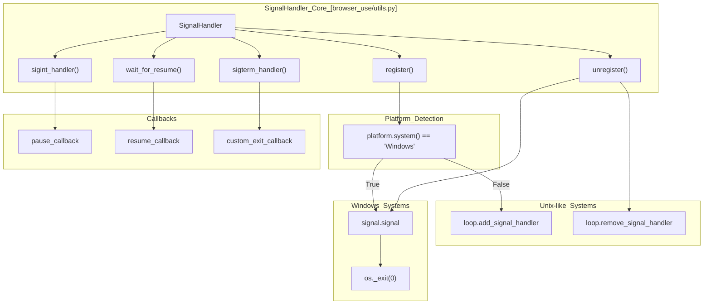
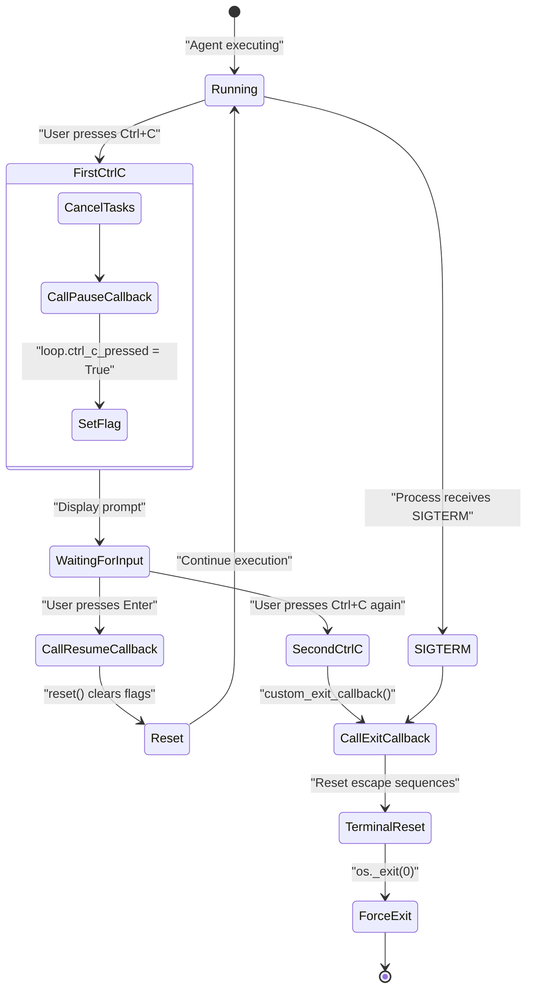
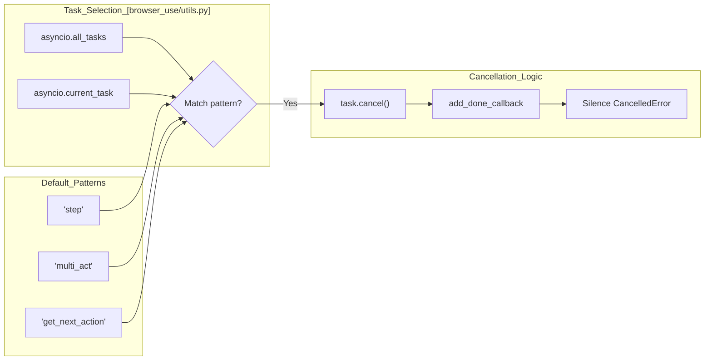

<!-- source: DeepWiki mcp.deepwiki.com · repo browser-use/browser-use · page 11.5 Signal Handling and Utilities · fetched 2026-10-30 -->

# Signal Handling and Utilities

Relevant source files

The following files were used as context for generating this wiki page:

- [browser_use/beta/service.py](browser_use/beta/service.py)
- [browser_use/utils.py](browser_use/utils.py)
- [examples/models/browser_use_provider_models.py](examples/models/browser_use_provider_models.py)
- [tests/ci/test_beta_agent.py](tests/ci/test_beta_agent.py)

This page documents browser-use's signal handling system and utility helpers, which provide graceful shutdown capabilities, terminal restoration, asyncio task cancellation, and data sanitization for browser automation workflows. The system handles `SIGINT` (Ctrl+C) and `SIGTERM` signals across different platforms and user interfaces, implementing a two-stage interruption pattern that allows users to pause execution or force exit.

For browser session lifecycle management, see [3.1. BrowserSession Lifecycle](). For error recovery mechanisms, see [11.3. Error Recovery and Resilience]().

## Purpose and Scope

The signal handling and utility system serves several critical functions:

1.  **Two-stage interruption**: First Ctrl+C pauses execution and allows resume; second Ctrl+C forces immediate exit [browser_use/utils.py:164-180]().
2.  **Terminal state restoration**: Resets terminal modes that may be corrupted by browser process termination or raw mode shifts [browser_use/utils.py:202-226]().
3.  **Task cancellation**: Selectively cancels interruptible async tasks without killing the entire event loop [browser_use/utils.py:285-303]().
4.  **Platform compatibility**: Handles differences between Windows and Unix-like systems (macOS, Linux) [browser_use/utils.py:171-172]().
5.  **Data sanitization & utility helpers**: Provides URL parsing, placeholder detection, and sensitive data redaction for agent logs and prompts [browser_use/utils.py:29-122]().

Sources: [browser_use/utils.py:29-183]()

## SignalHandler Architecture

The `SignalHandler` class is the core component that manages all signal handling logic [browser_use/utils.py:159-171](). It provides a modular, reusable system that can be customized for different contexts (CLI, Agent, MCP server).

### Code Entity Space: SignalHandler Structure
The following diagram maps the logical signal flow to the specific methods and flags used in the codebase.

Title: "SignalHandler Logic Mapping"

**Key attributes and configuration**:

| Attribute | Type | Purpose |
| :--- | :--- | :--- |
| `loop` | `asyncio.AbstractEventLoop` | Event loop to manage [browser_use/utils.py:175]() |
| `pause_callback` | `Callable` | Called on first Ctrl+C [browser_use/utils.py:176]() |
| `resume_callback` | `Callable` | Called when user resumes [browser_use/utils.py:177]() |
| `custom_exit_callback` | `Callable` | Called before exit [browser_use/utils.py:178]() |
| `exit_on_second_int` | `bool` | Whether second Ctrl+C exits (default: True) [browser_use/utils.py:179]() |
| `interruptible_task_patterns` | `list[str]` | Task name patterns to cancel on first Ctrl+C [browser_use/utils.py:180]() |
| `disabled` | `bool` | If True, registration is a no-op [browser_use/utils.py:181]() |

Sources: [browser_use/utils.py:159-182]()

## Two-Stage Ctrl+C Flow

The system implements a two-stage interruption pattern that distinguishes between pause and exit intentions.

### Execution Flow State Machine
This diagram shows the transition between execution states triggered by user signals.

Title: "Signal State Machine"

### First Ctrl+C Sequence

When the user presses Ctrl+C for the first time on a Unix-like system, `sigint_handler()` executes the following:

1.  **Check exit flag**: If already exiting, force exit immediately via `os._exit(0)` [browser_use/utils.py:150-151]().
2.  **Check second press**: If `loop.ctrl_c_pressed` is already True and `waiting_for_input` is False, trigger second Ctrl+C handling.
3.  **Set pressed flag**: Mark `loop.ctrl_c_pressed = True`.
4.  **Cancel interruptible tasks**: Call `_cancel_interruptible_tasks()` to cancel running async tasks matching patterns.
5.  **Invoke pause callback**: Execute user-provided `pause_callback()`.

### Second Ctrl+C or SIGTERM Sequence

When the user presses Ctrl+C again or the process receives `SIGTERM`:

1.  **Set global exit flag**: Prevent duplicate cleanup via `_exiting` global [browser_use/utils.py:150-151]().
2.  **Invoke exit callback**: Execute `custom_exit_callback()` if provided.
3.  **Reset terminal state**: Send multiple escape sequences to restore terminal.
4.  **Force exit**: Call `os._exit(0)` for immediate termination.

Sources: [browser_use/utils.py:150-182]()

## Task Cancellation Mechanism

The signal handler selectively cancels only "interruptible" tasks on the first Ctrl+C, allowing graceful pausing without destroying the entire event loop.

Title: "Task Cancellation Logic"

The task cancellation mechanism iterates through active tasks in the event loop and cancels those matching specific interruptible task patterns [browser_use/utils.py:179-182]().

Sources: [browser_use/utils.py:175-182]()

## Terminal Reset Sequences

Browser process termination (especially via Playwright/Chrome) can corrupt terminal state. The signal handler attempts to restore terminal state on exit using standard escape sequences:

| Sequence | Purpose |
| :--- | :--- |
| `\033[?25h` | Show cursor (Chrome may hide it) |
| `\033[0m` | Reset text attributes (colors/bold) |
| `\033[?1l` | Reset cursor keys to normal mode |
| `\033[?2004l` | Disable bracketed paste mode |
| `\r` | Carriage return for a clean line start |

Each sequence is sent to both `stdout` and `stderr` because terminal state is process-wide.

Sources: [browser_use/utils.py:150-182]()

## Platform-Specific Handling

Signal handling differs significantly between Windows and Unix-like systems.

### Windows Implementation
On Windows, `SignalHandler` uses a simplified approach:
1.  Uses `signal.signal(signal.SIGINT, ...)`.
2.  The handler immediately calls the exit callback and `os._exit(0)`.
3.  Pause/resume functionality is bypassed due to platform limitations with asyncio signal dispatch on Windows.

### Unix-like Implementation
On macOS and Linux:
1.  Uses `loop.add_signal_handler(signal.SIGINT, ...)` for asynchronous signal handling.
2.  Provides full two-stage Ctrl+C support.
3.  Includes `SIGTERM` handler for graceful shutdown on container stops or system termination signals.

Sources: [browser_use/utils.py:150-182]()

## Utility Functions and Helpers (`browser_use/utils.py`)

In addition to `SignalHandler`, `browser_use/utils.py` contains utility functions supporting URL management and security redaction:

- **`is_placeholder_url(url: str) -> bool`**: Returns `True` for mock placeholder hostnames like `https://XXX.XX` [browser_use/utils.py:29-41]().
- **`sanitize_url_candidate(url: str) -> str`**: Normalizes URL candidates captured from prose before auto-navigation, stripping trailing punctuation and escaped newlines [browser_use/utils.py:47-77]().
- **`has_url_negation(context: str) -> bool`**: Checks whether nearby prose explicitly negates navigation to a URL (e.g. "don't visit...") [browser_use/utils.py:79-82]().
- **`collect_sensitive_data_values(sensitive_data)`**: Flattens legacy and domain-scoped sensitive data into placeholder-to-value mappings [browser_use/utils.py:91-105]().
- **`redact_sensitive_string(value: str, sensitive_values: dict[str, str]) -> str`**: Replaces sensitive values with placeholders, sorting by longest matches first to prevent partial leaks [browser_use/utils.py:108-122]().

Sources: [browser_use/utils.py:29-122]()

---

