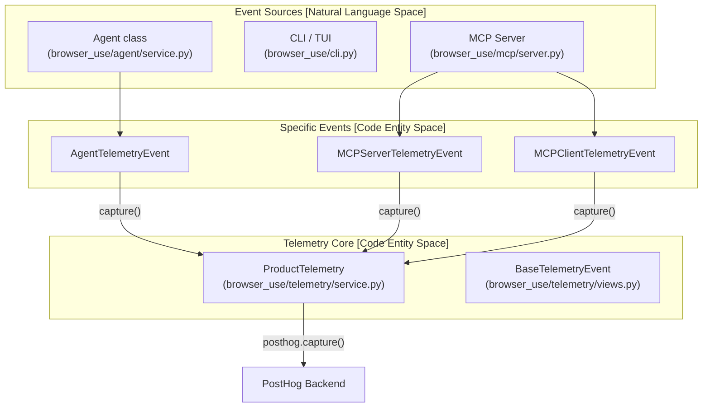
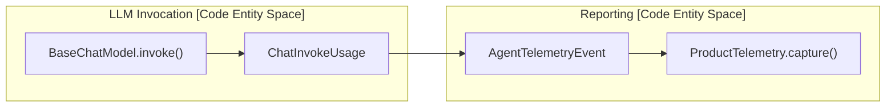

<!-- source: DeepWiki mcp.deepwiki.com · repo browser-use/browser-use · page 11.6 Telemetry and Usage Tracking · fetched 2026-10-30 -->

# Telemetry and Usage Tracking

<details>
<summary>Relevant source files</summary>

The following files were used as context for generating this wiki page:

- [browser_use/cli.py](browser_use/cli.py)
- [browser_use/telemetry/__init__.py](browser_use/telemetry/__init__.py)
- [browser_use/telemetry/service.py](browser_use/telemetry/service.py)
- [browser_use/telemetry/views.py](browser_use/telemetry/views.py)

</details>


This document explains the telemetry system that collects anonymized usage statistics and error information to improve the `browser-use` framework. It covers the `ProductTelemetry` class, event types, device ID generation, and privacy considerations. For information about cloud-specific event syncing, see [Cloud Sync and Observability](#11.8).

## Overview and Purpose

The telemetry system collects anonymous usage data to understand how `browser-use` is used, identify common error patterns, and prioritize feature development. The system is built on PostHog, an open-source analytics platform.

The architecture follows a singleton pattern where different components (Agent, CLI, MCP server) emit structured events to a central `ProductTelemetry` service that transmits them asynchronously to PostHog.

### Telemetry Architecture

Title: "Telemetry Data Flow and Code Entities"

Sources: [browser_use/telemetry/service.py:65-66](), [browser_use/telemetry/views.py:9-14](), [browser_use/telemetry/views.py:25-88](), [browser_use/cli.py:34-58]()

## ProductTelemetry Service

The `ProductTelemetry` class (defined in `browser_use/telemetry/service.py`) is the central hub for all telemetry data. It is decorated with `@singleton` to ensure a single instance manages the PostHog client and event queue [browser_use/telemetry/service.py:65-66]().

### Key Implementation Details

- **Initialization**: It checks `CONFIG.ANONYMIZED_TELEMETRY`. If `False`, the PostHog client is not initialized, effectively disabling tracking [browser_use/telemetry/service.py:79-83]().
- **User Identification**: It generates a unique `device_id` stored locally at `DEVICE_ID_PATH` to track recurring users anonymously [browser_use/telemetry/service.py:28-35](), [browser_use/telemetry/service.py:136-141]().
- **Event Capture**: The `capture()` method takes a `BaseTelemetryEvent` and forwards it to PostHog using the `user_id` as the `distinct_id` [browser_use/telemetry/service.py:103-107](), [browser_use/telemetry/service.py:117-121]().
- **Docker Detection**: Every event automatically includes an `is_docker` property by checking the environment context via `is_running_in_docker()` [browser_use/telemetry/views.py:17-21]().

| Method | Role |
| :--- | :--- |
| `capture(event)` | Public interface to record an event [browser_use/telemetry/service.py:103-107](). |
| `_direct_capture(event)` | Internal method that interacts with the `Posthog` client [browser_use/telemetry/service.py:109-123](). |
| `flush()` | Ensures all queued events are sent before process exit [browser_use/telemetry/service.py:125-133](). |
| `user_id` | Property that retrieves or generates the anonymous persistent ID [browser_use/telemetry/service.py:136-141](). |

Sources: [browser_use/telemetry/service.py:65-141](), [browser_use/telemetry/views.py:9-21]()

## Telemetry Events

All events inherit from `BaseTelemetryEvent`, which defines a `name` and a `properties` dictionary [browser_use/telemetry/views.py:9-22]().

### AgentTelemetryEvent
This is the most detailed event, captured during agent execution. It includes metadata about the task, the LLM used, and results from the judge system if enabled.

| Field | Description |
| :--- | :--- |
| `model` / `model_provider` | The LLM used (e.g., "openai/gpt-4o", "openai") [browser_use/telemetry/views.py:28-29](). |
| `steps` | Total number of steps executed [browser_use/telemetry/views.py:42](). |
| `total_tokens` | Aggregate token usage (input + output) [browser_use/telemetry/views.py:46](). |
| `success` | Whether the agent reached its goal [browser_use/telemetry/views.py:48](). |
| `judge_verdict` | The result of the LLM evaluation if a judge is used [browser_use/telemetry/views.py:52](). |
| `judge_reached_captcha` | Whether the judge detected a captcha block [browser_use/telemetry/views.py:55](). |

### MCP Usage Events
- **MCPClientTelemetryEvent**: Tracks client-side MCP usage including `tools_discovered` and `tool_call` durations [browser_use/telemetry/views.py:62-74]().
- **MCPServerTelemetryEvent**: Tracks server-side lifecycle events (`start`, `stop`, `tool_call`) and tool executions [browser_use/telemetry/views.py:78-88]().

### Browser Harness CLI Telemetry
The CLI uses `browser_harness.telemetry` to capture events such as command completion or errors. It sets environment variables `BH_CLIENT` to `browser-use-cli` and `BH_CLIENT_VERSION` to the current package version [browser_use/cli.py:27-32](), [browser_use/cli.py:34-57]().

Sources: [browser_use/telemetry/views.py:25-88](), [browser_use/cli.py:27-57]()

## Token and Cost Tracking

While not directly part of the PostHog telemetry in this specific module, the `AgentTelemetryEvent` aggregates token usage which is typically sourced from LLM invocation results.

Title: "Token Usage and Telemetry Association"

Sources: [browser_use/telemetry/views.py:43-46](), [browser_use/telemetry/service.py:103-107]()

## Privacy and Anonymization

Browser-use is designed with a "Privacy First" approach for telemetry. The system explicitly avoids collecting sensitive information.

### Data Handling:
- **Task Content**: While the `task` field exists in `AgentTelemetryEvent`, it is intended for high-level metadata. Users are encouraged to avoid sensitive data in task strings [browser_use/telemetry/views.py:27]().
- **Machine Fingerprinting**: The `_machine_fingerprint()` function generates a hashed hardware-derived ID using the machine's node and hostname to maintain anonymity while allowing for unique device identification [browser_use/telemetry/service.py:53-62]().
- **Anonymization**: User identification is limited to a generated `uuid7str` which has no link to real-world identities [browser_use/telemetry/service.py:33-34]().

### Opt-Out Mechanism
Users can disable all telemetry by setting the environment variable:
```bash
ANONYMIZED_TELEMETRY=False
```
This is processed in the `ProductTelemetry` constructor via `CONFIG.ANONYMIZED_TELEMETRY`. If disabled, `self._posthog_client` remains `None`, and all `capture` calls return early [browser_use/telemetry/service.py:79-83](), [browser_use/telemetry/service.py:104-105]().

Sources: [browser_use/telemetry/service.py:33-83](), [browser_use/telemetry/service.py:104-105](), [browser_use/telemetry/views.py:27]()

## Implementation Reference

### Lazy Loading
The telemetry module uses a lazy import mechanism in `browser_use/telemetry/__init__.py` to avoid unnecessary overhead if telemetry is not used or is disabled. Components like `ProductTelemetry` and `BaseTelemetryEvent` are only loaded when accessed via `__getattr__` [browser_use/telemetry/__init__.py:17-40]().

### Singleton Pattern
The `ProductTelemetry` class uses a `@singleton` decorator to ensure that multiple parts of the application (e.g., different agents in the same process) share the same PostHog client and `user_id` [browser_use/telemetry/service.py:65-66]().

Sources: [browser_use/telemetry/__init__.py:17-40](), [browser_use/telemetry/service.py:65-66]()

---

