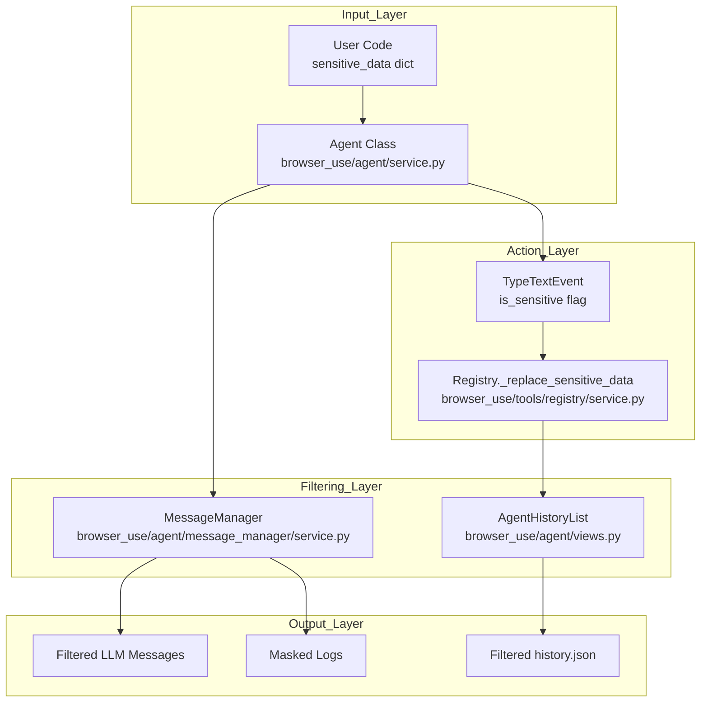
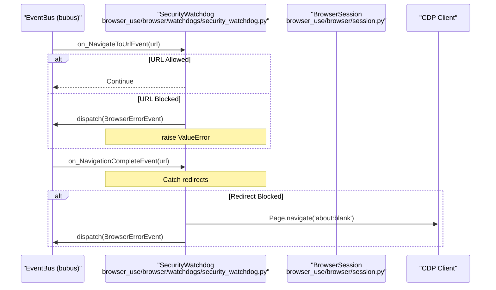

<!-- source: DeepWiki mcp.deepwiki.com · repo browser-use/browser-use · page 11.7 Security Considerations · fetched 2026-10-30 -->

# Security Considerations

Relevant source files

The following files were used as context for generating this wiki page:

- [browser_use/browser/demo_mode.py](browser_use/browser/demo_mode.py)
- [browser_use/browser/session_manager.py](browser_use/browser/session_manager.py)
- [browser_use/browser/watchdogs/crash_watchdog.py](browser_use/browser/watchdogs/crash_watchdog.py)
- [browser_use/browser/watchdogs/downloads_watchdog.py](browser_use/browser/watchdogs/downloads_watchdog.py)
- [browser_use/browser/watchdogs/popups_watchdog.py](browser_use/browser/watchdogs/popups_watchdog.py)
- [browser_use/browser/watchdogs/security_watchdog.py](browser_use/browser/watchdogs/security_watchdog.py)
- [browser_use/tools/registry/service.py](browser_use/tools/registry/service.py)
- [browser_use/tools/registry/views.py](browser_use/tools/registry/views.py)
- [examples/features/blocked_domains.py](examples/features/blocked_domains.py)
- [examples/features/large_blocklist.py](examples/features/large_blocklist.py)
- [tests/ci/security/test_ip_blocking.py](tests/ci/security/test_ip_blocking.py)
- [tests/ci/security/test_sensitive_data.py](tests/ci/security/test_sensitive_data.py)
- [tests/ci/test_browser_error_passthrough.py](tests/ci/test_browser_error_passthrough.py)
- [tests/ci/test_downloads_watchdog.py](tests/ci/test_downloads_watchdog.py)
- [tests/ci/test_multi_act_guards.py](tests/ci/test_multi_act_guards.py)
- [tests/ci/test_registry_empty_url_domain_filter.py](tests/ci/test_registry_empty_url_domain_filter.py)
- [tests/ci/test_remote_download_complete_callback.py](tests/ci/test_remote_download_complete_callback.py)
- [tests/ci/test_screenshot_exclusion.py](tests/ci/test_screenshot_exclusion.py)

This page covers security features and considerations when using `browser-use` for browser automation. It details sensitive data masking, domain restrictions, IP blocking, popup management, storage state security, and best practices for safe browser automation.

For general browser configuration options, see [Browser Configuration](#7). For LLM provider integration and API key management, see [LLM Integration](#8).

---

## Overview

Browser automation introduces several inherent security risks:
- **Credential Exposure**: Sensitive credentials (passwords, API keys) may be logged or leaked to LLM providers.
- **Prompt Injection Attacks**: Malicious websites can inject text that manipulates the agent's behavior.
- **Cross-Site Data Leakage**: Browser state (cookies, local storage) may be shared across unintended domains or sessions.
- **Server-Side Request Forgery (SSRF) / Internal Access**: Agents navigating to local or private IP addresses.

`browser-use` provides multiple security layers to mitigate these risks:
- Domain allowlisting and blocklisting via `SecurityWatchdog` [browser_use/browser/watchdogs/security_watchdog.py:22-33]().
- IP address blocking via `_is_ip_address()`canonicalization [browser_use/browser/watchdogs/security_watchdog.py:138-175]().
- Sensitive data masking via `<secret>` tags and `Registry._replace_sensitive_data` [tests/ci/security/test_sensitive_data.py:54-85]().
- Automatic JavaScript dialog handling via `PopupsWatchdog` [browser_use/browser/watchdogs/popups_watchdog.py:13-18]().

Sources: [browser_use/browser/watchdogs/security_watchdog.py:22-33](), [browser_use/browser/watchdogs/security_watchdog.py:138-175](), [tests/ci/security/test_sensitive_data.py:54-85](), [browser_use/browser/watchdogs/popups_watchdog.py:13-18]()

---

## Sensitive Data Filtering System

### Architecture and Data Flow

The sensitive data filtering system prevents credentials from appearing in logs, history, or LLM context by intercepting placeholders before action execution and history persistence.

Title: Sensitive Data Flow and Masking Architecture

Sources: [tests/ci/security/test_sensitive_data.py:42-74](), [browser_use/tools/registry/service.py:1-11]()

### Placeholder Replacement and Detection

The system uses `<secret>key_name</secret>` XML-style tags. When an action containing these tags is dispatched, `Registry._replace_sensitive_data` substitutes them with real values from the `sensitive_data` configuration, supporting domain-specific secrets [tests/ci/security/test_sensitive_data.py:54-135](). If a key is missing or empty, the placeholder tag is preserved to prevent leaking uninitialized or incorrect values [tests/ci/security/test_sensitive_data.py:54-85]().

Sources: [tests/ci/security/test_sensitive_data.py:54-135]()

---

## Domain Restrictions and Access Control

### SecurityWatchdog

The `SecurityWatchdog` is the primary component enforcing URL access policies. It listens to navigation and tab creation events and blocks unallowed destinations [browser_use/browser/watchdogs/security_watchdog.py:22-93]().

Title: SecurityWatchdog Event Enforcement

Sources: [browser_use/browser/watchdogs/security_watchdog.py:22-93]()

### Domain Allowlisting, Blocklisting, and IP Blocking

| Feature | Code Entity | Description |
| :--- | :--- | :--- |
| **Allowlist** | `BrowserProfile.allowed_domains` | Restricts navigation exclusively to specified domains [browser_use/browser/watchdogs/security_watchdog.py:176-203]() |
| **Blocklist** | `BrowserProfile.prohibited_domains` | Prevents navigation to restricted domains [examples/features/blocked_domains.py:19-27]() |
| **IP Blocking** | `BrowserProfile.block_ip_addresses` | Blocks IPv4 and IPv6 hostnames (canonicalized via `_is_ip_address`) to prevent SSRF [browser_use/browser/watchdogs/security_watchdog.py:138-175]() |
| **Internal Targets** | `about:blank`, `chrome://*` | Whitelisted internally to maintain browser session stability [browser_use/browser/watchdogs/security_watchdog.py:186-188]() |

**Large List Optimization**: Massive blocklists (e.g., 400k+ domains) are automatically converted into sets for $O(1)$ lookup performance [examples/features/blocked_domains.py:29-33]().

Sources: [browser_use/browser/watchdogs/security_watchdog.py:138-203](), [examples/features/blocked_domains.py:19-33]()

---

## Safe Browser Configuration

### Security-Related Profile Settings

The `BrowserProfile` class exposes security-critical configuration parameters:
- **`disable_security`**: When set to `True`, injects flags like `--disable-web-security` and `--ignore-certificate-errors`. **Warning: Never use in production.**
- **`block_ip_addresses`**: Uses `ipaddress` and `socket.inet_aton` to normalize hosts against non-standard IPv4 encodings (decimal, hex, octal) and block private ranges [browser_use/browser/watchdogs/security_watchdog.py:138-175]().

Sources: [browser_use/browser/watchdogs/security_watchdog.py:138-175]()

### Popup and Dialog Handling

The `PopupsWatchdog` automatically intercepts JavaScript dialogs (`alert`, `confirm`, `prompt`, `beforeunload`) to prevent infinite UI blocking [browser_use/browser/watchdogs/popups_watchdog.py:13-82]().
- **Alert / Confirm / Beforeunload**: Accepted automatically (`accept=True`) to maintain task progression.
- **Prompt**: Dismissed automatically (`accept=False`) since automated input cannot be reliably supplied.
- **Message Tracking**: Popup messages are captured and stored in `BrowserSession._closed_popup_messages` for inclusion in agent state [browser_use/browser/watchdogs/popups_watchdog.py:68-72]().

Sources: [browser_use/browser/watchdogs/popups_watchdog.py:13-82]()

---

## Best Practices

1. **Scope Credentials**: Use domain-specific keys in `sensitive_data` configurations to prevent credential exposure if the agent navigates across sites.
2. **Enforce Allowlists**: Define `allowed_domains` alongside sensitive data to bound agent navigation.
3. **Block IP Access**: Enable `block_ip_addresses=True` to prevent access to local metadata services or internal network endpoints [tests/ci/security/test_ip_blocking.py:17-29]().
4. **Disable Vision When Necessary**: Set `use_vision=False` if transmitting raw screenshots to untrusted LLM endpoints presents a risk.

Sources: [tests/ci/security/test_ip_blocking.py:17-29]()

---

