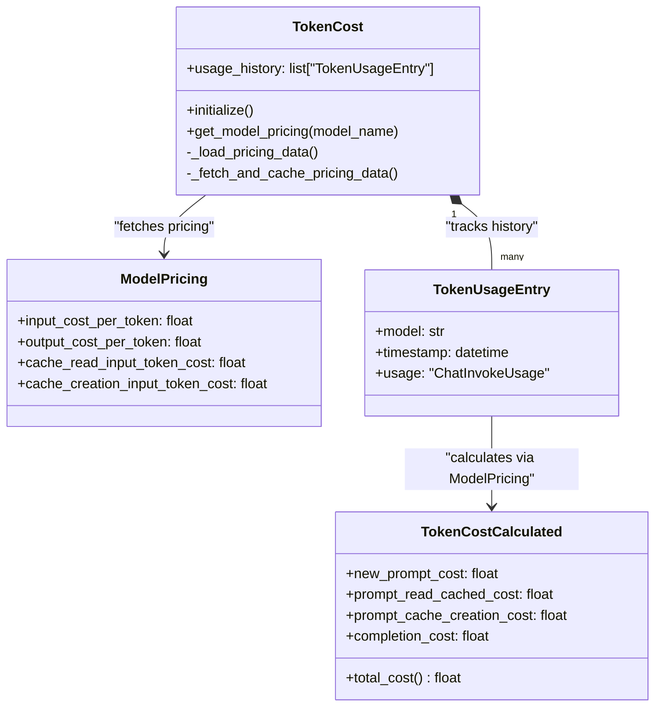

<!-- source: DeepWiki mcp.deepwiki.com · repo browser-use/browser-use · page 11.8 Cloud Sync and Observability · fetched 2026-10-30 -->

# Cloud Sync and Observability

<details>
<summary>Relevant source files</summary>

The following files were used as context for generating this wiki page:

- [browser_use/agent/cloud_events.py](browser_use/agent/cloud_events.py)
- [browser_use/observability.py](browser_use/observability.py)
- [browser_use/sync/auth.py](browser_use/sync/auth.py)
- [browser_use/sync/service.py](browser_use/sync/service.py)
- [tests/ci/conftest.py](tests/ci/conftest.py)
- [tests/ci/test_agent_cloud_events.py](tests/ci/test_agent_cloud_events.py)

</details>


This page documents the cloud synchronization, authentication, observability, and token cost tracking infrastructure of `browser-use`. The `CloudSync` service dispatches agent events to the Browser Use cloud, `DeviceAuthClient` manages OAuth2 device authorization, the `observability.py` module integrates Laminar (`lmnr`) tracing, and token cost services handle LLM usage and pricing calculations.

## Cloud Sync Service

The `CloudSync` service intercepts events from the agent's event system and synchronizes them with the Browser Use cloud backend [browser_use/sync/service.py:1-30]().

### Implementation and Data Flow

`CloudSync` is initialized with a base URL and an internal `DeviceAuthClient` instance [browser_use/sync/service.py:16-22](). It checks `CONFIG.BROWSER_USE_CLOUD_SYNC` to determine if synchronization is globally enabled [browser_use/sync/service.py:27]().

1. **Event Handling**: Incoming `BaseEvent` instances are intercepted by `handle_event()` [browser_use/sync/service.py:29-30](). If `self.enabled` is false, the event is ignored [browser_use/sync/service.py:32-34]().
2. **Session Identification**: When a `CreateAgentSessionEvent` is encountered, `self.session_id` is extracted from the event `id` attribute [browser_use/sync/service.py:36-38]().
3. **Authentication Guard**: Events are dispatched only if the client is authenticated (`self.auth_client.is_authenticated`) or if `allow_session_events_for_auth` permits it during an active authentication flow [browser_use/sync/service.py:41-52]().
4. **Payload Serialization and Dispatch**: The event is serialized via Pydantic's `model_dump(mode='json')`, enriched with `device_id`, and posted to `/api/v1/events` using an `httpx.AsyncClient` [browser_use/sync/service.py:79-90](). Errors are caught silently to prevent disruption to local agent execution [browser_use/sync/service.py:92-105]().

Sources: [browser_use/sync/service.py:16-106]()

### Cloud Event Types

Specialized cloud event models are defined in `browser_use/agent/cloud_events.py`:

| Class | Code Reference | Purpose | Key Fields |
| :--- | :--- | :--- | :--- |
| `UpdateAgentTaskEvent` | [browser_use/agent/cloud_events.py:18-33]() | Updates task status, state, and outputs | `id`, `stopped`, `done_output`, `agent_state` |
| `CreateAgentStepEvent` | [browser_use/agent/cloud_events.py:117-131]() | Records a single agent execution iteration | `step`, `memory`, `screenshot_url`, `actions` |
| `CreateAgentOutputFileEvent` | [browser_use/agent/cloud_events.py:62-71]() | Uploads execution artifacts like GIFs or files | `file_name`, `file_content` (Base64), `content_type` |

Screenshots attached to `CreateAgentStepEvent` are formatted as Base64 data URLs derived from `browser_state_summary.screenshot` [browser_use/agent/cloud_events.py:157-160]().

Sources: [browser_use/agent/cloud_events.py:18-185]()

## Authentication and Device Management

Authentication relies on the OAuth2 Device Authorization Grant flow, allowing local CLI and library installations to securely connect to the Browser Use cloud.

### DeviceAuthClient and Configuration

The `DeviceAuthClient` class coordinates authentication states and persistence [browser_use/sync/auth.py:87-112]().

* **Device ID**: `get_or_create_device_id()` generates and persists a unique installation UUID (`uuid7str()`) under the configuration directory [browser_use/sync/auth.py:22-45]().
* **Auth Persistence**: `CloudAuthConfig` loads and saves tokens in `cloud_auth.json` with restrictive file permissions (`0o600`) [browser_use/sync/auth.py:48-85]().
* **Temporary Identity**: Unauthenticated sessions default to `TEMP_USER_ID` (`99999999-9999-9999-9999-999999999999`) to allow pre-authorization telemetry [browser_use/sync/auth.py:18-20, 119-122]().

### System Component Diagram: Cloud Integration

```mermaid
graph TD
    subgraph "Local_Environment"
        ["Agent"] -- "dispatches" --> ["EventBus"]
        ["EventBus"] -- "triggers" --> ["CloudSync.handle_event"]
        ["CloudSync"] -- "uses" --> ["DeviceAuthClient"]
        ["DeviceAuthClient"] -- "reads/writes" --> ["CloudAuthConfig.save_to_file"]
        ["DeviceAuthClient"] -- "persists" --> ["get_or_create_device_id"]
    end

    subgraph "Browser_Use_Cloud"
        ["api_v1_events"]
        ["oauth_device_authorize"]
    end

    ["CloudSync"] -- "POST JSON {events: [...]}" --> ["api_v1_events"]
    ["DeviceAuthClient"] -- "Device Grant Flow" --> ["oauth_device_authorize"]
```
Sources: [browser_use/sync/auth.py:22-210](), [browser_use/sync/service.py:29-90]()

## Observability and Tracing

The `browser_use/observability.py` module provides optional tracing integration with the **Laminar (`lmnr`)** observability platform.

### Key Decorators

* **`@observe()`**: Traces execution using Laminar's `observe` decorator when available, attaching standard observability tags (`observe`, `observe_debug`) [browser_use/observability.py:87-124]().
* **`@observe_debug()`**: Conditionally traces execution only when debug mode is active (`_is_debug_mode()`), verified via the `LMNR_LOGGING_LEVEL` environment variable [browser_use/observability.py:134-176]().

### No-Op Fallback Architecture
If the `lmnr` package is not installed, `_create_no_op_decorator()` dynamically wraps sync and async functions to execute normally with zero tracing overhead [browser_use/observability.py:58-84]().

Sources: [browser_use/observability.py:1-204]()

## Token Cost Tracking

The `TokenCost` service provides automated token counting and financial cost attribution across LLM providers by fetching pricing records from LiteLLM.

### Pricing Logic and Cache Management
1. **Cache Persistence**: Pricing metadata is cached locally in `~/.cache/browser_use/token_cost` for 24 hours [browser_use/tokens/service.py:51-65]().
2. **Custom Overrides**: `CUSTOM_MODEL_PRICING` entries take precedence over LiteLLM mappings [browser_use/tokens/service.py:178-203]().
3. **Granular Cost Calculation**: The `TokenCostCalculated` view tracks distinct costs for new prompt tokens, cached prompt reads, cache creation, and completion tokens [browser_use/tokens/views.py:11-47]().

### Code Entity Space: Token Tracking


Sources: [browser_use/tokens/service.py:49-207](), [browser_use/tokens/views.py:11-112]()

## Anthropic Cache Integration

`browser-use` supports Anthropic prompt caching mechanisms through `ChatInvokeUsage` tracking [browser_use/llm/views.py:8-27](). 

* **Cache Metrics**: Captures `prompt_cached_tokens` and `prompt_cache_creation_tokens` during model responses [browser_use/llm/views.py:8-27]().
* **Cost Savings**: `TokenCostCalculated` factors in discounted cache-read rates to accurately compute aggregate execution expenditure [browser_use/tokens/views.py:25-47]().

Sources: [browser_use/llm/views.py:8-60](), [browser_use/tokens/views.py:19-47]()

---

