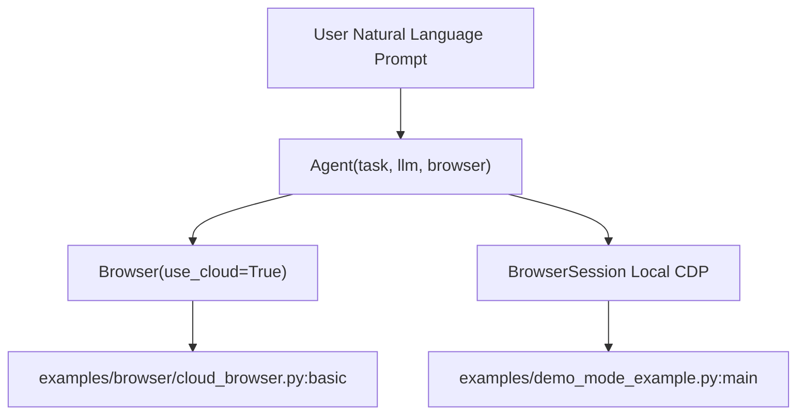
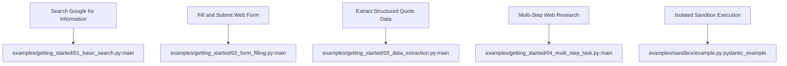

<!-- source: DeepWiki mcp.deepwiki.com · repo browser-use/browser-use · page 12 Example Applications and Use Cases · fetched 2026-10-30 -->

# Example Applications and Use Cases

Relevant source files

The following files were used as context for generating this wiki page:

- [examples/browser/cloud_browser.py](examples/browser/cloud_browser.py)
- [examples/demo_mode_example.py](examples/demo_mode_example.py)
- [examples/getting_started/01_basic_search.py](examples/getting_started/01_basic_search.py)
- [examples/getting_started/02_form_filling.py](examples/getting_started/02_form_filling.py)
- [examples/getting_started/03_data_extraction.py](examples/getting_started/03_data_extraction.py)
- [examples/getting_started/04_multi_step_task.py](examples/getting_started/04_multi_step_task.py)
- [examples/models/browser_use_llm.py](examples/models/browser_use_llm.py)
- [examples/sandbox/example.py](examples/sandbox/example.py)

The `examples/` directory within the `browser-use` repository provides a comprehensive collection of reference implementations, getting-started scripts, feature demonstrations, and production-grade end-to-end use-case automations [examples/getting_started/01_basic_search.py:1-29](). This parent page serves as a high-level guide to exploring how the `Agent` core, `Browser` session management, and `ChatBrowserUse` model abstractions are assembled to solve real-world automation challenges [examples/getting_started/04_multi_step_task.py:31-54]().

For detailed breakdowns of specific implementations, refer to the child pages:
- [Feature and Browser Examples](#12.1)
- [Use Cases and Demo Apps](#12.2)
- [Model Examples](#12.3)

---

## 12.1 Feature and Browser Examples

The `examples/features/` and `examples/browser/` subdirectories showcase advanced browser integration patterns, including Chrome DevTools Protocol (CDP) connections, persistent sessions, parallel agent execution, handling downloads, managing sensitive credentials, and configuring cloud-managed browser instances [examples/browser/cloud_browser.py:1-47](). 

For instance, developers can configure cloud execution by instantiating the `Browser` class with `use_cloud=True` or custom cloud parameters, passing it directly to the `Agent` execution context [examples/browser/cloud_browser.py:18-29](). Similarly, visual inspection modes like `demo_mode=True` enable real-time debugging by highlighting element interactions during execution steps [examples/demo_mode_example.py:7-12]().

Diagram: Feature and Browser Integration Mapping

Sources: [examples/browser/cloud_browser.py:18-29](), [examples/demo_mode_example.py:7-12]()

For details, see [Feature and Browser Examples](#12.1).

---

## 12.2 Use Cases and Demo Apps

The `examples/use-cases/` and `examples/apps/` directories contain complex, end-to-end automation pipelines ranging from basic data extraction and form completion to multi-step research tasks and full assistant workflows [examples/getting_started/02_form_filling.py:31-51](). 

Getting-started scripts illustrate foundational workflows such as single-query searches [examples/getting_started/01_basic_search.py:21-29](), HTTP form submissions [examples/getting_started/02_form_filling.py:36-47](), structured data parsing from external web pages [examples/getting_started/03_data_extraction.py:36-46](), and multi-step research tasks that require navigating multiple websites and aggregating information [examples/getting_started/04_multi_step_task.py:36-50](). Furthermore, sandbox execution examples demonstrate how to safely wrap agent loops using the `@sandbox` decorator with custom event callbacks like `on_browser_ready` [examples/sandbox/example.py:20-44]().

Diagram: Use Cases to Code Mapping

Sources: [examples/getting_started/01_basic_search.py:21-29](), [examples/getting_started/02_form_filling.py:36-47](), [examples/getting_started/03_data_extraction.py:36-46](), [examples/getting_started/04_multi_step_task.py:36-50](), [examples/sandbox/example.py:20-44]()

For details, see [Use Cases and Demo Apps](#12.2).

---

## 12.3 Model Examples

The `examples/models/` directory provides snippets demonstrating how to integrate various Large Language Model (LLM) providers with `browser-use`. These files illustrate initialization parameters, authentication handling, and provider-specific configurations for OpenAI, Google Gemini, Anthropic Claude, and the managed `ChatBrowserUse` gateway [examples/models/browser_use_llm.py:1-35]().

The `ChatBrowserUse` client serves as the default high-performance gateway, supporting models such as `bu-2-0` and preview variants like `bu-2-0-mini-preview`, while retaining the flexibility to route requests to alternative providers [examples/models/browser_use_llm.py:22-32](). 

For details, see [Model Examples](#12.3).

---

