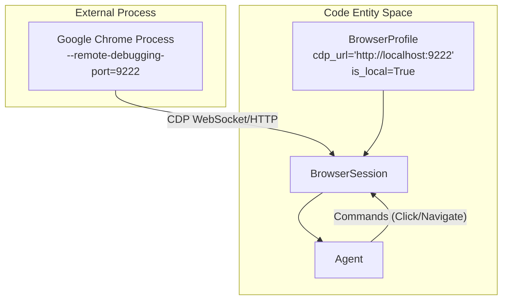
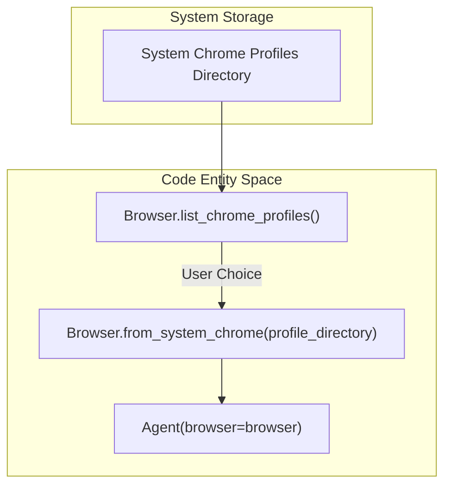
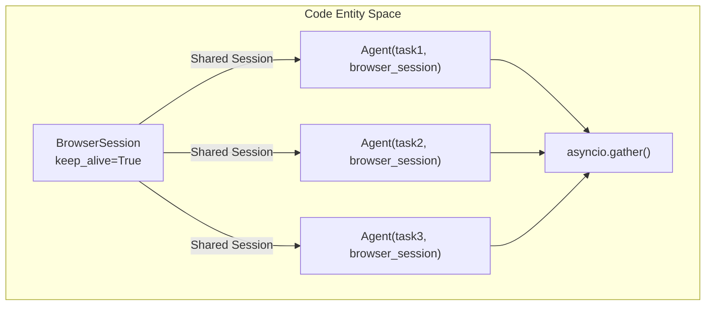
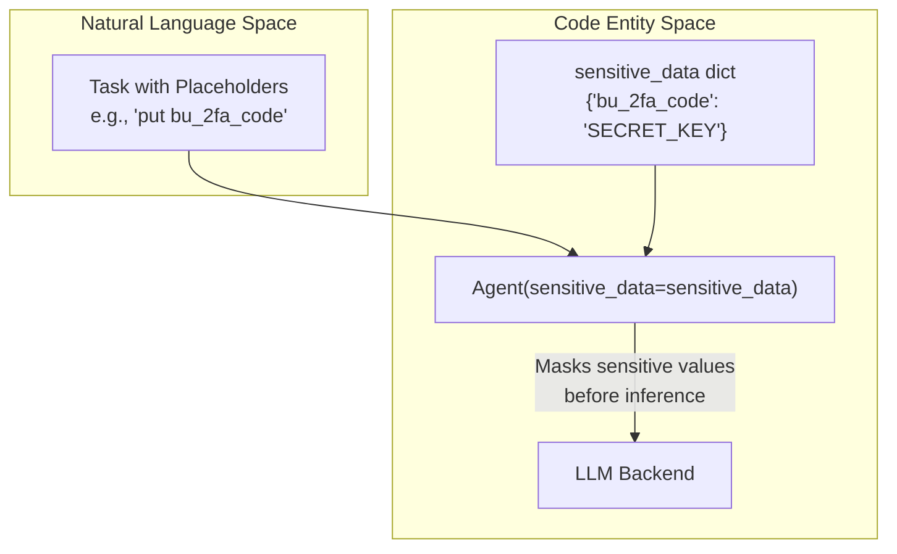
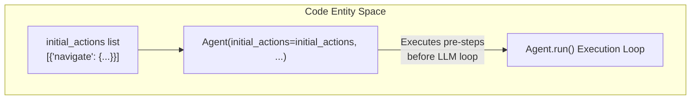

<!-- source: DeepWiki mcp.deepwiki.com · repo browser-use/browser-use · page 12.1 Feature and Browser Examples · fetched 2026-10-30 -->

# Feature and Browser Examples

Relevant source files

The following files were used as context for generating this wiki page:

- [.pre-commit-config.yaml](.pre-commit-config.yaml)
- [examples/browser/real_browser.py](examples/browser/real_browser.py)
- [examples/browser/save_cookies.py](examples/browser/save_cookies.py)
- [examples/browser/using_cdp.py](examples/browser/using_cdp.py)
- [examples/custom-functions/2fa.py](examples/custom-functions/2fa.py)
- [examples/custom-functions/notification.py](examples/custom-functions/notification.py)
- [examples/custom-functions/onepassword_2fa.py](examples/custom-functions/onepassword_2fa.py)
- [examples/features/custom_system_prompt.py](examples/features/custom_system_prompt.py)
- [examples/features/download_file.py](examples/features/download_file.py)
- [examples/features/initial_actions.py](examples/features/initial_actions.py)
- [examples/features/parallel_agents.py](examples/features/parallel_agents.py)
- [examples/features/restrict_urls.py](examples/features/restrict_urls.py)
- [examples/features/secure.py](examples/features/secure.py)
- [examples/features/sensitive_data.py](examples/features/sensitive_data.py)
- [examples/features/small_model_for_extraction.py](examples/features/small_model_for_extraction.py)
- [examples/file_system/alphabet_earnings.py](examples/file_system/alphabet_earnings.py)
- [examples/file_system/file_system.py](examples/file_system/file_system.py)
- [examples/use-cases/extract_pdf_content.py](examples/use-cases/extract_pdf_content.py)
- [tests/ci/browser/test_navigation_slow_pages.py](tests/ci/browser/test_navigation_slow_pages.py)

This page documents the usage patterns, configuration options, and architectural interactions demonstrated within the `examples/features/` and `examples/browser/` directories of the `browser-use` codebase. It covers advanced browser session initialization via Chrome DevTools Protocol (CDP), local profile reuse, multi-agent concurrency, sensitive data protection, file downloads, video recording, and pre-configured initial actions.

---

## 1. CDP Connection and Remote Debugging

The Chrome DevTools Protocol (CDP) allows `browser-use` to attach to an already-running Chrome instance instead of spawning a headless or isolated ephemeral browser. This is configured by instantiating `BrowserSession` with a `BrowserProfile` containing a `cdp_url` [examples/browser/using_cdp.py:32-32]().

### Implementation and Data Flow

To use CDP connection:
1. Launch Chrome with the remote debugging flag enabled: `--remote-debugging-port=9222` [examples/browser/using_cdp.py:8-8]().
2. Verify the debugging socket is active via `http://localhost:9222/json/version` [examples/browser/using_cdp.py:9-9]().
3. Configure `BrowserSession` using `BrowserProfile(cdp_url='http://localhost:9222', is_local=True)` [examples/browser/using_cdp.py:32-32]().
4. Pass the session into the `Agent` orchestrator [examples/browser/using_cdp.py:37-42]().

*Figure 1: CDP connection data flow mapping external Chrome debugging ports to `BrowserSession`.*

Sources: `examples/browser/using_cdp.py` [examples/browser/using_cdp.py:1-51]()

---

## 2. Real Browser Reuse and Profile Selection

Instead of starting a blank browser profile, `browser-use` can discover local Chrome user profiles using `Browser.list_chrome_profiles()` and connect to an active profile directory via `Browser.from_system_chrome()` [examples/browser/real_browser.py:20-37]().

### Key Classes and Functions

- `Browser.list_chrome_profiles()`: Scans standard system profile directories to retrieve available user profile names and paths [examples/browser/real_browser.py:20-20]().
- `Browser.from_system_chrome(profile_directory=profile)`: Initializes a `Browser` instance configured to use the selected local profile path, maintaining session state, cookies, and extension data [examples/browser/real_browser.py:37-37]().

*Figure 2: System profile discovery and integration pipeline.*

Sources: `examples/browser/real_browser.py` [examples/browser/real_browser.py:1-48]()

---

## 3. Parallel Agents and Shared Sessions

Multiple `Agent` instances can operate concurrently within a single `BrowserSession` when configured with `keep_alive=True` [examples/features/parallel_agents.py:16-23](). This enables parallel task execution, where multiple LLM loops interact with different tabs or shared contexts.

### Execution Flow

1. A single `BrowserSession` is instantiated with `BrowserProfile(keep_alive=True, ...)` [examples/features/parallel_agents.py:16-23]().
2. The session is explicitly started via `await browser_session.start()` [examples/features/parallel_agents.py:29-29]().
3. Multiple `Agent` objects are initialized, referencing the shared `browser_session` [examples/features/parallel_agents.py:30-43]().
4. Tasks are run concurrently using `asyncio.gather(*[agent.run() for agent in agents])` [examples/features/parallel_agents.py:46-46]().

*Figure 3: Parallel execution structure using shared `BrowserSession` and `asyncio.gather`.*

Sources: `examples/features/parallel_agents.py` [examples/features/parallel_agents.py:1-51]()

---

## 4. Sensitive Data Masking and 2FA Handling

To prevent sensitive credentials (such as passwords, tokens, or personal info) from being exposed in prompts, logs, or LLM vision payloads, `browser-use` supports a `sensitive_data` dictionary mapping placeholder keys to confidential string values [examples/features/sensitive_data.py:27-35]().

### Implementation Details

- **Substitution**: The agent framework automatically masks values matching the `sensitive_data` dictionary before sending prompts or screenshots to the LLM backend [examples/features/sensitive_data.py:39-39]().
- **2FA Automation**: Secrets like OTP keys (`OTP_SECRET_KEY`) can be registered under `sensitive_data` (e.g., `bu_2fa_code`) so that the agent can input generated codes dynamically during authentication flows [examples/custom-functions/2fa.py:13-28]().

*Figure 4: Data masking pipeline protecting sensitive variables from leaking to LLM endpoints.*

Sources: `examples/features/sensitive_data.py` [examples/features/sensitive_data.py:1-47](), `examples/custom-functions/2fa.py` [examples/custom-functions/2fa.py:1-32]()

---

## 5. Download Management and File Storage

File downloads are managed by specifying a custom download directory during `Browser` initialization [examples/features/download_file.py:21-21]().

### Key Mechanisms

- `Browser(downloads_path='~/Downloads/tmp')`: Configures the underlying browser download behavior to direct files into a controlled directory [examples/features/download_file.py:21-21]().
- The agent can interact with file download prompts, anchors, and file storage APIs automatically as part of its step execution loop [examples/features/download_file.py:25-30]().

Sources: `examples/features/download_file.py` [examples/features/download_file.py:1-34]()

---

## 6. Initial Actions and Pre-Navigation

When an agent needs to execute specific setup steps before starting its main reasoning loop (such as logging into a service or navigating through multiple pages), `initial_actions` can be passed directly to the `Agent` constructor [examples/features/initial_actions.py:15-21]().

### Data Flow

*Figure 5: Pre-population of execution steps via `initial_actions`.*

Sources: `examples/features/initial_actions.py` [examples/features/initial_actions.py:1-31]()

---

## 7. Video Recording Configuration

Video recording of browser sessions can be enabled by specifying `record_video_dir` within the `BrowserProfile` [examples/features/parallel_agents.py:16-20]().

### Configuration Parameters

- `BrowserProfile(record_video_dir=Path('./tmp/recordings'), ...)`: Automatically captures browser frames and serializes them into video output files inside the designated directory for auditing and debugging [examples/features/parallel_agents.py:16-20]().

Sources: `examples/features/parallel_agents.py` [examples/features/parallel_agents.py:1-51]()

---

