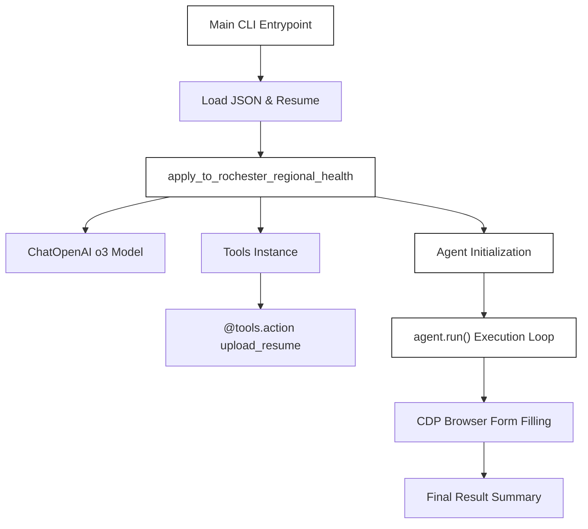
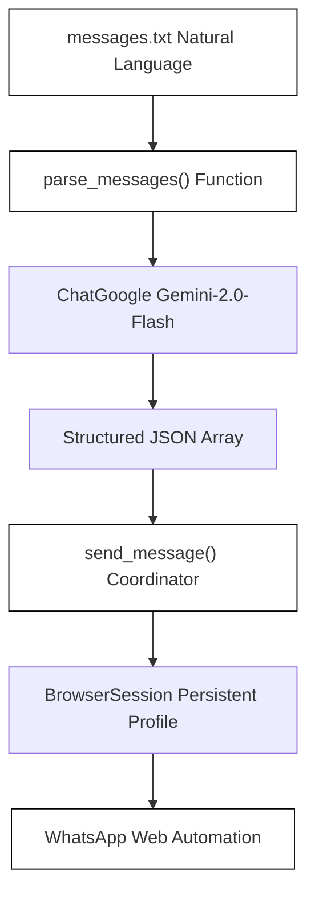

<!-- source: DeepWiki mcp.deepwiki.com · repo browser-use/browser-use · page 12.2 Use Cases and Demo Apps · fetched 2026-10-30 -->

# Use Cases and Demo Apps

Relevant source files

The following files were used as context for generating this wiki page:

- [examples/apps/ad-use/README.md](examples/apps/ad-use/README.md)
- [examples/apps/ad-use/ad_generator.py](examples/apps/ad-use/ad_generator.py)
- [examples/apps/ad-use/output/ad_20250908_150030.png](examples/apps/ad-use/output/ad_20250908_150030.png)
- [examples/apps/ad-use/output/landing_page_20250908_150030.png](examples/apps/ad-use/output/landing_page_20250908_150030.png)
- [examples/apps/msg-use/README.md](examples/apps/msg-use/README.md)
- [examples/apps/msg-use/login.py](examples/apps/msg-use/login.py)
- [examples/apps/msg-use/scheduler.py](examples/apps/msg-use/scheduler.py)
- [examples/apps/news-use/README.md](examples/apps/news-use/README.md)
- [examples/apps/news-use/news_monitor.py](examples/apps/news-use/news_monitor.py)
- [examples/use-cases/apply_to_job.py](examples/use-cases/apply_to_job.py)
- [examples/use-cases/buy_groceries.py](examples/use-cases/buy_groceries.py)
- [examples/use-cases/phone_comparison.py](examples/use-cases/phone_comparison.py)

## Purpose and Scope
This page documents the end-to-end automations, practical use cases, and full-featured demo applications located in the `examples/use-cases/` and `examples/apps/` directories of the codebase. These applications demonstrate how to combine browser-use's `Agent` orchestration, `BrowserSession` lifecycle management, custom action registries, and Pydantic-based structured outputs to solve complex real-world workflows like job applications, multi-marketplace price tracking, social media ad generation, messaging automation, and news monitoring.

---

## 1. Use-Case Automations (`examples/use-cases/`)

The `examples/use-cases/` directory contains focused, single-purpose automation scripts that highlight advanced features such as custom tool registration, Pydantic structured output extraction schemas, and remote browser connection via Chrome DevTools Protocol (CDP).

### 1.1 Job Application Automation (`apply_to_job.py`)
The job application script automates complex, multi-page form filling (e.g., Rochester Regional Health applications via Appcast) by feeding applicant profiles into the agent and registering specialized local file-upload tools [examples/use-cases/apply_to_job.py:14-111]().

- **Key Classes & Functions**: 
  - `apply_to_rochester_regional_health(info: dict, resume_path: str)`: Asynchronous coordinator that initializes `ChatOpenAI(model='o3')`, configures custom tools using the `@tools.action` decorator, and runs the main `Agent` loop [examples/use-cases/apply_to_job.py:14-110]().
  - `upload_resume(browser_session)`: A custom user-defined action registered via `tools.action` that wraps `UploadFileAction(path=resume_path, index=0)` to handle file uploads programmatically [examples/use-cases/apply_to_job.py:43-46]().
- **Data Flow**: The script reads mock candidate data from a JSON file (`test_data_path`), verifies the existence of the resume PDF, constructs a detailed step-by-step instruction prompt containing the source-of-truth profile data, and executes field-by-field form completion [examples/use-cases/apply_to_job.py:50-134]().

*Sources: [examples/use-cases/apply_to_job.py:1-134]()*

### 1.2 Marketplace Price Comparison & Shopping (`phone_comparison.py`, `buy_groceries.py`)
These scripts demonstrate structured data extraction using Pydantic models paired with `ChatBrowserUse` (`bu-2-0-mini-preview`) and an existing browser instance attached via CDP (`http://localhost:9222`) [examples/use-cases/phone_comparison.py:25-65](), [examples/use-cases/buy_groceries.py:24-53]().

- **Key Classes & Functions**:
  - `ProductListing` & `PriceComparison`: Pydantic models defining strict schemas (`title`, `url`, `price`, `condition`, `source`) for comparative shopping results [examples/use-cases/phone_comparison.py:8-23]().
  - `GroceryItem` & `GroceryCart`: Schemas capturing item metadata, brand, size, and pricing for grocery automation [examples/use-cases/buy_groceries.py:8-22]().
  - `find(item: str)` / `add_to_cart(items: list[str])`: Asynchronous tasks that instruct the agent to query multiple marketplaces (eBay, Amazon, Swappa, Instacart) and return validated structured objects via `output_model_schema` [examples/use-cases/phone_comparison.py:25-65](), [examples/use-cases/buy_groceries.py:24-53]().

Sources: [examples/use-cases/phone_comparison.py:1-91](), [examples/use-cases/buy_groceries.py:1-83]()

---

## 2. Full Demo Applications (`examples/apps/`)

The `examples/apps/` directory contains multi-file production-grade mini applications (`ad-use`, `msg-use`, `news-use`) featuring persistent session storage, continuous monitoring loops, background callback tasks, and external API integrations.

### 2.1 Ad Generator (`ad-use/`)
The `ad-use` application analyzes any landing page URL to extract brand messaging and generates targeted social media ads (Instagram image ads or TikTok video ads) [examples/apps/ad-use/ad_generator.py:47-180]().

- **Key Components**:
  - `LandingPageAnalyzer`: Launches a `BrowserSession` to visit a target URL, extract brand name, tagline, pricing, and calls-to-action, while concurrently capturing a reference screenshot via a background task callback (`create_task_with_error_handling`) [examples/apps/ad-use/ad_generator.py:47-101]().
  - `AdGenerator`: Interacts with Google's `genai.Client` to formulate creative concepts and generate visual assets (using Gemini 2.5 Flash Image for Instagram or Veo3 for TikTok) [examples/apps/ad-use/ad_generator.py:103-180]().
- **Execution Flow**:
  1. CLI arguments specify `--url`, `--count`, and platform mode (`--instagram` or `--tiktok`) [examples/apps/ad-use/ad_generator.py:23-33]().
  2. Agent navigates the landing page, extracts brand info [examples/apps/ad-use/ad_generator.py:60-72]().
  3. Screenshot callback saves a visual reference in `output/` [examples/apps/ad-use/output/landing_page_20250908_150030.png:1-3]() [examples/apps/ad-use/output/ad_20250908_150030.png:1-4]().
  4. Google GenAI API produces final marketing assets.

Sources: [examples/apps/ad-use/ad_generator.py:1-417](), [examples/apps/ad-use/README.md:1-87]()

### 2.2 WhatsApp Message Scheduler (`msg-use/`)
The `msg-use` application allows users to schedule messages in natural language via WhatsApp Web, supporting persistent sessions to bypass repeated QR code scanning [examples/apps/msg-use/scheduler.py:1-211](), [examples/apps/msg-use/login.py:1-71]().

- **Key Components**:
  - `parse_messages()`: Reads `messages.txt`, passes unstructured natural language instructions to `ChatGoogle`, and extracts a normalized JSON array of scheduled messages (`contact`, `message`, `datetime`) [examples/apps/msg-use/scheduler.py:44-115]().
  - `login.py`: Manages initial WhatsApp Web authentication, saving cookies and session state to `~/.config/whatsapp_scheduler/browser_profile/` [examples/apps/msg-use/login.py:10-71]().
  - `auto_respond_to_unread()`: Runs a periodic loop (every ~30 minutes) clicking the "Unread" filter tab on WhatsApp Web to generate contextual AI replies [examples/apps/msg-use/scheduler.py:145-173,185-205]().

*Sources: [examples/apps/msg-use/scheduler.py:44-143](), [examples/apps/msg-use/login.py:1-71]()*

### 2.3 News Monitor (`news-use/`)
The `news-use` application continuously monitors news sites, extracts top headline articles, performs sentiment analysis, and stores results with deduplication hashes [examples/apps/news-use/news_monitor.py:1-214]().

- **Key Classes & Functions**:
  - `NewsArticle`: Pydantic model defining fields for `title`, `url`, `posting_time`, `short_summary`, `long_summary`, and `sentiment` ('positive', 'neutral', 'negative') [examples/apps/news-use/news_monitor.py:52-59]().
  - `extract_latest_article(site_url: str)`: Asks Gemini Flash to navigate a news portal, click the top headline, extract full content, and return structured JSON [examples/apps/news-use/news_monitor.py:66-86]().
  - **Robust JSON Parsing & Sanitization**: Includes `_escape_newlines()` and balanced-brace substring searchers (`_try_parse`) to clean LLM output formatting errors reliably [examples/apps/news-use/news_monitor.py:118-168]().
  - **Deduplication**: Computes MD5 hashes of article URLs via `load_seen_hashes()` and `save_article()` to prevent duplicate processing across restarts [examples/apps/news-use/news_monitor.py:176-210]().

Sources: [examples/apps/news-use/news_monitor.py:1-303](), [examples/apps/news-use/README.md:1-87]()

---

