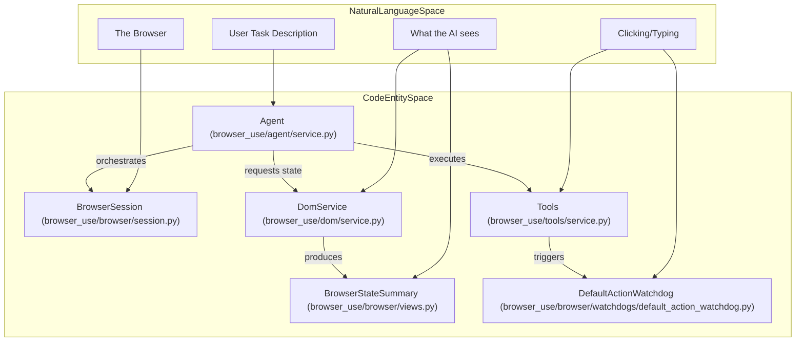
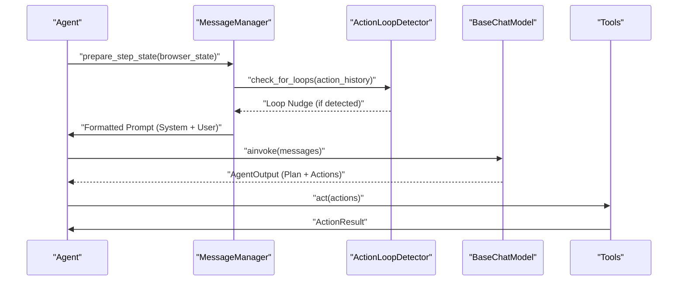

<!-- source: DeepWiki mcp.deepwiki.com · repo browser-use/browser-use · page 13 Glossary · fetched 2026-10-30 -->

# Glossary

Relevant source files

The following files were used as context for generating this wiki page:

- [browser_use/agent/message_manager/service.py](browser_use/agent/message_manager/service.py)
- [browser_use/agent/message_manager/views.py](browser_use/agent/message_manager/views.py)
- [browser_use/agent/prompts.py](browser_use/agent/prompts.py)
- [browser_use/agent/service.py](browser_use/agent/service.py)
- [browser_use/agent/views.py](browser_use/agent/views.py)
- [browser_use/browser/events.py](browser_use/browser/events.py)
- [browser_use/browser/profile.py](browser_use/browser/profile.py)
- [browser_use/browser/session.py](browser_use/browser/session.py)
- [browser_use/browser/views.py](browser_use/browser/views.py)
- [browser_use/browser/watchdog_base.py](browser_use/browser/watchdog_base.py)
- [browser_use/browser/watchdogs/default_action_watchdog.py](browser_use/browser/watchdogs/default_action_watchdog.py)
- [browser_use/dom/enhanced_snapshot.py](browser_use/dom/enhanced_snapshot.py)
- [browser_use/dom/playground/extraction.py](browser_use/dom/playground/extraction.py)
- [browser_use/dom/serializer/serializer.py](browser_use/dom/serializer/serializer.py)
- [browser_use/dom/service.py](browser_use/dom/service.py)
- [browser_use/dom/views.py](browser_use/dom/views.py)
- [browser_use/tools/service.py](browser_use/tools/service.py)
- [browser_use/tools/views.py](browser_use/tools/views.py)
- [examples/features/save_as_pdf.py](examples/features/save_as_pdf.py)
- [tests/ci/browser/test_send_keys_literal_plus.py](tests/ci/browser/test_send_keys_literal_plus.py)
- [tests/ci/test_action_save_as_pdf.py](tests/ci/test_action_save_as_pdf.py)
- [tests/ci/test_dom_live_input_value.py](tests/ci/test_dom_live_input_value.py)
- [tests/ci/test_image_only_dom_representation.py](tests/ci/test_image_only_dom_representation.py)

This page provides definitions for codebase-specific terms, jargon, and domain concepts used throughout the `browser-use` framework. It serves as a technical reference for engineers to understand the underlying abstractions and their implementations.

## Core Concepts

### Agent
The high-level orchestrator that manages the loop of perceiving the browser state, deciding on actions via an LLM, and executing those actions. It maintains the conversation history and handles task completion or failure.
*   **Implementation:** `Agent` class in [browser_use/agent/service.py:134-197]().
*   **Data Flow:** The agent calls `step()` iteratively, which triggers the `MessageManager` to build a prompt, the LLM to generate an `AgentOutput`, and the `Tools` system to execute the requested actions [browser_use/agent/service.py:43-63]().

### BrowserSession
An event-driven wrapper around a browser instance (local or cloud) that manages tabs, targets, and CDP (Chrome DevTools Protocol) communication.
*   **Implementation:** `BrowserSession` class in [browser_use/browser/session.py:134-185]().
*   **Key Detail:** It abstracts the complexity of managing multiple `CDPSession` objects and provides a high-level API for navigation and state retrieval [browser_use/browser/session.py:88-103]().

### CDP (Chrome DevTools Protocol)
The low-level protocol used to communicate directly with Chromium-based browsers. `browser-use` uses the `cdp-use` library to send commands and receive events via `CDPClient`.
*   **Usage:** Used for everything from clicking elements to capturing screenshots and extracting the DOM tree [browser_use/browser/session.py:97-99]().

### EnhancedDOMTreeNode
A specialized data structure representing a DOM element with additional metadata not present in standard HTML, such as visibility status, clickable detection results, and transformed coordinates.
*   **Implementation:** `EnhancedDOMTreeNode` class in [browser_use/dom/views.py:21-21]().
*   **Source:** Constructed by the `DomService` by fusing data from the DOM, Accessibility (AX) tree, and Layout snapshots [browser_use/dom/service.py:56-72]().

Sources: [browser_use/agent/service.py:43-197](), [browser_use/browser/session.py:88-185](), [browser_use/dom/views.py:21-21](), [browser_use/dom/service.py:56-72]().

---

## Technical Jargon & Abbreviations

| Term | Definition | Code Pointer |
| :--- | :--- | :--- |
| **AX Tree** | Accessibility Tree. Used to understand element roles (e.g., "button", "link") and names for better LLM context. | [browser_use/dom/service.py:6-7]() |
| **BBox Filtering** | Bounding Box Filtering. A process to remove elements that are visually covered by other elements (occlusion) to reduce LLM context size. | [browser_use/dom/serializer/serializer.py:146-154]() |
| **CDP Client** | The active connection to a specific browser target (tab or iframe). | [browser_use/browser/session.py:97-99]() |
| **Interactive Index** | A small numeric ID assigned to clickable elements in the serialized DOM so the LLM can refer to them easily. | [browser_use/dom/serializer/serializer.py:155-160]() |
| **Nudge** | A system-injected message sent to the LLM to correct behavior (e.g., "You are in a loop" or "Try scrolling"). | [browser_use/agent/views.py:157-165]() |
| **Paint Order** | The stack ranking of elements. Used to determine which element is "on top" if they overlap. | [browser_use/dom/serializer/serializer.py:133-138]() |
| **Selector Map** | A dictionary mapping interactive identifiers to the actual `EnhancedDOMTreeNode` for action execution. | [browser_use/dom/views.py:18-18]() |
| **Flash Mode** | A high-speed configuration that disables thinking, evaluation goals, and next-goal predictions for faster execution. | [browser_use/agent/views.py:72-73]() |

Sources: [browser_use/dom/service.py:6-7](), [browser_use/dom/serializer/serializer.py:133-160](), [browser_use/browser/session.py:97-99](), [browser_use/agent/views.py:72-165](), [browser_use/dom/views.py:18-18]().

---

## System Architectures

### 1. Natural Language to Code Entity Mapping
This diagram shows how user-facing concepts map to specific classes and files within the repository.

**Diagram: Entity Mapping**

Sources: [browser_use/agent/service.py:134-197](), [browser_use/browser/session.py:134-185](), [browser_use/dom/service.py:56-72](), [browser_use/tools/service.py:1-61](), [browser_use/browser/watchdogs/default_action_watchdog.py:42-43]().

### 2. The Agent Loop (Decision Flow)
This diagram explains the internal logic of the execution loop and how terms like "Message Manager" and "Action Loop Detector" interact.

**Diagram: Step Execution Logic**

Sources: [browser_use/agent/service.py:134-197](), [browser_use/agent/message_manager/service.py:107-148](), [browser_use/agent/views.py:157-165](), [browser_use/tools/service.py:1-61]().

---

## Domain Concepts

### Action Loop Detection
A mechanism to prevent the LLM from getting stuck in repetitive behaviors. It computes a stable hash of actions (normalizing parameters like search queries or coordinates) and tracks them over a rolling window.
*   **Code:** `ActionLoopDetector` in [browser_use/agent/views.py:157-165]().
*   **Normalization:** The function `_normalize_action_for_hash` ensures that minor variations result in the same hash [browser_use/agent/views.py:110-149]().

### Message Compaction
When the conversation history grows too large for the LLM's context window, the `MessageManager` can summarize older steps into a "compacted memory" block to reduce prompt size.
*   **Settings:** `MessageCompactionSettings` [browser_use/agent/views.py:35-56]().
*   **Logic:** Triggered based on token counts or step counts to maintain efficiency [browser_use/agent/message_manager/service.py:153-188]().

### Sensitive Data Masking
A security feature that prevents sensitive information (like passwords or API keys) from being logged or sent back to the LLM in plain text.
*   **Implementation:** `_detect_sensitive_key_name` in [browser_use/tools/service.py:166-182]().

### Compound Components
Synthetic metadata added to complex HTML elements to provide the LLM with a clearer understanding of how to interact with them.
*   **Implementation:** `_add_compound_components` in [browser_use/dom/serializer/serializer.py:167-192]().

### Download Detection
A specialized behavior within the `DefaultActionWatchdog` that monitors for file downloads triggered by clicks, managing start and completion events.
*   **Implementation:** `_execute_click_with_download_detection` in [browser_use/browser/watchdogs/default_action_watchdog.py:45-116]().

### Viewport Threshold
A setting that determines how far outside the current viewport the DOM engine should look for elements. Elements beyond this threshold are considered "hidden by threshold" and summarized.
*   **Implementation:** `viewport_threshold` in [browser_use/dom/service.py:56-72]().

### Chrome Launch Arguments
The library manages a set of default arguments to optimize Chromium for AI agents, including disabling background networking and enabling deterministic rendering.
*   **Defaults:** `CHROME_DEFAULT_ARGS` [browser_use/browser/profile.py:162-167]().
*   **Docker Optimization:** `CHROME_DOCKER_ARGS` for shared memory and sandbox handling [browser_use/browser/profile.py:128-138]().

Sources: [browser_use/agent/views.py:35-165](), [browser_use/agent/message_manager/service.py:153-188](), [browser_use/tools/service.py:166-182](), [browser_use/dom/serializer/serializer.py:167-192](), [browser_use/browser/watchdogs/default_action_watchdog.py:45-116](), [browser_use/dom/service.py:56-72](), [browser_use/browser/profile.py:128-167]().