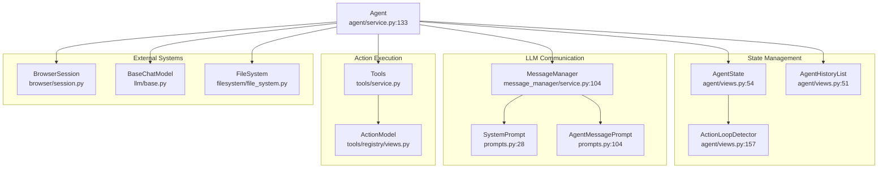
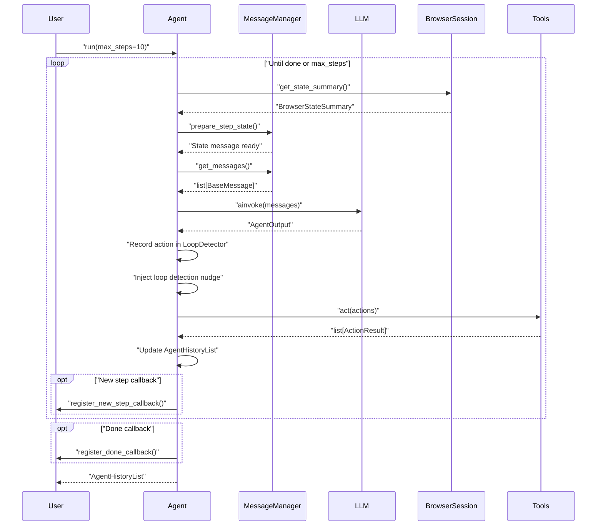
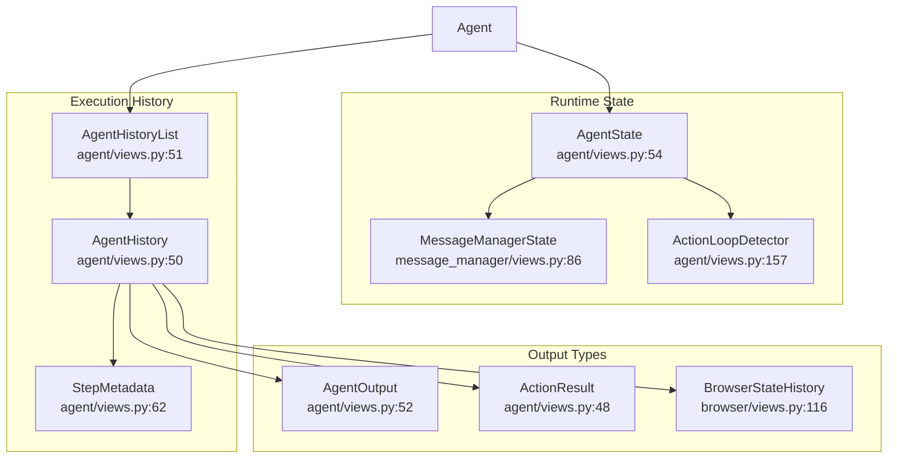

<!-- source: DeepWiki mcp.deepwiki.com · repo browser-use/browser-use · page 2 Agent System · fetched 2026-10-30 -->

# Agent System

Relevant source files

The following files were used as context for generating this wiki page:

- [browser_use/agent/message_manager/service.py](browser_use/agent/message_manager/service.py)
- [browser_use/agent/message_manager/views.py](browser_use/agent/message_manager/views.py)
- [browser_use/agent/prompts.py](browser_use/agent/prompts.py)
- [browser_use/agent/service.py](browser_use/agent/service.py)
- [browser_use/agent/views.py](browser_use/agent/views.py)
- [browser_use/browser/views.py](browser_use/browser/views.py)

## Purpose and Scope

The Agent System is the central orchestration layer in `browser-use`, responsible for coordinating task execution through a sense-think-act loop. The `Agent` class [browser_use/agent/service.py:133-134]() manages the interaction between LLMs, browser state, and action execution to accomplish user-defined tasks.

This page provides a high-level overview of the Agent System architecture and its key subsystems. For detailed documentation of specific components, see:

- [Agent Core and Execution Loop](#2.1) — Detailed explanation of `Agent.__init__`, the step() method, and the iterative decision-action-observe loop
- [Message Manager and Prompt Construction](#2.2) — How `MessageManager` builds LLM prompts by combining system prompts, browser state, task context, and history
- [Agent State and History Management](#2.3) — `AgentState` persistence, `AgentHistoryList` serialization, and history save/load/rerun mechanisms
- [System Prompts and Output Formats](#2.4) — `SystemPrompt` generation, prompt markdown variants, `AgentOutput` structure, and structured output schema customization
- [Skills Integration](#2.5) — How skills are registered as Agent actions, skill execution flow, skill service/views, and cookie requirements
- [Agent Configuration and Settings](#2.6) — `AgentSettings` parameters: `use_vision`, `max_failures`, `enable_planning`, `use_judge`, and other configuration options
- [Loop Detection and Behavioral Nudges](#2.7) — `ActionLoopDetector` implementation, action hash normalization, and nudge message injection
- [Message Compaction System](#2.8) — Automatic prompt compression via `maybe_compact_messages` when token limits are approached
- [Memory and Follow-up Tasks](#2.9) — Long-term memory management, conversation persistence, and `add_new_task()` for multi-turn interactions
- [Judge System and Trace Evaluation](#2.10) — Agent judge for evaluating execution traces, `construct_judge_messages`, `use_judge` configuration, and GIF history generation
- [Beta Agent](#2.11) — The experimental `browser_use/beta` service: what it changes relative to the main Agent, its API surface, and example usage

**Sources:** [browser_use/agent/service.py:133-134]()

---

## Agent Class Architecture

The `Agent` class [browser_use/agent/service.py:133-134]() serves as the main orchestrator. It is generic over two type parameters: `Context` (for custom tool context) and `AgentStructuredOutput` (for typed output schemas).

### Core Components Diagram

**Sources:** [browser_use/agent/service.py:133-209](), [browser_use/agent/views.py:54](), [browser_use/agent/views.py:51](), [browser_use/agent/message_manager/service.py:104-148]()

### Agent Initialization

The `Agent.__init__` method [browser_use/agent/service.py:135-197]() accepts extensive configuration including:

- **Task definition**: Natural language task string.
- **LLM configuration**: `llm`, `fallback_llm`, `page_extraction_llm`, `judge_llm`.
- **Browser setup**: `browser_session` (alias: `browser`), `browser_profile`.
- **Tools**: `tools` (alias: `controller`) for action registry.
- **Skills**: `skill_ids` (alias: `skills`) for actions.
- **Output schema**: `output_model_schema` for structured extraction.
- **Settings**: Configuration via parameters that populate `AgentSettings` [browser_use/agent/views.py:59-94]().
- **Callbacks**: `register_new_step_callback`, `register_done_callback`, `register_should_stop_callback`.

#### Key Initialization Steps

1. **LLM Setup**: Auto-detects default LLM from config, handles provider-specific timeouts [browser_use/agent/views.py:85](), and configures screenshot size.
2. **Browser Profile**: Creates or updates `BrowserProfile` with settings like `include_attributes`.
3. **Tools Registry**: Configures available actions based on vision settings and model capabilities.
4. **Message Manager**: Initializes with system prompt, task, and compaction settings [browser_use/agent/message_manager/service.py:104-148]().
5. **Loop Detector**: Configures repetition window size from settings [browser_use/agent/views.py:90]().

**Sources:** [browser_use/agent/service.py:135-197](), [browser_use/agent/views.py:59-94]()

---

## Execution Loop Overview

The agent operates through an iterative sense-think-act loop. The loop continues until the task is complete, max steps is reached, or an error occurs.

### High-Level Execution Flow

The execution loop integrates several subsystems:

- **State Capture**: `BrowserSession` provides `BrowserStateSummary` containing DOM, tabs, and screenshots [browser_use/browser/views.py:91]().
- **Prompt Construction**: `MessageManager` builds LLM context from browser state and history [browser_use/agent/message_manager/service.py:104]().
- **Loop Detection**: `ActionLoopDetector` tracks action repetition and page stagnation [browser_use/agent/views.py:157]().
- **Action Execution**: `Tools` dispatches actions to the browser.
- **History Tracking**: `AgentHistoryList` records each step for serialization [browser_use/agent/views.py:51]().

**Sources:** [browser_use/agent/service.py:133-209](), [browser_use/agent/message_manager/service.py:196-200]()

---

## State Management Overview

The agent maintains multiple state layers for execution continuity and serialization. State is split between runtime control flags and persistent execution history.

### State Hierarchy

### Key State Components

- **AgentState** [browser_use/agent/views.py:54](): Runtime control state including step count, failure tracking, and nested state objects.
- **AgentHistoryList** [browser_use/agent/views.py:51](): Execution trace container with serialization support.
- **ActionLoopDetector** [browser_use/agent/views.py:157-165](): Tracks action repetition and page stagnation for behavioral nudges.
- **MessageManagerState** [browser_use/agent/message_manager/views.py:86-101](): Message history and compaction state.

**Sources:** [browser_use/agent/views.py:35-65](), [browser_use/agent/message_manager/views.py:86-101]()

---

## Message Construction Overview

The `MessageManager` [browser_use/agent/message_manager/service.py:104]() builds LLM prompts by assembling browser state, agent history, and task instructions.

### Message Components

The message construction pipeline assembles several components:

- **System Prompt**: Instructions and action schemas via `SystemPrompt` [browser_use/agent/prompts.py:28](). It selects templates based on model type (e.g., `is_browser_use_model`, `is_anthropic_4_5`) [browser_use/agent/prompts.py:65-82]().
- **Agent History**: Previous steps and results from `MessageManagerState.agent_history_items` [browser_use/agent/message_manager/views.py:91]().
- **Browser State**: Current DOM, tabs, and page statistics via `BrowserStateSummary` [browser_use/browser/views.py:91]().
- **Compacted Memory**: Summarized history via `MessageCompactionSettings` [browser_use/agent/views.py:35-56]().

The `MessageManager.prepare_step_state()` method orchestrates assembly by updating history, handling screenshots based on `vision_detail_level` [browser_use/agent/message_manager/service.py:117](), filtering sensitive data, and managing token-based message compaction.

**Sources:** [browser_use/agent/message_manager/service.py:104-148](), [browser_use/agent/prompts.py:28-100](), [browser_use/agent/views.py:35-56]()

---

## Loop Detection and Behavioral Nudges

The agent includes a loop detection system to identify and nudge the agent away from repetitive behavior. This is implemented through the `ActionLoopDetector` class [browser_use/agent/views.py:157-165]().

### Detection Mechanisms

1. **Action Repetition**: Tracks normalized action hashes. Actions are normalized to detect semantic similarity (e.g., stripping minor keyword variations in search) via `_normalize_action_for_hash` [browser_use/agent/views.py:110-148]().
2. **Page Stagnation**: Tracks page content via `PageFingerprint` (URL + element count + text hash) [browser_use/agent/views.py:95-108]().

Nudges are awareness messages injected into the prompt. The agent remains free to continue if it believes repetition is productive.

**Sources:** [browser_use/agent/views.py:95-165]()

---

## Code Entity Reference

### Primary Classes

| Class | Path | Purpose |
|-------|------|---------|
| `Agent` | [browser_use/agent/service.py:134]() | Main orchestrator coordinating LLM, Browser, and Tools. |
| `MessageManager` | [browser_use/agent/message_manager/service.py:104]() | Prompt construction and history management. |
| `AgentState` | [browser_use/agent/views.py:54]() | Runtime state (steps, failures, flags). |
| `AgentHistoryList` | [browser_use/agent/views.py:51]() | Execution trace container. |
| `ActionLoopDetector` | [browser_use/agent/views.py:157]() | Repetition and stagnation detection. |
| `AgentSettings` | [browser_use/agent/views.py:59]() | Configuration model for Agent behavior. |
| `SystemPrompt` | [browser_use/agent/prompts.py:28]() | System message builder from markdown templates. |
| `MessageCompactionSettings` | [browser_use/agent/views.py:35]() | Configuration for history summarization. |

### Key Methods

| Method | Path | Purpose |
|--------|------|---------|
| `Agent.__init__` | [browser_use/agent/service.py:136]() | Initializes agent with task, LLM, and browser. |
| `compute_action_hash()` | [browser_use/agent/views.py:151]() | Generates a stable hash for action repetition tracking. |
| `log_response()` | [browser_use/agent/service.py:90]() | Utility to log LLM thinking, memory, and goals. |

**Sources:** [browser_use/agent/service.py:90-136](), [browser_use/agent/views.py:35-151](), [browser_use/agent/message_manager/service.py:104]()

---

