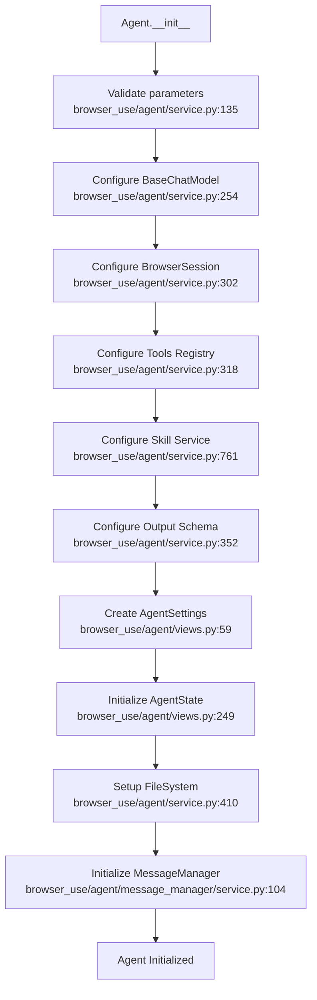
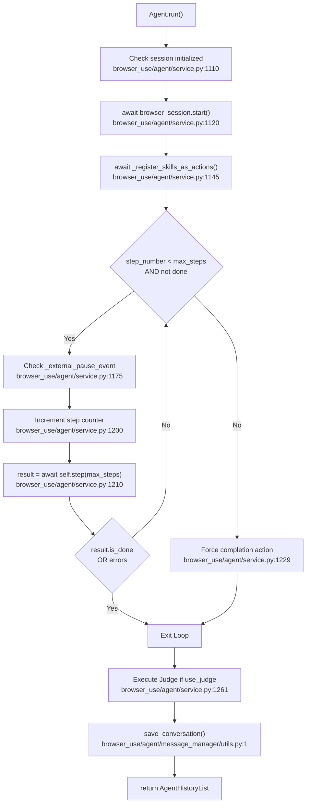
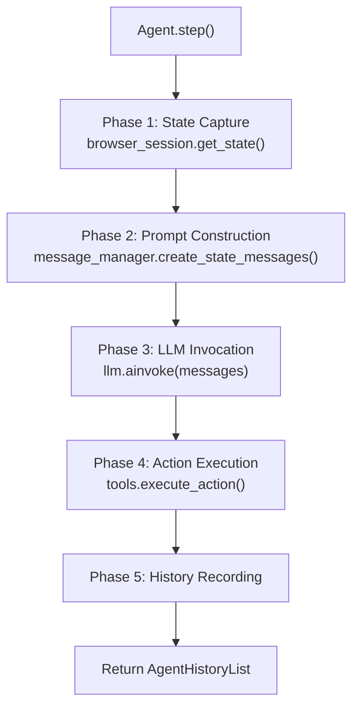

<!-- source: DeepWiki mcp.deepwiki.com · repo browser-use/browser-use · page 2.1 Agent Core and Execution Loop · fetched 2026-10-30 -->

# Agent Core and Execution Loop

Relevant source files

The following files were used as context for generating this wiki page:

- [browser_use/agent/message_manager/service.py](browser_use/agent/message_manager/service.py)
- [browser_use/agent/message_manager/views.py](browser_use/agent/message_manager/views.py)
- [browser_use/agent/prompts.py](browser_use/agent/prompts.py)
- [browser_use/agent/service.py](browser_use/agent/service.py)
- [browser_use/agent/views.py](browser_use/agent/views.py)
- [browser_use/browser/views.py](browser_use/browser/views.py)

## Purpose and Scope

This page documents the `Agent` class and its core execution loop, which orchestrates browser automation tasks through LLM-driven decision making. It covers Agent initialization in `Agent.__init__`, the main execution orchestrator `run()`, single-step execution via `step()`, and how the Agent coordinates with subsystems like `BrowserSession`, `MessageManager`, and `Tools`.

For information about how prompts are constructed and history is managed, see [2.2 Message Manager and Prompt Construction](). For state persistence and history serialization, see [2.3 Agent State and History Management](). For loop detection mechanisms, see [2.7 Loop Detection and Behavioral Nudges]().

Sources: [browser_use/agent/service.py:1-197]()

## Agent Class Structure

The `Agent` class (`browser_use/agent/service.py`) acts as the central orchestrator linking language model inference, browser session control, action execution, and state persistence. It implements an iterative, step-based execution model where each step observes the live browser state, prompts the LLM for decisions, executes designated actions via the action registry, and records metrics.

### Key Components

| Component | Class/Type | Role & File Source |
|-----------|------------|--------------------|
| `llm` | `BaseChatModel` | Language model provider for inference [browser_use/agent/service.py:138]() |
| `browser_session` | `BrowserSession` | Browser lifecycle and DOM/screenshot capture [browser_use/agent/service.py:141]() |
| `tools` | `Tools` | Action registry and execution router [browser_use/agent/service.py:143]() |
| `_message_manager` | `MessageManager` | Conversation history and prompt compilation [browser_use/agent/message_manager/service.py:104-147]() |
| `state` | `AgentState` | Mutable execution counters, failures, and planning status [browser_use/agent/views.py:249-274]() |
| `history` | `AgentHistoryList` | Serialized record of all execution steps [browser_use/agent/views.py:616-856]() |
| `settings` | `AgentSettings` | Configuration options and timeouts [browser_use/agent/views.py:59-91]() |

Sources: [browser_use/agent/service.py:134-197](), [browser_use/agent/views.py:59-91]()

## Agent Initialization Flow

The `Agent.__init__` method performs setup across all sub-systems, establishing configurations, output schemas, and initial states.

### Natural Language to Code: Initialization Flow

**Key Initialization Steps:**
1. **Parameter Resolution & Aliases**: Resolves aliases such as `browser` for `browser_session` and `controller` for `tools` [browser_use/agent/service.py:141-145]().
2. **LLM Configuration**: Sets up the chat model and checks for model-specific capabilities (e.g., auto-enabling flash mode or coordinate clicking) [browser_use/agent/service.py:254-271]().
3. **Tools & Output Schema**: Generates Pydantic action models dynamically via `tools.get_output_model()` [browser_use/agent/service.py:352-364]().
4. **Message Manager**: Instantiates `MessageManager` with the system prompt, task string, and file system references [browser_use/agent/message_manager/service.py:104-147]().

Sources: [browser_use/agent/service.py:135-455](), [browser_use/agent/views.py:59-91]()

## The Main Execution Loop (`run`)

The `run()` method executes the iterative loop over steps until completion criteria or limits are reached [browser_use/agent/service.py:1095-1396]().

### Code Entity Space: Execution Orchestration Flow

**Key Loop Mechanics:**
- **Pause/Resume**: Inspects `_external_pause_event` prior to each iteration to support interactive pausing [browser_use/agent/service.py:1175-1181]().
- **Stop Callbacks**: Evaluates `register_should_stop_callback()` to allow external interruption [browser_use/agent/service.py:1183-1185]().
- **Forced Completion**: If `max_steps` is exhausted without a `done` action, a final recovery call forces termination [browser_use/agent/service.py:1229-1234]().

Sources: [browser_use/agent/service.py:1095-1396]()

## Single Step Execution (`step`)

The `step()` method executes a single decision-action-observe iteration.

### Step Execution Phases

**Detailed Phase Breakdown:**
1. **State Capture**: Captures the current DOM state, viewport dimensions, open tabs, and screenshot via `browser_session.get_state()` [browser_use/agent/service.py:1469-1499]().
2. **Prompt Construction**: Compiles messages via `message_manager` incorporating system prompts, browser summary, and history [browser_use/agent/message_manager/service.py:183-419]().
3. **LLM Invocation**: Invokes the chat model with structured output enforcement (`AgentOutput`) [browser_use/agent/service.py:1607-1694]().
4. **Action Execution**: Executes actions returned in `AgentOutput` sequentially through `tools.execute_action()`, handling sensitive data replacement and loop detection logging [browser_use/agent/service.py:1696-1786]().
5. **History Recording**: Records step metadata, token consumption, and saves state snapshots to `AgentHistory` [browser_use/agent/service.py:1788-1841]().

Sources: [browser_use/agent/service.py:1398-1848]()

## Error Handling, Loop Detection, and Recovery

- **Consecutive Failure Tracking**: `state.consecutive_failures` increments on execution exceptions and resets upon successful step completion [browser_use/agent/service.py:1788-1841]().
- **Action Loop Detection**: `ActionLoopDetector` monitors action repetition and page stagnation using normalized hashes (`compute_action_hash`), injecting soft nudge instructions into prompt construction without blocking actions [browser_use/agent/views.py:110-154]().
- **Timeouts**: `settings.llm_timeout` and `settings.step_timeout` govern invocation limits across calls [browser_use/agent/views.py:85-86]().

Sources: [browser_use/agent/service.py:135-1848](), [browser_use/agent/views.py:59-154]()

---

