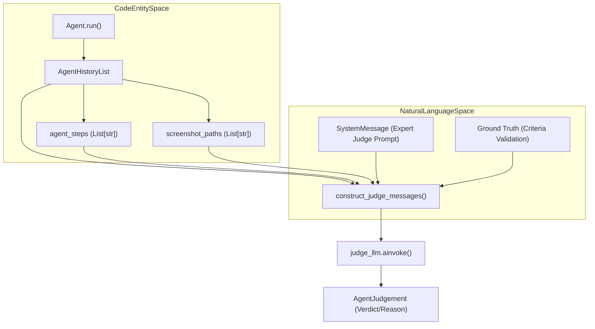
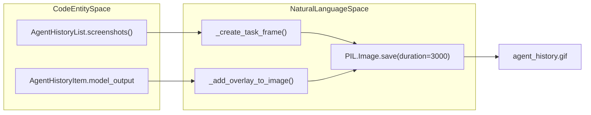

<!-- source: DeepWiki mcp.deepwiki.com · repo browser-use/browser-use · page 2.10 Judge System and Trace Evaluation · fetched 2026-10-30 -->

# Judge System and Trace Evaluation

<details>
<summary>Relevant source files</summary>

The following files were used as context for generating this wiki page:

- [browser_use/agent/gif.py](browser_use/agent/gif.py)
- [browser_use/agent/judge.py](browser_use/agent/judge.py)
- [examples/features/judge_trace.py](examples/features/judge_trace.py)

</details>


The Judge System is a specialized evaluation layer in `browser-use` designed to verify the success of an agent's execution. It processes the complete execution trace—including step descriptions, final results, and screenshots—to provide a binary verdict and qualitative feedback on the agent's performance [browser_use/agent/judge.py:1-18]().

## Overview of the Judge System

The judge operates after an agent completes its task loop. It uses a separate LLM call (or the same one) to act as an "expert judge" that reviews the history. This is particularly useful for automated testing, benchmarks (like GAIA), and ensuring high-reliability browser automation [browser_use/agent/judge.py:1-18]().

### Key Components

| Component | Description | Code Reference |
|---|---|---|
| `use_judge` | A configuration flag in `Agent` that enables post-execution evaluation. | `browser_use/agent/views.py` |
| `construct_judge_messages` | The core function that assembles the prompt, screenshots, and ground truth for the LLM. | `[browser_use/agent/judge.py:44-52]()` |
| `AgentHistoryList` | The data structure containing the execution trace evaluated by the judge. | `browser_use/agent/views.py:10-20` |
| `create_history_gif` | A utility to visualize the trace, often used alongside the judge for manual audit. | `[browser_use/agent/gif.py:35-49]()` |

Sources: `[browser_use/agent/judge.py:1-155]`, `[browser_use/agent/gif.py:35-49]()`

---

## Judge Evaluation Flow and Message Construction

The judge system bridges the gap between raw execution data (`CodeEntitySpace`) and a human-readable evaluation verdict (`NaturalLanguageSpace`).

### Data Transformation: Trace to Verdict
The following diagram illustrates how `Agent` state and execution traces are transformed into judge prompt messages via `construct_judge_messages()`.



### Message Construction Details
The `construct_judge_messages` function gathers context to ensure the judge has a comprehensive view of the agent's actions and visual states [browser_use/agent/judge.py:44-66]():

1. **Text Truncation**: To avoid context window overflows, the task, results, and steps are truncated to 40,000 characters using `_truncate_text` [browser_use/agent/judge.py:34-42]() and `_encode_image` for images [browser_use/agent/judge.py:21-31]().
2. **Vision Integration**: If `use_vision` is enabled (or `'auto'`), the last $N$ screenshots (default `max_images=10`) are encoded into base64 and attached as `ContentPartImageParam` [browser_use/agent/judge.py:72-89]().
3. **Ground Truth Priority**: If a `ground_truth` string is provided, the system prompt is modified to give it absolute precedence over other evaluation criteria [browser_use/agent/judge.py:95-104]().

Sources: `[browser_use/agent/judge.py:21-104]`, `[examples/features/judge_trace.py:29-43]()`

---

## Evaluation Framework and Verdict Guidelines

The judge follows a strict internal framework defined within the system prompt inside `construct_judge_messages()` [browser_use/agent/judge.py:106-154]():

- **Task Satisfaction**: Evaluates whether the agent accomplished what the user asked for by breaking down task criteria [browser_use/agent/judge.py:110-111]().
- **Verdict Guidelines**: Returns `true` only if task completion is human-like and meets all user criteria without hallucinations; otherwise returns `false` [browser_use/agent/judge.py:117-119]().
- **Failure Conditions**: Automatically triggers a `false` verdict if blocked by captchas, missing authentication, infinite loops, browser crashes, or calling `done` prematurely [browser_use/agent/judge.py:135-146]().
- **Impossible Task Detection**: Sets `impossible_task` to true when instructions are fundamentally ambiguous or target sites are broken/inaccessible [browser_use/agent/judge.py:147-154]().

Sources: `[browser_use/agent/judge.py:106-154]()`

---

## GIF History Generation

To facilitate human evaluation and debugging of agent traces, `browser-use` includes a utility to generate animated GIFs (`create_history_gif`) from the agent's history and screenshots [browser_use/agent/gif.py:35-49]().

### GIF Creation Pipeline
The GIF generator handles screenshot filtering, unicode text overlays, and task frame construction.



### Key Implementation Steps in `gif.py`
1. **Screenshot Filtering**: Ignores placeholder screenshots (such as 4px white squares for `about:blank` defined by `PLACEHOLDER_4PX_SCREENSHOT`) and new tab pages [browser_use/agent/gif.py:160-175]().
2. **Text Overlay**: Overlays step numbers and `next_goal` text onto each frame using `PIL.ImageDraw` [browser_use/agent/gif.py:181-190]().
3. **Unicode Support**: Uses `decode_unicode_escapes_to_utf8` to ensure non-ASCII characters (e.g., Chinese or Arabic) render properly in overlay texts [browser_use/agent/gif.py:20-33]().

Sources: `[browser_use/agent/gif.py:20-226]`, `[browser_use/agent/views.py:10-20]()`

---

## Configuration and Usage

The judge system is configured during `Agent` initialization by setting `use_judge=True` and specifying a `judge_llm` along with optional `ground_truth` parameters [examples/features/judge_trace.py:29-37]().

```python
from browser_use import Agent
from browser_use.llm.browser_use.chat import ChatBrowserUse

agent = Agent(
    task=task,
    llm=llm,
    use_judge=True,
    judge_llm=llm,
    ground_truth='16', # Optional criteria or expected answer
)
history = await agent.run()

if history.is_judged():
    judgement = history.judgement()
    print(f'Agent history judgement: {judgement}')
```

Sources: `[examples/features/judge_trace.py:29-43]()`

---

