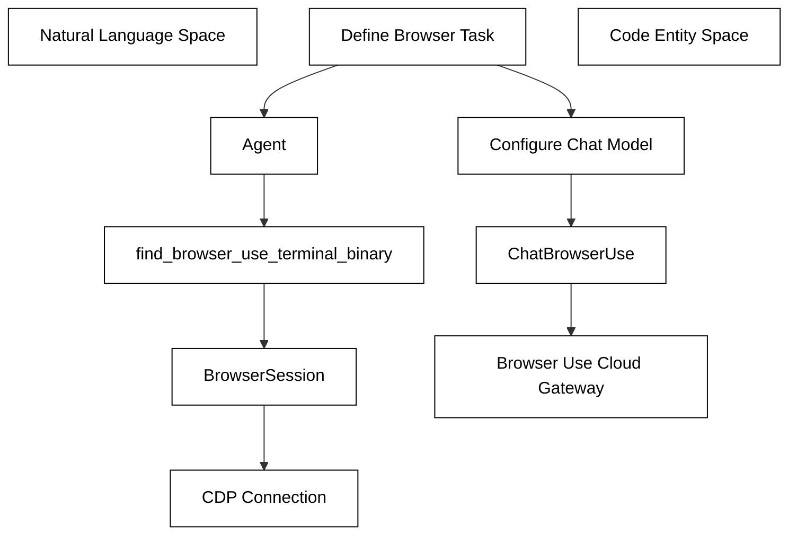
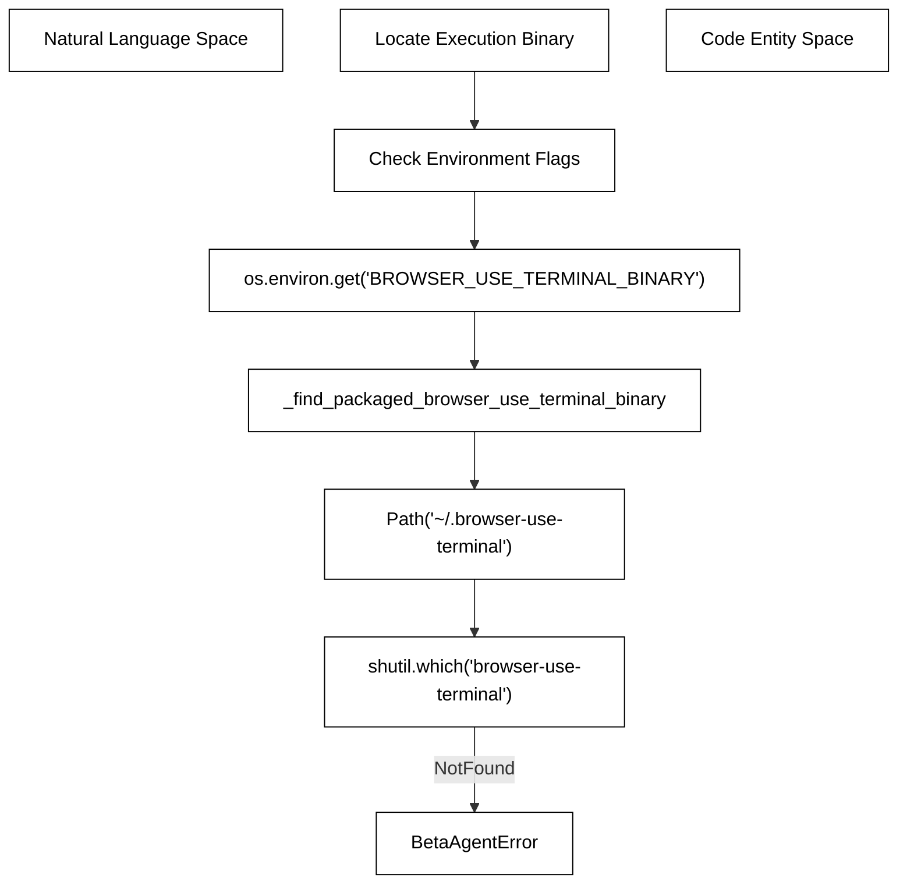

<!-- source: DeepWiki mcp.deepwiki.com · repo browser-use/browser-use · page 2.11 Beta Agent · fetched 2026-10-30 -->

# Beta Agent

<details>
<summary>Relevant source files</summary>

The following files were used as context for generating this wiki page:

- [browser_use/beta/service.py](browser_use/beta/service.py)
- [browser_use/llm/browser_use/chat.py](browser_use/llm/browser_use/chat.py)
- [browser_use/tokens/custom_pricing.py](browser_use/tokens/custom_pricing.py)
- [browser_use/tokens/openrouter_pricing.py](browser_use/tokens/openrouter_pricing.py)
- [browser_use/utils.py](browser_use/utils.py)
- [examples/beta_agent/basic.py](examples/beta_agent/basic.py)
- [examples/models/browser_use_provider_models.py](examples/models/browser_use_provider_models.py)
- [examples/models/bu_oss.py](examples/models/bu_oss.py)
- [skills/open-source/references/models.md](skills/open-source/references/models.md)
- [tests/ci/models/test_llm_browseruse.py](tests/ci/models/test_llm_browseruse.py)
- [tests/ci/test_beta_agent.py](tests/ci/test_beta_agent.py)
- [tests/ci/test_llm_retries.py](tests/ci/test_llm_retries.py)
- [tests/ci/test_openrouter_token_cost.py](tests/ci/test_openrouter_token_cost.py)

</details>


## Purpose and Scope

The Beta Agent service (`browser_use/beta`) provides an experimental orchestration layer for browser automation within the `browser-use` framework. It bridges high-level browser tasks with advanced execution backends—including the Rust-backed `browser-use-terminal` binary and optimized cloud LLM routing via `ChatBrowserUse`. This page details the architectural differences between the main Python agent and the beta service, its API surface, terminal binary resolution, telemetry/observability hooks, and example usage patterns.

Sources:
- `browser_use/beta/service.py` [browser_use/beta/service.py:1-103]()
- `tests/ci/test_beta_agent.py` [tests/ci/test_beta_agent.py:1-52]()

---

## 1. Architecture and Differences from the Main Agent

The primary distinction between the standard Python agent (`browser_use.agent.service.Agent`) and the Beta Agent (`browser_use.beta.Agent`) lies in their execution plumbing and backend targets. While the classic agent executes loops natively in Python using DOM serialization and direct CDP commands, the Beta Agent service can delegate or wrap execution through alternative runtime environments, integrate tightly with the Browser Use Cloud gateway, and leverage advanced telemetry systems like Laminar (`lmnr`).


*Diagram 1: Bridging Natural Language Task Configuration to Code Entities in the Beta Service.*

Sources:
- `browser_use/beta/service.py` [browser_use/beta/service.py:187-207]()
- `browser_use/llm/browser_use/chat.py` [browser_use/llm/browser_use/chat.py:31-76]()

---

## 2. API Surface and Module Re-exports

The `browser_use.beta` package mirrors and extends the core `browser-use` namespace, exposing drop-in replacements for core classes while preserving exact constructor signatures and typing structures.

| Beta Export Symbol | Underlying Code Entity | Role & Description |
| :--- | :--- | :--- |
| `Agent` | `browser_use.beta.Agent` (or wrapped service) | Orchestrates task execution loops and state |
| `BrowserSession` | `browser_use.browser.BrowserSession` | Manages local, remote, or cloud CDP sessions |
| `BrowserProfile` | `browser_use.browser.BrowserProfile` | Configures Chrome launch flags and extensions |
| `ChatBrowserUse` | `browser_use.llm.browser_use.chat.ChatBrowserUse` | Client for the Browser Use Cloud LLM gateway |

Compatibility is enforced via automated test suites that check signature parity, generic subscriptions, and type hints between the standard agent and the beta interface.

Sources:
- `tests/ci/test_beta_agent.py` [tests/ci/test_beta_agent.py:53-186]()
- `browser_use/beta/service.py` [browser_use/beta/service.py:56-62]()

---

## 3. Terminal Binary Integration and Rust Backend

When operating in environments requiring the high-performance Rust execution core, the Beta Agent searches for the `browser-use-terminal` executable. The resolution mechanism checks environment overrides, packaged binaries, and local installation directories.


*Diagram 2: Binary Resolution Flow for the Rust-backed Terminal Engine.*

### Key Resolution Functions
- `find_browser_use_terminal_binary()`: Scans environment variables (`BROWSER_USE_TERMINAL_BINARY`, `BUT_HOME`, `BUT_INSTALL_DIR`) and system `PATH` for a compatible binary [browser_use/beta/service.py:187-207]().
- `BetaAgentError`: Custom exception raised when the required terminal binary is missing or incompatible [browser_use/beta/service.py:100-102]().

Sources:
- `browser_use/beta/service.py` [browser_use/beta/service.py:100-102](), [browser_use/beta/service.py:187-207]()

---

## 4. Observability and Cloud Integration

The beta service integrates deeply with **Laminar** (`lmnr`) for distributed tracing and span management, as well as the **Browser Use Cloud** LLM API (`ChatBrowserUse`).

### Observability Helpers
- `_laminar_ready()`: Verifies if the Laminar tracking client is initialized [browser_use/beta/service.py:104-110]().
- `_laminar_start_span()`: Wraps execution blocks in tracing spans [browser_use/beta/service.py:153-160]().
- `_laminar_force_flush()`: Flushes pending telemetry spans on shutdown [browser_use/beta/service.py:163-175]().

### ChatBrowserUse Cloud Client
The `ChatBrowserUse` class handles authentication against `BROWSER_USE_API_KEY`, manages exponential backoff retries on HTTP errors (`429`, `500`, `502`, `503`, `504`), and supports sticky routing via `session_id` parameters.

Sources:
- `browser_use/beta/service.py` [browser_use/beta/service.py:104-185]()
- `browser_use/llm/browser_use/chat.py` [browser_use/llm/browser_use/chat.py:31-115]()

---

## 5. Example Usage

The following script illustrates setting up a Beta Agent task with a remote CDP session and a cloud-hosted LLM model:

```python
import asyncio
import os
from browser_use.beta import Agent, BrowserSession, ChatBrowserUse

async def main() -> None:
    cdp_url = os.environ.get('BU_CDP_URL') or os.environ.get('BROWSER_USE_CDP_URL')
    browser_session = BrowserSession(cdp_url=cdp_url) if cdp_url else None
    
    agent = Agent(
        task='Open https://example.com and report the page title.',
        llm=ChatBrowserUse(model='openai/gpt-5.5'),
        browser_session=browser_session,
    )
    history = await agent.run(max_steps=20)
    print(history.final_result() or '(no final result)')

if __name__ == '__main__':
    asyncio.run(main())
```

Sources:
- `examples/beta_agent/basic.py` [examples/beta_agent/basic.py:1-37]()

---

