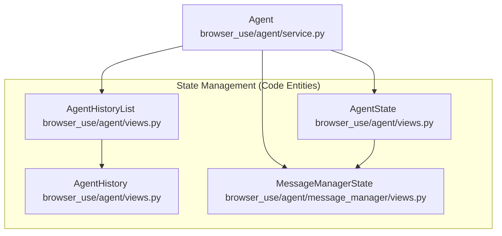
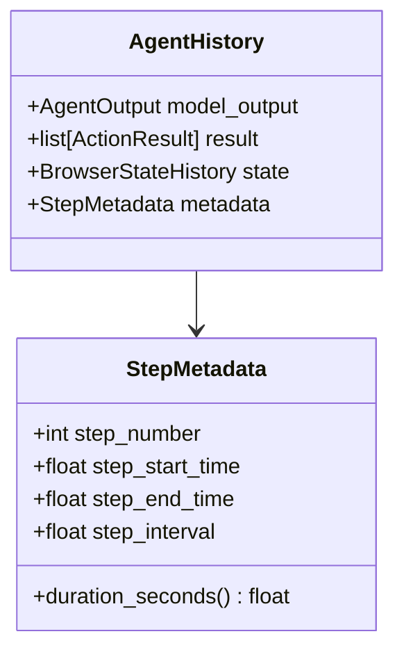

<!-- source: DeepWiki mcp.deepwiki.com · repo browser-use/browser-use · page 2.3 Agent State and History Management · fetched 2026-10-30 -->

# Agent State and History Management

Relevant source files

The following files were used as context for generating this wiki page:

- [browser_use/agent/message_manager/service.py](browser_use/agent/message_manager/service.py)
- [browser_use/agent/message_manager/views.py](browser_use/agent/message_manager/views.py)
- [browser_use/agent/prompts.py](browser_use/agent/prompts.py)
- [browser_use/agent/service.py](browser_use/agent/service.py)
- [browser_use/agent/views.py](browser_use/agent/views.py)
- [browser_use/browser/views.py](browser_use/browser/views.py)
- [examples/features/rerun_history.py](examples/features/rerun_history.py)
- [tests/ci/test_ai_step.py](tests/ci/test_ai_step.py)
- [tests/ci/test_ax_name_matching.py](tests/ci/test_ax_name_matching.py)
- [tests/ci/test_history_wait_time.py](tests/ci/test_history_wait_time.py)
- [tests/ci/test_variable_substitution.py](tests/ci/test_variable_substitution.py)

This page documents the state management and history tracking systems in `browser-use`. The agent maintains several complementary state representations: `AgentState` for tracking current execution status and control flow, `AgentHistoryList` for persisting the complete execution trace with results and metadata, and `MessageManagerState` for LLM conversation context. These systems enable checkpointing, error recovery, execution analysis, variable substitution, and history-based reruns.

## State Management Architecture

The agent's state is split across three primary models, each serving a distinct purpose in the orchestration loop:

| State Model | Location | Purpose | Serializable |
|-------------|----------|---------|--------------|
| `AgentState` | [browser_use/agent/views.py:228-278]() | Runtime execution state (step count, failures, pause/stop flags) | ✓ |
| `AgentHistoryList` | [browser_use/agent/views.py:417-738]() | Persistent execution trace with results and metadata | ✓ |
| `MessageManagerState` | [browser_use/agent/message_manager/views.py:86-101]() | LLM conversation context and prompt history | ✓ |

### State Entity Relationships

The following diagram bridges the natural language concepts of "State" and "History" to the specific code entities that implement them within the `Agent` class.

**Sources**: [browser_use/agent/views.py:228-278](), [browser_use/agent/views.py:283-397](), [browser_use/agent/views.py:417-738](), [browser_use/agent/message_manager/views.py:86-101](), [browser_use/agent/service.py:133-206]()

## AgentState: Runtime Execution State

`AgentState` tracks the agent's current execution status and control flow. It is updated continuously during the `Agent.step()` loop [browser_use/agent/service.py:133-206]().

### Key State Properties

| Field | Type | Purpose |
|-------|------|---------|
| `n_steps` | `int` | Current step number, incremented after each successful step |
| `consecutive_failures` | `int` | Count of consecutive failures, reset to 0 on success |
| `last_result` | `list[ActionResult]` | Results from the most recent action execution |
| `last_model_output` | `AgentOutput` | Most recent LLM response containing thinking and actions |
| `paused` | `bool` | Whether agent execution is paused (controlled by `SignalHandler`) |
| `stopped` | `bool` | Whether agent execution should terminate |

**Sources**: [browser_use/agent/views.py:228-278](), [browser_use/agent/service.py:133-206]()

### Loop Detection and Behavioral Nudges
The `ActionLoopDetector` within `AgentState` tracks action repetition and page stagnation to detect behavioral loops [browser_use/agent/views.py:157-162](). It uses `compute_action_hash` to normalize action parameters—for example, sorting search tokens or stripping minor keyword variations—to identify repeated behaviors even if parameters change slightly [browser_use/agent/views.py:110-155]().

**Sources**: [browser_use/agent/views.py:110-155](), [browser_use/agent/views.py:157-174]()

## AgentHistory and Serialization

The `AgentHistoryList` provides a complete execution trace. Each `AgentHistory` item contains the LLM's `AgentOutput`, the resulting `ActionResult`, and a `BrowserStateHistory` snapshot [browser_use/agent/views.py:283-294]().

### History Structure and Metadata

The `step_interval` in `StepMetadata` tracks the time elapsed since the previous step, which is critical for accurate replaying of history during a `load_and_rerun` operation [browser_use/agent/views.py:343-348](), [tests/ci/test_history_wait_time.py:23-36]().

**Sources**: [browser_use/agent/views.py:283-397](), [tests/ci/test_history_wait_time.py:4-22]()

### Serialization and Sensitive Data
`AgentHistoryList` supports saving to and loading from JSON. During serialization, the `redact_sensitive_string` utility is used to replace sensitive values (defined in `Agent.sensitive_data`) with placeholders to prevent credential leaks in logs or saved files [browser_use/utils.py:30-31](), [browser_use/agent/views.py:306-333]().

**Sources**: [browser_use/agent/views.py:449-458](), [browser_use/utils.py:30-31](), [browser_use/agent/views.py:306-333]()

## History Rerun and Variable Substitution

`browser-use` allows rerunning saved history with different data inputs via variable substitution, which is useful for replaying successful workflows with different data or debugging [examples/features/rerun_history.py:3-15]().

### Rerun Mechanism
1. **Variable Detection**: `Agent.detect_variables()` scans history for patterns like emails, names, and dates in input actions [examples/features/rerun_history.py:80-82]().
2. **Substitution**: `Agent._substitute_variables_in_history()` replaces detected values with new values provided by the user [tests/ci/test_variable_substitution.py:51-54]().
3. **Execution**: The agent replays the modified actions. For `extract` actions, the rerun system uses an AI step to re-evaluate the page content since the new data might have changed the expected output [examples/features/rerun_history.py:23-27]().

**Sources**: [examples/features/rerun_history.py:73-135](), [tests/ci/test_variable_substitution.py:38-60](), [browser_use/agent/service.py:1158-1200]()

### Element Matching Fallbacks
During history reruns, elements are matched across sessions using a multi-level strategy. If a direct `element_hash` match fails (common in dynamic SPAs where DOM structure changes), the system falls back to `ax_name` (accessible name) matching [tests/ci/test_ax_name_matching.py:21-26](). This ensures that a "Submit" button can still be found if its accessible name remains stable even if internal IDs change [tests/ci/test_ax_name_matching.py:78-80]().

**Sources**: [tests/ci/test_ax_name_matching.py:21-80](), [browser_use/agent/views.py:17-18]()

## Message Compaction and Context Management

To prevent LLM context overflow, `MessageManager` implements a compaction system governed by `MessageCompactionSettings` [browser_use/agent/views.py:35-46]().

- **Compaction**: When history exceeds `trigger_char_count` or `compact_every_n_steps`, older history items are summarized into a `compacted_memory` block to reduce prompt size [browser_use/agent/views.py:35-46]().
- **Truncation**: The `agent_history_description` property respects `max_history_items`, keeping the initial task context and the most recent items while omitting middle steps [browser_use/agent/message_manager/service.py:152-189]().

**Sources**: [browser_use/agent/views.py:35-56](), [browser_use/agent/message_manager/service.py:152-189](), [browser_use/agent/message_manager/views.py:97-99]()

---

