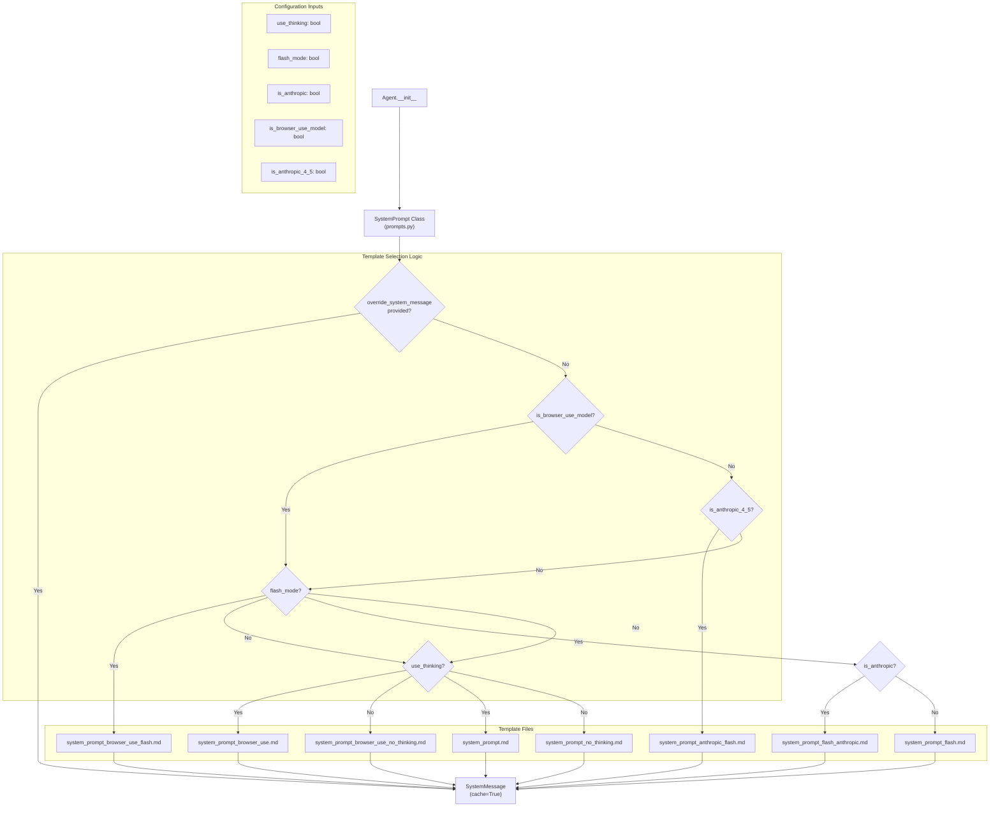
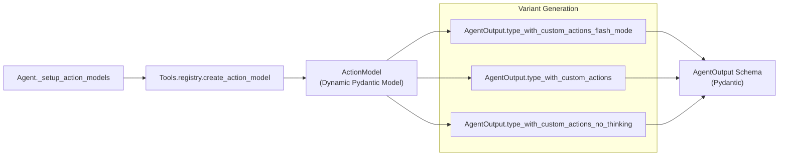

<!-- source: DeepWiki mcp.deepwiki.com · repo browser-use/browser-use · page 2.4 System Prompts and Output Formats · fetched 2026-10-30 -->

# System Prompts and Output Formats

<details>
<summary>Relevant source files</summary>

The following files were used as context for generating this wiki page:

- [browser_use/agent/message_manager/service.py](browser_use/agent/message_manager/service.py)
- [browser_use/agent/message_manager/views.py](browser_use/agent/message_manager/views.py)
- [browser_use/agent/prompts.py](browser_use/agent/prompts.py)
- [browser_use/agent/service.py](browser_use/agent/service.py)
- [browser_use/agent/system_prompts/system_prompt.md](browser_use/agent/system_prompts/system_prompt.md)
- [browser_use/agent/system_prompts/system_prompt_anthropic_flash.md](browser_use/agent/system_prompts/system_prompt_anthropic_flash.md)
- [browser_use/agent/system_prompts/system_prompt_browser_use.md](browser_use/agent/system_prompts/system_prompt_browser_use.md)
- [browser_use/agent/system_prompts/system_prompt_browser_use_flash.md](browser_use/agent/system_prompts/system_prompt_browser_use_flash.md)
- [browser_use/agent/system_prompts/system_prompt_browser_use_no_thinking.md](browser_use/agent/system_prompts/system_prompt_browser_use_no_thinking.md)
- [browser_use/agent/system_prompts/system_prompt_flash.md](browser_use/agent/system_prompts/system_prompt_flash.md)
- [browser_use/agent/system_prompts/system_prompt_flash_anthropic.md](browser_use/agent/system_prompts/system_prompt_flash_anthropic.md)
- [browser_use/agent/system_prompts/system_prompt_no_thinking.md](browser_use/agent/system_prompts/system_prompt_no_thinking.md)
- [browser_use/agent/views.py](browser_use/agent/views.py)
- [browser_use/browser/views.py](browser_use/browser/views.py)

</details>


This page documents how `browser-use` configures LLM behavior through system prompts and structured output formats. The system uses the `SystemPrompt` class to select appropriate prompt templates, and the `AgentOutput` model to define output format variants: standard (with thinking), no-thinking, and flash mode. It also supports custom structured output via `output_model_schema`.

For information about how prompts are constructed with browser state and history, see **2.2. Message Manager and Prompt Construction**. For information about the agent execution loop that uses these outputs, see **2.1. Agent Core and Execution Loop**.

---

## System Prompt Template System

The `SystemPrompt` class manages the loading and formatting of system prompt templates from markdown files located in `browser_use/agent/system_prompts/`. The system maintains multiple distinct prompt templates that are selected based on model type, reasoning mode, and performance settings.

### System Prompt Selection Logic

The following diagram illustrates how the `Agent` and `SystemPrompt` classes collaborate to select the correct template file based on the provided configuration.

Title: System Prompt Template Selection Flow

Sources: [browser_use/agent/prompts.py:28-91](), [browser_use/agent/service.py:133-210]()

### Template Selection Matrix

The `_load_prompt_template` method in `SystemPrompt` selects the markdown file based on the state of the `Agent`.

| Template File | Condition | Purpose |
|--------------|-----------|---------|
| `system_prompt_browser_use_flash.md` | `is_browser_use_model=True` AND `flash_mode=True` | Minimal prompt for fine-tuned browser-use models. |
| `system_prompt_browser_use.md` | `is_browser_use_model=True` AND `use_thinking=True` | Simplified prompt for fine-tuned models with reasoning. |
| `system_prompt_browser_use_no_thinking.md` | `is_browser_use_model=True` AND `use_thinking=False` | Simplified prompt for fine-tuned models without reasoning. |
| `system_prompt_anthropic_flash.md` | `is_anthropic_4_5=True` AND `flash_mode=True` | Long prompt (4096+ tokens) required for caching on Claude 4.5. |
| `system_prompt_flash_anthropic.md` | `flash_mode=True` AND `is_anthropic=True` | Optimized flash mode for standard Anthropic models. |
| `system_prompt_flash.md` | `flash_mode=True` AND `is_anthropic=False` | General flash mode for other providers (OpenAI, Gemini). |
| `system_prompt.md` | `use_thinking=True` | Standard prompt with full reasoning chain. |
| `system_prompt_no_thinking.md` | `use_thinking=False` | Standard prompt without the thinking field. |

Sources: [browser_use/agent/prompts.py:64-81](), [browser_use/agent/prompts.py:16-24]()

---

## AgentOutput Format Variants

The `AgentOutput` class defines the structured response schema for the LLM. Depending on `AgentSettings` [browser_use/agent/views.py:59-94](), the agent dynamically constructs a Pydantic model to enforce the desired output format.

### Output Schema Construction

Title: Agent Output Schema Generation

Sources: [browser_use/agent/service.py:726-746](), [browser_use/agent/views.py:186-279]()

### Standard Format (with thinking)
Used when `use_thinking=True` and `flash_mode=False`. It includes the full reasoning process.
*   `thinking`: Internal reasoning (logged to debug via `log_response`).
*   `evaluation_previous_goal`: Assessment of the last step.
*   `memory`: Knowledge to persist across steps.
*   `next_goal`: The immediate next objective.
*   `action`: List of actions to execute.

Sources: [browser_use/agent/views.py:214-227](), [browser_use/agent/service.py:87-123](), [browser_use/agent/system_prompts/system_prompt_browser_use.md:7-18]()

### No-Thinking Format
Used when `use_thinking=False` and `flash_mode=False`. It removes the internal reasoning field but keeps the planning structure.
*   `evaluation_previous_goal`, `memory`, `next_goal`, `action`.

Sources: [browser_use/agent/views.py:229-251](), [browser_use/agent/system_prompts/system_prompt_no_thinking.md:40-56]()

### Flash Mode Format
Used when `flash_mode=True`. This is the most minimal format, designed for high-speed inference. It removes evaluation and next-goal fields to reduce latency and token usage.
*   `memory`: Key context.
*   `action`: List of actions.

Sources: [browser_use/agent/views.py:253-279](), [browser_use/agent/system_prompts/system_prompt_flash.md:9-16]()

---

## Output Schema Customization

The library allows for advanced customization of the output schema through `Agent` initialization parameters.

### Custom Structured Output
Users can provide a custom Pydantic model via `output_model_schema`. If provided, the LLM is instructed to return data matching this schema in the `done` action.

Sources: [browser_use/agent/service.py:164](), [browser_use/agent/views.py:11-13]()

### Dynamic Action Models
The `action` field in `AgentOutput` is not static. It is dynamically generated by the `Tools` registry to include only the actions available to the agent (built-in or custom).

```python
# From browser_use/agent/service.py:726-728
def _setup_action_models(self) -> None:
    self.ActionModel = self.tools.registry.create_action_model()
```

Sources: [browser_use/agent/service.py:726-728](), [browser_use/tools/service.py:74]()

---

## Prompt Construction Details

The `AgentMessagePrompt` class in `browser_use/agent/prompts.py` is responsible for building the actual `UserMessage` content sent to the LLM at each step.

### Data Grounding and Context
The prompt includes several XML-tagged sections to ground the LLM's decisions:
1.  `<agent_history>`: Chronological stream of previous steps and results. Managed by `MessageManager.agent_history_description` which respects `max_history_items`.
2.  `<browser_state>`: Current URL, open tabs, and the interactive element tree. Interactive elements are provided in a tree-style XML format.
3.  `<browser_vision>`: Information about the screenshot and bounding boxes.
4.  `<file_system>`: Summary of available files and the `todo.md` checklist for long tasks (>10 steps).

Sources: [browser_use/agent/prompts.py:103-147](), [browser_use/agent/message_manager/service.py:150-186](), [browser_use/agent/system_prompts/system_prompt.md:23-67](), [browser_use/agent/system_prompts/system_prompt_anthropic_flash.md:14-22]()

### Redaction and Security
Before being added to the prompt, sensitive data is redacted using `redact_sensitive_string`. This replaces sensitive values with `<secret>key</secret>` placeholders to prevent leakage to the LLM provider.

Sources: [browser_use/utils.py:76-80](), [browser_use/agent/message_manager/service.py:31]()

### System Message Caching
The `SystemPrompt` class sets `cache=True` on the `SystemMessage` [browser_use/agent/prompts.py:58](). This tells supported LLM providers (like Anthropic) to cache the system prompt, significantly reducing the cost and latency of subsequent steps in the same task.

Sources: [browser_use/agent/prompts.py:58]()

---

