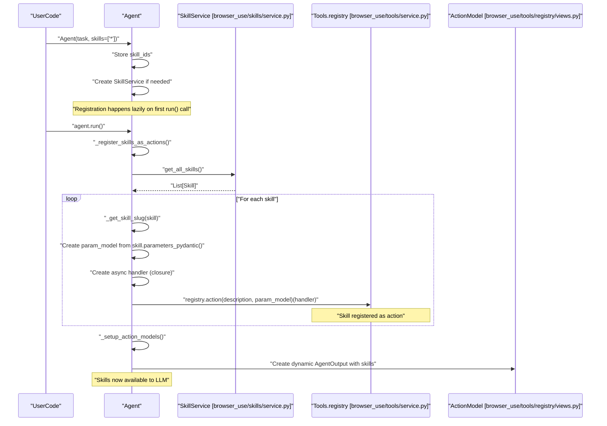
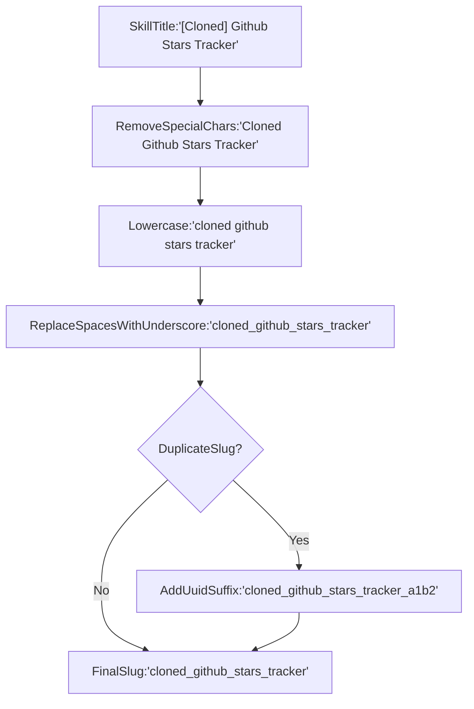
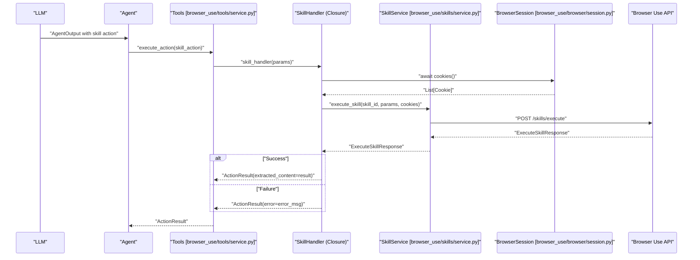

<!-- source: DeepWiki mcp.deepwiki.com · repo browser-use/browser-use · page 2.5 Skills Integration · fetched 2026-10-30 -->

# Skills Integration

Relevant source files

The following files were used as context for generating this wiki page:

- [browser_use/skills/README.md](browser_use/skills/README.md)
- [browser_use/skills/__init__.py](browser_use/skills/__init__.py)
- [browser_use/skills/browser-use/SKILL.md](browser_use/skills/browser-use/SKILL.md)
- [browser_use/skills/browser_use.py](browser_use/skills/browser_use.py)
- [browser_use/skills/install.py](browser_use/skills/install.py)
- [browser_use/skills/service.py](browser_use/skills/service.py)
- [browser_use/skills/utils.py](browser_use/skills/utils.py)
- [browser_use/skills/views.py](browser_use/skills/views.py)
- [pyproject.toml](pyproject.toml)
- [skills/browser-use/SKILL.md](skills/browser-use/SKILL.md)
- [skills/remote-browser/SKILL.md](skills/remote-browser/SKILL.md)
- [tests/ci/test_browser_use_skill_install_docs.py](tests/ci/test_browser_use_skill_install_docs.py)

## Purpose and Scope

This document explains how external skills are dynamically registered as actions within the Agent system. Skills extend the agent's capabilities beyond built-in browser actions by allowing execution of cloud-hosted or custom functions. This integration covers dynamic action registration, parameter validation, and session-aware execution involving browser cookies.

## Overview

Skills are external capabilities that can be registered with an `Agent` instance to extend its functionality. Each skill becomes a separate action in the agent's action model, allowing the LLM to invoke it like any built-in browser action. Skills are managed by a `SkillService` that handles fetching skill metadata, validating parameters, and executing skill code via API calls [browser_use/skills/service.py:19-38]().

**Key Characteristics:**
- **Dynamic Registration**: Skills are registered at `Agent` initialization time and converted into action schemas during execution.
- **Parameter Validation**: Each skill defines typed parameters via Pydantic models generated from the skill's schema [browser_use/skills/views.py:49-61]().
- **Cookie Requirements**: Skills can require browser cookies for authentication (e.g., session tokens), which are automatically extracted from the active browser session during execution [browser_use/skills/service.py:194-206]().
- **Cloud Execution**: Skills execute remotely via the `AsyncBrowserUse` client [browser_use/skills/service.py:165-182]().
- **Unavailability Handling**: Skills missing required cookies are reported to the agent as unavailable in the prompt.

Sources: [browser_use/skills/service.py:19-38](), [browser_use/skills/views.py:23-36](), [browser_use/skills/browser_use.py:32-74]()

## Skill Registration Flow

The following diagram bridges the Natural Language request for skills to the internal Code Entity Space of the `Agent` and `SkillService`.

**Title: Skill Action Registration Sequence**

**Registration Steps:**

1. **Initialization**: User passes `skills` or `skill_ids` to `Agent.__init__`.
2. **SkillService Creation**: Agent creates a `SkillService` instance with the provided skill IDs [browser_use/skills/service.py:22-38]().
3. **Lazy Registration**: Skills are registered during the first run or step call via internal registration helpers.
4. **Skill Fetching**: `SkillService.get_all_skills()` fetches and caches skill metadata from the Browser Use API [browser_use/skills/service.py:154-163]().
5. **Slug Generation**: Each skill gets a clean action name via internal slug generation.
6. **Handler Creation**: A closure-based handler is created for each skill that handles cookie retrieval and execution.
7. **Action Registration**: Skills are registered with the `Tools` registry.
8. **Action Model Rebuild**: Dynamic action models are rebuilt to include the newly registered skill actions.

Sources: [browser_use/skills/service.py:39-138](), [browser_use/skills/views.py:38-47](), [browser_use/skills/utils.py:10-22]()

## Skill Slug Generation

Skills are identified by human-readable slugs derived from their titles. The normalization logic ensures that skill titles are converted into valid Python identifier names.

**Title: Slug Normalization Logic**

**Slug Rules:**
- Special characters are removed using regex.
- Whitespace and hyphens are replaced with underscores.
- Leading/trailing underscores are stripped.
- If multiple skills result in the same slug, a short UUID suffix is appended to ensure uniqueness.

Sources: [browser_use/skills/browser_use.py:32-74]()

## Skill Parameters and Metadata

Each skill defines its interface through a parameter schema that becomes the action's parameter model. The `Skill` view class provides helpers to convert these schemas into Pydantic models [browser_use/skills/views.py:49-61]().

**Parameter Conversion Logic:**
- **Type Mapping**: `string` -> `str`, `number` -> `float`, `boolean` -> `bool`, `object` -> `dict`, `array` -> `list`, `cookie` -> `str` [browser_use/skills/utils.py:32-44]().
- **Cookie Exclusion**: When registering for the LLM, `exclude_cookies=True` is used so the LLM doesn't try to provide session tokens manually [browser_use/skills/views.py:58-59]().
- **Required Fields**: Fields are marked as required or optional based on the `ParameterSchema.required` property [browser_use/skills/utils.py:46-60]().

Sources: [browser_use/skills/views.py:23-36](), [browser_use/skills/utils.py:10-63]()

## Skill Execution Flow

The following diagram maps the execution flow from the LLM's decision down to the remote API call, bridging Natural Language actions to internal code components.

**Title: Skill Execution Data Flow**

**Execution Steps:**
1. **Handler Call**: The agent invokes the skill handler closure created during registration.
2. **Cookie Collection**: The handler retrieves current browser cookies from the active session to satisfy any authentication requirements of the skill.
3. **Service Execution**: `SkillService.execute_skill` validates parameters and checks for required cookies [browser_use/skills/service.py:165-206]().
4. **API Call**: The `AsyncBrowserUse` SDK client transmits the request to the cloud execution environment [browser_use/skills/service.py:214-218]().
5. **Result Processing**: The output is returned as an `ActionResult`, making it available for the agent's next step.

Sources: [browser_use/skills/service.py:165-225](), [browser_use/skills/views.py:9-21]()

## Cookie Dependencies and Authentication

Skills can declare cookie dependencies for authentication. The agent tracks which skills are unavailable due to missing cookies and informs the LLM via the prompt.

**Missing Cookie Handling:**
- **MissingCookieException**: Raised by the `SkillService` if a required cookie is not found in the provided list [browser_use/skills/views.py:9-21]().
- **Validation**: `SkillService.execute_skill` iterates through `cookie_params` and raises an exception if `is_required` is True but the cookie is missing from the cookie dictionary [browser_use/skills/service.py:201-212]().

Sources: [browser_use/skills/service.py:194-212](), [browser_use/skills/views.py:9-21]()

## Skill Service Interface

The `SkillService` manages the lifecycle of remote skills, including pagination and wildcard fetching.

| Method | Purpose | Source |
|--------|---------|--------|
| `async_init()` | Fetches skills from API and filters by requested IDs | [browser_use/skills/service.py:39-138]() |
| `get_skill(id)` | Retrieves a cached skill by UUID | [browser_use/skills/service.py:140-152]() |
| `execute_skill()` | Validates and executes a skill via SDK | [browser_use/skills/service.py:165-225]() |

**Skill ID Resolution:**
- **Wildcard**: `['*']` fetches the first page (max 100 skills) to avoid LLM tool overload [browser_use/skills/service.py:59-74]().
- **Explicit**: Paginated search until all requested IDs are found, with a safety limit of 5 pages [browser_use/skills/service.py:76-103]().

Sources: [browser_use/skills/service.py:19-225]()

## Local and Domain Skills

The library supports local "skills" defined as Markdown files (`SKILL.md`) that provide instructions to LLM-based coding assistants [browser_use/skills/browser-use/SKILL.md:1-22]().

- **Installation**: The CLI can install these instruction files into common assistant directories (e.g., `.cursor/skills/browser-use/SKILL.md`) using `browser_use/skills/install.py` [browser_use/skills/install.py:25-34]().
- **Domain Skills**: When `BH_DOMAIN_SKILLS=1` is enabled, the system searches for site-specific instructions in `$BH_AGENT_WORKSPACE/domain-skills/<site>/` [browser_use/skills/browser-use/SKILL.md:32-35]().
- **Remote Browser Skill**: A specialized skill for agents running in sandboxes (no GUI) to control browsers via a CLI daemon [skills/remote-browser/SKILL.md:1-26]().

Sources: [browser_use/skills/browser-use/SKILL.md:1-35](), [browser_use/skills/install.py:25-34](), [browser_use/skills/browser_use.py:32-74](), [skills/remote-browser/SKILL.md:1-26]()

---

