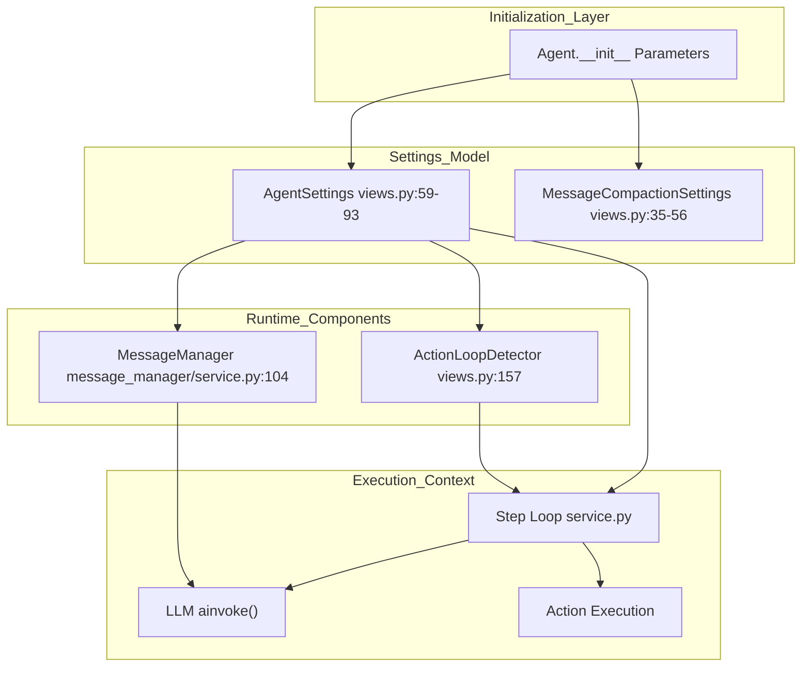
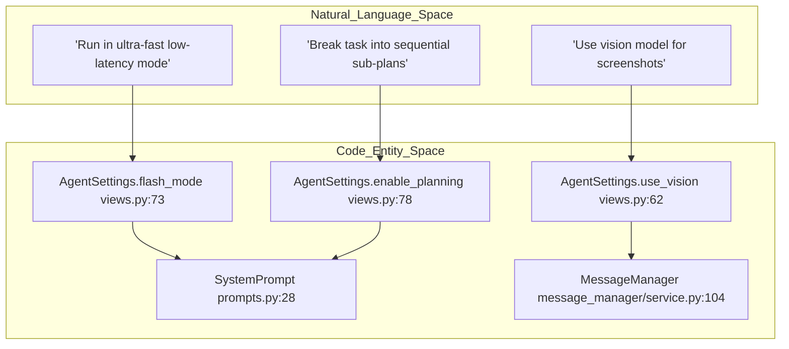
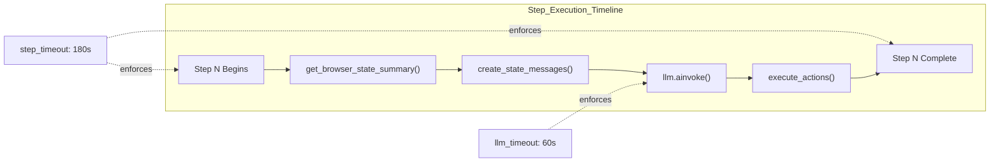
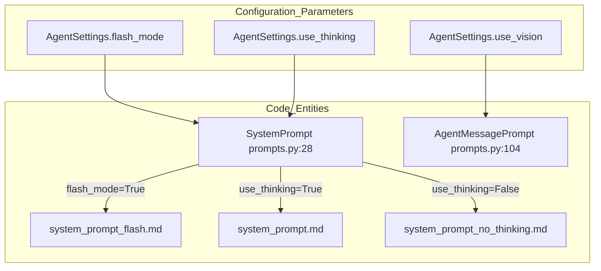
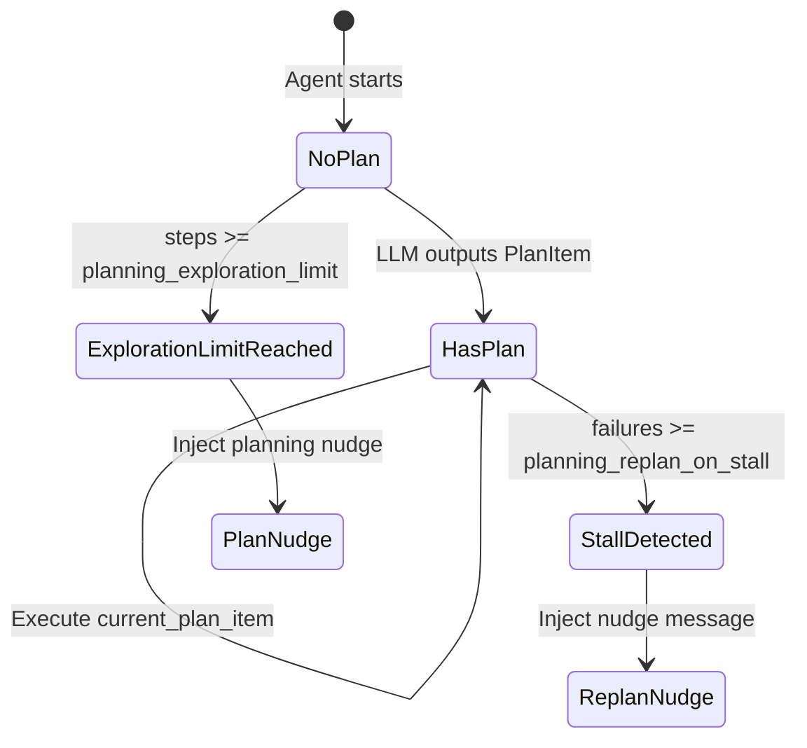
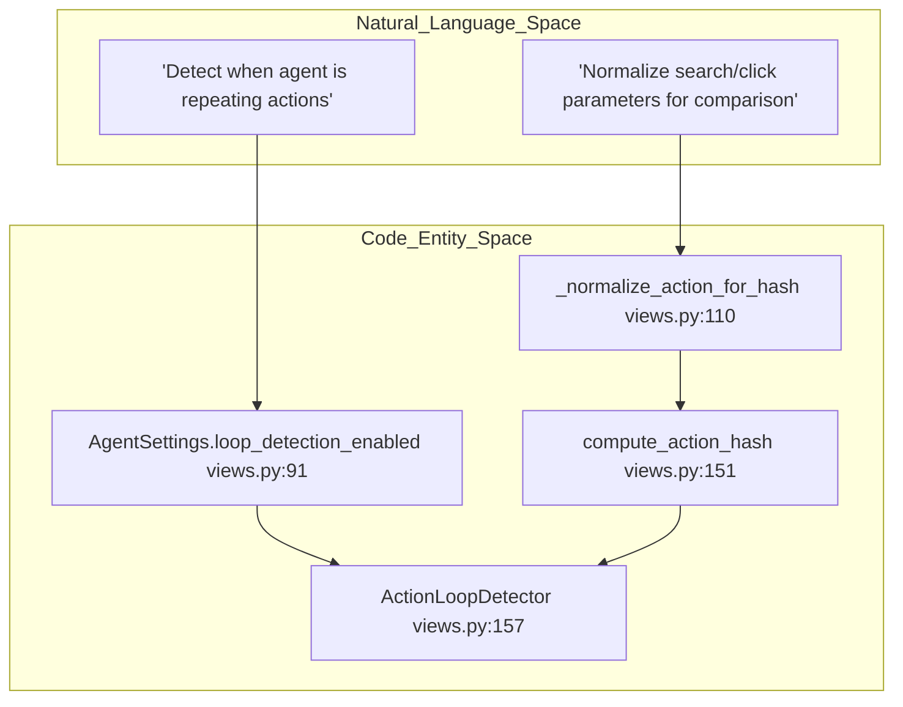
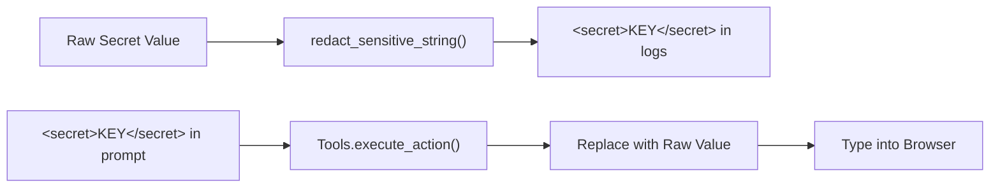

<!-- source: DeepWiki mcp.deepwiki.com · repo browser-use/browser-use · page 2.6 Agent Configuration and Settings · fetched 2026-10-30 -->

# Agent Configuration and Settings

Relevant source files

The following files were used as context for generating this wiki page:

- [browser_use/agent/message_manager/service.py](browser_use/agent/message_manager/service.py)
- [browser_use/agent/message_manager/views.py](browser_use/agent/message_manager/views.py)
- [browser_use/agent/prompts.py](browser_use/agent/prompts.py)
- [browser_use/agent/service.py](browser_use/agent/service.py)
- [browser_use/agent/views.py](browser_use/agent/views.py)
- [browser_use/browser/views.py](browser_use/browser/views.py)

This page documents the configuration parameters available when initializing an `Agent` instance (`[browser_use/agent/service.py:134-197]()`). These settings control execution behavior, LLM interaction modes, planning strategies, security constraints, and debugging capabilities through the underlying `AgentSettings` view (`[browser_use/agent/views.py:59-93]()`).

For information about the core Agent execution loop and state management, see [Agent Core and Execution Loop](2.1). For details on how configuration affects prompt construction, see [Message Manager and Prompt Construction](2.2). For browser-specific configuration, see [Browser Profile Configuration](3.2).

---

## Configuration Architecture

Agent configuration flows through three primary layers: initialization parameters passed to `Agent.__init__` (`[browser_use/agent/service.py:135-197]()`), the `AgentSettings` model that stores validated settings (`[browser_use/agent/views.py:59-93]()`), and runtime state managed by `MessageManager` (`[browser_use/agent/message_manager/service.py:104-140]()`) and `ActionLoopDetector` (`[browser_use/agent/views.py:157]()`).

### Configuration Data Flow
Title: Agent Configuration Data Flow

Sources: [browser_use/agent/service.py:133-209](), [browser_use/agent/views.py:59-93](), [browser_use/agent/views.py:35-56]()

### Natural Language to Code Entity Space: Settings Mapping
Title: Natural Language Space to Code Entity Space - Settings Mapping

Sources: [browser_use/agent/views.py:59-93](), [browser_use/agent/prompts.py:28-101](), [browser_use/agent/message_manager/service.py:104-140]()

---

## Core Execution Parameters

These settings control the fundamental execution behavior of the agent, including step limits, failure handling, and timeouts.

| Parameter | Type | Default | Description |
|-----------|------|---------|-------------|
| `max_failures` | `int` | `5` | Consecutive action failures before stopping (`[browser_use/agent/views.py:66]()`). |
| `step_timeout` | `int` | `180` | Timeout in seconds for each complete step (`[browser_use/agent/views.py:86]()`). |
| `llm_timeout` | `int` | `60` | Timeout in seconds for LLM calls (auto-detected: 30s for gemini, 90s for o3) (`[browser_use/agent/views.py:85]()`). |
| `final_response_after_failure` | `bool` | `True` | If True, attempt one final recovery call after `max_failures` reached (`[browser_use/agent/views.py:87]()`). |

### Step Execution Timeline
Title: Agent Step Timeline and Timeouts

Sources: [browser_use/agent/service.py:133-209](), [browser_use/agent/views.py:59-93]()

---

## LLM Behavior Configuration

These settings control how the agent interacts with the language model, including vision capabilities and reasoning modes.

| Parameter | Type | Default | Description |
|-----------|------|---------|-------------|
| `use_vision` | `bool \| Literal['auto']` | `True` | Vision mode: `True` (always), `False` (never), `'auto'` (conditional) (`[browser_use/agent/views.py:62]()`). |
| `vision_detail_level` | `Literal['auto', 'low', 'high']` | `'auto'` | OpenAI-style detail level for image processing (`[browser_use/agent/views.py:63]()`). |
| `use_thinking` | `bool` | `True` | Enable explicit thinking field in LLM output schema (`[browser_use/agent/views.py:72]()`). |
| `flash_mode` | `bool` | `False` | Disables evaluation/planning and sets `use_thinking=False` (`[browser_use/agent/views.py:73]()`). |
| `max_actions_per_step` | `int` | `5` | Maximum actions the LLM can output in a single step (`[browser_use/agent/views.py:71]()`). |

### Prompt and Schema Selection
Title: Configuration to Code Entity Mapping

Sources: [browser_use/agent/prompts.py:28-101](), [browser_use/agent/views.py:62-73]()

---

## Planning and Strategy Settings

Agent planning enables multi-step task decomposition and progress tracking.

| Parameter | Type | Default | Description |
|-----------|------|---------|-------------|
| `enable_planning` | `bool` | `True` | Enable plan generation and tracking (`[browser_use/agent/views.py:78]()`). |
| `planning_replan_on_stall` | `int` | `3` | Consecutive failures before replan nudge (`[browser_use/agent/views.py:79]()`). |
| `planning_exploration_limit` | `int` | `5` | Steps without a plan before nudge (`[browser_use/agent/views.py:80]()`). |

### Planning Flow
Title: Agent Planning State Machine

Sources: [browser_use/agent/views.py:78-81](), [browser_use/agent/service.py:133-209]()

---

## Loop Detection Configuration

Loop detection identifies repetitive behaviors and injects awareness nudges. The `ActionLoopDetector` (`[browser_use/agent/views.py:157]()`) tracks both action hashes and page fingerprints to detect stagnation (`[browser_use/agent/views.py:95-154]()`).

| Parameter | Type | Default | Description |
|-----------|------|---------|-------------|
| `loop_detection_enabled` | `bool` | `True` | Enable action repetition tracking (`[browser_use/agent/views.py:91]()`). |
| `loop_detection_window` | `int` | `20` | Rolling window size for action similarity tracking (`[browser_use/agent/views.py:90]()`). |

### Natural Language to Code Entity Space: Loop Detection Mapping
Title: Natural Language Space to Code Entity Space - Loop Detection Mapping

Sources: [browser_use/agent/views.py:90-174]()

---

## Message Compaction Settings

Message compaction summarizes older history into a compact memory block (`MessageCompactionSettings`, `[browser_use/agent/views.py:35-56]()`) to reduce prompt size when thresholds are approached.

| Parameter | Type | Default | Description |
|-----------|------|---------|-------------|
| `enabled` | `bool` | `True` | Master switch for compaction (`[browser_use/agent/views.py:38]()`). |
| `compact_every_n_steps` | `int` | `25` | Step interval between compaction attempts (`[browser_use/agent/views.py:39]()`). |
| `trigger_char_count` | `int` | `40000` | Min char floor (~10k tokens) (`[browser_use/agent/views.py:55]()`). |
| `keep_last_items` | `int` | `6` | Number of recent history items to retain (`[browser_use/agent/views.py:43]()`). |

Sources: [browser_use/agent/views.py:35-56](), [browser_use/agent/message_manager/service.py:152-190]()

---

## Security and Sensitive Data

The sensitive data system allows agents to handle credentials without exposing them in logs. The `redact_sensitive_string` function replaces raw secrets with placeholders (`[browser_use/utils.py:76-89]()`).

| Parameter | Type | Default | Description |
|-----------|------|---------|-------------|
| `sensitive_data` | `dict` | `None` | Flattened or domain-scoped sensitive data (`[browser_use/agent/service.py:151]()`). |

### Redaction Pipeline
Title: Sensitive Data Redaction Pipeline

Sources: [browser_use/utils.py:76-89](), [browser_use/agent/message_manager/service.py:115-145]()

---

## Advanced Configuration

| Parameter | Type | Default | Description |
|-----------|------|---------|-------------|
| `max_history_items` | `int \| None` | `None` | Limit history items in prompt (must be > 5) (`[browser_use/agent/message_manager/service.py:141]()`). |
| `include_attributes` | `list[str]` | `DEFAULT` | Attributes to include in DOM serialization (`[browser_use/agent/views.py:70]()`). |
| `max_clickable_elements_length` | `int` | `40000` | Max characters for clickable elements in prompt (`[browser_use/agent/views.py:92]()`). |
| `calculate_cost` | `bool` | `False` | Track token usage and costs (`[browser_use/agent/views.py:83]()`). |
| `use_judge` | `bool` | `True` | Use a separate LLM judge to evaluate task completion (`[browser_use/agent/views.py:74]()`). |

Sources: [browser_use/agent/service.py:166-208](), [browser_use/agent/views.py:59-93](), [browser_use/agent/message_manager/service.py:124-148]()

---

