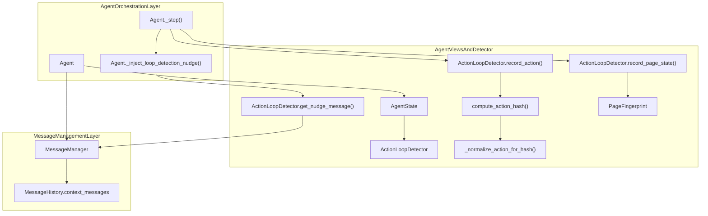
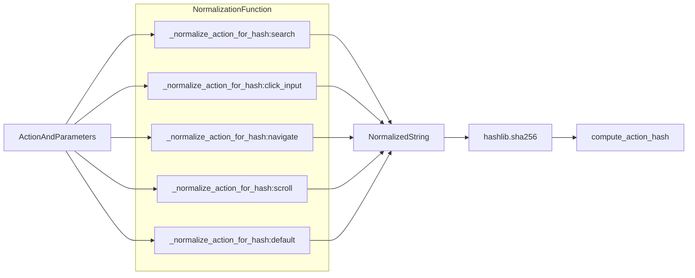

<!-- source: DeepWiki mcp.deepwiki.com · repo browser-use/browser-use · page 2.7 Loop Detection and Behavioral Nudges · fetched 2026-10-30 -->

# Loop Detection and Behavioral Nudges

Relevant source files

The following files were used as context for generating this wiki page:

- [browser_use/agent/message_manager/service.py](browser_use/agent/message_manager/service.py)
- [browser_use/agent/message_manager/views.py](browser_use/agent/message_manager/views.py)
- [browser_use/agent/prompts.py](browser_use/agent/prompts.py)
- [browser_use/agent/service.py](browser_use/agent/service.py)
- [browser_use/agent/views.py](browser_use/agent/views.py)
- [browser_use/browser/views.py](browser_use/browser/views.py)
- [tests/ci/test_action_loop_detection.py](tests/ci/test_action_loop_detection.py)

Loop detection is a soft intervention system that identifies when the agent is stuck in repetitive behavior patterns without making progress. Rather than blocking actions, it injects contextual warning messages into the LLM's prompt to encourage strategy changes. This system operates through two parallel detection mechanisms: action repetition tracking and page stagnation monitoring.

For information about the core agent execution loop, see [browser_use/agent/service.py:131-205](). For details on how messages are constructed and delivered to the LLM, see [browser_use/agent/message_manager/service.py:104-148]().

---

## Architecture Overview

The loop detection system integrates into the agent execution layer through `ActionLoopDetector` (managed via `AgentState`) and triggers nudge injection during the execution flow before LLM inference.

### Component Architecture

Sources: [browser_use/agent/views.py:95-175](), [browser_use/agent/service.py:131-205](), [browser_use/agent/message_manager/service.py:104-148]()

---

## Core Data Structures

### ActionLoopDetector

The `ActionLoopDetector` class maintains the state for loop detection and implements the analysis logic. It is a Pydantic model that tracks action history within a rolling window to identify high-frequency repetitions [browser_use/agent/views.py:157-165]().

| Field | Type | Description |
|-------|------|-------------|
| `window_size` | `int` | Rolling window size for action tracking (default 20) [browser_use/agent/views.py:167]() |
| `recent_action_hashes` | `list[str]` | Hash strings of recent actions, trimmed to `window_size` [browser_use/agent/views.py:168]() |
| `recent_page_fingerprints` | `list[PageFingerprint]` | Recent page states (max 5 kept) [browser_use/agent/views.py:171]() |
| `max_repetition_count` | `int` | Highest count of any single action hash in current window [browser_use/agent/views.py:174]() |
| `consecutive_stagnant_pages` | `int` | How many consecutive steps had identical page state [browser_use/agent/views.py:175]() |

Sources: [browser_use/agent/views.py:157-175]()

### PageFingerprint

A lightweight fingerprint of the browser page state used for stagnation detection. It allows the system to determine if actions are actually changing the DOM [browser_use/agent/views.py:95-108]().

| Field | Type | Description |
|-------|------|-------------|
| `url` | `str` | Current page URL [browser_use/agent/views.py:100]() |
| `element_count` | `int` | Total number of DOM elements [browser_use/agent/views.py:101]() |
| `text_hash` | `str` | First 16 characters of SHA-256 hash of DOM text representation [browser_use/agent/views.py:102]() |

Sources: [browser_use/agent/views.py:95-108]()

---

## Action Hash Normalization

Action hashes are computed by normalizing action parameters to detect semantic similarity rather than exact string matches. This prevents the agent from bypassing detection with trivial changes (like whitespace).

### Normalization Logic

- **Search Actions**: Normalizes the query by lowercasing, sorting tokens alphabetically, and removing punctuation via `re.sub(r'[^\w\s]', ' ', query.lower())` to catch rephrased searches [browser_use/agent/views.py:118-123]().
- **Click/Input Actions**: Focuses on the element identity (`index`). For inputs, it also includes the lowercase, stripped text content [browser_use/agent/views.py:125-133]().
- **Navigate Actions**: Uses the full URL string. Navigating to the exact same URL repeatedly is a loop signal [browser_use/agent/views.py:135-139]().
- **Scroll Actions**: Combines the direction string and the target element index [browser_use/agent/views.py:141-144]().
- **Default**: Sorts all parameters and excludes `None` values to ensure a stable representation [browser_use/agent/views.py:146-148]().

Sources: [browser_use/agent/views.py:110-154](), [tests/ci/test_action_loop_detection.py:22-133]()

---

## Detection and Nudging

### Detection Logic

1. **Action Recording**: Every time the agent executes an action, `record_action()` computes the normalized hash via `compute_action_hash()` and updates the rolling window `recent_action_hashes` [browser_use/agent/views.py:151-155]().
2. **Page Recording**: `record_page_state()` creates a `PageFingerprint` from `BrowserStateSummary`. If the fingerprint matches the previous one, `consecutive_stagnant_pages` increments [browser_use/agent/views.py:95-108]().
3. **Evaluation**: The system checks if the repetition count or stagnant page counter exceeds thresholds during `get_nudge_message()` [browser_use/agent/views.py:157-165]().

### Escalation Thresholds

The `get_nudge_message()` method returns escalating warning messages based on repetition frequency and stagnation:

| Severity | Repetition Threshold | Message Content Example |
|----------|----------------------|-------------------------|
| **Mild** | ≥ 5 times | "You have repeated a similar action 5 times..." [browser_use/agent/views.py:215-220]() |
| **Strong** | ≥ 8 times | "STRONG LOOP WARNING: You are still making progress..." [browser_use/agent/views.py:222-227]() |
| **Critical** | ≥ 12 times | "CRITICAL LOOP DETECTED: You have repeated this action 12 times..." [browser_use/agent/views.py:229-234]() |
| **Stagnation** | ≥ 5 stagnant steps | "PAGE STAGNATION: Your last 5 actions have not changed the page..." [browser_use/agent/views.py:241-246]() |

Sources: [browser_use/agent/views.py:157-165](), [tests/ci/test_action_loop_detection.py:138-178]()

---

## Agent Integration

### Configuration

Loop detection is enabled by default and configured via `AgentSettings` [browser_use/agent/views.py:59-94]().

| Parameter | Default | Description |
|-----------|---------|-------------|
| `loop_detection_window` | 20 | Rolling window size for tracking action similarity [browser_use/agent/views.py:90]() |
| `loop_detection_enabled` | True | Global toggle for loop detection nudges [browser_use/agent/views.py:91]() |

Sources: [browser_use/agent/views.py:59-94]()

### Nudge Injection Process

Nudges are injected as ephemeral messages before the LLM makes its next decision.

1. **Detection**: At the start of a step, the `Agent` evaluates the current `ActionLoopDetector` state [browser_use/agent/service.py:131-205]().
2. **Injection**: If `get_nudge_message()` returns a string, it is added to the `MessageManager`'s context messages.
3. **Prompt Construction**: The `MessageManager` includes these messages in the history description or context messages sent to the LLM [browser_use/agent/message_manager/service.py:104-148]().
4. **Cleanup**: Context messages are managed by `MessageHistory` to ensure they reflect current state [browser_use/agent/message_manager/views.py:66-83]().

Sources: [browser_use/agent/service.py:131-205](), [browser_use/agent/message_manager/service.py:104-148](), [browser_use/agent/message_manager/views.py:66-83]()

---

## Design Philosophy

- **Soft Intervention**: The system provides awareness, not hard constraints. The agent can choose to ignore a nudge if it believes the repetition is necessary, such as paginating through many results [browser_use/agent/views.py:157-165]().
- **Two-Dimensional Detection**: By tracking both specific actions and the resulting page state via `PageFingerprint`, the system distinguishes between "busy-waiting" (repeated actions) and "stalling" (actions that result in no visual change) [browser_use/agent/views.py:95-175]().
- **Normalization**: Hashing raw parameters would be too sensitive to minor noise. Normalization in `_normalize_action_for_hash()` ensures that semantic loops, like searching for the same thing with different wording, are caught [browser_use/agent/views.py:110-154]().

Sources: [browser_use/agent/views.py:95-175]()

---

