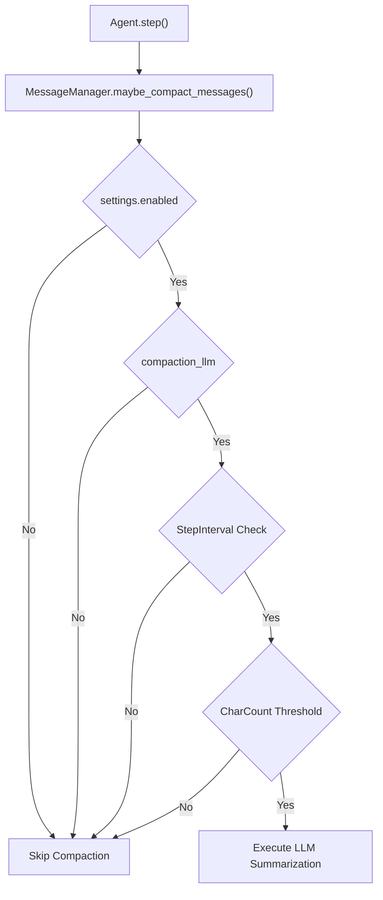
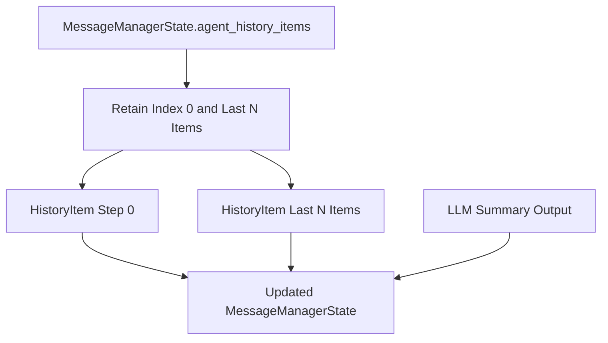
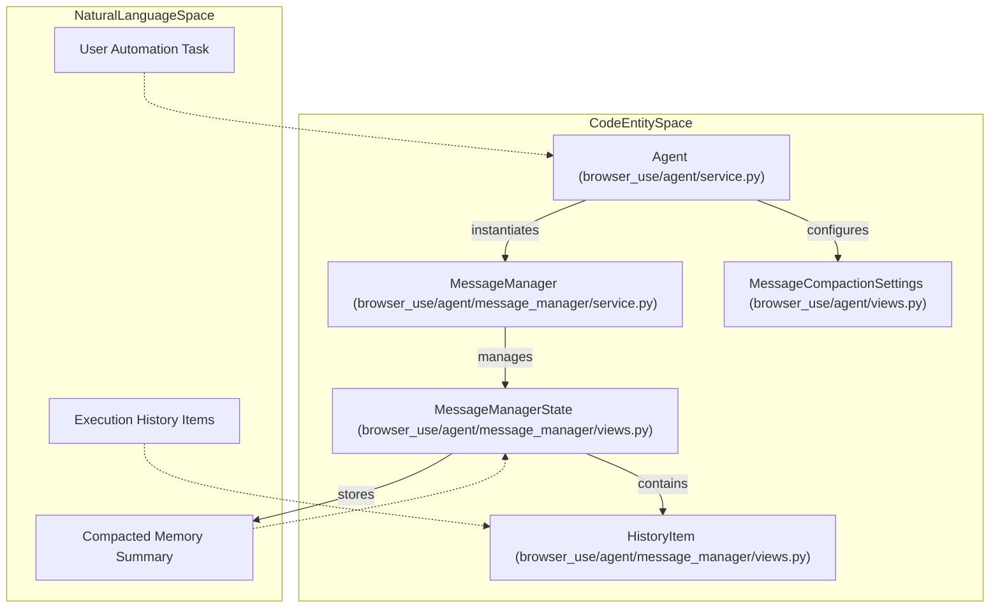

<!-- source: DeepWiki mcp.deepwiki.com · repo browser-use/browser-use · page 2.8 Message Compaction System · fetched 2026-10-30 -->

# Message Compaction System

Relevant source files

The following files were used as context for generating this wiki page:

- [browser_use/agent/message_manager/service.py](browser_use/agent/message_manager/service.py)
- [browser_use/agent/message_manager/views.py](browser_use/agent/message_manager/views.py)
- [browser_use/agent/prompts.py](browser_use/agent/prompts.py)
- [browser_use/agent/service.py](browser_use/agent/service.py)
- [browser_use/agent/views.py](browser_use/agent/views.py)
- [browser_use/browser/views.py](browser_use/browser/views.py)

The Message Compaction System manages prompt token budgets by automatically summarizing older agent execution history into compact memory blocks. This prevents context window overflow during long-running automation tasks while preserving critical historical state and progress for the LLM.

For information about the overall message construction pipeline, see [Message Manager and Prompt Construction (2.2)](). For general history tracking without compaction, see [Agent State and History Management (2.3)]().

---

## Purpose and Mechanism

As the agent executes multiple steps, the `agent_history_items` list within `MessageManagerState` expands with each action, evaluation, and result (`[browser_use/agent/message_manager/views.py:86-101]()`). Without compaction, this history can exceed model token limits (typically 128K–200K tokens). The compaction system addresses this by:

1. **Periodic Summarization**: Triggered every $N$ steps when history exceeds a character threshold, using an LLM to condense older history items into a summary block (`[browser_use/agent/message_manager/service.py:153-160]()`).
2. **Selective Retention**: Preserving the initial setup item (index 0) and the most recent $N$ history items in full detail (`[browser_use/agent/message_manager/service.py:179-184]()`).
3. **Transparent Prompt Injection**: Injecting the compacted memory block enclosed within `<compacted_memory>` XML tags at the top of the history description (`[browser_use/agent/message_manager/service.py:153-160]()`).

Sources: [browser_use/agent/message_manager/service.py:150-186](), [browser_use/agent/message_manager/views.py:86-101]()

---

## Configuration Settings

The `MessageCompactionSettings` class defines the configuration options for the compaction engine (`[browser_use/agent/views.py:35-58]()`):

| Field | Type | Default | Description |
| :--- | :--- | :--- | :--- |
| `enabled` | `bool` | `True` | Master switch for compaction (`[browser_use/agent/views.py:38]()`). |
| `compact_every_n_steps` | `int` | `25` | Step interval between compaction attempts (`[browser_use/agent/views.py:39]()`). |
| `trigger_char_count` | `int \| None` | `40000` | Minimum history character floor (~10k tokens) to trigger compaction (`[browser_use/agent/views.py:55]()`). |
| `trigger_token_count` | `int \| None` | `None` | Alternative token-based threshold (`[browser_use/agent/views.py:41]()`). |
| `chars_per_token` | `float` | `4.0` | Conversion ratio for token-to-character calculations (`[browser_use/agent/views.py:42]()`). |
| `keep_last_items` | `int` | `6` | Number of recent history items to preserve uncompacted (`[browser_use/agent/views.py:43]()`). |
| `summary_max_chars` | `int` | `6000` | Maximum character limit of the generated summary block (`[browser_use/agent/views.py:44]()`). |
| `include_read_state` | `bool` | `False` | Whether to include `read_state` in the compaction LLM input (`[browser_use/agent/views.py:45]()`). |
| `compaction_llm` | `BaseChatModel \| None` | `None` | Custom LLM for summarization, defaulting to the agent's main LLM (`[browser_use/agent/views.py:46]()`). |

The model validator `_resolve_trigger_threshold` validates that either `trigger_char_count` or `trigger_token_count` is set, automatically computing the character count from token counts when provided (`[browser_use/agent/views.py:48-56]()`).

Sources: [browser_use/agent/views.py:35-58]()

---

## Compaction Trigger Logic

The compaction engine evaluates execution state after each agent step to determine whether summarization should be executed (`[browser_use/agent/service.py:134-197]()`, `[browser_use/agent/views.py:35-58]()`).

Title: "Compaction Decision Flow"

Sources: [browser_use/agent/views.py:35-58](), [browser_use/agent/message_manager/views.py:86-101]()

---

## Compaction Process and State Update

When compaction thresholds are reached, the process follows three primary phases managed by `MessageManager` (`[browser_use/agent/message_manager/service.py:104-188]()`, `[browser_use/agent/message_manager/views.py:86-101]()`):

1. **Input Assembly**: Combines existing `compacted_memory`, history string representations (`HistoryItem.to_string()`), and optional `read_state_description` into a text payload (`[browser_use/agent/message_manager/views.py:33-64](), [browser_use/agent/message_manager/views.py:86-101]()`). Sensitive values are sanitized via `redact_sensitive_string` (`[browser_use/agent/message_manager/service.py:29-31]()`).
2. **LLM Summarization**: Invokes the `compaction_llm` to generate a condensed summary preserving key milestones, URLs, and state (`[browser_use/agent/views.py:46]()`).
3. **State Mutation**: Updates `MessageManagerState` by setting `compacted_memory`, incrementing `compaction_count`, updating `last_compaction_step`, and truncating `agent_history_items` to retain only index 0 and the last `keep_last_items` (`[browser_use/agent/message_manager/views.py:86-101]()`).

Title: "History Pruning Flow"

Sources: [browser_use/agent/message_manager/service.py:150-186](), [browser_use/agent/message_manager/views.py:33-64](), [browser_use/agent/message_manager/views.py:86-101]()

---

## Integration with Message Construction

The `MessageManager.agent_history_description` property dynamically constructs the history block for LLM prompt injection (`[browser_use/agent/message_manager/service.py:150-186]`). If `state.compacted_memory` is present, it formats the summary inside `<compacted_memory>` tags with an unverified context instruction header (`[browser_use/agent/message_manager/service.py:153-160]()`).

Sources: [browser_use/agent/message_manager/service.py:150-186]()

---

## Architecture Bridge: Natural Language Space to Code Entity Space

The following diagram associates natural language concepts with their corresponding code entities in the message compaction subsystem.

Title: "Compaction Architecture Bridge"

Sources: [browser_use/agent/service.py:134-197](), [browser_use/agent/message_manager/service.py:104-140](), [browser_use/agent/views.py:35-58](), [browser_use/agent/message_manager/views.py:86-101]()

---

## Sensitive Data Redaction

Prior to submitting history items to the compaction LLM, the payload passes through sensitive data filtering (`[browser_use/agent/message_manager/service.py:29-31]()`). Secrets and credentials are replaced with standardized placeholder tokens (`[browser_use/agent/message_manager/service.py:29-31]()`).

Sources: [browser_use/agent/message_manager/service.py:29-31]()

---

