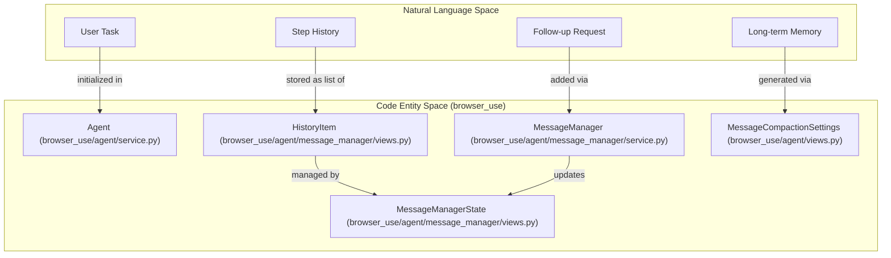
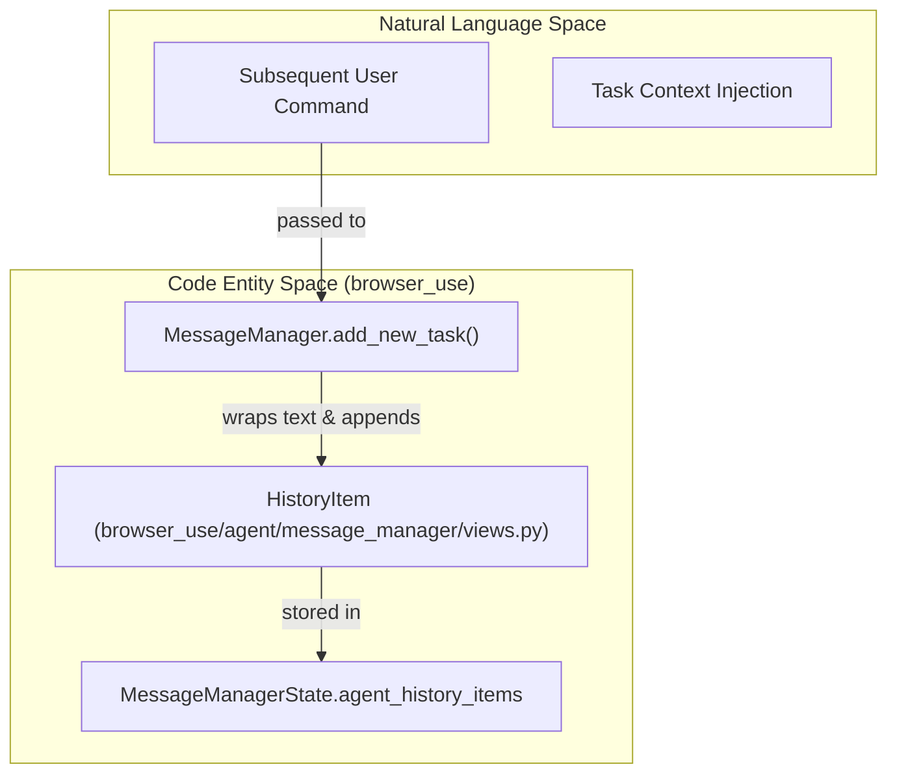
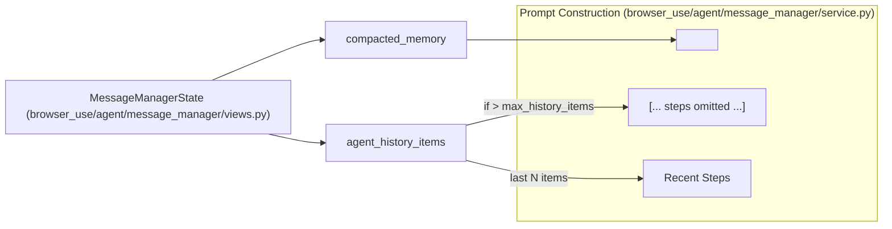

<!-- source: DeepWiki mcp.deepwiki.com · repo browser-use/browser-use · page 2.9 Memory and Follow-up Tasks · fetched 2026-10-30 -->

# Memory and Follow-up Tasks

<details>
<summary>Relevant source files</summary>

The following files were used as context for generating this wiki page:

- [browser_use/agent/message_manager/service.py](browser_use/agent/message_manager/service.py)
- [browser_use/agent/message_manager/views.py](browser_use/agent/message_manager/views.py)
- [browser_use/agent/prompts.py](browser_use/agent/prompts.py)
- [browser_use/agent/service.py](browser_use/agent/service.py)
- [browser_use/agent/views.py](browser_use/agent/views.py)
- [browser_use/browser/views.py](browser_use/browser/views.py)
- [examples/features/follow_up_tasks.py](examples/features/follow_up_tasks.py)

</details>


This document covers how `browser-use` maintains conversational context across multiple agent steps and enables multi-turn task interactions. It explains long-term memory management, the `add_new_task()` method for follow-up interactions, and the message compaction system that prevents token limit overflows.

## Purpose and Scope

The memory and follow-up task subsystem is responsible for maintaining agent state across execution steps and turns. Its scope includes:
1. Tracking step-by-step agent actions, thoughts, evaluations, and errors via `HistoryItem` [browser_use/agent/message_manager/views.py:15-26]().
2. Managing multi-turn sessions where users supply subsequent instructions using `add_new_task()`.
3. Summarizing older interactions through `MessageCompactionSettings` to fit within model token limits [browser_use/agent/views.py:35-56]().
4. Serializing state and conversation logs to disk.

Sources: [browser_use/agent/service.py:135-197](), [browser_use/agent/message_manager/views.py:15-26](), [browser_use/agent/views.py:35-56]()

## Overview

The memory system in `browser-use` is managed primarily by the `MessageManager` [browser_use/agent/message_manager/service.py:104-123]() and the `Agent` execution loop [browser_use/agent/service.py:135-197](). It facilitates short-term tracking, multi-turn task injection, and long-term context reduction.

Sources: [browser_use/agent/service.py:135-197](), [browser_use/agent/message_manager/service.py:104-123]()

## Memory Architecture and Data Flow

Memory flows from the `BrowserStateSummary` [browser_use/browser/views.py:91-113]() and `AgentOutput` into a persistent history stored in the `MessageManagerState` [browser_use/agent/message_manager/views.py:86-101](). This history is then used to construct prompts for subsequent execution steps.

### Natural Language to Code Entity Mapping

The following diagram bridges the conceptual memory space to the specific classes and methods that implement it.



Sources: [browser_use/agent/service.py:135-197](), [browser_use/agent/message_manager/service.py:104-123](), [browser_use/agent/message_manager/views.py:15-26](), [browser_use/agent/views.py:35-56]()

## Follow-up Tasks with add_new_task()

The `add_new_task()` method in `MessageManager` allows the agent to handle sequential requests within the same browser session. It wraps the new request in tags and appends it to the history.

### Implementation Details
When a follow-up task is injected:
1. The original task is wrapped in `<initial_user_request>` tags if not already tagged [browser_use/agent/message_manager/service.py:193-194]().
2. The new task is appended inside `<follow_up_user_request>` tags [browser_use/agent/message_manager/service.py:192-195]().
3. A new `HistoryItem` is created with the task update and added to `self.state.agent_history_items` [browser_use/agent/message_manager/service.py:196-197]().

### Natural Language to Code Entity Mapping: Follow-up Orchestration



### Multi-turn Execution Loop Example
The `Agent.run()` method can be called repeatedly using a persistent `BrowserProfile` to preserve browser session state [examples/features/follow_up_tasks.py:15-28]().

```python
from browser_use import Agent, BrowserProfile

profile = BrowserProfile(keep_alive=True)
agent = Agent(task="Go to reddit.com", browser_profile=profile)
await agent.run(max_steps=1)

# Add a follow-up task to the existing agent session
agent.add_new_task("Search for 'browser-use'")
await agent.run()
```

Sources: [examples/features/follow_up_tasks.py:15-28](), [browser_use/agent/message_manager/service.py:191-197]()

## Message Compaction and Long-term Memory

To prevent the LLM context from exceeding token ceilings, `browser-use` incorporates an automated compaction mechanism.

### Compaction Parameters
The `MessageCompactionSettings` class configures how and when history is summarized [browser_use/agent/views.py:35-56]().

| Parameter | Default | Description |
| :--- | :--- | :--- |
| `enabled` | `True` | Whether to enable message compaction [browser_use/agent/views.py:38](). |
| `compact_every_n_steps` | `25` | Step frequency triggering compaction [browser_use/agent/views.py:39](). |
| `trigger_char_count` | `40000` | Character threshold (~10k tokens) triggering compaction [browser_use/agent/views.py:55](). |
| `keep_last_items` | `6` | Number of recent history items retained uncompressed [browser_use/agent/views.py:43](). |
| `summary_max_chars` | `6000` | Maximum character length for generated summaries [browser_use/agent/views.py:44](). |

Sources: [browser_use/agent/views.py:35-56]()

### Data Flow: History to Prompt Construction



Sources: [browser_use/agent/message_manager/service.py:153-189](), [browser_use/agent/message_manager/views.py:86-101]()

## Persistence and Serialization

### Conversation Persistence
The `save_conversation` utility writes message histories and final model responses to disk [browser_use/agent/message_manager/utils.py:26]().
* **File Path**: Configured via `save_conversation_path` in `AgentSettings` [browser_use/agent/views.py:64]().
* **Encoding**: Defaults to `utf-8` [browser_use/agent/views.py:65]().

Sources: [browser_use/agent/service.py:26](), [browser_use/agent/views.py:64-65]()

### Agent History State Schema
The `HistoryItem` class represents agent state snapshots per step [browser_use/agent/message_manager/views.py:15-26]().

| Field | Description |
| :--- | :--- |
| `step_number` | Execution step index [browser_use/agent/message_manager/views.py:18](). |
| `memory` | Persistent agent memory string [browser_use/agent/message_manager/views.py:20](). |
| `evaluation_previous_goal` | Assessment of the prior objective [browser_use/agent/message_manager/views.py:19](). |
| `next_goal` | Planned subsequent objective [browser_use/agent/message_manager/views.py:21](). |
| `action_results` | Results of executed tool actions [browser_use/agent/message_manager/views.py:22](). |

Sources: [browser_use/agent/message_manager/views.py:15-24](), [browser_use/agent/message_manager/views.py:33-63]()

## Loop Detection and Behavioral Memory

The `ActionLoopDetector` class maintains a rolling window of recent action hashes to identify agent stagnation [browser_use/agent/views.py:157-174]().
* **Normalization**: Actions are normalized via `_normalize_action_for_hash` (e.g., sorting search terms, stripping URL paths) to detect semantic loops [browser_use/agent/views.py:110-149]().
* **Page Fingerprints**: `PageFingerprint` tracks URL, element count, and DOM hashes to detect scenarios where actions are repeatedly dispatched without changing page content [browser_use/agent/views.py:95-108]().

Sources: [browser_use/agent/views.py:95-154](), [browser_use/agent/views.py:157-174]()

---

