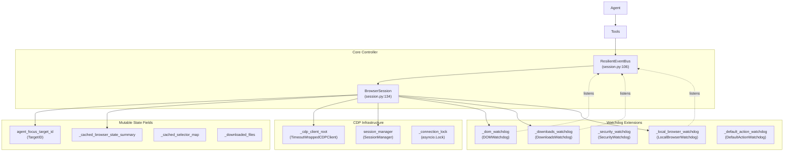

<!-- source: DeepWiki mcp.deepwiki.com · repo browser-use/browser-use · page 3 Browser Session Management · fetched 2026-10-30 -->

# Browser Session Management

Relevant source files

The following files were used as context for generating this wiki page:

- [browser_use/browser/events.py](browser_use/browser/events.py)
- [browser_use/browser/profile.py](browser_use/browser/profile.py)
- [browser_use/browser/session.py](browser_use/browser/session.py)
- [browser_use/browser/watchdog_base.py](browser_use/browser/watchdog_base.py)

## Purpose and Scope

`BrowserSession` is the central coordinator for browser lifecycle, CDP (Chrome DevTools Protocol) connections, and event coordination. It bridges high-level Agent operations with low-level browser control through an event-driven architecture.

**Key Responsibilities:**
- Browser lifecycle management (start, stop, kill, reset) `[browser_use/browser/session.py:628-669]()`
- CDP WebSocket connection management and circuit breaking `[browser_use/browser/session.py:442-482]()`
- Target and session pool ownership via `SessionManager` `[browser_use/browser/session.py:1371-1457]()`
- Event coordination through `ResilientEventBus` `[browser_use/browser/session.py:106-131]()`
- State caching for DOM, screenshots, and downloads `[browser_use/browser/session.py:1485-1522]()`

**Child Pages:**
- [BrowserSession Lifecycle](#3.1) — BrowserSession initialization modes (local, cloud, remote CDP), start/stop/kill methods, and reconnection logic
- [Browser Profile Configuration](#3.2) — BrowserProfile class, Chrome arguments assembly, extension management, and browser mode selection
- [SessionManager and CDP Session Pool](#3.3) — SessionManager as single source of truth for targets/sessions, attach/detach event handling, CDP timeouts, and session pooling
- [Target and Frame Management](#3.4) — Target lifecycle, iframe handling, agent focus management, and automatic focus recovery
- [Navigation and Tab Control](#3.5) — Navigation flow, tab creation/switching/closing, and multi-tab coordination

Sources: `[browser_use/browser/session.py:1-131]()`, `[browser_use/browser/session.py:628-669]()`, `[browser_use/browser/session.py:1371-1457]()`

---

## Core Architecture

`BrowserSession` implements a two-layer architecture combining event-driven coordination with direct CDP access. It acts as the primary consumer of the `EventBus` for high-level actions.

Title: BrowserSession Code Entity Map

**Architecture Layers:**
1. **Event Coordination**: `ResilientEventBus` mediates between high-level actions (Agent/Tools) and low-level handlers (Watchdogs), handling graceful no-ops on torn-down buses `[browser_use/browser/session.py:106-131]()`.
2. **State Management**: Mutable session state tracks agent focus, cached browser state, and downloaded files `[browser_use/browser/session.py:400-430]()`.
3. **CDP Communication**: `TimeoutWrappedCDPClient` manages the root WebSocket connection with custom timeouts `[browser_use/browser/session.py:23-23]()`; `SessionManager` owns the target/session pool `[browser_use/browser/session.py:388-390]()`.
4. **Monitoring**: Specialized watchdogs extend functionality by subscribing to specific events `[browser_use/browser/watchdog_base.py:15-22]()`.

Sources: `[browser_use/browser/session.py:101-543]()`, `[browser_use/browser/watchdog_base.py:1-22]()`

---

## 3.1. BrowserSession Lifecycle

`BrowserSession` supports multiple initialization modes including local browser launch, remote CDP connection, and cloud-managed browser instances `[browser_use/browser/session.py:134-200]()`. The lifecycle methods (`start()`, `stop()`, `kill()`) control the underlying browser process or connection state, supported by robust reconnection logic when WebSocket connections drop `[browser_use/browser/session.py:628-828]()`.

For full details on initialization parameters, state transitions, and connection recovery, see [BrowserSession Lifecycle](#3.1).

Sources: `[browser_use/browser/session.py:134-200]()`, `[browser_use/browser/session.py:628-828]()`

---

## 3.2. Browser Profile Configuration

The `BrowserProfile` class handles the compilation of Chrome command-line arguments, environment-based defaults, headless/headed mode selection, user data directory management, and extension loading `[browser_use/browser/profile.py:1-184]()`. It ensures deterministic rendering, security isolation options, and proper handling of transient profile files.

For details on profile options, argument assemblies, and custom extensions, see [Browser Profile Configuration](#3.2).

Sources: `[browser_use/browser/profile.py:1-184]()`

---

## 3.3. SessionManager and CDP Session Pool

`SessionManager` serves as the single source of truth for tracking browser targets and CDP sessions `[browser_use/browser/session.py:1371-1457]`. It manages target attachment and detachment events, handles CDP command timeouts via `TimeoutWrappedCDPClient` `[browser_use/browser/session.py:23-23]()`, and maintains a session pool for efficient multi-context interaction.

For comprehensive documentation on target tracking, attachment lifecycles, and session pooling, see [SessionManager and CDP Session Pool](#3.3).

Sources: `[browser_use/browser/session.py:23-23]`, `[browser_use/browser/session.py:1371-1457]()`

---

## 3.4. Target and Frame Management

Browser targets (such as pages, iframes, and workers) have distinct lifecycles governed by CDP target discovery `[browser_use/browser/session.py:73-87]()`. `BrowserSession` coordinates agent focus management (`agent_focus_target_id`) to ensure actions are dispatched to the correct context, implementing automatic focus recovery when targets close or navigate unexpectedly.

For details on iframe handling, target tracking, and focus recovery mechanisms, see [Target and Frame Management](#3.4).

Sources: `[browser_use/browser/session.py:73-87]()`, `[browser_use/browser/session.py:401]()`

---

## 3.5. Navigation and Tab Control

Navigation flow and tab operations are driven by high-level events like `NavigateToUrlEvent`, `SwitchTabEvent`, and `CloseTabEvent` `[browser_use/browser/events.py:110-184]()`. These events coordinate multi-tab environments, tab creation, foreground switching, and lifecycle cleanup across the session.

For complete coverage of navigation flows, tab management, and multi-tab coordination, see [Navigation and Tab Control](#3.5).

Sources: `[browser_use/browser/events.py:110-184]()`

---

