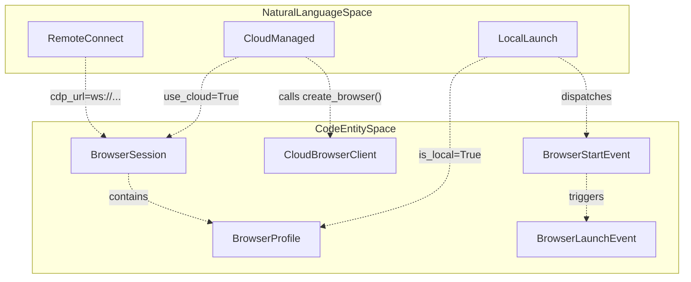
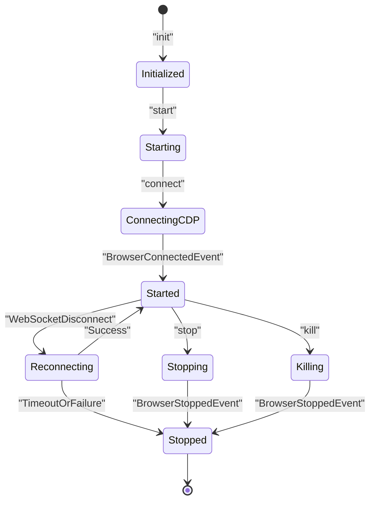
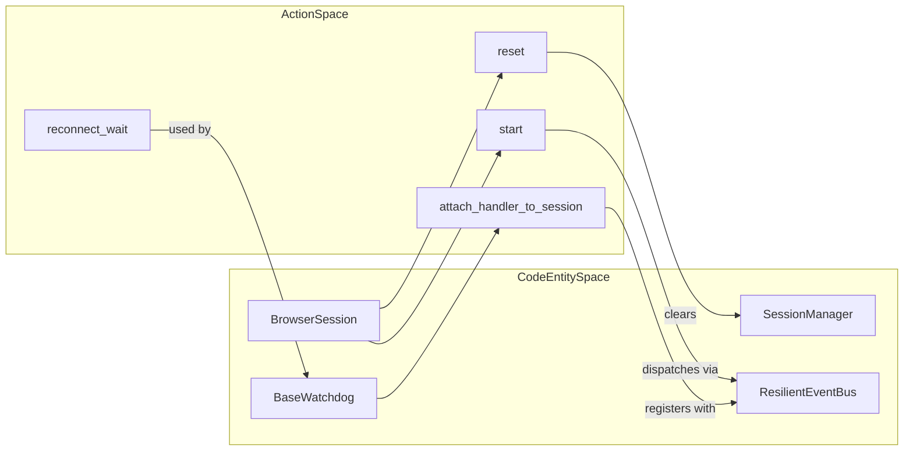

<!-- source: DeepWiki mcp.deepwiki.com · repo browser-use/browser-use · page 3.1 BrowserSession Lifecycle · fetched 2026-10-30 -->

# BrowserSession Lifecycle

Relevant source files

The following files were used as context for generating this wiki page:

- [browser_use/browser/events.py](browser_use/browser/events.py)
- [browser_use/browser/profile.py](browser_use/browser/profile.py)
- [browser_use/browser/session.py](browser_use/browser/session.py)
- [browser_use/browser/watchdog_base.py](browser_use/browser/watchdog_base.py)
- [tests/ci/test_browser_session.py](tests/ci/test_browser_session.py)

This page documents the lifecycle management of `BrowserSession` instances, including initialization modes (local, cloud, remote CDP), startup/shutdown sequences, and WebSocket reconnection logic.

## Overview

`BrowserSession` is the core class responsible for managing the browser instance lifecycle. It provides a two-layer architecture: high-level event handling for agents/tools and direct CDP calls for browser operations [browser_use/browser/session.py:137-140](). It supports multiple initialization modes and uses a `ResilientEventBus` [browser_use/browser/session.py:106-132]() to coordinate transitions between states such as starting, connected, and stopped [browser_use/browser/session.py:34-54]().

The `ResilientEventBus` ensures that when a session is torn down or kept alive, calling `step()` or `wait_until_idle()` on a closed event bus safely no-ops rather than asserting, which supports worker resume scenarios [browser_use/browser/session.py:106-132]().

Sources: [browser_use/browser/session.py:34-54](), [browser_use/browser/session.py:106-140]()

## Initialization Modes

`BrowserSession` supports three distinct modes, determined by the parameters passed to `__init__` [browser_use/browser/session.py:164-245]():

| Mode | Use Case | CDP URL Source | Browser Launch |
|------|----------|----------------|----------------|
| **Local** | Development, testing | Launched process | Yes (via `BrowserLaunchEvent`) |
| **Cloud** | Production, scaling | Browser Use Cloud API | Managed remotely via `CloudBrowserClient` |
| **Remote CDP** | Existing browser | User-provided URL | No (already running) |

### Local Browser Mode
Launches a Chrome/Chromium process on the local machine. This mode is active when `cdp_url` is `None` and `use_cloud` is `False`. The session configures a `BrowserProfile` [browser_use/browser/profile.py:66]() and delegates launching by dispatching a `BrowserStartEvent` [browser_use/browser/session.py:42]() and `BrowserLaunchEvent` [browser_use/browser/session.py:38](). The `BrowserProfile` class handles the assembly of Chrome arguments, including default flags [browser_use/browser/profile.py:162-180](), Docker-specific settings [browser_use/browser/profile.py:128-138](), and security-disabling arguments [browser_use/browser/profile.py:141-149]().

Sources: [browser_use/browser/profile.py:66](), [browser_use/browser/profile.py:128-180](), [browser_use/browser/session.py:38-42](), [browser_use/browser/session.py:164-245]()

### Cloud Browser Mode
Connects to Browser Use Cloud for managed, stealth-enabled browsers. This is triggered by setting `use_cloud=True` or providing `cloud_browser_params` [browser_use/browser/session.py:176-178](). It uses `CloudBrowserClient` [browser_use/browser/session.py:24]() to request a browser session and receives a remote CDP URL [browser_use/browser/session.py:741-755]().

Sources: [browser_use/browser/session.py:24](), [browser_use/browser/session.py:176-178](), [browser_use/browser/session.py:741-755]()

### Remote CDP Mode
Connects to an existing browser via a provided `cdp_url` [browser_use/browser/session.py:241](). The session skips the launch phase and connects directly to the WebSocket endpoint using a `TimeoutWrappedCDPClient` [browser_use/browser/session.py:23](), [browser_use/browser/session.py:767-802]().

Sources: [browser_use/browser/session.py:23](), [browser_use/browser/session.py:241](), [browser_use/browser/session.py:767-802]()

## Code Entity Association: Initialization

The following diagram maps natural language initialization concepts to the specific code entities in `browser_use`.

Sources: [browser_use/browser/profile.py:66](), [browser_use/browser/events.py:34-54](), [browser_use/browser/session.py:164-245]()

## Lifecycle State Transitions

The session transitions through states triggered by methods or external events (like WebSocket disconnects).

Sources: [browser_use/browser/events.py:34-54](), [browser_use/browser/session.py:670-721](), [browser_use/browser/session.py:1187-1227]()

## Core Lifecycle Methods

### `start()`
The `start()` method is the primary entry point. It is idempotent; if a connection already exists, it returns immediately [browser_use/browser/session.py:723-731]().

1. **Watchdog Attachment**: Calls `attach_all_watchdogs()` so listeners are ready for launch and browser events [browser_use/browser/session.py:733]().
2. **URL Resolution**: 
    - In **Cloud Mode**, it calls `CloudBrowserClient.create_browser` [browser_use/browser/session.py:744-747]().
    - In **Local Mode**, it dispatches `BrowserStartEvent` and `BrowserLaunchEvent`, then waits for a `BrowserLaunchResult` containing the `cdp_url` [browser_use/browser/session.py:757-766]().
3. **Connection**: Uses a `_connection_lock` to prevent race conditions and calls `connect(cdp_url)` [browser_use/browser/session.py:772-780]().
4. **Session Management**: Initializes the `SessionManager` to discover existing targets and enable `setAutoAttach` [browser_use/browser/session.py:821-823]().

Sources: [browser_use/browser/session.py:723-823]()

### `stop()` and `kill()`
- **`stop()`**: A graceful shutdown. It dispatches a `BrowserStopEvent(force=False)` [browser_use/browser/session.py:698-721](). It keeps the local browser process alive if `keep_alive=True` is configured [browser_use/browser/session.py:1192-1194]().
- **`kill()`**: A forceful termination. It dispatches `BrowserStopEvent(force=True)` [browser_use/browser/session.py:44](), which triggers the destruction of the browser process [browser_use/browser/session.py:678-696]().

Sources: [browser_use/browser/session.py:44](), [browser_use/browser/session.py:678-721](), [browser_use/browser/session.py:1192-1194]()

### `reset()`
An internal cleanup method that clears all session-specific data structures, including the `SessionManager` target pool, cached selector maps, and the root `CDPClient` [browser_use/browser/session.py:579-638]().

Sources: [browser_use/browser/session.py:579-638]()

## Reconnection Logic

`BrowserSession` implements automatic reconnection to handle transient network issues and WebSocket drops, as validated in session recovery tests [tests/ci/test_browser_session.py:12-43]().

1. **Detection**: Disconnection is detected via the `is_cdp_connected` property, which checks if the root CDP client is active [browser_use/browser/session.py:453-467]().
2. **Circuit Breaker**: The `BaseWatchdog` [browser_use/browser/watchdog_base.py:15]() implementation includes a circuit breaker in `make_unique_handler` that checks `is_cdp_connected` before executing handlers [browser_use/browser/watchdog_base.py:95-98]().
3. **Wait Loop**: If a reconnection is in progress (`is_reconnecting`), watchdogs wait for `RECONNECT_WAIT_TIMEOUT` while the session attempts to re-establish the WebSocket via `_reconnect_event.wait()` [browser_use/browser/watchdog_base.py:100-106]().
4. **Restoration**: Upon successful reconnection, the session dispatches a `BrowserReconnectedEvent` [browser_use/browser/events.py:40]().

Sources: [browser_use/browser/events.py:40](), [browser_use/browser/session.py:453-467](), [browser_use/browser/watchdog_base.py:15-123](), [tests/ci/test_browser_session.py:12-43]()

## Code Entity Association: Session Control

This diagram associates session control actions with the classes and methods that implement them.

Sources: [browser_use/browser/session.py:106-132](), [browser_use/browser/session.py:579-838](), [browser_use/browser/watchdog_base.py:56-112]()

## Session Identity and Logging
Each session is assigned a unique `id` using `uuid7str()` [browser_use/browser/session.py:21](), [browser_use/browser/session.py:373](). For logging clarity, `BrowserSession` maintains an internal `_id_for_logs`, which often uses the CDP port or a shortened version of the UUID to distinguish multiple sessions in console output [browser_use/browser/session.py:556-577](). Unique session IDs are tracked in `_LOGGED_UNIQUE_SESSION_IDS` to avoid ambiguity in logs [browser_use/browser/session.py:68]().

Sources: [browser_use/browser/session.py:21-68](), [browser_use/browser/session.py:373-577]()

---

