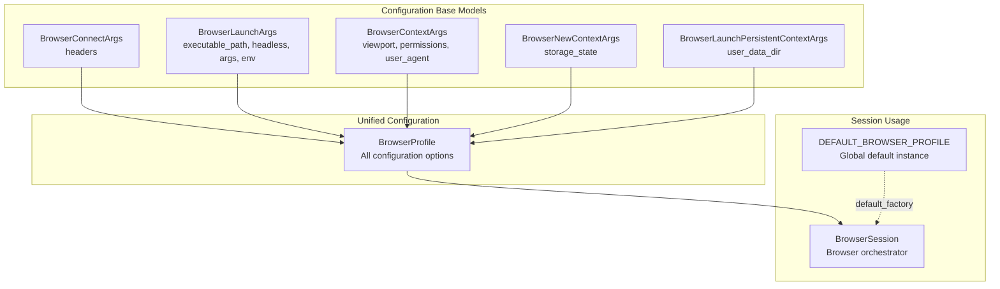
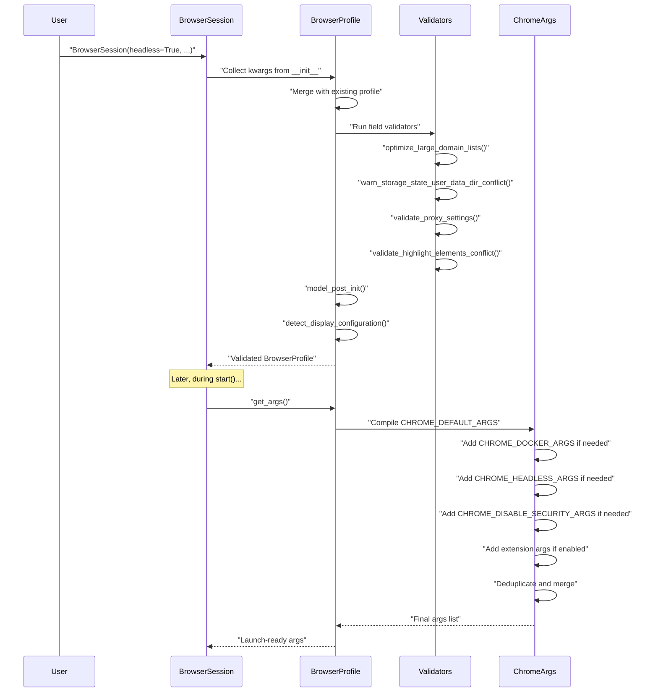

<!-- source: DeepWiki mcp.deepwiki.com · repo browser-use/browser-use · page 3.2 Browser Profile Configuration · fetched 2026-10-30 -->

# Browser Profile Configuration

<details>
<summary>Relevant source files</summary>

The following files were used as context for generating this wiki page:

- [browser_use/browser/chrome.py](browser_use/browser/chrome.py)
- [browser_use/browser/events.py](browser_use/browser/events.py)
- [browser_use/browser/profile.py](browser_use/browser/profile.py)
- [browser_use/browser/session.py](browser_use/browser/session.py)
- [browser_use/browser/watchdog_base.py](browser_use/browser/watchdog_base.py)
- [examples/custom-functions/advanced_search.py](examples/custom-functions/advanced_search.py)
- [examples/custom-functions/save_to_file_hugging_face.py](examples/custom-functions/save_to_file_hugging_face.py)
- [examples/features/custom_output.py](examples/features/custom_output.py)
- [examples/use-cases/find_influencer_profiles.py](examples/use-cases/find_influencer_profiles.py)

</details>


## Purpose and Scope

This page documents the `BrowserProfile` class and its configuration system, which provides a centralized way to configure browser launch parameters, runtime behavior, viewport settings, extensions, and other browser-related options. The `BrowserProfile` serves as a reusable configuration template that can be passed to `BrowserSession` to control browser behavior.

For information about browser session lifecycle and connection management, see [browser_use/browser/session.py:134-154](). For detailed Chrome launch arguments and security settings, see [browser_use/browser/profile.py:154-186]() and [browser_use/browser/profile.py:37-86]().

**Sources:** [browser_use/browser/profile.py:538-697](), [browser_use/browser/session.py:134-154]()

---

## BrowserProfile Architecture

The `BrowserProfile` class consolidates multiple Pydantic models into a single configuration object that supports all browser initialization patterns:

**Diagram: BrowserProfile Class Hierarchy**


The `BrowserProfile` inherits from base models that correspond to different browser initialization APIs. This design allows a single profile object to work with multiple browser connection patterns while maintaining type safety and validation.

**Sources:** [browser_use/browser/profile.py:304-520](), [browser_use/browser/session.py:66-66](), [browser_use/browser/session.py:134-154]()

---

## Configuration Categories

### Launch Configuration

Launch configuration controls how the browser process starts:

| Field | Type | Default | Description |
|-------|------|---------|-------------|
| `executable_path` | `str \| Path \| None` | `None` | Path to Chrome/Chromium binary |
| `headless` | `bool \| None` | Auto-detected | Headless vs windowed mode |
| `args` | `list[str]` | `[]` | Extra CLI arguments |
| `ignore_default_args` | `list[str] \| True` | See code | Args to exclude from defaults |
| `channel` | `BrowserChannel \| None` | `None` | Chrome channel (chromium, chrome, chrome-beta, etc.) |
| `chromium_sandbox` | `bool` | `not IN_DOCKER` | Enable Chromium sandbox |
| `devtools` | `bool` | `False` | Auto-open DevTools (headful only) |
| `downloads_path` | `str \| Path \| None` | Auto-generated | Download directory |
| `traces_dir` | `str \| Path \| None` | `None` | Playwright trace output |
| `env` | `dict \| None` | `None` | Environment variables |

**Sources:** [browser_use/browser/profile.py:359-425]()

### Context Configuration

Context configuration controls browser capabilities and permissions:

| Field | Type | Default | Description |
|-------|------|---------|-------------|
| `accept_downloads` | `bool` | `True` | Allow file downloads |
| `permissions` | `list[str]` | `['clipboardReadWrite', 'notifications']` | Granted permissions |
| `user_agent` | `str \| None` | `None` | Custom user agent string |
| `viewport` | `ViewportSize \| None` | Auto-detected | Content viewport size |
| `screen` | `ViewportSize \| None` | Auto-detected | Screen dimensions |
| `no_viewport` | `bool \| None` | `None` | Disable viewport (content fits window) |
| `device_scale_factor` | `float \| None` | `None` | Device pixel ratio |
| `record_har_path` | `str \| Path \| None` | `None` | HAR file output path |
| `record_video_dir` | `str \| Path \| None` | `None` | Video recording directory |

**Sources:** [browser_use/browser/profile.py:304-343]()

### Session Configuration

Session configuration controls persistence and identity:

| Field | Type | Default | Description |
|-------|------|---------|-------------|
| `cdp_url` | `str \| None` | `None` | CDP URL for remote browser |
| `is_local` | `bool` | `False` | Local browser instance flag |
| `user_data_dir` | `str \| Path \| None` | Temp directory | Chrome profile directory |
| `profile_directory` | `str` | `'Default'` | Profile folder name |
| `storage_state` | `str \| Path \| dict \| None` | `None` | Initial cookies/localStorage |
| `keep_alive` | `bool \| None` | `None` | Keep browser alive after stop |

**Sources:** [browser_use/browser/profile.py:498-520](), [browser_use/browser/profile.py:561-577]()

### Browser-Specific Configuration

Browser-specific settings control rendering and behavior:

| Field | Type | Default | Description |
|-------|------|---------|-------------|
| `disable_security` | `bool` | `False` | Disable web security features |
| `deterministic_rendering` | `bool` | `False` | Enable deterministic rendering flags |
| `allowed_domains` | `list[str] \| set[str] \| None` | `None` | Whitelist for navigation |
| `prohibited_domains` | `list[str] \| set[str] \| None` | `None` | Blacklist for navigation |
| `block_ip_addresses` | `bool` | `False` | Block IP-based URLs |
| `proxy` | `ProxySettings \| None` | `None` | Proxy configuration |
| `enable_default_extensions` | `bool` | `True` | Load automation extensions |
| `demo_mode` | `bool` | `False` | Show agent logs in browser |
| `window_size` | `ViewportSize \| None` | Auto-detected | Window dimensions (headful) |
| `window_position` | `ViewportSize \| None` | `(0, 0)` | Window position (headful) |

**Sources:** [browser_use/browser/profile.py:579-623]()

### DOM Processing Configuration

DOM processing settings control element extraction and highlighting:

| Field | Type | Default | Description |
|-------|------|---------|-------------|
| `cross_origin_iframes` | `bool` | `True` | Process cross-origin iframes |
| `max_iframes` | `int` | `100` | Max iframes to process |
| `max_iframe_depth` | `int` | `5` | Max iframe nesting depth |
| `highlight_elements` | `bool` | `True` | Show element highlights |
| `dom_highlight_elements` | `bool` | `False` | DOM-based highlighting |
| `filter_highlight_ids` | `bool` | `True` | Filter highlight IDs by length |
| `paint_order_filtering` | `bool` | `True` | Use paint order filtering |
| `interaction_highlight_color` | `str` | `'rgb(255, 127, 39)'` | Highlight color |
| `interaction_highlight_duration` | `float` | `1.0` | Highlight duration (seconds) |

**Sources:** [browser_use/browser/profile.py:624-658]()

### Timing Configuration

Timing settings control page load and action delays:

| Field | Type | Default | Description |
|-------|------|---------|-------------|
| `minimum_wait_page_load_time` | `float` | `0.25` | Min wait before state capture |
| `wait_for_network_idle_page_load_time` | `float` | `0.5` | Network idle timeout |
| `wait_between_actions` | `float` | `0.1` | Delay between actions |

**Sources:** [browser_use/browser/profile.py:640-643]()

### Cloud Browser Configuration

Cloud browser settings enable browser-use cloud service. These parameters can be provided via `CloudBrowserParams` (defined in [browser_use/browser/cloud/views.py:28-70]()).

| Field | Type | Default | Description |
|-------|------|---------|-------------|
| `use_cloud` | `bool` | `False` | Use cloud browser service |
| `cloud_browser_params` | `CloudBrowserParams \| None` | `None` | Cloud browser configuration |

The `CloudBrowserParams` object supports:
- `profile_id`: UUID of cloud profile
- `proxy_country_code`: Proxy country selection (e.g., US, DE)
- `timeout`: Session timeout in minutes

**Sources:** [browser_use/browser/profile.py:564-576](), [browser_use/browser/cloud/views.py:28-70]()

---

## Configuration Patterns

### Pattern 1: Direct Parameter Passing

The most common pattern is to pass configuration parameters directly to `BrowserSession`. The constructor maps these to an internal `BrowserProfile` instance:

```python
session = BrowserSession(
    headless=True,
    user_data_dir='./my-profile',
    viewport={'width': 1920, 'height': 1080},
    enable_default_extensions=True,
)
```

**Sources:** [browser_use/browser/session.py:163-210]()

### Pattern 2: Explicit Profile Object

For reusable configurations, create a `BrowserProfile` explicitly:

```python
profile = BrowserProfile(
    headless=False,
    disable_security=True,
    window_size=ViewportSize(width=1920, height=1080),
)

session = BrowserSession(browser_profile=profile)
```

**Sources:** [browser_use/browser/session.py:148-153]()

---

## Configuration Flow Diagram

**Diagram: Configuration Initialization and Validation Flow**


**Sources:** [browser_use/browser/session.py:163-210](), [browser_use/browser/profile.py:793-918]()

---

## Launch Arguments System

### Default Arguments

The system provides comprehensive default Chrome arguments via `CHROME_DEFAULT_ARGS` to optimize for automation stability and performance:

```python
CHROME_DEFAULT_ARGS = [
    '--disable-field-trial-config',
    '--disable-background-networking',
    '--disable-background-timer-throttling',
    '--disable-backgrounding-occluded-windows',
    '--disable-back-forward-cache',
    '--disable-breakpad',
    # ... optimized defaults
]
```

**Sources:** [browser_use/browser/profile.py:154-186]()

### Disabled Components

Chrome features are specifically disabled for automation via `CHROME_DISABLED_COMPONENTS` to reduce noise and prevent detection:

- `AutomationControlled`: Removes the `navigator.webdriver` flag.
- `CalculateNativeWinOcclusion`: Ensures background rendering (prevents tab freezing when not in focus).
- `Translate`: Disables auto-translation popups.

**Sources:** [browser_use/browser/profile.py:37-86]()

### Security Bypass Arguments

When `disable_security=True` is set in the profile, the system adds `CHROME_DISABLE_SECURITY_ARGS`:

```python
CHROME_DISABLE_SECURITY_ARGS = [
    '--disable-site-isolation-trials',
    '--disable-web-security',
    '--disable-features=IsolateOrigins,site-per-process',
    '--allow-running-insecure-content',
    '--ignore-certificate-errors',
]
```

**Sources:** [browser_use/browser/profile.py:133-141]()

---

## Extension System

### Default Extensions

When `enable_default_extensions=True` (default), the system loads a suite of extensions to facilitate automation. This is controlled globally via the `_get_enable_default_extensions_default()` helper which checks the `BROWSER_USE_DISABLE_EXTENSIONS` environment variable.

| Extension | Purpose |
|-----------|---------|
| uBlock Origin | Ad and tracker blocking |
| I still don't care about cookies | Automatic cookie banner dismissal |
| ClearURLs | Removes tracking parameters from URLs |
| Force Background Tab | Management of tab focus behavior |

**Sources:** [browser_use/browser/profile.py:19-25](), [browser_use/browser/profile.py:943-964]()

### Extension Management

The `_ensure_default_extensions_downloaded()` method handles the retrieval and local caching of these extensions. If `cookie_whitelist_domains` are provided in the `BrowserProfile`, the system applies patches to the cookie-dismissal extensions to respect these whitelists.

**Sources:** [browser_use/browser/profile.py:936-1030]()

---

## Chrome Executable and Profile Helpers

The library includes utility functions in `browser_use/browser/chrome.py` for locating browser binaries and managing existing user data directories.

### Path Resolution Logic
The `find_chrome_executable()` function iterates through common installation paths for Chrome, Chromium, and Chrome Canary across macOS, Linux, and Windows. Similarly, `get_chrome_profile_path()` resolves the platform-specific "User Data" directory.

**Sources:** [browser_use/browser/chrome.py:38-69](), [browser_use/browser/chrome.py:72-92]()

### Profile Listing
The `list_chrome_profiles()` function parses individual Chrome `Local State` JSON files to return a list of available user profiles (e.g., "Default", "Profile 1") along with their display names.

**Sources:** [browser_use/browser/chrome.py:95-126]()

---

## Validation and Performance

### Performance Optimizations
To maintain high performance during navigation checks, the `optimize_large_domain_lists` validator converts `allowed_domains` and `prohibited_domains` from lists to sets if they exceed the `DOMAIN_OPTIMIZATION_THRESHOLD` (set to 100).

**Sources:** [browser_use/browser/profile.py:29](), [browser_use/browser/profile.py:698-713]()

---

## Code Entity Mapping

| Concept | Primary Class/Function | File Location |
|---------|------------------------|---------------|
| Profile Configuration | `BrowserProfile` | [browser_use/browser/profile.py:538-697]() |
| Launch Arguments | `get_args()` | [browser_use/browser/profile.py:840-918]() |
| Default Arguments | `CHROME_DEFAULT_ARGS` | [browser_use/browser/profile.py:154-186]() |
| Extension Loading | `_ensure_default_extensions_downloaded()` | [browser_use/browser/profile.py:936-1030]() |
| Display Detection | `detect_display_configuration()` | [browser_use/browser/profile.py:1163-1211]() |
| Proxy Settings | `ProxySettings` | [browser_use/browser/profile.py:521-536]() |
| Executable Discovery | `find_chrome_executable()` | [browser_use/browser/chrome.py:38-69]() |
| Profile Listing | `list_chrome_profiles()` | [browser_use/browser/chrome.py:95-126]() |

**Sources:** [browser_use/browser/profile.py:1-1211](), [browser_use/browser/session.py:1-210](), [browser_use/browser/chrome.py:1-126]()

---

