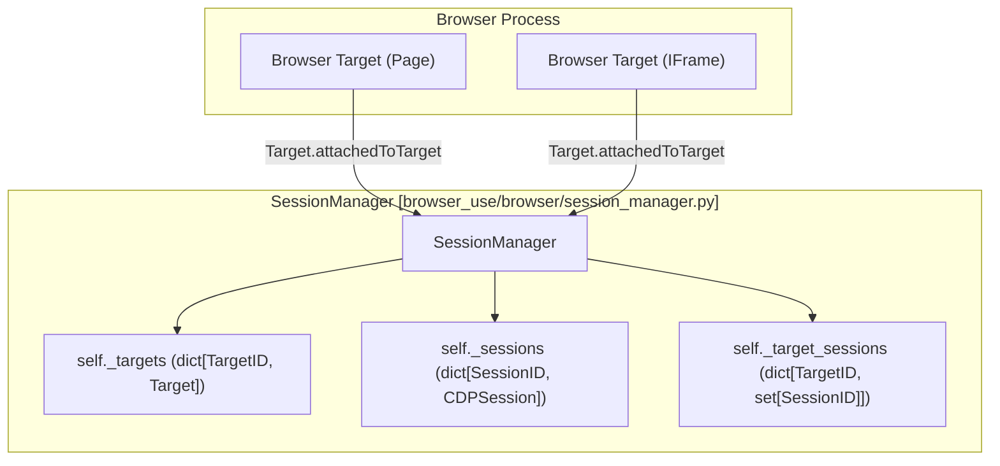
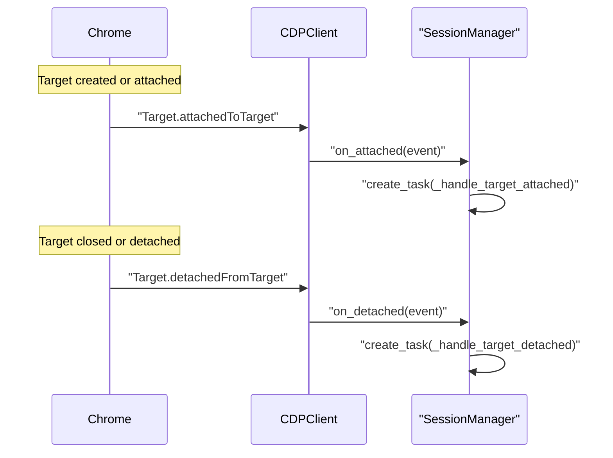
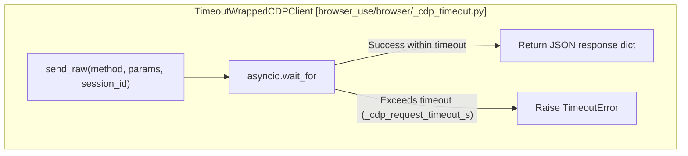

<!-- source: DeepWiki mcp.deepwiki.com · repo browser-use/browser-use · page 3.3 SessionManager and CDP Session Pool · fetched 2026-10-30 -->

# SessionManager and CDP Session Pool

<details>
<summary>Relevant source files</summary>

The following files were used as context for generating this wiki page:

- [browser_use/browser/_cdp_timeout.py](browser_use/browser/_cdp_timeout.py)
- [browser_use/browser/demo_mode.py](browser_use/browser/demo_mode.py)
- [browser_use/browser/session_manager.py](browser_use/browser/session_manager.py)
- [browser_use/browser/watchdogs/crash_watchdog.py](browser_use/browser/watchdogs/crash_watchdog.py)
- [browser_use/browser/watchdogs/downloads_watchdog.py](browser_use/browser/watchdogs/downloads_watchdog.py)
- [browser_use/browser/watchdogs/popups_watchdog.py](browser_use/browser/watchdogs/popups_watchdog.py)
- [browser_use/browser/watchdogs/security_watchdog.py](browser_use/browser/watchdogs/security_watchdog.py)
- [examples/features/large_blocklist.py](examples/features/large_blocklist.py)
- [tests/ci/security/test_ip_blocking.py](tests/ci/security/test_ip_blocking.py)
- [tests/ci/test_cdp_timeout.py](tests/ci/test_cdp_timeout.py)
- [tests/ci/test_downloads_watchdog.py](tests/ci/test_downloads_watchdog.py)
- [tests/ci/test_remote_download_complete_callback.py](tests/ci/test_remote_download_complete_callback.py)

</details>


## Purpose and Scope

The `SessionManager` class is the core component responsible for managing Chrome DevTools Protocol (CDP) sessions and target lifecycles in `browser-use`. It provides an event-driven session pool that automatically stays synchronized with browser state, eliminating stale sessions and ensuring reliable CDP communication across all browser targets (pages, iframes, workers). Additionally, CDP request timeouts are enforced via the `TimeoutWrappedCDPClient` wrapper to prevent agent hangs when downstream browser sockets become silent.

---

## 1. SessionManager as Single Source of Truth

The `SessionManager` acts as the **Single Source of Truth** for all targets and sessions within a `BrowserSession` [browser_use/browser/session_manager.py:19-31](). By utilizing native CDP target discovery and attachment events (`Target.attachedToTarget` and `Target.detachedFromTarget`), it ensures that the internal session pool precisely reflects the underlying browser's reality without relying on active polling.



Sources: [browser_use/browser/session_manager.py:19-31]()

---

## 2. Target and CDP Session Architecture

`SessionManager` manages four primary internal data structures to track relationships between targets and communication sessions [browser_use/browser/session_manager.py:33-48]():

| Data Structure | Type | Purpose |
|----------------|------|---------|
| `self._targets` | `dict[TargetID, Target]` | Maps unique `TargetID` to active `Target` entities (pages, iframes, workers). |
| `self._sessions` | `dict[SessionID, CDPSession]` | Maps unique `SessionID` to communication channels (`CDPSession`). |
| `self._target_sessions` | `dict[TargetID, set[SessionID]]` | Maps a target to all CDP sessions currently attached to it (supports 1:N mapping). |
| `self._session_to_target` | `dict[SessionID, TargetID]` | Reverse lookup mapping each session to its parent target. |

**Diagram: Data Structure Relationships**

```mermaid
graph LR
    subgraph "SessionManager Data Structures"
        T["self._targets"] -->|TargetID| TS["self._target_sessions"]
        TS -->|set[SessionID]| S["self._sessions"]
        S -->|SessionID| ST["self._session_to_target"]
    end
```

Sources: [browser_use/browser/session_manager.py:33-48]()

---

## 3. Attach/Detach Event Handling and Synchronization

Monitoring is initialized via `start_monitoring()`, which registers event listeners on the root CDP client and sets up target discovery [browser_use/browser/session_manager.py:63-79]().



### Event Registration Pattern

CDP event handlers are registered synchronously during startup [browser_use/browser/session_manager.py:82-132]():

```python
def on_attached(event: AttachedToTargetEvent, session_id: SessionID | None = None):
    create_task_with_error_handling(
        self._handle_target_attached(event),
        name='handle_target_attached',
        logger_instance=self.logger,
        suppress_exceptions=True,
    )
```

Sources: [browser_use/browser/session_manager.py:63-134]()

---

## 4. CDP Timeouts and Reliability

To protect against silent WebSocket hangs (e.g., when a cloud-hosted browser container crashes or proxy connections stall while TCP keepalives remain active), `browser-use` wraps raw CDP requests using `TimeoutWrappedCDPClient` [browser_use/browser/_cdp_timeout.py:1-21]().

### Timeout Configuration

- Environment variable: `BROWSER_USE_CDP_TIMEOUT_S` (defaults to `60.0` seconds) [browser_use/browser/_cdp_timeout.py:35-68]().
- Constructor parameter: `cdp_request_timeout_s` [browser_use/browser/_cdp_timeout.py:99-107]().



Sources: [browser_use/browser/_cdp_timeout.py:1-125](), [tests/ci/test_cdp_timeout.py:1-71]()

---

## 5. Focus Recovery and Stale Session Management

When a target detaches or crashes, `SessionManager` tracks stale references and coordinates recovery. If `_get_session_for_target()` is invoked for a target that has detached while holding agent focus, focus is cleared and recovery is triggered [browser_use/browser/session_manager.py:162-179]().

### Recovery State Tracking

| Attribute | Type | Purpose |
|-----------|------|---------|
| `self._recovery_in_progress` | `bool` | Flag preventing concurrent recovery loops [browser_use/browser/session_manager.py:59-59](). |
| `self._recovery_complete_event` | `asyncio.Event \| None` | Synchronization primitive signaling recovery completion [browser_use/browser/session_manager.py:60-60](). |
| `self._recovery_task` | `asyncio.Task \| None` | Reference to the active recovery coroutine [browser_use/browser/session_manager.py:61-61](). |

Sources: [browser_use/browser/session_manager.py:55-62](), [browser_use/browser/session_manager.py:162-179]()

---

