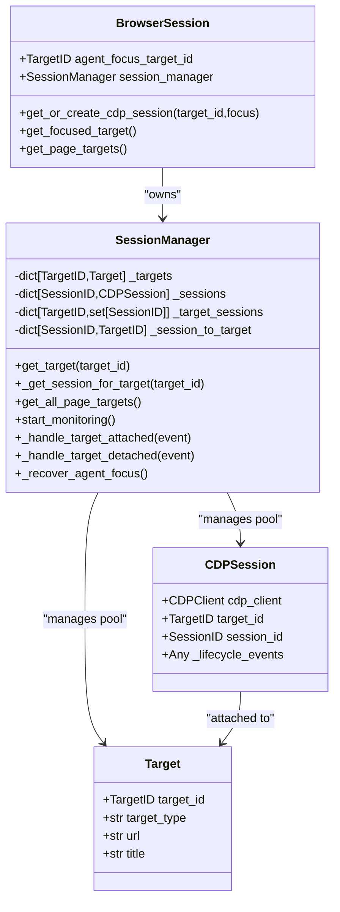
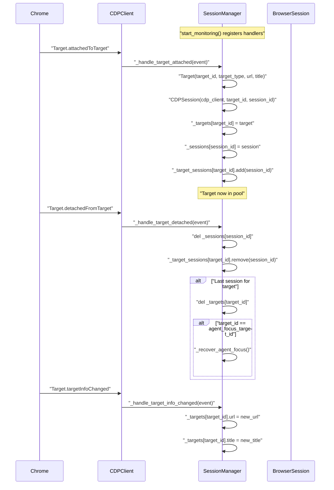
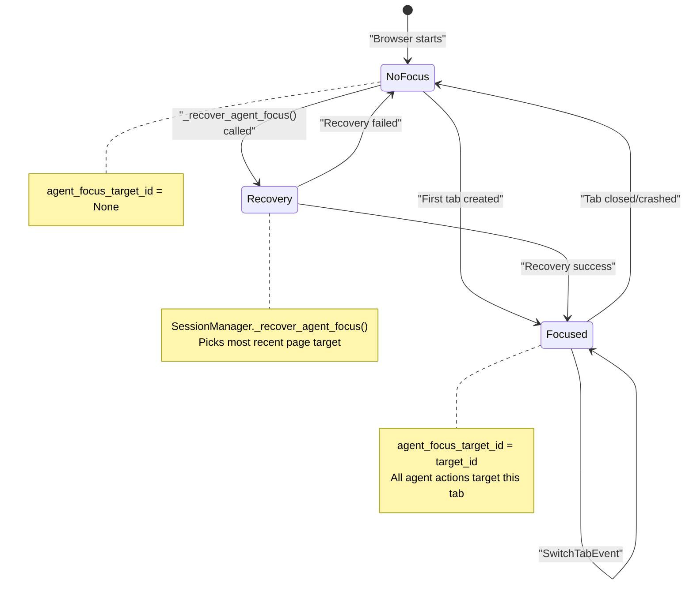

<!-- source: DeepWiki mcp.deepwiki.com · repo browser-use/browser-use · page 3.4 Target and Frame Management · fetched 2026-10-30 -->

# Target and Frame Management

<details>
<summary>Relevant source files</summary>

The following files were used as context for generating this wiki page:

- [.github/workflows/eval-on-pr.yml](.github/workflows/eval-on-pr.yml)
- [browser_use/browser/events.py](browser_use/browser/events.py)
- [browser_use/browser/profile.py](browser_use/browser/profile.py)
- [browser_use/browser/session.py](browser_use/browser/session.py)
- [browser_use/browser/watchdog_base.py](browser_use/browser/watchdog_base.py)
- [browser_use/dom/serializer/clickable_elements.py](browser_use/dom/serializer/clickable_elements.py)
- [tests/ci/browser/iframe_template.html](tests/ci/browser/iframe_template.html)
- [tests/ci/browser/test_cross_origin_click.py](tests/ci/browser/test_cross_origin_click.py)
- [tests/ci/browser/test_dom_serializer.py](tests/ci/browser/test_dom_serializer.py)
- [tests/ci/browser/test_page_stacked_template.html](tests/ci/browser/test_page_stacked_template.html)
- [tests/ci/browser/test_page_template.html](tests/ci/browser/test_page_template.html)

</details>


**Purpose**: This page documents how browser-use manages browser targets (pages, iframes, workers), CDP sessions, frame hierarchies, and agent focus. It covers the event-driven session pool, automatic target lifecycle management, focus recovery, and cross-origin iframe handling.

For browser launch and connection details, see [3.1 BrowserSession Lifecycle](). For DOM extraction from frames, see [5.1 DOM Tree Construction](). For navigation and tab control, see [3.5 Navigation and Tab Control]().

---

## Overview: Targets, Sessions, and Frames

Browser-use manages browser contexts through three core entities:

*   **`Target`**: Represents a browsing context (page, iframe, worker). It is the actual entity being controlled, defined by its URL, title, and type [browser_use/browser/session.py:73-86]().
*   **`CDPSession`**: A communication channel to a specific target. Multiple sessions can attach to the same target for communication. It wraps the `CDPClient` and tracks `session_id` [browser_use/browser/session.py:88-103]().
*   **Frame Hierarchy**: Pages contain a root frame (where `frame_id` usually equals `target_id`) and optional child iframes. Same-origin iframes share the parent's CDP session. Cross-origin iframes (OOPIF) create separate `Target` instances with dedicated sessions [browser_use/browser/session.py:191-192]().
*   **Agent Focus**: `BrowserSession.agent_focus_target_id` stores the single target receiving agent operations. When this target detaches, `SessionManager` automatically recovers focus to another valid target [browser_use/browser/session_manager.py:58-62]().

Sources: [browser_use/browser/session.py:73-103](), [browser_use/browser/session.py:191-192](), [browser_use/browser/session_manager.py:58-62]()

---

## Target and Session Data Model



**Target and Session Data Model Classes**

Sources: [browser_use/browser/session.py:73-103](), [browser_use/browser/session_manager.py:19-54](), [browser_use/browser/session_manager.py:139-181](), [browser_use/browser/session.py:134-161]()

---

## Event-Driven Target Lifecycle

`SessionManager` maintains the session pool by handling CDP events: `Target.attachedToTarget`, `Target.detachedFromTarget`, and `Target.targetInfoChanged`. This system uses event handlers rather than polling to ensure real-time synchronization [browser_use/browser/session_manager.py:63-132]().



**Event-Driven Target Lifecycle Sequence**

Key `SessionManager` methods:
- `start_monitoring()`: Registers `cdp_client.register.Target.attachedToTarget` and other listeners [browser_use/browser/session_manager.py:63-134]().
- `_handle_target_attached(event)`: Handles `setAutoAttach` for children and creates `CDPSession` [browser_use/browser/session_manager.py:82-93]().
- `_handle_target_detached(event)`: Removes session/target and triggers recovery if focus is lost [browser_use/browser/session_manager.py:95-101]().
- `_handle_target_info_changed(event)`: Updates `Target` state from `targetInfoChanged` events without polling [browser_use/browser/session_manager.py:103-110]().

Sources: [browser_use/browser/session_manager.py:63-134](), [browser_use/browser/session.py:73-103]()

---

## Session Pool and Target Mappings

`SessionManager` maintains four private dictionaries as the single source of truth for the browser's state [browser_use/browser/session_manager.py:38-47]().

| Field | Type | Purpose |
|---|---|---|
| `_targets` | `dict[TargetID, Target]` | All targets (pages, iframes, workers) |
| `_sessions` | `dict[SessionID, CDPSession]` | All active CDP communication channels |
| `_target_sessions` | `dict[TargetID, set[SessionID]]` | Mapping of Target ID to its attached sessions |
| `_session_to_target` | `dict[SessionID, TargetID]` | Reverse mapping from Session ID to Target ID |

Public accessor methods allow safe interaction with this pool [browser_use/browser/session_manager.py:147-185]().

```python
# SessionManager methods
_get_session_for_target(target_id: TargetID) -> CDPSession | None
get_all_page_targets() -> list[Target]
get_target_id_from_session_id(session_id: SessionID) -> TargetID | None
```

Sources: [browser_use/browser/session_manager.py:38-47](), [browser_use/browser/session_manager.py:147-185]()

---

## Agent Focus Management

`BrowserSession.agent_focus_target_id` tracks the specific target receiving agent operations. If this becomes stale (e.g., tab closed), `SessionManager` triggers recovery [browser_use/browser/session_manager.py:161-170]().



**Agent Focus State Transitions**

Focus changes occur through:
1. `on_SwitchTabEvent(event)`: Updates `agent_focus_target_id` and activates the target via CDP [browser_use/browser/events.py:169-175]().
2. `_recover_agent_focus()`: Triggered by `SessionManager` when a focused target is lost or stale [browser_use/browser/session_manager.py:171-179]().
3. `get_or_create_cdp_session()`: Validates focus and waits for recovery if needed [browser_use/browser/session.py:1710-1730]().

Sources: [browser_use/browser/session_manager.py:58-62](), [browser_use/browser/session_manager.py:161-179](), [browser_use/browser/events.py:169-175]()

---

## Focus Recovery Mechanism

When the focused target detaches, `SessionManager._recover_agent_focus()` automatically finds a replacement. It uses an `asyncio.Event` to coordinate multiple callers waiting for a valid session [browser_use/browser/session_manager.py:58-62]().

Recovery steps in `_recover_agent_focus()`:
1. Sets `_recovery_in_progress = True` [browser_use/browser/session_manager.py:59]().
2. Retrieves all available page targets via `get_all_page_targets()` [browser_use/browser/session_manager.py:183-189]().
3. Selects the most recent valid target and calls `Target.activateTarget`.
4. Signals completion via `_recovery_complete_event.set()` [browser_use/browser/session_manager.py:60]().

Sources: [browser_use/browser/session_manager.py:58-62](), [browser_use/browser/session_manager.py:183-189]()

---

## Frame Hierarchy and Iframe Handling

Browser-use supports both same-origin and cross-origin iframes. Cross-origin iframes (OOPIFs) are treated as separate `Target` entities with their own CDP sessions [browser_use/browser/session.py:191-192]().

**Iframe Configuration (`BrowserProfile`)** [browser_use/browser/profile.py:290-297]():

| Parameter | Type | Default | Purpose |
|---|---|---|---|
| `cross_origin_iframes` | `bool` | `True` | Whether to enable and track OOPIF targets. |
| `max_iframes` | `int` | `100` | Limit on the number of iframes processed. |
| `max_iframe_depth` | `int` | `5` | Maximum nesting depth for iframe traversal. |

Same-origin iframes are accessed via the parent's session, while OOPIFs require `SessionManager` to attach a new `CDPSession` to the iframe target [browser_use/browser/session_manager.py:77-79]().

The `DomService` also provides LLM hints for iframes by collecting hidden interactive elements, allowing the agent to know when it needs to scroll within a specific frame [browser_use/dom/service.py:70-75]().

Sources: [browser_use/browser/session.py:191-192](), [browser_use/browser/profile.py:290-297](), [browser_use/browser/session_manager.py:77-79](), [browser_use/dom/service.py:70-75]()

---

## Integration with Watchdogs

Watchdogs rely on `Target` and `CDPSession` management to perform their specific monitoring tasks. They use the `BaseWatchdog` pattern which includes a circuit breaker to skip handlers if CDP is disconnected, or wait if reconnection is in progress [browser_use/browser/watchdog_base.py:93-117]().

*   **PopupsWatchdog**: Registers `Page.javascriptDialogOpening` handlers on every new tab to automatically handle alerts and prompts [browser_use/browser/watchdogs/popups_watchdog.py:27-47]().
*   **DownloadsWatchdog**: Attaches to targets to register download behavior and monitor `DownloadWillBeginEvent` [browser_use/browser/watchdogs/downloads_watchdog.py:184-191]().
*   **CrashWatchdog**: Attaches to targets to monitor `TargetCrashedEvent` and emit `BrowserErrorEvent` [browser_use/browser/watchdogs/crash_watchdog.py:87-111]().
*   **StorageStateWatchdog**: Monitors cookie changes across sessions to persist auth state [browser_use/browser/watchdogs/storage_state_watchdog.py:128-143]().

Watchdogs generally use `focus=False` when calling `get_or_create_cdp_session` to ensure background monitoring doesn't interfere with the agent's active tab [browser_use/browser/watchdogs/popups_watchdog.py:40-42]().

Sources: [browser_use/browser/watchdog_base.py:93-117](), [browser_use/browser/watchdogs/popups_watchdog.py:27-47](), [browser_use/browser/watchdogs/downloads_watchdog.py:184-191](), [browser_use/browser/watchdogs/crash_watchdog.py:87-111](), [browser_use/browser/watchdogs/storage_state_watchdog.py:128-143]()

---

